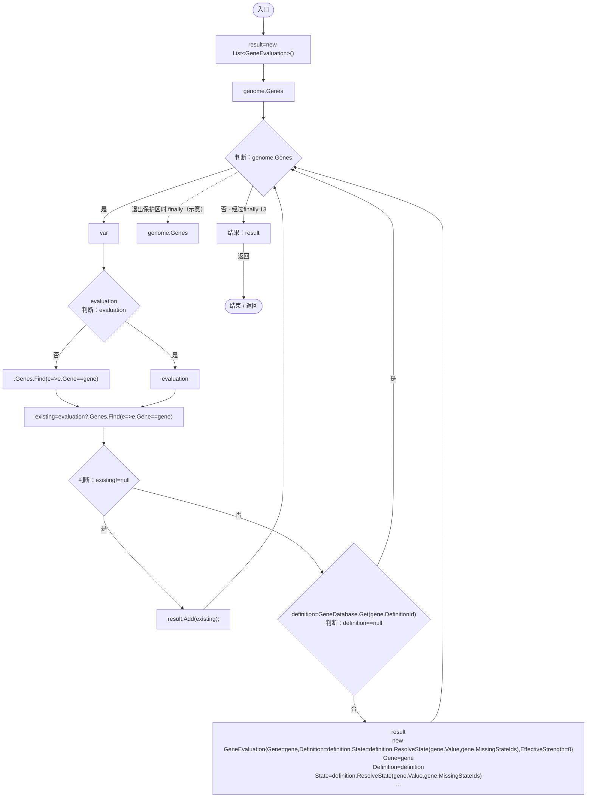
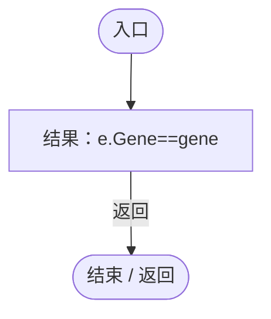
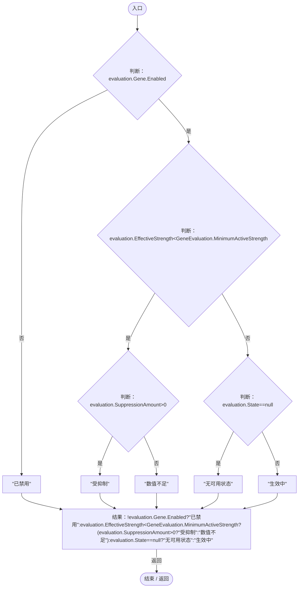

```mermaid
flowchart TD
  b0(["入口"])
  b1{"reasons=new List&lt;string&gt;()<br/>gene=evaluation.Gene<br/>判断：gene.Enabled"}
  b2["reasons.Add(&quot;该基因已被手动禁用。&quot;);<br/>结果：reasons"]
  b3{"判断：gene.Value&lt;GeneEvaluation.MinimumActiveStrength"}
  b4["reasons.Add($&quot;原始值 {gene.Value:F1} 低于生效阈值 {GeneEvaluation.MinimumActiveStrength:F1}。&quot;);"]
  b5{"判断：evaluation.EnvironmentSuppression&gt;0"}
  b6["reasons.Add($&quot;环境不适应抑制 {evaluation.EnvironmentSuppression:F1}。&quot;);"]
  b7{"判断：evaluation.RoleSuppression&gt;0"}
  b8["reasons.Add($&quot;种群分工/角色表达抑制 {evaluation.RoleSuppression:F1}。&quot;);"]
  b9{"other=evaluation.SuppressionAmount-evaluation.EnvironmentSuppression-evaluation.RoleSuppression<br/>判断：other&gt;.0001f"}
  b10["genome.Genes"]
  b11{"判断：genome.Genes"}
  b12["var"]
  b13{"判断：source.Enabled"}
  b14["definition=GeneDatabase.Get(source.DefinitionId)"]
  b15{"definition<br/>判断：definition"}
  b16[".SuppressionRules"]
  b17["definition"]
  b18{"判断：definition?.SuppressionRules==null"}
  b19{"判断：evaluation.GestatingAtEvaluation"}
  b20{"判断：source.DefinitionId==&quot;gene_reproduction&quot;"}
  b21{"判断：definition.SuppressionOnlyWhileGestating"}
  b22["definition.SuppressionRules"]
  b23{"判断：definition.SuppressionRules"}
  b24{"var<br/>判断：rule.TargetGeneId==gene.DefinitionId"}
  b25{"判断：source.Value*rule.Coefficient&gt;0"}
  b26["reasons.Add($&quot;受到“{definition.DisplayName}”抑制 {source.Value*rule.Coefficient/1000f:F1}。&quot;);"]
  b27["definition.SuppressionRules"]
  b28["genome.Genes"]
  b29["reasons.Add($&quot;基因间抑制合计 {other:F1}。&quot;);"]
  b30{"判断：evaluation.IsActive"}
  b31["reasons.Add($&quot;有效值 = 原始值 {gene.Value:F1} − 抑制 {evaluation.SuppressionAmount:F1} = {evaluation.EffectiveStrength:F1}，未达到 {GeneEvaluation.MinimumActiveStrength:F1}。&quot;);"]
  b32{"判断：evaluation.State==null"}
  b33["reasons.Add(&quot;没有可用基因状态（状态缺失或定义未提供）。&quot;);"]
  b34{"判断：evaluation.IsActive"}
  b35{"判断：gene.CopyStrength&lt;=0"}
  b36["reasons.Add(&quot;表达值生效，但复制强度为0，不提供属性贡献。&quot;);"]
  b37["结果：reasons"]
  b38(["结束 / 返回"])
  b0 --> b1
  b1 -->|"否"| b2
  b1 -->|"是"| b3
  b2 -->|"返回"| b38
  b3 -->|"是"| b4
  b3 -->|"否"| b5
  b4 --> b5
  b5 -->|"是"| b6
  b5 -->|"否"| b7
  b6 --> b7
  b7 -->|"是"| b8
  b7 -->|"否"| b9
  b8 --> b9
  b9 -->|"是"| b10
  b9 -->|"否"| b30
  b10 --> b11
  b11 -->|"是"| b12
  b11 -->|"否 · 经过finally 28"| b29
  b12 --> b13
  b13 -->|"否"| b11
  b13 -->|"是"| b14
  b14 --> b15
  b15 -->|"否"| b16
  b15 -->|"是"| b17
  b16 --> b18
  b17 --> b18
  b18 -->|"否"| b19
  b18 -->|"是"| b11
  b19 -->|"否"| b20
  b19 -->|"是"| b22
  b20 -->|"否"| b21
  b20 -->|"是"| b11
  b21 -->|"是"| b11
  b21 -->|"否"| b22
  b22 --> b23
  b23 -->|"是"| b24
  b23 -->|"否 · 经过finally 27"| b11
  b24 -->|"是"| b25
  b24 -->|"否"| b23
  b25 -->|"是"| b26
  b25 -->|"否"| b23
  b26 --> b23
  b29 --> b30
  b30 -->|"否"| b31
  b30 -->|"是"| b32
  b31 --> b32
  b32 -->|"是"| b33
  b32 -->|"否"| b34
  b33 --> b34
  b34 -->|"是"| b35
  b34 -->|"否"| b37
  b35 -->|"是"| b36
  b35 -->|"否"| b37
  b36 --> b37
  b37 -->|"返回"| b38
  b23 -. "退出保护区时 finally（示意）" .-> b27
  b11 -. "退出保护区时 finally（示意）" .-> b28

```

# GeneFailureReasons.cs

[返回总索引](../README.md) · `Runtime` · `Assets/DarwinPark/Genetics/GeneFailureReasons.cs`

[源文件](../../../Assets/DarwinPark/Genetics/GeneFailureReasons.cs) · 源码校验：`f3f5b56b1a3087c67daa27be76cfeb726005296f7bf26485d6c3b2f156e27fbb`

方法按源文件位置排列。事件/回调引用不表示立即执行；分支与异常说明见总索引。完整源码与可点击关系图请打开离线手册。

## Inspect · L9

`public static List<GeneEvaluation> Inspect(Genome genome,GenomeEvaluation evaluation)`

### Editor / Player · Roslyn编译器控制流

项目内调用/回调引用：

- [GeneDatabase.Get · L136](ec0a03483435a863.md#me6a5fefe6c3492f9)（方法）
- [GeneDefinition.ResolveState · L85](07f99d5784e3dadb.md#mf00205d71765b81f)（方法）
- [GeneFailureReasons.回调@13 · L13](e611915e807d8990.md#maf5c7b410e9cc7d7)（回调/委托）

## 回调@13 · L13

`e … => 回调`

### Editor / Player · Roslyn编译器控制流

## Explain · L19

`public static List<string> Explain(Genome genome,GeneEvaluation evaluation)`

### Editor / Player · Roslyn编译器控制流

项目内调用/回调引用：

- [GeneDatabase.Get · L136](ec0a03483435a863.md#me6a5fefe6c3492f9)（方法）

## Summary · L41

`public static string Summary(GeneEvaluation evaluation)`

### Editor / Player · Roslyn编译器控制流

