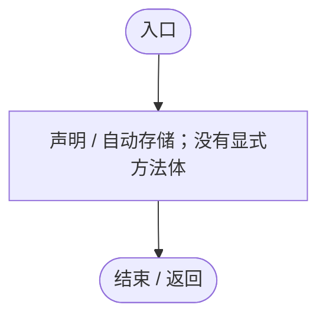
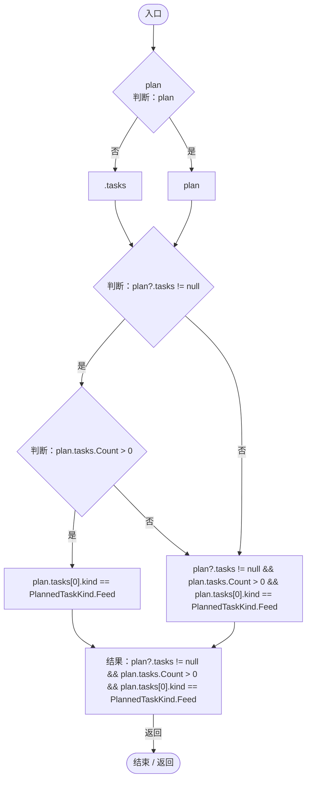
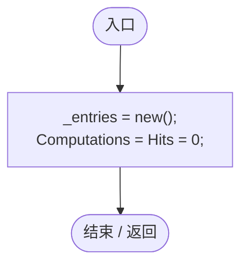

```mermaid
flowchart TD
  b0(["入口"])
  b1["timing=PerformanceTimings.Measure(PerformanceTimings.Area.FeedDecision)"]
  b2{"判断：member == null"}
  b3["结果：false"]
  b4{"entry = _entries.GetOrCreateValue(member)<br/>判断：entry.stats == null"}
  b5["entry.stats = OptionalComponent.Read&lt;EntityStats&gt;(member);"]
  b6{"stats = entry.stats<br/>判断：stats == null"}
  b7["结果：false"]
  b8["settings = AntColonySettings.Current<br/>tuning = GameplayTuning.Current<br/>options = HashCode.Combine(settings.memberFeedThreshold, settings.queenFeedThreshold, settings.queenReserveTarget, tuning.memberFeedResume, tuning.queenReserveBuffer)"]
  b9{"OptionalComponent.Read&lt;EggIncubation&gt;(member)<br/>判断：OptionalComponent.Read&lt;EggIncubation&gt;(member)"}
  b10[".Incubating"]
  b11["OptionalComponent.Read&lt;EggIncubation&gt;(member)"]
  b12["egg = OptionalComponent.Read&lt;EggIncubation&gt;(member)?.Incubating == true"]
  b13{"plan = member.State.plan<br/>判断：entry.frame == Time.frameCount"}
  b14{"判断：entry.values == stats.ValueRevision"}
  b15{"判断：entry.genes == member.Genes.LogicRevision"}
  b16{"判断：entry.groups == PopulationGroupIndex.Revision"}
  b17{"判断：entry.role == member.State.role"}
  b18{"判断：entry.options == options"}
  b19{"判断：entry.egg == egg"}
  b20{"判断：ReferenceEquals(entry.plan, plan)"}
  b21["entry.feeding"]
  b22{"plan<br/>判断：plan"}
  b23[".feeding"]
  b24["plan"]
  b25{"判断：plan?.feeding"}
  b26["plan?.feeding"]
  b27["false"]
  b28{"判断：entry.feeding == (plan?.feeding ?? false)"}
  b29{"判断：entry.queued == Queued(plan)"}
  b30["Hits++;<br/>结果：entry.result"]
  b31["Computations++;"]
  b32{"判断：member.Active"}
  b33{"判断：egg"}
  b34["EntityTaskPlan.EvaluateFeeding(member, stats)"]
  b35["member.Active &amp;&amp; !egg &amp;&amp; EntityTaskPlan.EvaluateFeeding(member, stats)"]
  b36["result = member.Active &amp;&amp; !egg &amp;&amp; EntityTaskPlan.EvaluateFeeding(member, stats)"]
  b37["entry.frame = Time.frameCount;<br/>entry.values = stats.ValueRevision;<br/>entry.genes = member.Genes.LogicRevision;<br/>entry.groups = PopulationGroupIndex.Revision;<br/>entry.role = member.State.role;<br/>entry.options = options;<br/>entry.egg = egg;<br/>entry.pl…"]
  b38["entry.feeding"]
  b39{"entry.plan<br/>判断：entry.plan"}
  b40[".feeding"]
  b41["entry.plan"]
  b42{"判断：entry.plan?.feeding"}
  b43["entry.plan?.feeding"]
  b44["false"]
  b45["entry.feeding = entry.plan?.feeding ?? false;"]
  b46["entry.queued = Queued(entry.plan);<br/>entry.result = result;<br/>结果：result"]
  b47["timing=PerformanceTimings.Measure(PerformanceTimings.Area.FeedDecision)"]
  b48(["结束 / 返回"])
  b0 --> b1
  b1 --> b2
  b2 -->|"是"| b3
  b2 -->|"否"| b4
  b3 -->|"返回 · 经过finally 47"| b48
  b4 -->|"是"| b5
  b4 -->|"否"| b6
  b5 --> b6
  b6 -->|"是"| b7
  b6 -->|"否"| b8
  b7 -->|"返回 · 经过finally 47"| b48
  b8 --> b9
  b9 -->|"否"| b10
  b9 -->|"是"| b11
  b10 --> b12
  b11 --> b12
  b12 --> b13
  b13 -->|"是"| b14
  b13 -->|"否"| b31
  b14 -->|"是"| b15
  b14 -->|"否"| b31
  b15 -->|"是"| b16
  b15 -->|"否"| b31
  b16 -->|"是"| b17
  b16 -->|"否"| b31
  b17 -->|"是"| b18
  b17 -->|"否"| b31
  b18 -->|"是"| b19
  b18 -->|"否"| b31
  b19 -->|"是"| b20
  b19 -->|"否"| b31
  b20 -->|"是"| b21
  b20 -->|"否"| b31
  b21 --> b22
  b22 -->|"否"| b23
  b22 -->|"是"| b24
  b23 --> b25
  b24 --> b25
  b25 -->|"否"| b26
  b25 -->|"是"| b27
  b26 --> b28
  b27 --> b28
  b28 -->|"是"| b29
  b28 -->|"否"| b31
  b29 -->|"是"| b30
  b29 -->|"否"| b31
  b30 -->|"返回 · 经过finally 47"| b48
  b31 --> b32
  b32 -->|"是"| b33
  b32 -->|"否"| b35
  b33 -->|"否"| b34
  b33 -->|"是"| b35
  b34 --> b36
  b35 --> b36
  b36 --> b37
  b37 --> b38
  b38 --> b39
  b39 -->|"否"| b40
  b39 -->|"是"| b41
  b40 --> b42
  b41 --> b42
  b42 -->|"否"| b43
  b42 -->|"是"| b44
  b43 --> b45
  b44 --> b45
  b45 --> b46
  b46 -->|"返回 · 经过finally 47"| b48
  b2 -. "退出保护区时 finally（示意）" .-> b47

```

# ColonyFeedDecision.cs

[返回总索引](../README.md) · `Runtime` · `Assets/DarwinPark/Entities/Ecology/ColonyFeedDecision.cs`

[源文件](../../../Assets/DarwinPark/Entities/Ecology/ColonyFeedDecision.cs) · 源码校验：`858cd5392506b071aa0ad8862f502e102d95b39711aa637f57bed32bbfcc60f8`

方法按源文件位置排列。事件/回调引用不表示立即执行；分支与异常说明见总索引。完整源码与可点击关系图请打开离线手册。

## Computations.get · L18

`get`

### Editor / Player · 语法控制结构 / 声明（非CFG）

## Computations.set · L18

`private set`

### Editor / Player · 语法控制结构 / 声明（非CFG）

## Hits.get · L19

`get`

### Editor / Player · 语法控制结构 / 声明（非CFG）

## Hits.set · L19

`private set`

### Editor / Player · 语法控制结构 / 声明（非CFG）

## Queued · L20

`private static bool Queued(EntityTaskPlanSave plan)`

### Editor / Player · Roslyn编译器控制流

## Read · L21

`public static bool Read(AntColonyMember member)`

### Editor / Player · Roslyn编译器控制流

项目内调用/回调引用：

- [PerformanceTimings.Measure · L24](a8403a4c7503726d.md#m592e16f2b6513efd)（方法）
- [OptionalComponent.Read · L7](806c46b42ced4d36.md#m69622a4dee165c5a)（方法）
- [AntColonySettings.Current.get · L31](cb0a937e97c8fbb3.md#mcd121159f407ccdf)（访问器）
- [GameplayTuning.Current.get · L46](db546e5713b32d53.md#m4fa691bd8a3b9618)（访问器）
- [AntColonyMember.State.get · L34](baebd85c05598377.md#m64745194ab46f363)（访问器）
- [EntityStats.ValueRevision.get · L11](75aa86a368efdf24.md#m61d2673905656496)（访问器）
- [EntityGeneController.LogicRevision.get · L21](7494d53178552f0e.md#m98a686d126eac5b3)（访问器）
- [AntColonyMember.Genes.get · L35](baebd85c05598377.md#m32357842031ebe8d)（访问器）
- [PopulationGroupIndex.Revision.get · L20](6bb343d8be5beae5.md#m54a3b3992914501f)（访问器）
- [ColonyFeedDecision.Queued · L20](e6b738dfaf434f21.md#mb98cae73b9e6076e)（方法）
- [ColonyFeedDecision.Hits.set · L19](e6b738dfaf434f21.md#m29d3fc11ac9f6e28)（访问器）
- [ColonyFeedDecision.Hits.get · L19](e6b738dfaf434f21.md#m2334637b986fae08)（访问器）
- [ColonyFeedDecision.Computations.set · L18](e6b738dfaf434f21.md#m41337e44391288f5)（访问器）
- [ColonyFeedDecision.Computations.get · L18](e6b738dfaf434f21.md#mf9ebce4438daf4d9)（访问器）
- [EntityTaskPlan.EvaluateFeeding · L22](da041665b1125ffc.md#mb9988f48c09393bf)（方法）

## Reset · L41

`[RuntimeInitializeOnLoadMethod(RuntimeInitializeLoadType.SubsystemRegistration)] private static void Reset()`

### Editor / Player · Roslyn编译器控制流

项目内调用/回调引用：

- [ColonyFeedDecision.Computations.set · L18](e6b738dfaf434f21.md#m41337e44391288f5)（访问器）
- [ColonyFeedDecision.Hits.set · L19](e6b738dfaf434f21.md#m29d3fc11ac9f6e28)（访问器）
