# LiveSimulationAudit.cs

[返回总索引](../README.md) · `Editor` · `Assets/DarwinPark/Editor/LiveSimulationAudit.cs`

[源文件](../../../Assets/DarwinPark/Editor/LiveSimulationAudit.cs) · 源码校验：`4701edfe564dddf72c2bf856ea06f6b9faa8d1f293316ccfbc635dafe5acd5a0`

方法按源文件位置排列。事件/回调引用不表示立即执行；分支与异常说明见总索引。完整源码与可点击关系图请打开离线手册。

## Folder.get · L23

`private static string Folder`

### Editor · 语法控制结构 / 声明（非CFG）

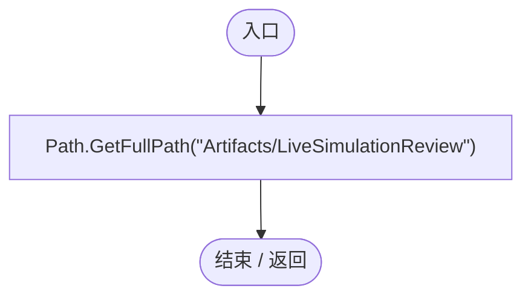

## LiveSimulationAudit.ctor · L24

`static LiveSimulationAudit()`

### Editor · Roslyn编译器控制流

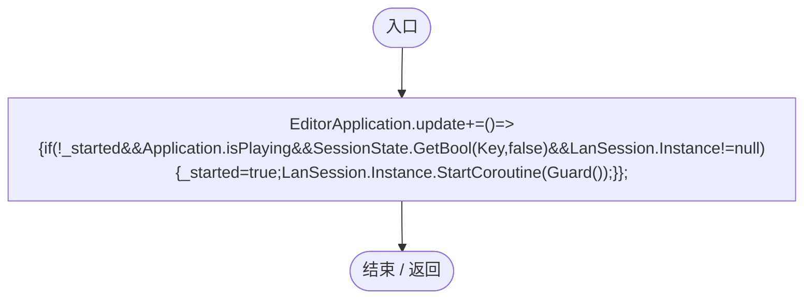

项目内调用/回调引用：

- [LiveSimulationAudit.回调@24 · L24](e6e68fc03d2d6235.md#mf8139a34a48f67e3)（回调/委托）

## 回调@24 · L24

`( … => 回调`

### Editor · Roslyn编译器控制流

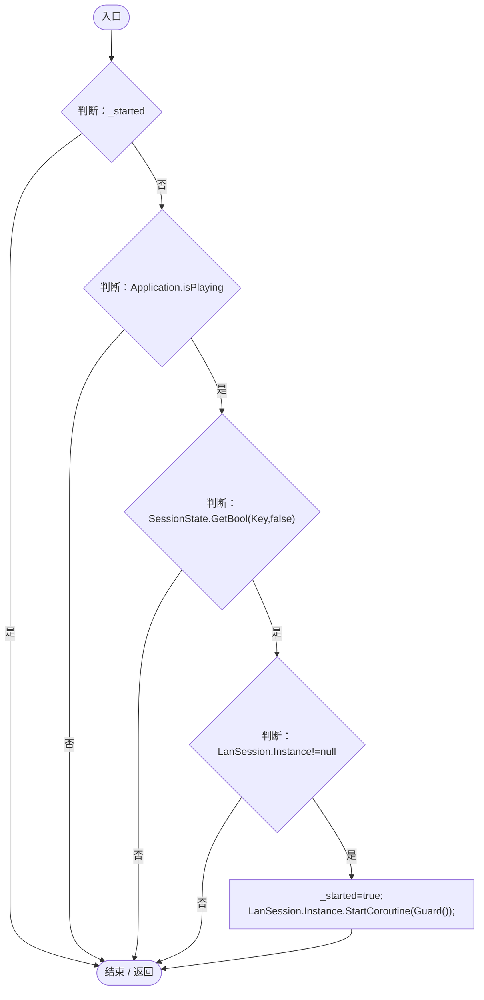

项目内调用/回调引用：

- [LanSession.Instance.get · L23](9fb633eebffe669c.md#mbf83306994878383)（访问器）
- [LiveSimulationAudit.Guard · L31](e6e68fc03d2d6235.md#m2a31bfa880cfb911)（方法）

## RunBatch · L25

`public static void RunBatch()`

### Editor · Roslyn编译器控制流

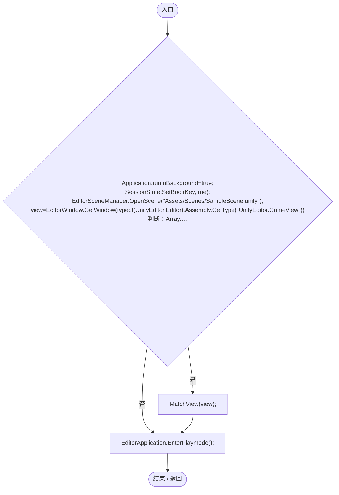

项目内调用/回调引用：

- [LiveSimulationAudit.MatchView · L27](e6e68fc03d2d6235.md#mdcafc3132babd8cd)（方法）

## MatchView · L27

`private static void MatchView(EditorWindow view)`

★ 新增：用已记录的用户Game视口尺寸对照DX12，不能把不同视野/渲染量混为同一帧数。

### Editor · Roslyn编译器控制流

```mermaid
flowchart TD
  b0(["入口"])
  b1["assembly=typeof(UnityEditor.Editor).Assembly<br/>sizesType=assembly.GetType(&quot;UnityEditor.GameViewSizes&quot;)<br/>sizes=sizesType.GetProperty(&quot;instance&quot;,BindingFlags.Public&#124;BindingFlags.Static&#124;BindingFlags.FlattenHierarchy).GetValue(null)<br/>get=sizesTy…"]
  b2(["结束 / 返回"])
  b0 --> b1
  b1 --> b2

```

## Guard · L31

`private static IEnumerator Guard()`

### Editor · Roslyn编译器控制流

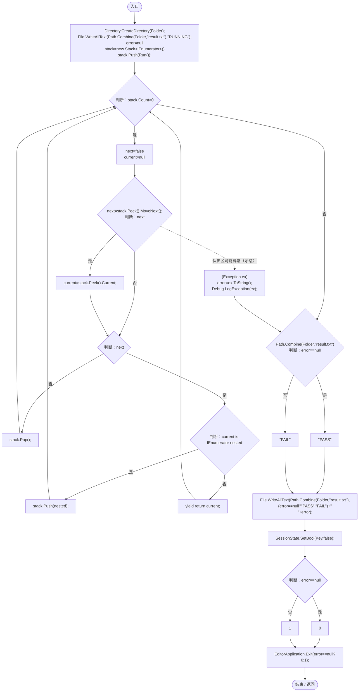

项目内调用/回调引用：

- [LiveSimulationAudit.Run · L46](e6e68fc03d2d6235.md#m3bbcb68cb097ef3d)（方法）

## Counters · L37

`private static Dictionary<string,long> Counters()`

### Editor · Roslyn编译器控制流

```mermaid
flowchart TD
  b0(["入口"])
  b1{"values=new Dictionary&lt;string,long&gt;()<br/>type=typeof(ActiveSimulationPlan)<br/>判断：type!=null"}
  b2["type.GetFields(BindingFlags.Public&#124;BindingFlags.Static)"]
  b3{"判断：type.GetFields(BindingFlags.Public&#124;BindingFlags.Static)"}
  b4{"var<br/>判断：f.FieldType==typeof(long)"}
  b5["values[f.Name]=(long)f.GetValue(null);"]
  b6{"type.GetFields(BindingFlags.Public&#124;BindingFlags.Static)<br/>判断：type.GetFields(BindingFlags.Public&#124;BindingFlags.Static)"}
  b7["type.GetFields(BindingFlags.Public&#124;BindingFlags.Static)"]
  b8["连接 / 离开区域"]
  b9["结果：values"]
  b10(["结束 / 返回"])
  b0 --> b1
  b1 -->|"是"| b2
  b1 -->|"否"| b9
  b2 --> b3
  b3 -->|"是"| b4
  b3 -->|"否 · 经过finally 6"| b9
  b4 -->|"是"| b5
  b4 -->|"否"| b3
  b5 --> b3
  b6 -->|"否"| b7
  b6 -->|"是"| b8
  b7 --> b8
  b9 -->|"返回"| b10
  b3 -. "退出保护区时 finally（示意）" .-> b6

```

## Sample · L39

`private static IEnumerator Sample(string name)`

### Editor · Roslyn编译器控制流

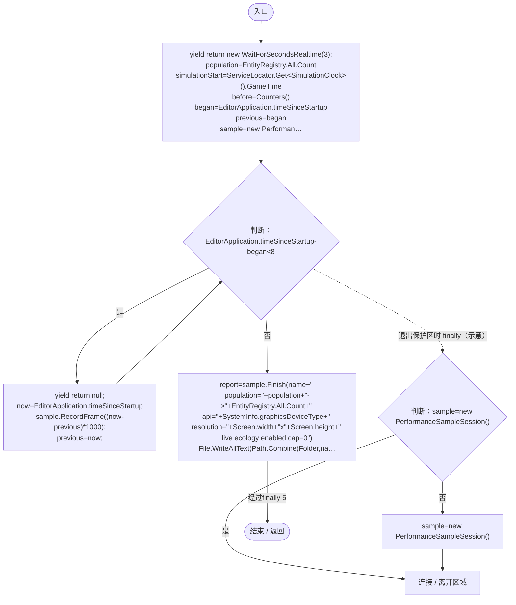

项目内调用/回调引用：

- [SimulationClock.GameTime.get · L23](a8f444aec9614b0a.md#m74adfa39a896652f)（访问器）
- [ServiceLocator.Get · L33](f2fdbe9f9ccd93cb.md#m2ae625299520c56d)（方法）
- [LiveSimulationAudit.Counters · L37](e6e68fc03d2d6235.md#mb5440aaf40d67017)（方法）
- [PerformanceSampleSession.PerformanceSampleSession.ctor · L40](a8403a4c7503726d.md#m3c05843ea4405ab7)（构造函数）
- [PerformanceSampleSession.RecordFrame · L47](a8403a4c7503726d.md#m8e99e8af42397205)（方法）
- [PerformanceSampleSession.Finish · L51](a8403a4c7503726d.md#m4669e6a0590f65f9)（方法）
- [LiveSimulationAudit.回调@44 · L44](e6e68fc03d2d6235.md#m455f51f427b4225a)（回调/委托）
- [LiveSimulationAudit.回调@44 · L44](e6e68fc03d2d6235.md#m393072a5a7c3f182)（回调/委托）
- [LiveSimulationAudit.回调@44 · L44](e6e68fc03d2d6235.md#mbd9775e849d97c3c)（回调/委托）
- [LiveSimulationAudit.回调@44 · L44](e6e68fc03d2d6235.md#m7afc16b38c6f571b)（回调/委托）
- [LiveSimulationAudit.回调@44 · L44](e6e68fc03d2d6235.md#md902d9211d25809b)（回调/委托）

## 回调@44 · L44

`p … => 回调`

### Editor · Roslyn编译器控制流

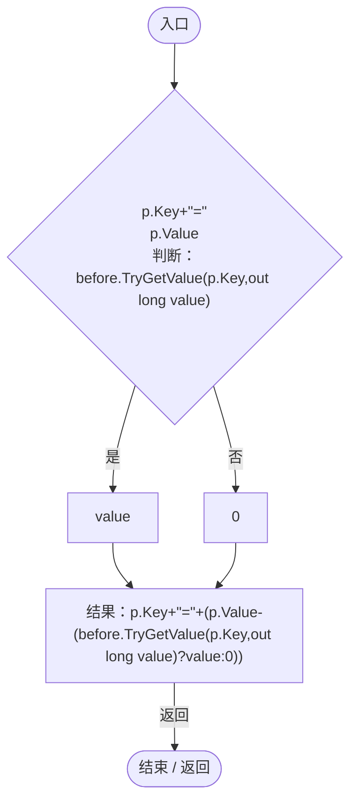

## 回调@44 · L44

`e … => 回调`

### Editor · Roslyn编译器控制流

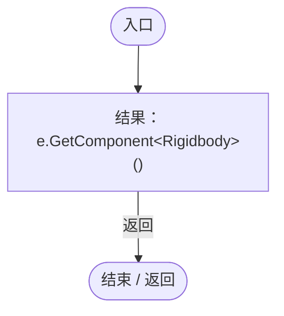

## 回调@44 · L44

`b … => 回调`

### Editor · Roslyn编译器控制流

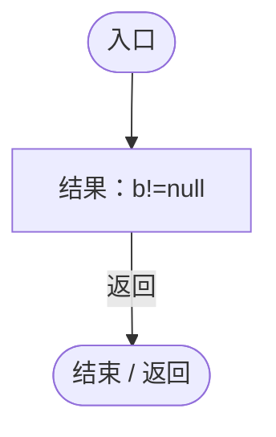

## 回调@44 · L44

`b … => 回调`

### Editor · Roslyn编译器控制流

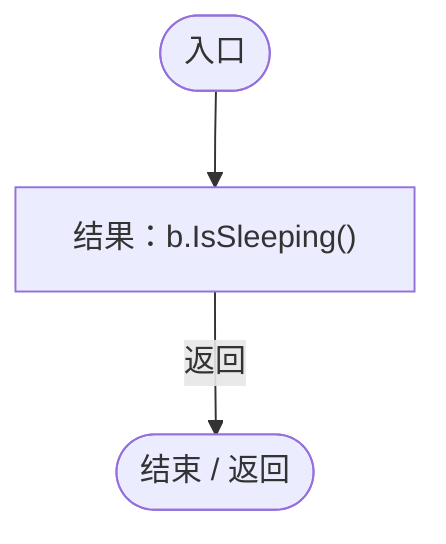

## 回调@44 · L44

`b … => 回调`

### Editor · Roslyn编译器控制流

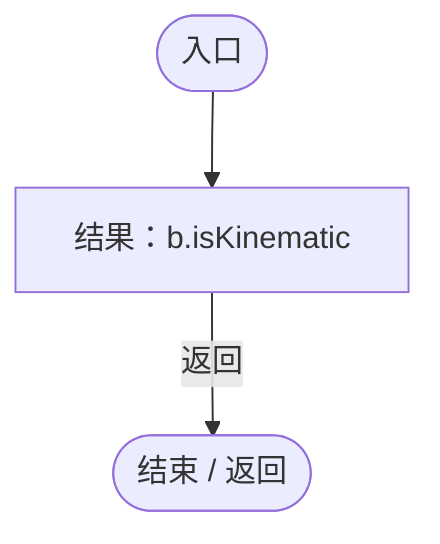

## Run · L46

`private static IEnumerator Run()`

### Editor · Roslyn编译器控制流

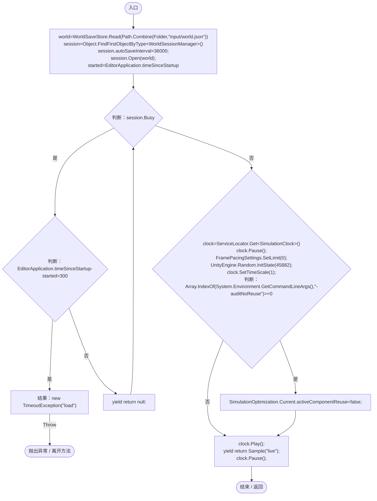

项目内调用/回调引用：

- [WorldSaveStore.Read · L74](d67a35e5e3814c15.md#mde52fadbe0185af1)（方法）
- [WorldSessionManager.Open · L60](08741c7b7b9d9344.md#m7bd56ef45131b4e5)（方法）
- [WorldSessionManager.Busy.get · L24](08741c7b7b9d9344.md#m4483e2e4f28f7c85)（访问器）
- [ServiceLocator.Get · L33](f2fdbe9f9ccd93cb.md#m2ae625299520c56d)（方法）
- [SimulationClock.Pause · L79](a8f444aec9614b0a.md#m30929d45a885d0f1)（方法）
- [FramePacingSettings.SetLimit · L19](8a946f816b77d4b6.md#mff17d0cc654b6a7f)（方法）
- [SimulationClock.SetTimeScale · L81](a8f444aec9614b0a.md#mecaa463a0561aca3)（方法）
- [SimulationOptimization.Current.get · L23](11c9091e70893352.md#m354909aa8678017c)（访问器）
- [SimulationClock.Play · L78](a8f444aec9614b0a.md#m7aa9e64b7de60ed0)（方法）
- [LiveSimulationAudit.Sample · L39](e6e68fc03d2d6235.md#mabbc74a9068b8061)（方法）
