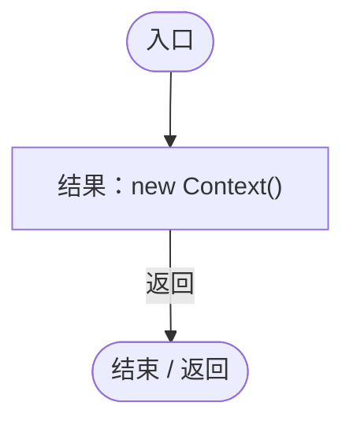

# ActiveNutritionContext.cs

[返回总索引](../README.md) · `Runtime` · `Assets/DarwinPark/Entities/Simulation/ActiveNutritionContext.cs`

[源文件](../../../Assets/DarwinPark/Entities/Simulation/ActiveNutritionContext.cs) · 源码校验：`8b0505fc09072d0822ebbca67666195ccda159001846b52015ad814b1b2d899e`

方法按源文件位置排列。事件/回调引用不表示立即执行；分支与异常说明见总索引。完整源码与可点击关系图请打开离线手册。

## Blocked · L15

`public static bool Blocked(EntityGeneController owner)`

### Editor / Player · Roslyn编译器控制流

```mermaid
flowchart TD
  b0(["入口"])
  b1{"判断：SimulationOptimization.Current.activeComponentReuse"}
  b2{"判断：EcologyQueries.Active(owner,NutritionEcologySettings.Current.heterotrophyGene)!=null"}
  b3["EcologyQueries.Active(owner,NutritionEcologySettings.Current.scavengerGene)!=null"]
  b4["EcologyQueries.Active(owner,NutritionEcologySettings.Current.heterotrophyGene)!=null"]
  b5["结果：EcologyQueries.Active(owner,NutritionEcologySettings.Current.heterotrophyGene)!=null&#124;&#124;EcologyQueries.Active(owner,NutritionEcologySettings.Current.scavengerGene)!=null"]
  b6{"settings=NutritionEcologySettings.Current<br/>context=Cache.GetValue(owner,_=&gt;new Context())<br/>判断：context.revision!=owner.LogicRevision"}
  b7{"判断：ReferenceEquals(context.evaluation,owner.Evaluation)"}
  b8{"判断：ReferenceEquals(context.nutrition,settings)"}
  b9["context.revision=owner.LogicRevision;<br/>context.evaluation=owner.Evaluation;<br/>context.nutrition=settings;"]
  b10{"context.blocked<br/>判断：EcologyQueries.Active(owner,settings.heterotrophyGene)!=null"}
  b11["EcologyQueries.Active(owner,settings.scavengerGene)!=null"]
  b12["EcologyQueries.Active(owner,settings.heterotrophyGene)!=null"]
  b13["context.blocked=EcologyQueries.Active(owner,settings.heterotrophyGene)!=null&#124;&#124;EcologyQueries.Active(owner,settings.scavengerGene)!=null;"]
  b14["结果：context.blocked"]
  b15(["结束 / 返回"])
  b0 --> b1
  b1 -->|"否"| b2
  b1 -->|"是"| b6
  b2 -->|"否"| b3
  b2 -->|"是"| b4
  b3 --> b5
  b4 --> b5
  b5 -->|"返回"| b15
  b6 -->|"否"| b7
  b6 -->|"是"| b9
  b7 -->|"是"| b8
  b7 -->|"否"| b9
  b8 -->|"否"| b9
  b8 -->|"是"| b14
  b9 --> b10
  b10 -->|"否"| b11
  b10 -->|"是"| b12
  b11 --> b13
  b12 --> b13
  b13 --> b14
  b14 -->|"返回"| b15

```

项目内调用/回调引用：

- [SimulationOptimization.Current.get · L23](11c9091e70893352.md#m354909aa8678017c)（访问器）
- [EcologyQueries.Active · L28](bdf7ccc2c9c0452f.md#m4fb10ad424167e3b)（方法）
- [NutritionEcologySettings.Current.get · L19](846a17351dbd6aa4.md#mb3eb930022e314f3)（访问器）
- [EntityGeneController.LogicRevision.get · L19](7494d53178552f0e.md#me69facc1c0f1e164)（访问器）
- [EntityGeneController.Evaluation.get · L18](7494d53178552f0e.md#mc0039c100a31b455)（访问器）
- [ActiveNutritionContext.回调@18 · L18](e8a4c7e1945f6f55.md#mbad8bc6fe74c3763)（回调/委托）

## 回调@18 · L18

`_ … => 回调`

### Editor / Player · Roslyn编译器控制流

