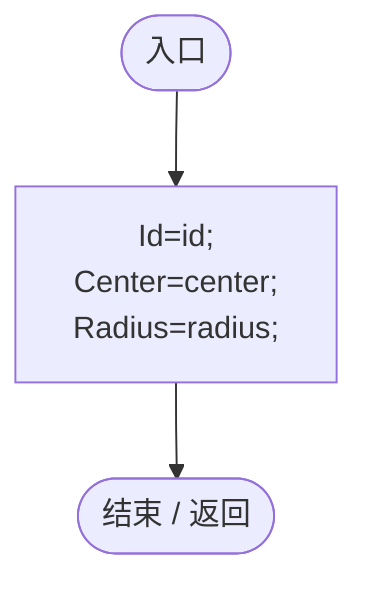
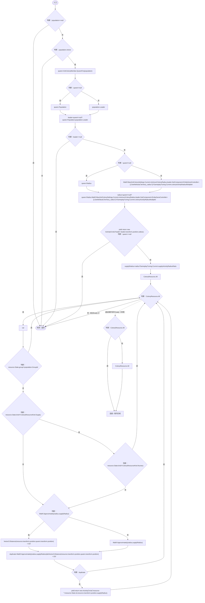
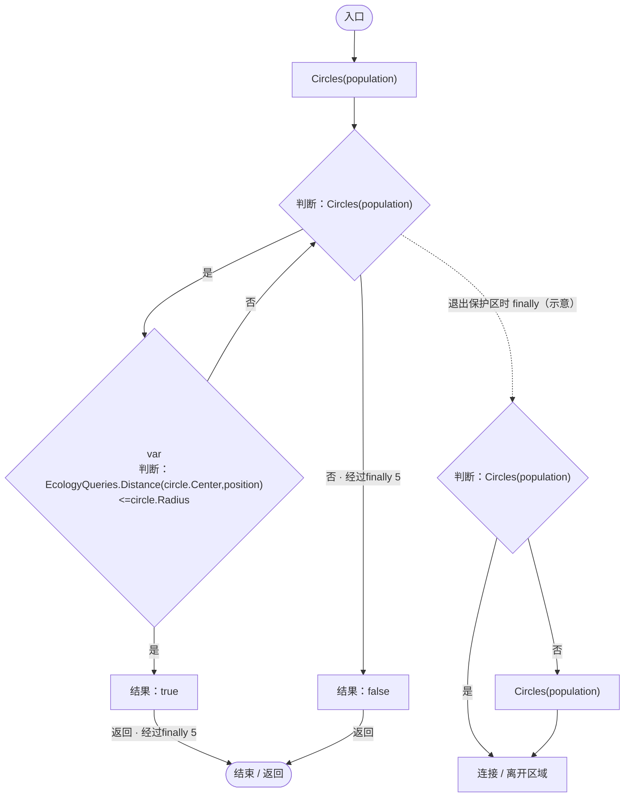
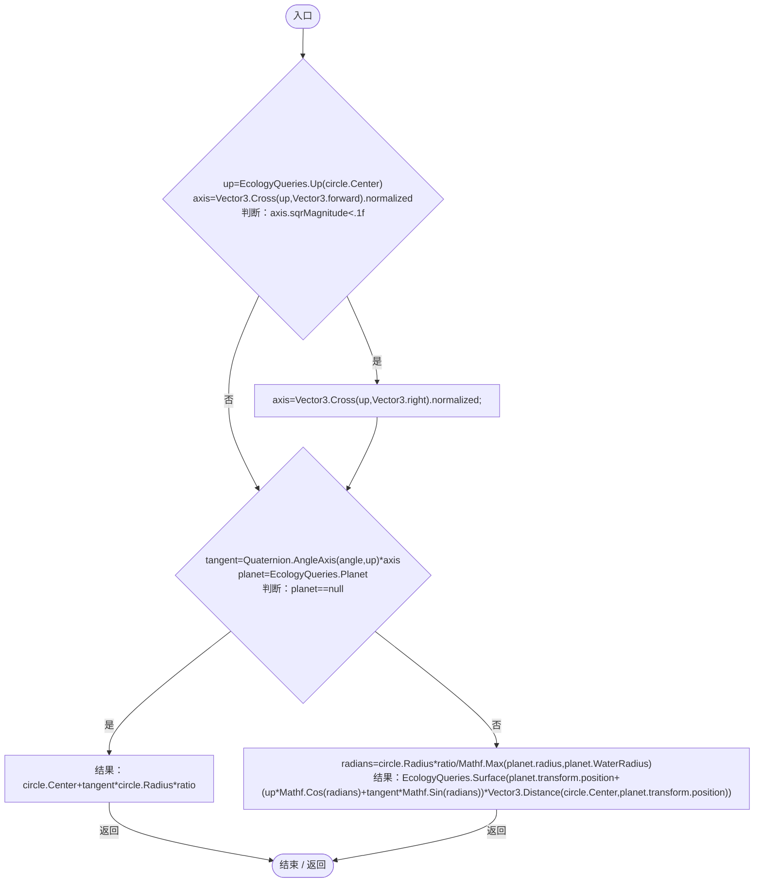
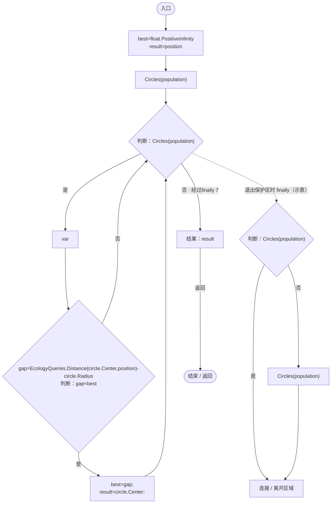
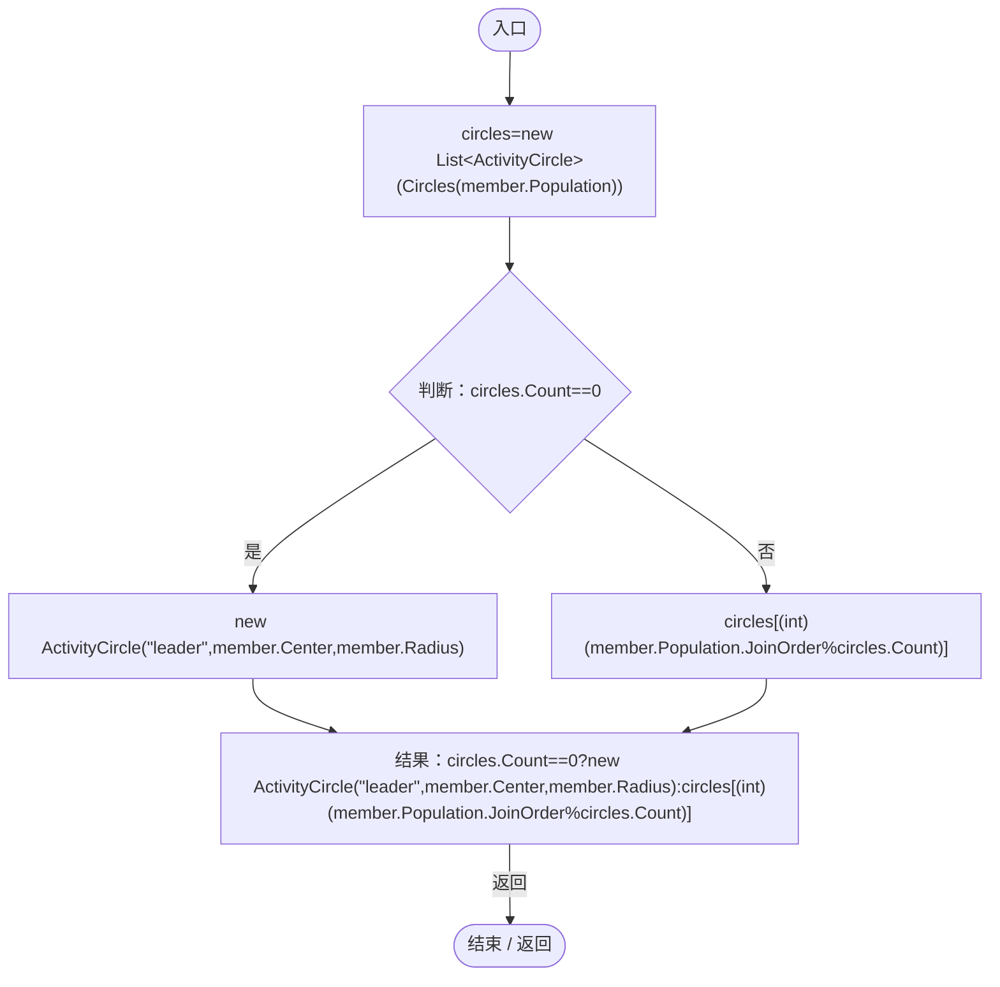

# ColonyActivityRange.cs

[返回总索引](../README.md) · `Runtime` · `Assets/DarwinPark/Entities/Ecology/ColonyActivityRange.cs`

[源文件](../../../Assets/DarwinPark/Entities/Ecology/ColonyActivityRange.cs) · 源码校验：`9229c24a8d055f2343cf0b95d1ccb65e68b72b7de65a6eb33f0478c692480c8a`

方法按源文件位置排列。事件/回调引用不表示立即执行；分支与异常说明见总索引。完整源码与可点击关系图请打开离线手册。

## ActivityCircle.ctor · L10

`public ActivityCircle(string id,Vector3 center,float radius)`

### Editor / Player · Roslyn编译器控制流

## Circles · L15

`public static IEnumerable<ActivityCircle> Circles(PopulationBehavior population)`

### Editor / Player · Roslyn编译器控制流

项目内调用/回调引用：

- [AntColonyMember.QueenFor · L52](baebd85c05598377.md#m43e694922d18a6a8)（方法）
- [AntColonyMember.Population.get · L30](baebd85c05598377.md#m688c2c0dfb5a66d6)（访问器）
- [AntColonySettings.Current.get · L31](cb0a937e97c8fbb3.md#mcd121159f407ccdf)（访问器）
- [EntityGeneController.GetAttribute · L225](7494d53178552f0e.md#mc707943b1138a009)（方法）
- [GameplayTuning.Current.get · L21](db546e5713b32d53.md#m1caba89e7704d239)（访问器）
- [ActivityCircle.ActivityCircle.ctor · L10](e8d854132f563257.md#m7ad6684817aa9fd4)（构造函数）
- [ColonyResource.State.get · L22](293dbaecfff4b585.md#m341a1355f4d657bf)（访问器）
- [PopulationBehavior.GroupId.get · L20](21e4f62f75a9a80f.md#m5145936fa914ba8c)（访问器）

## Contains · L33

`public static bool Contains(PopulationBehavior population,Vector3 position)`

### Editor / Player · Roslyn编译器控制流

项目内调用/回调引用：

- [ColonyActivityRange.Circles · L15](e8d854132f563257.md#m455fdb9801c8ae0e)（方法）
- [EcologyQueries.Distance · L42](bdf7ccc2c9c0452f.md#mba9c3e3c95d0f2dd)（方法）

## Boundary · L38

`public static Vector3 Boundary(ActivityCircle circle,float angle,float ratio=1)`

### Editor / Player · Roslyn编译器控制流

项目内调用/回调引用：

- [EcologyQueries.Up · L41](bdf7ccc2c9c0452f.md#maca7070196f125fd)（方法）
- [PlanetTerrainMeshBuilder.WaterRadius.get · L94](415285cf043354a9.md#m28d8809083881ec1)（访问器）
- [EcologyQueries.Surface · L47](bdf7ccc2c9c0452f.md#m2f1f6873ee5fc8df)（方法）

## NearestCenter · L46

`public static Vector3 NearestCenter(PopulationBehavior population,Vector3 position)`

### Editor / Player · Roslyn编译器控制流

项目内调用/回调引用：

- [ColonyActivityRange.Circles · L15](e8d854132f563257.md#m455fdb9801c8ae0e)（方法）
- [EcologyQueries.Distance · L42](bdf7ccc2c9c0452f.md#mba9c3e3c95d0f2dd)（方法）

## PatrolCircle · L52

`public static ActivityCircle PatrolCircle(AntColonyMember member)`

### Editor / Player · Roslyn编译器控制流

项目内调用/回调引用：

- [ColonyActivityRange.Circles · L15](e8d854132f563257.md#m455fdb9801c8ae0e)（方法）
- [AntColonyMember.Population.get · L30](baebd85c05598377.md#m688c2c0dfb5a66d6)（访问器）
- [ActivityCircle.ActivityCircle.ctor · L10](e8d854132f563257.md#m7ad6684817aa9fd4)（构造函数）
- [AntColonyMember.Center.get · L40](baebd85c05598377.md#m0295e0f1ea7ab95c)（访问器）
- [PopulationBehavior.JoinOrder.get · L21](21e4f62f75a9a80f.md#m83871a50fb1160fd)（访问器）
