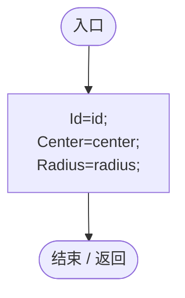
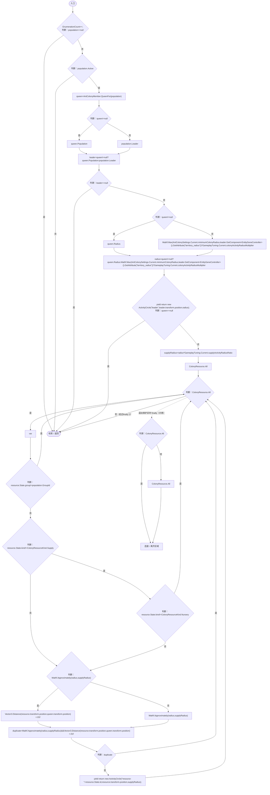
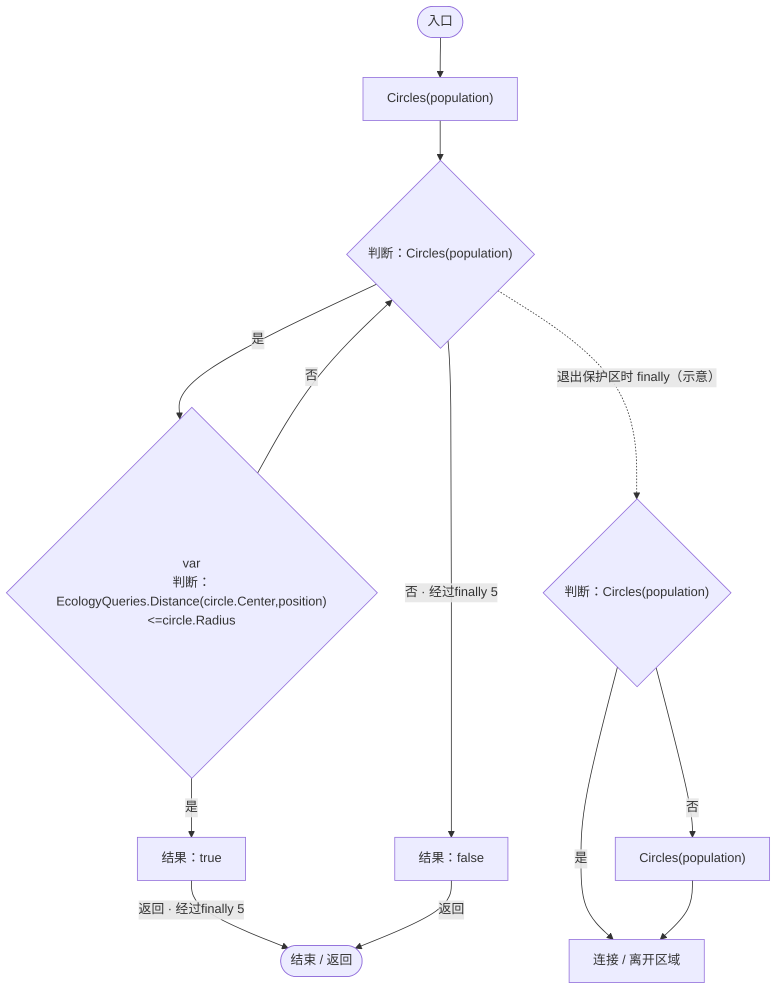
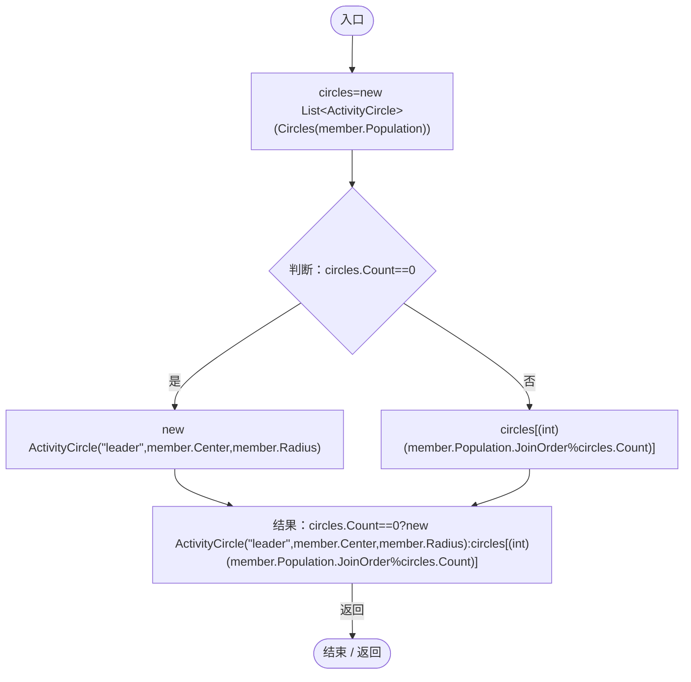

# ColonyActivityRange.cs

[返回总索引](../README.md) · `Runtime` · `Assets/DarwinPark/Entities/Ecology/ColonyActivityRange.cs`

[源文件](../../../Assets/DarwinPark/Entities/Ecology/ColonyActivityRange.cs) · 源码校验：`0c32a387e0c9227a80b70b0a5ea622dd967eacc3dfa95da85d035c919832bc75`

方法按源文件位置排列。事件/回调引用不表示立即执行；分支与异常说明见总索引。完整源码与可点击关系图请打开离线手册。

## ActivityCircle.ctor · L10

`public ActivityCircle(string id,Vector3 center,float radius)`

### Editor / Player · Roslyn编译器控制流

## EnumerationCount.get · L15

`get`

### Editor / Player · 语法控制结构 / 声明（非CFG）

## EnumerationCount.set · L15

`private set`

### Editor / Player · 语法控制结构 / 声明（非CFG）

## Circles · L16

`public static IEnumerable<ActivityCircle> Circles(PopulationBehavior population)`

### Editor / Player · Roslyn编译器控制流

项目内调用/回调引用：

- [ColonyActivityRange.EnumerationCount.set · L15](e8d854132f563257.md#mb10e8b15cde999f4)（访问器）
- [ColonyActivityRange.EnumerationCount.get · L15](e8d854132f563257.md#m8f570fb70a02e1cc)（访问器）
- [AntColonyMember.QueenFor · L60](baebd85c05598377.md#mb79e1008f1593414)（方法）
- [AntColonyMember.Population.get · L35](baebd85c05598377.md#mbb8ec90c4baa2d1c)（访问器）
- [AntColonySettings.Current.get · L31](cb0a937e97c8fbb3.md#mcd121159f407ccdf)（访问器）
- [EntityGeneController.GetAttribute · L266](7494d53178552f0e.md#mdf5d5273fb7a0a56)（方法）
- [GameplayTuning.Current.get · L31](db546e5713b32d53.md#m557c9ecc76cc372d)（访问器）
- [ActivityCircle.ActivityCircle.ctor · L10](e8d854132f563257.md#m7ad6684817aa9fd4)（构造函数）
- [ColonyResource.State.get · L24](293dbaecfff4b585.md#m41824f1a0e160aa5)（访问器）
- [PopulationBehavior.GroupId.get · L20](21e4f62f75a9a80f.md#m5145936fa914ba8c)（访问器）

## Contains · L35

`public static bool Contains(PopulationBehavior population,Vector3 position)`

### Editor / Player · Roslyn编译器控制流

项目内调用/回调引用：

- [ColonyActivityRange.Circles · L16](e8d854132f563257.md#md27786d1fb691b16)（方法）
- [EcologyQueries.Distance · L42](bdf7ccc2c9c0452f.md#mba9c3e3c95d0f2dd)（方法）

## Contains · L41

`public static bool Contains(IReadOnlyList<ActivityCircle> circles,Vector3 position)`

★ 修复（防Bug回归）：一次同步任务搜索复用范围快照，候选循环不能为每个对象重新枚举全世界资源。

### Editor / Player · Roslyn编译器控制流

项目内调用/回调引用：

- [EcologyQueries.Distance · L42](bdf7ccc2c9c0452f.md#mba9c3e3c95d0f2dd)（方法）

## Boundary · L43

`public static Vector3 Boundary(ActivityCircle circle,float angle,float ratio=1)`

### Editor / Player · Roslyn编译器控制流

项目内调用/回调引用：

- [EcologyQueries.Up · L41](bdf7ccc2c9c0452f.md#maca7070196f125fd)（方法）
- [PlanetTerrainMeshBuilder.WaterRadius.get · L94](415285cf043354a9.md#m28d8809083881ec1)（访问器）
- [EcologyQueries.Surface · L47](bdf7ccc2c9c0452f.md#m2f1f6873ee5fc8df)（方法）

## NearestCenter · L51

`public static Vector3 NearestCenter(PopulationBehavior population,Vector3 position)`

### Editor / Player · Roslyn编译器控制流

项目内调用/回调引用：

- [ColonyActivityRange.Circles · L16](e8d854132f563257.md#md27786d1fb691b16)（方法）
- [EcologyQueries.Distance · L42](bdf7ccc2c9c0452f.md#mba9c3e3c95d0f2dd)（方法）

## PatrolCircle · L57

`public static ActivityCircle PatrolCircle(AntColonyMember member)`

### Editor / Player · Roslyn编译器控制流

项目内调用/回调引用：

- [ColonyActivityRange.Circles · L16](e8d854132f563257.md#md27786d1fb691b16)（方法）
- [AntColonyMember.Population.get · L35](baebd85c05598377.md#mbb8ec90c4baa2d1c)（访问器）
- [ActivityCircle.ActivityCircle.ctor · L10](e8d854132f563257.md#m7ad6684817aa9fd4)（构造函数）
- [AntColonyMember.Center.get · L45](baebd85c05598377.md#m9814886883b8be8a)（访问器）
- [PopulationBehavior.JoinOrder.get · L21](21e4f62f75a9a80f.md#m83871a50fb1160fd)（访问器）
