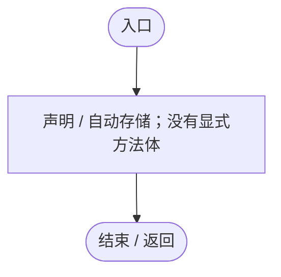
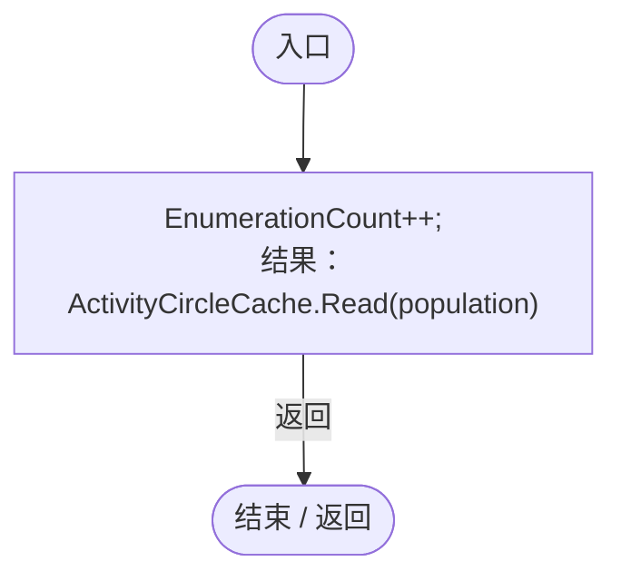
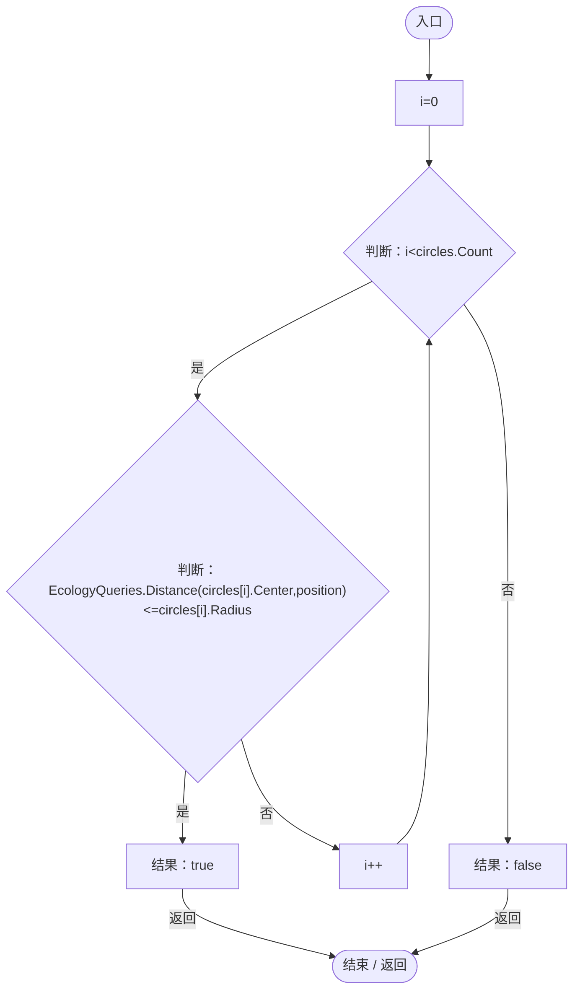
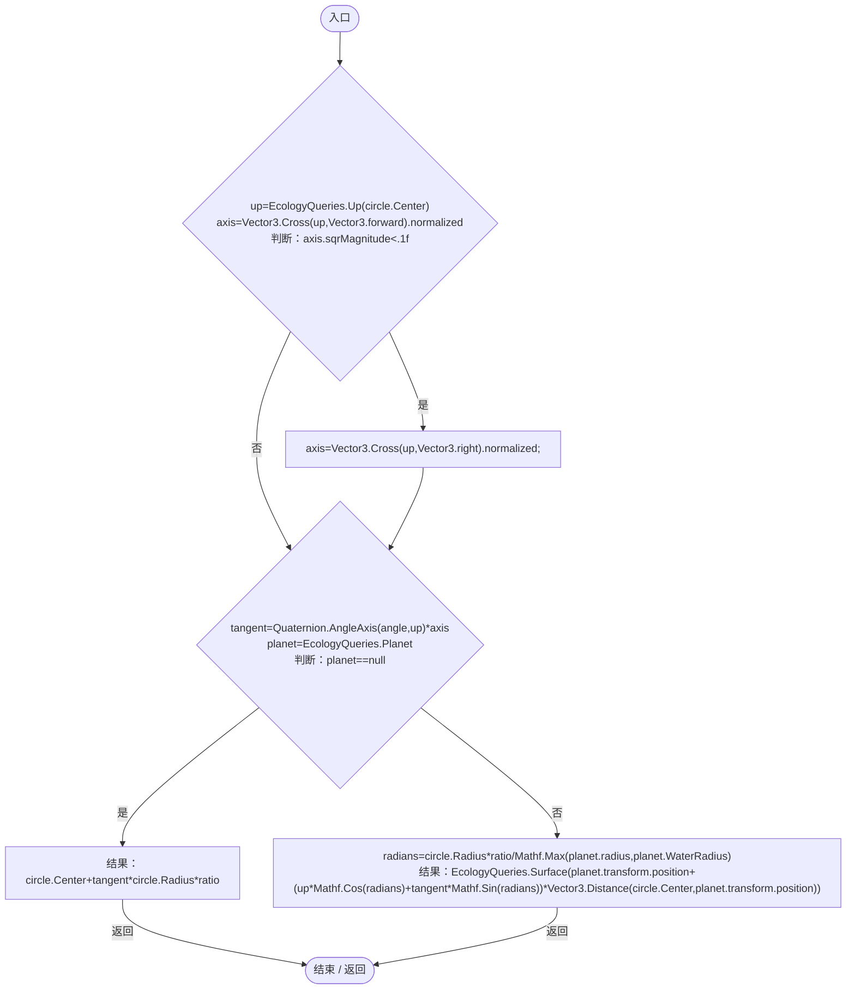
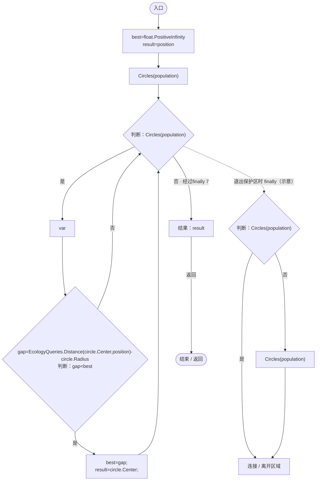
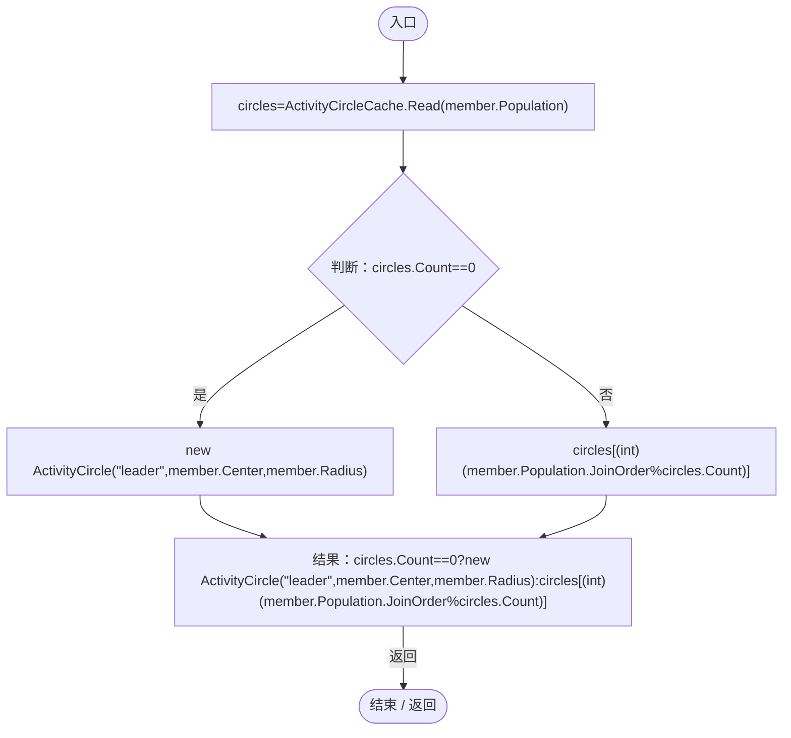

# ColonyActivityRange.cs

[返回总索引](../README.md) · `Runtime` · `Assets/DarwinPark/Entities/Ecology/ColonyActivityRange.cs`

[源文件](../../../Assets/DarwinPark/Entities/Ecology/ColonyActivityRange.cs) · 源码校验：`670af1f267490028fa22218fe4dc535ef5554c6d4bae67ee20a737618e0811a8`

方法按源文件位置排列。事件/回调引用不表示立即执行；分支与异常说明见总索引。完整源码与可点击关系图请打开离线手册。

## ActivityCircle.ctor · L10

`public ActivityCircle(string id,Vector3 center,float radius)`

### Editor / Player · Roslyn编译器控制流

## EnumerationCount.get · L15

`get`

### Editor / Player · 语法控制结构 / 声明（非CFG）

## EnumerationCount.set · L15

`private set`

### Editor / Player · 语法控制结构 / 声明（非CFG）

## Circles · L16

`public static IEnumerable<ActivityCircle> Circles(PopulationBehavior population)`

### Editor / Player · Roslyn编译器控制流

项目内调用/回调引用：

- [ColonyActivityRange.EnumerationCount.set · L15](e8d854132f563257.md#mb10e8b15cde999f4)（访问器）
- [ColonyActivityRange.EnumerationCount.get · L15](e8d854132f563257.md#m8f570fb70a02e1cc)（访问器）
- [ActivityCircleCache.Read · L24](97a3c8522367343a.md#mef9553f88695636c)（方法）

## Contains · L21

`public static bool Contains(PopulationBehavior population,Vector3 position)`

### Editor / Player · Roslyn编译器控制流

项目内调用/回调引用：

- [ColonyActivityRange.Circles · L16](e8d854132f563257.md#md27786d1fb691b16)（方法）
- [EcologyQueries.Distance · L43](bdf7ccc2c9c0452f.md#m6e395dce655ebcac)（方法）

## Contains · L27

`public static bool Contains(IReadOnlyList<ActivityCircle> circles,Vector3 position)`

★ 修复（防Bug回归）：一次同步任务搜索复用范围快照，候选循环不能为每个对象重新枚举全世界资源。

### Editor / Player · Roslyn编译器控制流

项目内调用/回调引用：

- [EcologyQueries.Distance · L43](bdf7ccc2c9c0452f.md#m6e395dce655ebcac)（方法）

## Boundary · L29

`public static Vector3 Boundary(ActivityCircle circle,float angle,float ratio=1)`

### Editor / Player · Roslyn编译器控制流

项目内调用/回调引用：

- [EcologyQueries.Up · L42](bdf7ccc2c9c0452f.md#ma73e6bbbc726282f)（方法）
- [PlanetTerrainMeshBuilder.WaterRadius.get · L99](415285cf043354a9.md#m76719c213b06ba56)（访问器）
- [EcologyQueries.Surface · L48](bdf7ccc2c9c0452f.md#m40ee3e975d7f5137)（方法）

## NearestCenter · L37

`public static Vector3 NearestCenter(PopulationBehavior population,Vector3 position)`

### Editor / Player · Roslyn编译器控制流

项目内调用/回调引用：

- [ColonyActivityRange.Circles · L16](e8d854132f563257.md#md27786d1fb691b16)（方法）
- [EcologyQueries.Distance · L43](bdf7ccc2c9c0452f.md#m6e395dce655ebcac)（方法）

## PatrolCircle · L43

`public static ActivityCircle PatrolCircle(AntColonyMember member)`

### Editor / Player · Roslyn编译器控制流

项目内调用/回调引用：

- [ActivityCircleCache.Read · L24](97a3c8522367343a.md#mef9553f88695636c)（方法）
- [AntColonyMember.Population.get · L36](baebd85c05598377.md#m3fa1d6d15c7c95ba)（访问器）
- [ActivityCircle.ActivityCircle.ctor · L10](e8d854132f563257.md#m7ad6684817aa9fd4)（构造函数）
- [AntColonyMember.Center.get · L46](baebd85c05598377.md#m9110b7f639b4ef76)（访问器）
- [PopulationBehavior.JoinOrder.get · L21](21e4f62f75a9a80f.md#m83871a50fb1160fd)（访问器）
