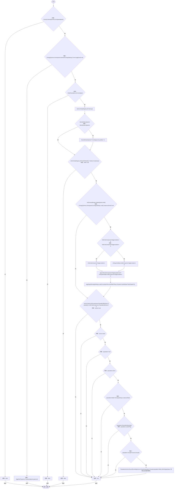
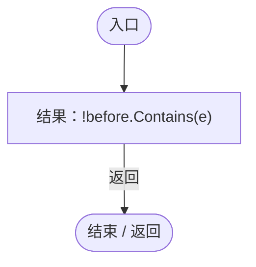

# EcologyReproduction.cs

[返回总索引](../README.md) · `Runtime` · `Assets/DarwinPark/Entities/Ecology/EcologyReproduction.cs`

[源文件](../../../Assets/DarwinPark/Entities/Ecology/EcologyReproduction.cs) · 源码校验：`436356737b15e76b2a7bc89fe22c87b009c9599891fb51a0965875b686fb8a38`

方法按源文件位置排列。事件/回调引用不表示立即执行；分支与异常说明见总索引。完整源码与可点击关系图请打开离线手册。

## Spawn · L9

`public static bool Spawn(EntityGeneController parent,Genome genome,Vector3 position)`

★ 新增：卵生后代先作为可攻击的独立卵存在，孵化前不进入普通生命周期。

### Editor / Player · Roslyn编译器控制流

项目内调用/回调引用：

- [ColonyContinuityPriority.CanSpawn · L17](dbd1eb8a8137aa05.md#mbb141444fee59435)（方法）
- [EcologyQueries.Active · L28](bdf7ccc2c9c0452f.md#m4fb10ad424167e3b)（方法）
- [NutritionEcologySettings.Current.get · L19](846a17351dbd6aa4.md#mb3eb930022e314f3)（访问器）
- [EggHostPregnancy.TryDeposit · L16](b0ff4b8259f98b85.md#mbf3d4ddb9cabb30c)（方法）
- [AntColonyMember.OnBirth · L71](baebd85c05598377.md#m619dc78e47b5ca6e)（方法）
- [EcologySettings.Load · L18](90428a275d065ef6.md#mb0575490373edaf2)（方法）
- [EggIncubation.Begin · L9](f5a647fca719706f.md#md45ae9ffbcf543e9)（方法）
- [EntityGeneController.GetAttribute · L262](7494d53178552f0e.md#mfead0db2249507df)（方法）
- [PopulationBehavior.EnsureMembership · L107](21e4f62f75a9a80f.md#medb038b51f8cd8e6)（方法）
- [PopulationBehavior.LeaderFlag.get · L22](21e4f62f75a9a80f.md#m381bf45ebdf091a9)（访问器）
- [PopulationBehavior.GroupId.get · L20](21e4f62f75a9a80f.md#m5145936fa914ba8c)（访问器）
- [PopulationArchive.RecordFounding · L60](084e119b69cdd751.md#mf4687fa10ee7a98a)（方法）
- [EcologyReproduction.回调@18 · L18](eaaa574d7ae50e29.md#m61223d5dc4f31ad9)（回调/委托）

## 回调@18 · L18

`e … => 回调`

### Editor / Player · Roslyn编译器控制流

