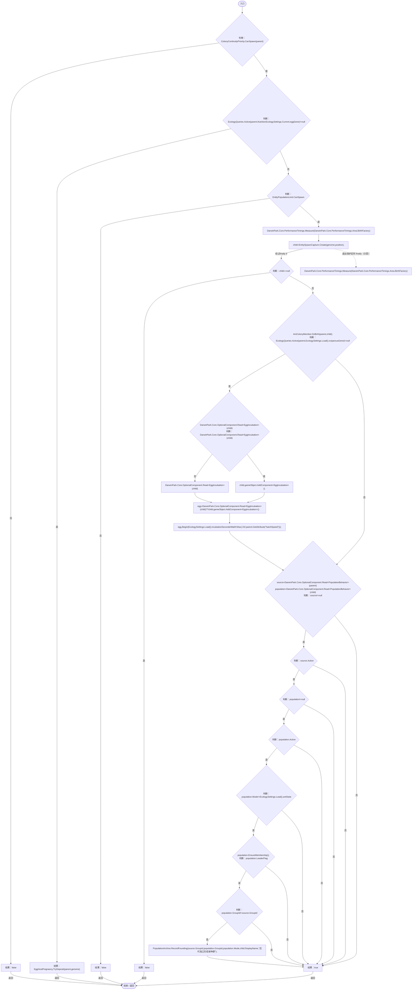

# EcologyReproduction.cs

[返回总索引](../README.md) · `Runtime` · `Assets/DarwinPark/Entities/Ecology/EcologyReproduction.cs`

[源文件](../../../Assets/DarwinPark/Entities/Ecology/EcologyReproduction.cs) · 源码校验：`ef9d2abb017b6fcf35feee1c0f720eaeee4fd33ddb8f571806e6cdf8521c1f7f`

方法按源文件位置排列。事件/回调引用不表示立即执行；分支与异常说明见总索引。完整源码与可点击关系图请打开离线手册。

## Spawn · L10

`public static bool Spawn(EntityGeneController parent,Genome genome,Vector3 position)`

★ 新增：卵生后代先作为可攻击的独立卵存在，孵化前不进入普通生命周期。

### Editor / Player · Roslyn编译器控制流

项目内调用/回调引用：

- [ColonyContinuityPriority.CanSpawn · L18](dbd1eb8a8137aa05.md#mc10b0878cf116782)（方法）
- [EcologyQueries.Active · L29](bdf7ccc2c9c0452f.md#m200839bb9db5ec55)（方法）
- [NutritionEcologySettings.Current.get · L19](846a17351dbd6aa4.md#mb3eb930022e314f3)（访问器）
- [EggHostPregnancy.TryDeposit · L17](b0ff4b8259f98b85.md#mda991bb1ba8c5c4a)（方法）
- [PerformanceTimings.Measure · L24](a8403a4c7503726d.md#m592e16f2b6513efd)（方法）
- [EntitySpawnCapture.Create · L11](5a4874756805f604.md#m2adfeb24d77063b5)（方法）
- [AntColonyMember.OnBirth · L73](baebd85c05598377.md#m5a3b31593e0247b1)（方法）
- [EcologySettings.Load · L18](90428a275d065ef6.md#mb0575490373edaf2)（方法）
- [OptionalComponent.Read · L7](806c46b42ced4d36.md#m69622a4dee165c5a)（方法）
- [EggIncubation.Begin · L9](f5a647fca719706f.md#md45ae9ffbcf543e9)（方法）
- [EntityGeneController.GetAttribute · L288](7494d53178552f0e.md#m45127bcdd833aaf5)（方法）
- [PopulationBehavior.EnsureMembership · L111](21e4f62f75a9a80f.md#m0aafd394c2ef20b7)（方法）
- [PopulationBehavior.LeaderFlag.get · L24](21e4f62f75a9a80f.md#m2972bf9eaa193643)（访问器）
- [PopulationBehavior.GroupId.get · L22](21e4f62f75a9a80f.md#me471d0106be463ca)（访问器）
- [PopulationArchive.RecordFounding · L61](084e119b69cdd751.md#m4f038dbcbee72807)（方法）
