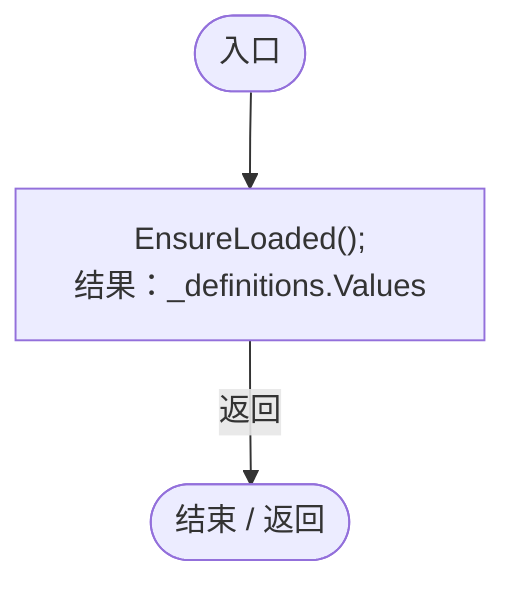
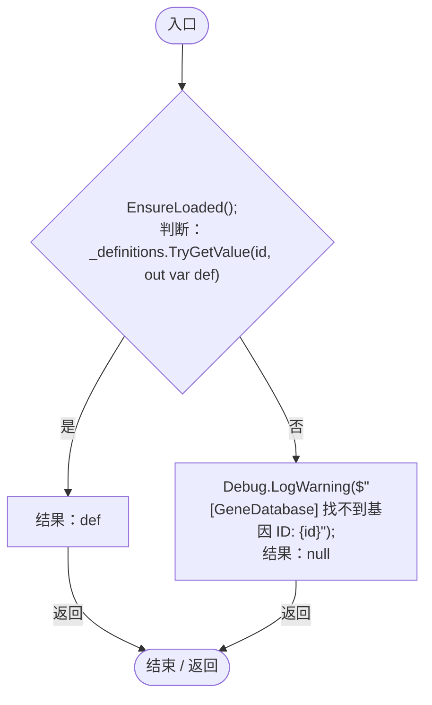
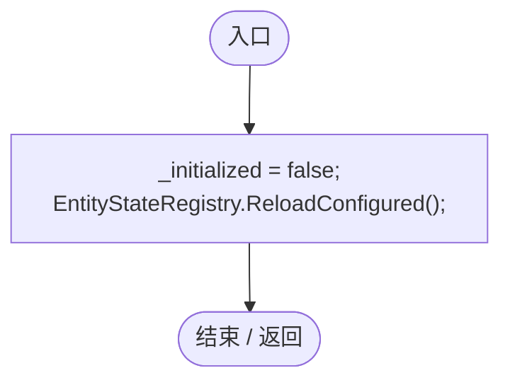

```mermaid
flowchart TD
  b0(["入口"])
  b1{"判断：_initialized"}
  b2{"_definitions = new Dictionary&lt;string, GeneDefinition&gt;();<br/>assets = System.Linq.Enumerable.ToArray(GeneTreeStorage.RuntimeAssets())<br/>判断：assets == null"}
  b3{"判断：assets.Length == 0"}
  b4["Debug.LogError(&quot;[GeneDatabase] 致命错误：Resources/Genes 下找不到任何 JSON 文件！&quot;);"]
  b5["assets"]
  b6{"判断：assets"}
  b7["var"]
  b8{"json = JsonUtility.FromJson&lt;GeneDefinitionJson&gt;(asset.text)<br/>判断：json == null"}
  b9{"判断：string.IsNullOrEmpty(json.id)"}
  b10["Debug.LogError($&quot;[GeneDatabase] JSON 解析为空或缺少 id：{asset.name}&quot;);"]
  b11["new GeneDefinition { Id = json.id, DisplayName = json.displayName, Category = (GeneCategory)Enum.Parse(typeof(GeneCategory), json.category, true), ParentGeneId = json.parentGeneId, BaseGeneId = json.baseGeneId, IsBaseGene = json.isBaseGe…"]
  b12{"判断：json.attributeCurves != null"}
  b13["json.attributeCurves"]
  b14{"判断：json.attributeCurves"}
  b15["var"]
  b16["def.AttributeCurves<br/>new AttributeCurve { attributeId = c.attributeId, minValue = c.minValue, maxValue = c.maxValue }<br/>attributeId = c.attributeId<br/>minValue = c.minValue<br/>maxValue = c.maxValue<br/>def.AttributeCurves.Add(new AttributeCurve { att…"]
  b17["json.attributeCurves"]
  b18{"判断：json.states != null"}
  b19["json.states"]
  b20{"判断：json.states"}
  b21["var"]
  b22["def.States<br/>new GeneStateDefinition { StateId = s.stateId, DisplayName = s.displayName, Center = s.center, Color = (s.color != null &amp;&amp; s.color.Length &gt;= 3) ? new Color(s.color[0], s.color[1], s.color[2]) : Color.white, Tier = s.tier, Base…"]
  b23{"判断：s.color != null"}
  b24{"判断：s.color.Length &gt;= 3"}
  b25["new Color(s.color[0], s.color[1], s.color[2])"]
  b26["Color.white"]
  b27["Color = (s.color != null &amp;&amp; s.color.Length &gt;= 3) ? new Color(s.color[0], s.color[1], s.color[2]) : Color.white"]
  b28["Tier = s.tier<br/>BaseGeneId = s.baseGeneId<br/>AiModuleId = s.aiModuleId"]
  b29{"判断：s.allowedNextStates != null"}
  b30["new List&lt;string&gt;(s.allowedNextStates)"]
  b31["new List&lt;string&gt;()"]
  b32["AllowedNextStates = s.allowedNextStates != null ? new List&lt;string&gt;(s.allowedNextStates) : new List&lt;string&gt;()"]
  b33["def.States.Add(new GeneStateDefinition { StateId = s.stateId, DisplayName = s.displayName, Center = s.center, Color = (s.color != null &amp;&amp; s.color.Length &gt;= 3) ? new Color(s.color[0], s.color[1], s.color[2]) : Color.white, Tier = s.tier, …"]
  b34["json.states"]
  b35{"判断：json.suppressionRules != null"}
  b36["json.suppressionRules"]
  b37{"判断：json.suppressionRules"}
  b38["var"]
  b39["def.SuppressionRules<br/>new GeneSuppressionRule { TargetGeneId = r.targetGeneId, Coefficient = r.coefficient }<br/>TargetGeneId = r.targetGeneId<br/>Coefficient = r.coefficient<br/>def.SuppressionRules.Add(new GeneSuppressionRule { TargetGeneId = r.tar…"]
  b40["json.suppressionRules"]
  b41{"判断：json.attributeLinkages != null"}
  b42["def.Linkages.AddRange(json.attributeLinkages);"]
  b43["GeneTreeStorage.ApplyInfluences(def);<br/>_definitions[json.id] = def;"]
  b44["(Exception e)<br/>Debug.LogError($&quot;[GeneDatabase] 加载 {asset.name} 失败：{e.Message}&quot;);"]
  b45{"assets<br/>判断：assets"}
  b46["assets"]
  b47["连接 / 离开区域"]
  b48["_initialized = true;<br/>GeneAttributeInheritance.Prepare(_definitions);<br/>Debug.Log($&quot;[GeneDatabase] 初始化完成，共加载 {_definitions.Count} 个基因。&quot;);"]
  b49(["结束 / 返回"])
  b0 --> b1
  b1 -->|"是"| b49
  b1 -->|"否"| b2
  b2 -->|"否"| b3
  b2 -->|"是"| b4
  b3 -->|"是"| b4
  b3 -->|"否"| b5
  b4 --> b49
  b5 --> b6
  b6 -->|"是"| b7
  b6 -->|"否 · 经过finally 45"| b48
  b7 --> b8
  b8 -->|"否"| b9
  b8 -->|"是"| b10
  b9 -->|"是"| b10
  b9 -->|"否"| b11
  b10 --> b6
  b11 --> b12
  b12 -->|"是"| b13
  b12 -->|"否"| b18
  b13 --> b14
  b14 -->|"是"| b15
  b14 -->|"否 · 经过finally 17"| b18
  b15 --> b16
  b16 --> b14
  b18 -->|"是"| b19
  b18 -->|"否"| b35
  b19 --> b20
  b20 -->|"是"| b21
  b20 -->|"否 · 经过finally 34"| b35
  b21 --> b22
  b22 --> b23
  b23 -->|"是"| b24
  b23 -->|"否"| b26
  b24 -->|"是"| b25
  b24 -->|"否"| b26
  b25 --> b27
  b26 --> b27
  b27 --> b28
  b28 --> b29
  b29 -->|"是"| b30
  b29 -->|"否"| b31
  b30 --> b32
  b31 --> b32
  b32 --> b33
  b33 --> b20
  b35 -->|"是"| b36
  b35 -->|"否"| b41
  b36 --> b37
  b37 -->|"是"| b38
  b37 -->|"否 · 经过finally 40"| b41
  b38 --> b39
  b39 --> b37
  b41 -->|"是"| b42
  b41 -->|"否"| b43
  b42 --> b43
  b43 --> b6
  b44 --> b6
  b45 -->|"否"| b46
  b45 -->|"是"| b47
  b46 --> b47
  b48 --> b49
  b14 -. "退出保护区时 finally（示意）" .-> b17
  b20 -. "退出保护区时 finally（示意）" .-> b34
  b37 -. "退出保护区时 finally（示意）" .-> b40
  b8 -. "保护区可能异常（示意）" .-> b44
  b6 -. "退出保护区时 finally（示意）" .-> b45

```

# GeneDatabase.cs

[返回总索引](../README.md) · `Runtime` · `Assets/DarwinPark/Genetics/Data/GeneDatabase.cs`

[源文件](../../../Assets/DarwinPark/Genetics/Data/GeneDatabase.cs) · 源码校验：`f7cea4d784435b968461cb8821410dca509309f6b93ee54129307dac1080fa56`

方法按源文件位置排列。事件/回调引用不表示立即执行；分支与异常说明见总索引。完整源码与可点击关系图请打开离线手册。

## EnsureLoaded · L12

`public static void EnsureLoaded()`

### Editor / Player · Roslyn编译器控制流

项目内调用/回调引用：

- [GeneTreeStorage.RuntimeAssets · L110](a885bad0d7dedee8.md#m3b680cb19d835ce7)（方法）
- [GeneEntityStateTags.Read · L29](d87d75eb0b331d5c.md#m870acf111d189611)（方法）
- [GeneTreeStorage.ApplyInfluences · L117](a885bad0d7dedee8.md#ma58a13a0fae63ad6)（方法）
- [GeneAttributeInheritance.Prepare · L15](cbba0870e05d6571.md#m9242f311b1323506)（方法）

## All.get · L128

`get`

### Editor / Player · Roslyn编译器控制流

项目内调用/回调引用：

- [GeneDatabase.EnsureLoaded · L12](ec0a03483435a863.md#mc3e6357b9ca440f5)（方法）

## Get · L135

`public static GeneDefinition Get(string id)`

### Editor / Player · Roslyn编译器控制流

项目内调用/回调引用：

- [GeneDatabase.EnsureLoaded · L12](ec0a03483435a863.md#mc3e6357b9ca440f5)（方法）

## Reload · L145

`public static void Reload()`

### Editor / Player · Roslyn编译器控制流

项目内调用/回调引用：

- [EntityStateRegistry.ReloadConfigured · L54](440408d2db5c7d96.md#m14e2f47d046d80ef)（方法）
