# ParasiteBehavior.cs

[返回总索引](../README.md) · `Runtime` · `Assets/DarwinPark/Entities/Ecology/ParasiteBehavior.cs`

[源文件](../../../Assets/DarwinPark/Entities/Ecology/ParasiteBehavior.cs) · 源码校验：`07c2f705e2729befdf2d9ad1f26ee28433d65a9d07193fc6ffc67d3fc086dd56`

方法按源文件位置排列。事件/回调引用不表示立即执行；分支与异常说明见总索引。完整源码与可点击关系图请打开离线手册。

<a id="m26d7e4af4cdffdbb"></a>

## Host.get · L18

`get`


### Editor / Player · 语法控制结构 / 声明（非CFG）

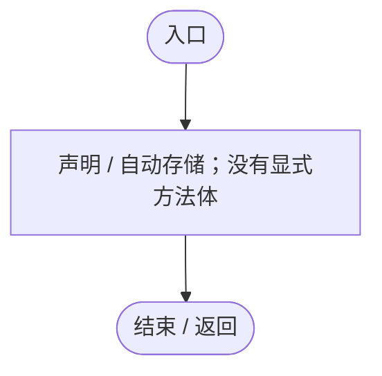

<a id="md057cd47821a7aa9"></a>

## Host.set · L18

`private set`


### Editor / Player · 语法控制结构 / 声明（非CFG）


<a id="me65a7509f034e027"></a>

## Offset.get · L19

`public Vector3 Offset`


### Editor / Player · 语法控制结构 / 声明（非CFG）

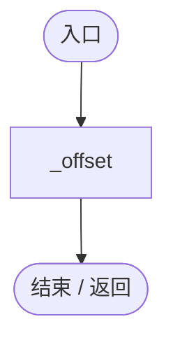

<a id="mc0b1fc7eaac7771a"></a>

## DetectedByHost.get · L20

`public bool DetectedByHost`


### Editor / Player · 语法控制结构 / 声明（非CFG）

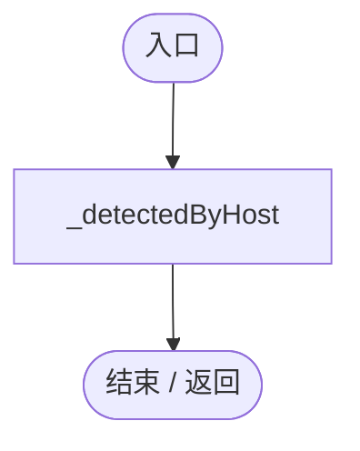

<a id="md2af822af86a84dd"></a>

## DetectionRemaining.get · L21

`public float DetectionRemaining`


### Editor / Player · 语法控制结构 / 声明（非CFG）

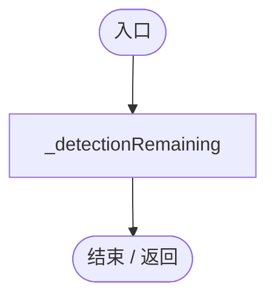

<a id="md0a6c5009a0a1a3e"></a>

## VisibleTo · L22

`public bool VisibleTo(DarwinEntity observer)`


### Editor / Player · Roslyn编译器控制流

```mermaid
flowchart TD
  b0(["入口"])
  b1{"判断：observer!=Host"}
  b2["_detectedByHost"]
  b3["observer!=Host"]
  b4["结果：observer!=Host&#124;&#124;_detectedByHost"]
  b5(["结束 / 返回"])
  b0 --> b1
  b1 -->|"否"| b2
  b1 -->|"是"| b3
  b2 --> b4
  b3 --> b4
  b4 -->|"返回"| b5

```

项目内调用/回调引用：

- [ParasiteBehavior.Host.get · L18](ec21ecbd299caaed.md#m26d7e4af4cdffdbb)（访问器）

<a id="m5047a40ae90aa091"></a>

## RestoreDetection · L23

`public void RestoreDetection(bool detected,float remaining)`


### Editor / Player · Roslyn编译器控制流

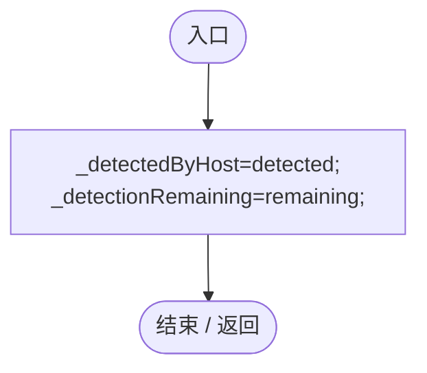

<a id="m45857745d20c309b"></a>

## Active.get · L25

`public bool Active`

★ 修复（防Bug回归）：热更新或旧组件残留时，新卵寄生逻辑不能继续触发旧的吸血/跟随行为。

### Editor / Player · 语法控制结构 / 声明（非CFG）

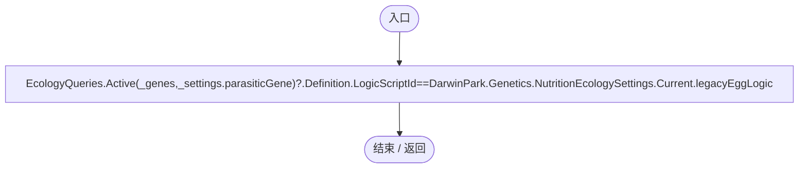

项目内调用/回调引用：

- [EcologyQueries.Active · L29](bdf7ccc2c9c0452f.md#m200839bb9db5ec55)（方法）
- [NutritionEcologySettings.Current.get · L19](846a17351dbd6aa4.md#mb3eb930022e314f3)（访问器）

<a id="mb50e6bdc00e42f73"></a>

## Internal.get · L26

`public bool Internal`


### Editor / Player · 语法控制结构 / 声明（非CFG）

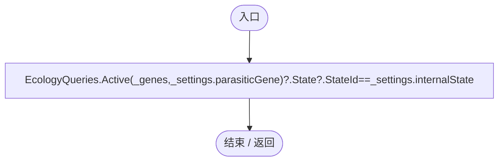

项目内调用/回调引用：

- [EcologyQueries.Active · L29](bdf7ccc2c9c0452f.md#m200839bb9db5ec55)（方法）

<a id="md273b2395ba33966"></a>

## OriginalKinematic.get · L27

`public bool OriginalKinematic`


### Editor / Player · 语法控制结构 / 声明（非CFG）

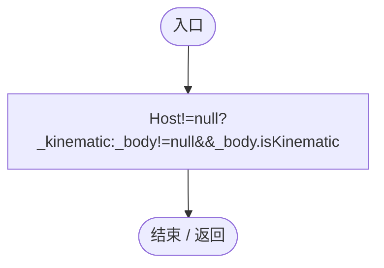

项目内调用/回调引用：

- [ParasiteBehavior.Host.get · L18](ec21ecbd299caaed.md#m26d7e4af4cdffdbb)（访问器）

<a id="m583105d4b5e5f7bb"></a>

## Awake · L28

`private void Awake()`


### Editor / Player · Roslyn编译器控制流

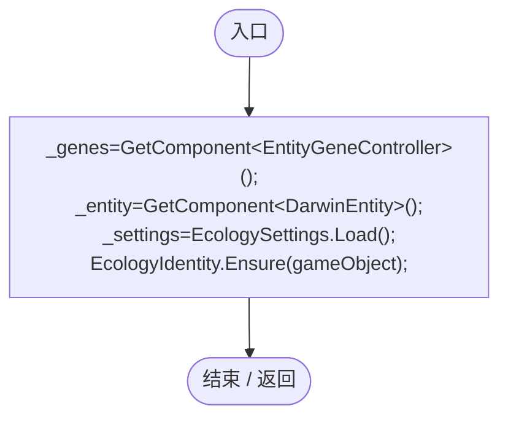

项目内调用/回调引用：

- [EcologySettings.Load · L18](90428a275d065ef6.md#mb0575490373edaf2)（方法）
- [EcologyIdentity.Ensure · L23](bdf7ccc2c9c0452f.md#m8adfd15f583f225a)（方法）

<a id="md862501ee37e8380"></a>

## Update · L29

`private void Update()`


### Editor / Player · Roslyn编译器控制流

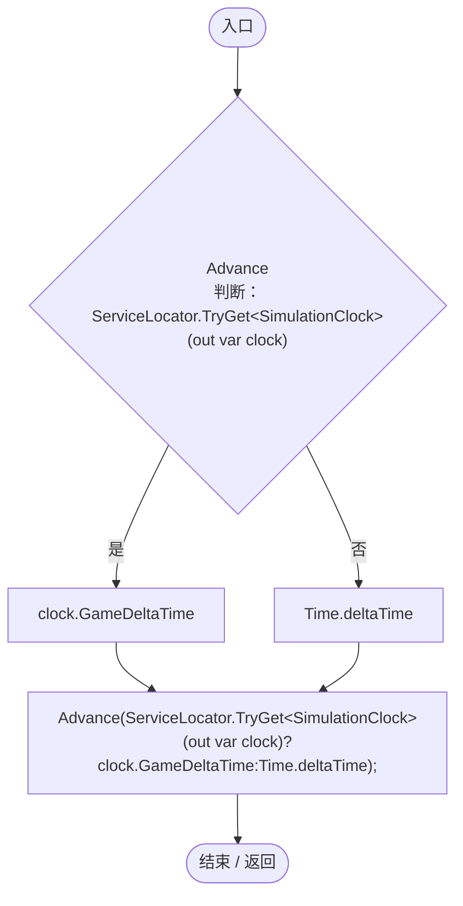

项目内调用/回调引用：

- [ParasiteBehavior.Advance · L31](ec21ecbd299caaed.md#m52dd6e8d78f1a34c)（方法）
- [ServiceLocator.TryGet · L26](f2fdbe9f9ccd93cb.md#m143b24e6d58471b0)（方法）
- [SimulationClock.GameDeltaTime.get · L26](a8f444aec9614b0a.md#me7f11abae18a4f2d)（访问器）

<a id="mdf6475e5137b4c4a"></a>

## OnDisable · L30

`private void OnDisable()`


### Editor / Player · Roslyn编译器控制流

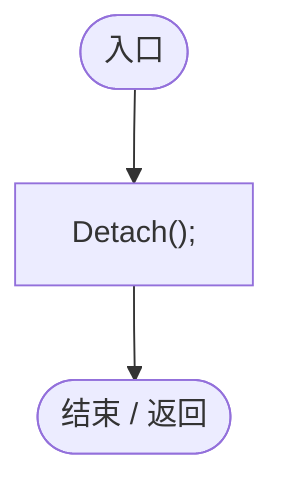

项目内调用/回调引用：

- [ParasiteBehavior.Detach · L94](ec21ecbd299caaed.md#m85ba1f015e87ec39)（方法）

<a id="m52dd6e8d78f1a34c"></a>

## Advance · L31

`public void Advance(float dt)`


### Editor / Player · Roslyn编译器控制流

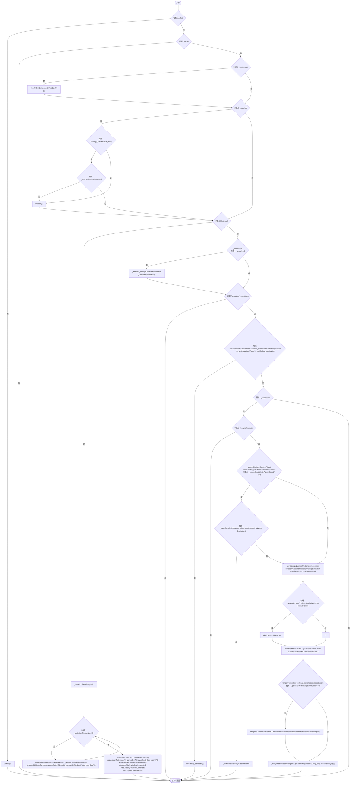

项目内调用/回调引用：

- [ParasiteBehavior.Detach · L94](ec21ecbd299caaed.md#m85ba1f015e87ec39)（方法）
- [EcologyQueries.Alive · L39](bdf7ccc2c9c0452f.md#m8352bfacbe2996a8)（方法）
- [ParasiteBehavior.Host.get · L18](ec21ecbd299caaed.md#m26d7e4af4cdffdbb)（访问器）
- [EntityGeneController.GetAttribute · L288](7494d53178552f0e.md#m45127bcdd833aaf5)（方法）
- [EntityStats.TryGet · L93](75aa86a368efdf24.md#m03cef847022eee28)（方法）
- [EntityStats.Modify · L107](75aa86a368efdf24.md#mf17c464aaa04f6f2)（方法）
- [EntityStats.Feed · L98](75aa86a368efdf24.md#me8ee3fa22434267a)（方法）
- [ParasiteBehavior.Follow · L93](ec21ecbd299caaed.md#mc051bf3a9b9733ce)（方法）
- [ParasiteBehavior.FindHost · L59](ec21ecbd299caaed.md#m5b3425b94bdcab23)（方法）
- [ParasiteBehavior.CanHost · L68](ec21ecbd299caaed.md#m976734fde9bb01e4)（方法）
- [ParasiteBehavior.HostRadius · L77](ec21ecbd299caaed.md#ma9c640d736992744)（方法）
- [ParasiteBehavior.TryAttach · L78](ec21ecbd299caaed.md#m8473a35a233ea83d)（方法）
- [LandRoutePlan.Resolve · L42](d357e13967229560.md#md0b0a64ddf86d978)（方法）
- [EcologyQueries.Up · L42](bdf7ccc2c9c0452f.md#ma73e6bbbc726282f)（方法）
- [ServiceLocator.TryGet · L26](f2fdbe9f9ccd93cb.md#m143b24e6d58471b0)（方法）
- [LandRoutePlan.SafeVelocity · L54](d357e13967229560.md#mdb046d6a448848cc)（方法）

<a id="m5b3425b94bdcab23"></a>

## FindHost · L59

`private DarwinEntity FindHost()`


### Editor / Player · Roslyn编译器控制流

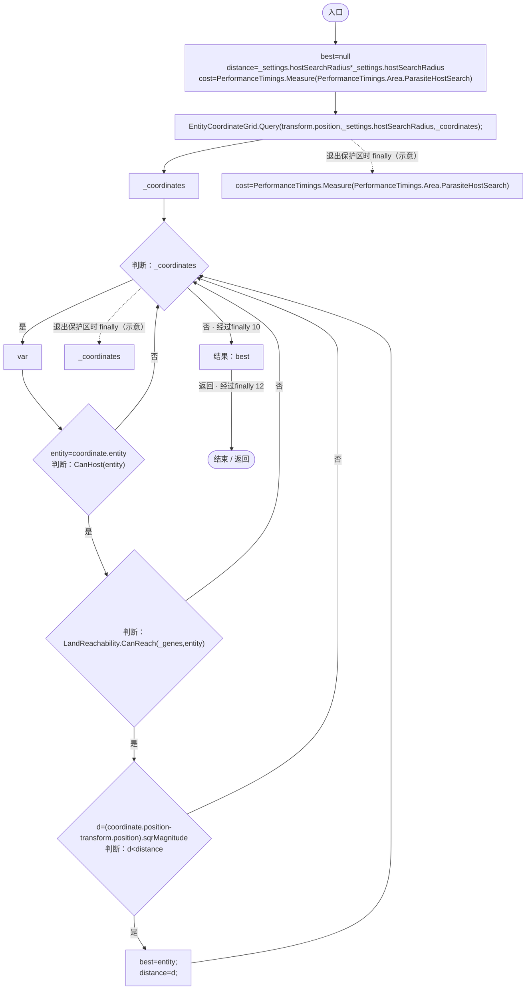

项目内调用/回调引用：

- [PerformanceTimings.Measure · L25](a8403a4c7503726d.md#m36fde3c234084192)（方法）
- [EntityCoordinateGrid.Query · L26](f6d0404a662a5d5c.md#mb223b609771bd310)（方法）
- [ParasiteBehavior.CanHost · L68](ec21ecbd299caaed.md#m976734fde9bb01e4)（方法）
- [LandReachability.CanReach · L15](816416ac988cda79.md#m421ee61c476fabe8)（方法）

<a id="m976734fde9bb01e4"></a>

## CanHost · L68

`private bool CanHost(DarwinEntity entity)`


### Editor / Player · Roslyn编译器控制流

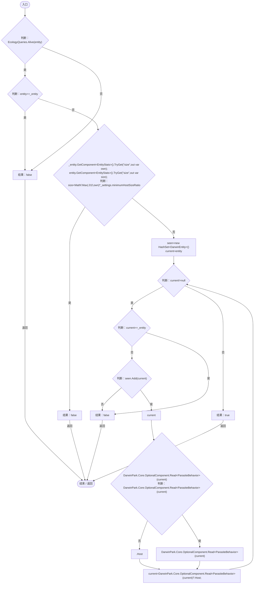

项目内调用/回调引用：

- [EcologyQueries.Alive · L39](bdf7ccc2c9c0452f.md#m8352bfacbe2996a8)（方法）
- [EntityStats.TryGet · L93](75aa86a368efdf24.md#m03cef847022eee28)（方法）
- [OptionalComponent.Read · L7](806c46b42ced4d36.md#m69622a4dee165c5a)（方法）
- [ParasiteBehavior.Host.get · L18](ec21ecbd299caaed.md#m26d7e4af4cdffdbb)（访问器）

<a id="ma9c640d736992744"></a>

## HostRadius · L77

`private static float HostRadius(DarwinEntity entity)`


### Editor / Player · Roslyn编译器控制流

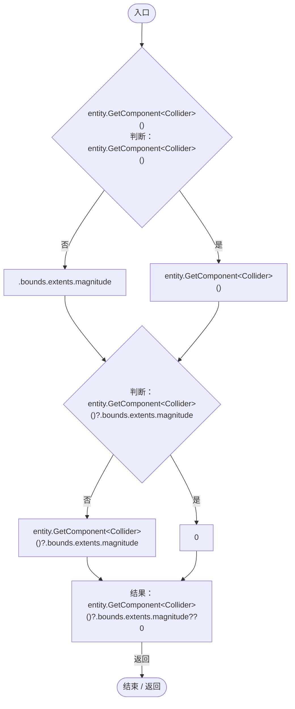

<a id="m8473a35a233ea83d"></a>

## TryAttach · L78

`public bool TryAttach(DarwinEntity host,bool restoring=false,Vector3 savedOffset=default,bool originalKinematic=false)`


### Editor / Player · Roslyn编译器控制流

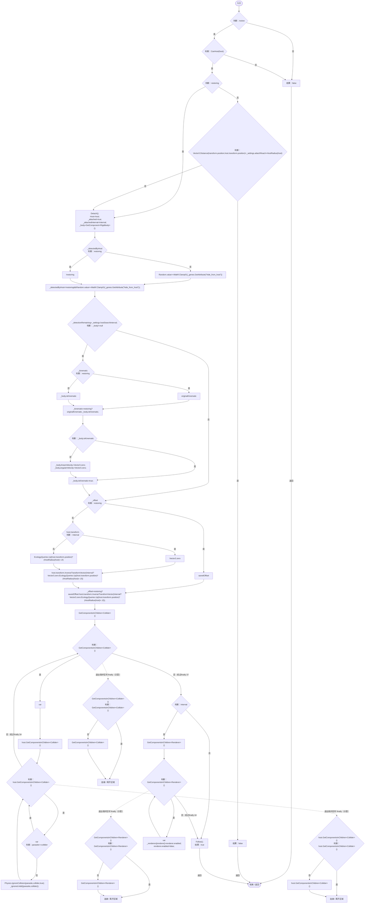

项目内调用/回调引用：

- [ParasiteBehavior.CanHost · L68](ec21ecbd299caaed.md#m976734fde9bb01e4)（方法）
- [ParasiteBehavior.HostRadius · L77](ec21ecbd299caaed.md#ma9c640d736992744)（方法）
- [ParasiteBehavior.Detach · L94](ec21ecbd299caaed.md#m85ba1f015e87ec39)（方法）
- [ParasiteBehavior.Host.set · L18](ec21ecbd299caaed.md#md057cd47821a7aa9)（访问器）
- [EntityGeneController.GetAttribute · L288](7494d53178552f0e.md#m45127bcdd833aaf5)（方法）
- [EcologyQueries.Up · L42](bdf7ccc2c9c0452f.md#ma73e6bbbc726282f)（方法）
- [ParasiteBehavior.Follow · L93](ec21ecbd299caaed.md#mc051bf3a9b9733ce)（方法）

<a id="mdb66a478067005fe"></a>

## LateUpdate · L91

`private void LateUpdate()`


### Editor / Player · Roslyn编译器控制流

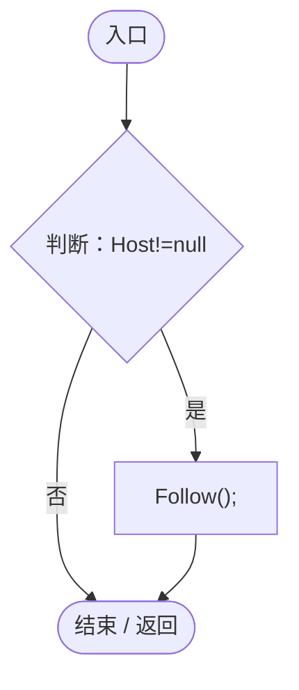

项目内调用/回调引用：

- [ParasiteBehavior.Host.get · L18](ec21ecbd299caaed.md#m26d7e4af4cdffdbb)（访问器）
- [ParasiteBehavior.Follow · L93](ec21ecbd299caaed.md#mc051bf3a9b9733ce)（方法）

<a id="mc051bf3a9b9733ce"></a>

## Follow · L93

`private void Follow()`

★ 适配：宿主跟随可能发生在基因模拟之后，及时同步空间索引。

### Editor / Player · Roslyn编译器控制流

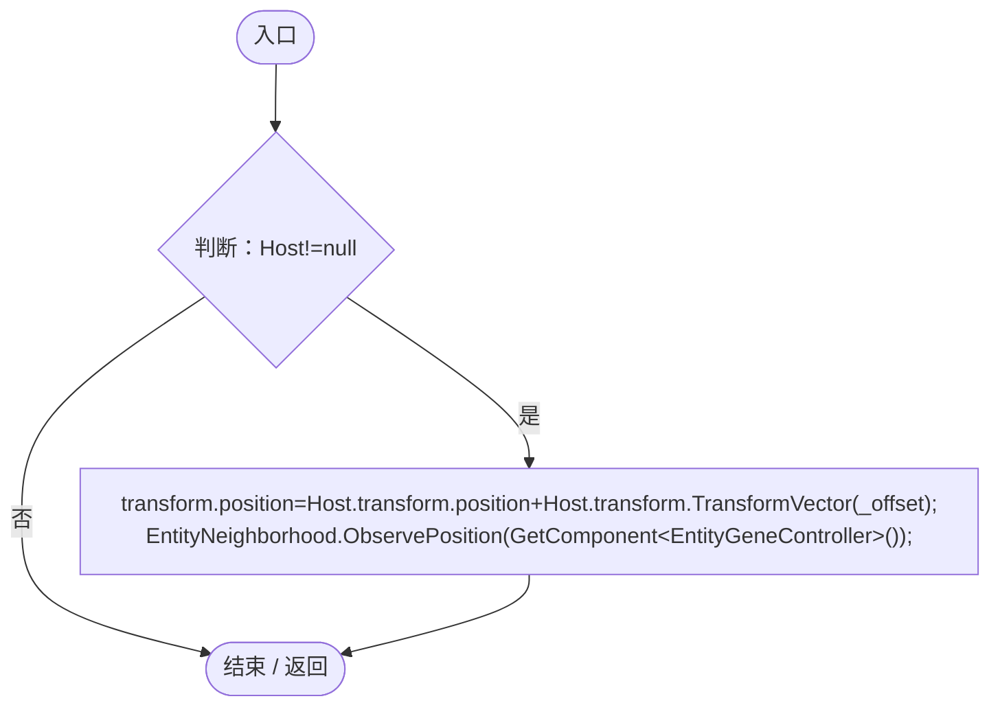

项目内调用/回调引用：

- [ParasiteBehavior.Host.get · L18](ec21ecbd299caaed.md#m26d7e4af4cdffdbb)（访问器）
- [EntityNeighborhood.ObservePosition · L81](e5e24c4aff0395b1.md#m232339f32a8c5875)（方法）

<a id="m85ba1f015e87ec39"></a>

## Detach · L94

`public void Detach()`


### Editor / Player · Roslyn编译器控制流

```mermaid
flowchart TD
  b0(["入口"])
  b1["_ignored"]
  b2{"判断：_ignored"}
  b3{"var<br/>判断：pair.parasite!=null"}
  b4{"判断：pair.host!=null"}
  b5["Physics.IgnoreCollision(pair.parasite,pair.host,false);"]
  b6["_ignored"]
  b7["_ignored.Clear();"]
  b8["_renderers"]
  b9{"判断：_renderers"}
  b10{"var<br/>判断：pair.Key!=null"}
  b11["pair.Key.enabled=pair.Value;"]
  b12["_renderers"]
  b13{"_renderers.Clear();<br/>判断：_body!=null"}
  b14{"判断：_attached"}
  b15{"_body.isKinematic=_kinematic;<br/>判断：_body.isKinematic"}
  b16["_body.linearVelocity=Vector3.zero;"]
  b17["_attached=false;<br/>Host=null;<br/>_candidate=null;<br/>_search=0;"]
  b18(["结束 / 返回"])
  b0 --> b1
  b1 --> b2
  b2 -->|"是"| b3
  b2 -->|"否 · 经过finally 6"| b7
  b3 -->|"是"| b4
  b3 -->|"否"| b2
  b4 -->|"是"| b5
  b4 -->|"否"| b2
  b5 --> b2
  b7 --> b8
  b8 --> b9
  b9 -->|"是"| b10
  b9 -->|"否 · 经过finally 12"| b13
  b10 -->|"是"| b11
  b10 -->|"否"| b9
  b11 --> b9
  b13 -->|"是"| b14
  b13 -->|"否"| b17
  b14 -->|"是"| b15
  b14 -->|"否"| b17
  b15 -->|"否"| b16
  b15 -->|"是"| b17
  b16 --> b17
  b17 --> b18
  b2 -. "退出保护区时 finally（示意）" .-> b6
  b9 -. "退出保护区时 finally（示意）" .-> b12

```

项目内调用/回调引用：

- [ParasiteBehavior.Host.set · L18](ec21ecbd299caaed.md#md057cd47821a7aa9)（访问器）
