# ParasiteBehavior.cs

[返回总索引](../README.md) · `Runtime` · `Assets/DarwinPark/Entities/Ecology/ParasiteBehavior.cs`

[源文件](../../../Assets/DarwinPark/Entities/Ecology/ParasiteBehavior.cs) · 源码校验：`8402596d68452419fe6870c9cd232551ba645e80c2982c39f35c72eff09be571`

方法按源文件位置排列。事件/回调引用不表示立即执行；分支与异常说明见总索引。完整源码与可点击关系图请打开离线手册。

<a id="m854b55763184d078"></a>

## Host.get · L16

`get`


### Editor / Player · 语法控制结构 / 声明（非CFG）

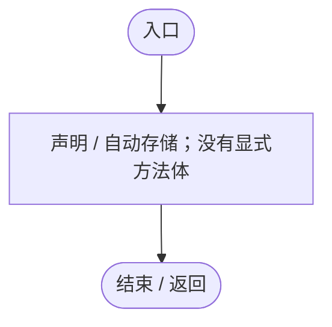

<a id="mb11b1f8f75e0ff5c"></a>

## Host.set · L16

`private set`


### Editor / Player · 语法控制结构 / 声明（非CFG）


<a id="mab6a402b1bce3096"></a>

## Offset.get · L17

`public Vector3 Offset`


### Editor / Player · 语法控制结构 / 声明（非CFG）

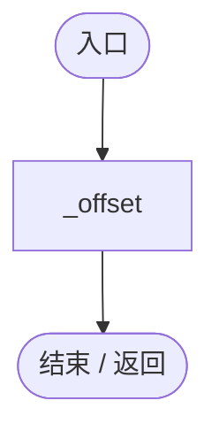

<a id="mb64276e3de46de12"></a>

## DetectedByHost.get · L18

`public bool DetectedByHost`


### Editor / Player · 语法控制结构 / 声明（非CFG）

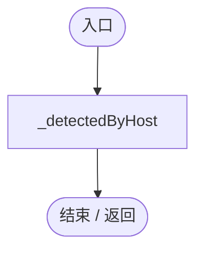

<a id="m88caae5cb66292ed"></a>

## DetectionRemaining.get · L19

`public float DetectionRemaining`


### Editor / Player · 语法控制结构 / 声明（非CFG）

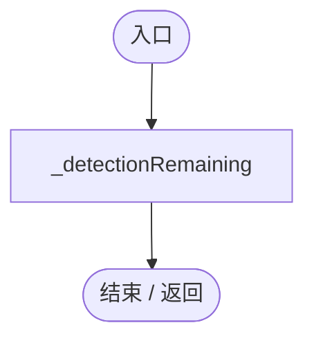

<a id="me3b68e7667800a21"></a>

## VisibleTo · L20

`public bool VisibleTo(DarwinEntity observer)`


### Editor / Player · Roslyn编译器控制流

```mermaid
flowchart TD
  b0(["入口"])
  b1{"判断：observer!=Host"}
  b2["_detectedByHost"]
  b3["observer!=Host"]
  b4["结果：observer!=Host&#124;&#124;_detectedByHost"]
  b5(["结束 / 返回"])
  b0 --> b1
  b1 -->|"否"| b2
  b1 -->|"是"| b3
  b2 --> b4
  b3 --> b4
  b4 -->|"返回"| b5

```

项目内调用/回调引用：

- [ParasiteBehavior.Host.get · L16](ec21ecbd299caaed.md#m854b55763184d078)（访问器）

<a id="m40a5d06b41539454"></a>

## RestoreDetection · L21

`public void RestoreDetection(bool detected,float remaining)`


### Editor / Player · Roslyn编译器控制流

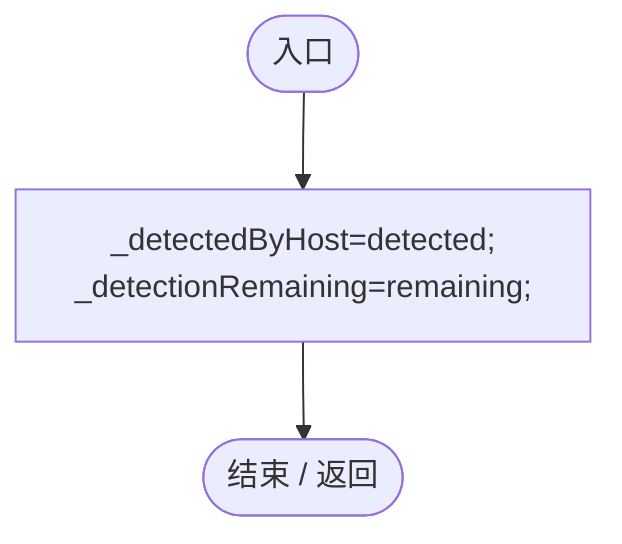

<a id="m1da8e8fa9a54e121"></a>

## Active.get · L23

`public bool Active`

★ 修复（防Bug回归）：热更新或旧组件残留时，新卵寄生逻辑不能继续触发旧的吸血/跟随行为。

### Editor / Player · 语法控制结构 / 声明（非CFG）

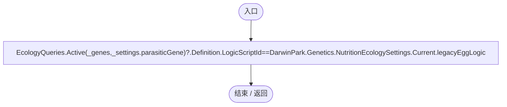

项目内调用/回调引用：

- [EcologyQueries.Active · L28](bdf7ccc2c9c0452f.md#m4fb10ad424167e3b)（方法）
- [NutritionEcologySettings.Current.get · L19](846a17351dbd6aa4.md#mb3eb930022e314f3)（访问器）

<a id="m65972a59ce611781"></a>

## Internal.get · L24

`public bool Internal`


### Editor / Player · 语法控制结构 / 声明（非CFG）

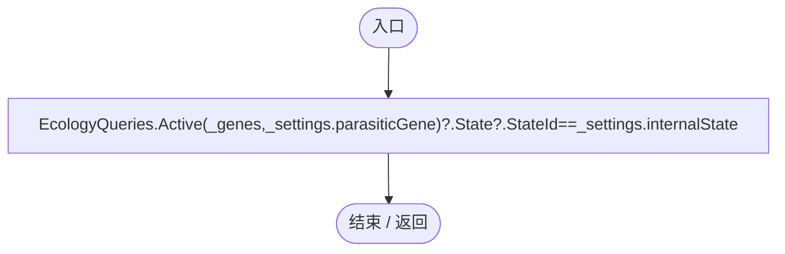

项目内调用/回调引用：

- [EcologyQueries.Active · L28](bdf7ccc2c9c0452f.md#m4fb10ad424167e3b)（方法）

<a id="m165db6c6d3d0933e"></a>

## OriginalKinematic.get · L25

`public bool OriginalKinematic`


### Editor / Player · 语法控制结构 / 声明（非CFG）

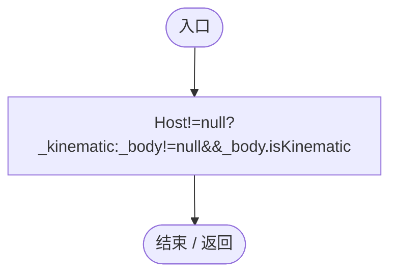

项目内调用/回调引用：

- [ParasiteBehavior.Host.get · L16](ec21ecbd299caaed.md#m854b55763184d078)（访问器）

<a id="mecdc144500af3a24"></a>

## Awake · L26

`private void Awake()`


### Editor / Player · Roslyn编译器控制流

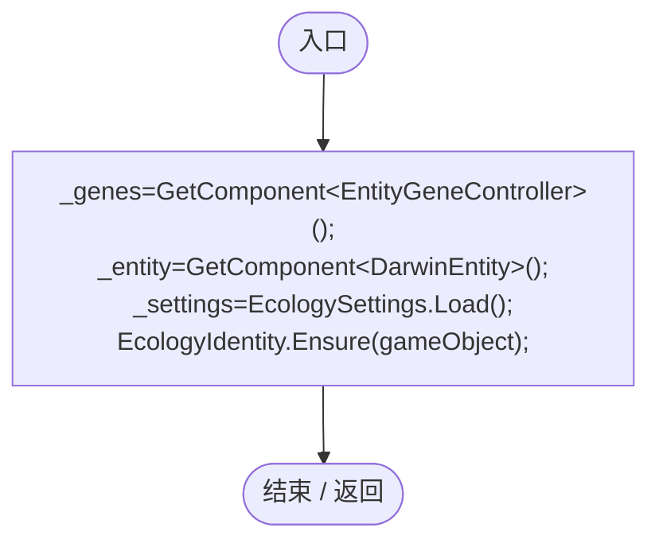

项目内调用/回调引用：

- [EcologySettings.Load · L18](90428a275d065ef6.md#mb0575490373edaf2)（方法）
- [EcologyIdentity.Ensure · L22](bdf7ccc2c9c0452f.md#m40609054a6d444d0)（方法）

<a id="m92afb1ae749564d1"></a>

## Update · L27

`private void Update()`


### Editor / Player · Roslyn编译器控制流

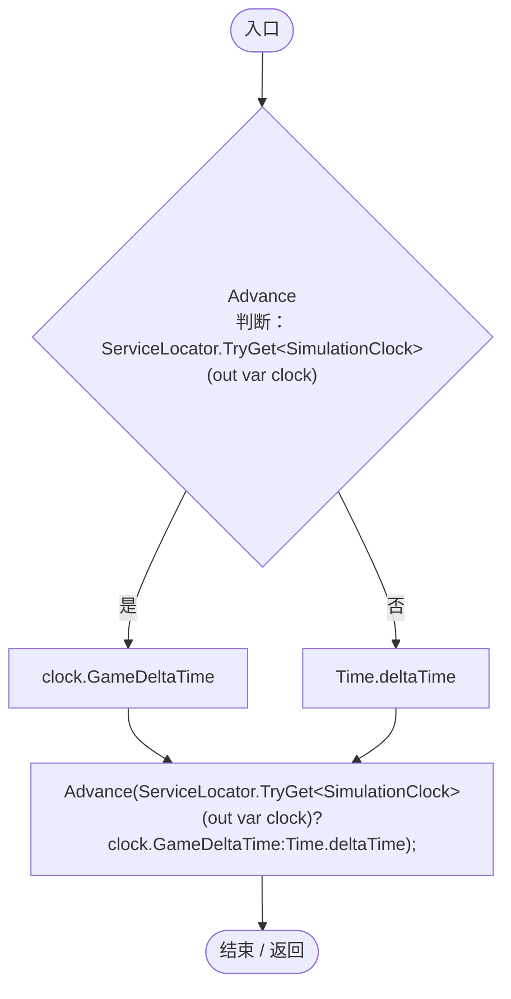

项目内调用/回调引用：

- [ParasiteBehavior.Advance · L29](ec21ecbd299caaed.md#m77af337c4ab30f62)（方法）
- [ServiceLocator.TryGet · L26](f2fdbe9f9ccd93cb.md#m143b24e6d58471b0)（方法）
- [SimulationClock.GameDeltaTime.get · L26](a8f444aec9614b0a.md#me7f11abae18a4f2d)（访问器）

<a id="m489548e8990ec4e2"></a>

## OnDisable · L28

`private void OnDisable()`


### Editor / Player · Roslyn编译器控制流

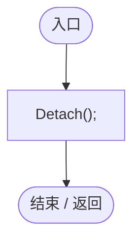

项目内调用/回调引用：

- [ParasiteBehavior.Detach · L86](ec21ecbd299caaed.md#m858d10391da0e50c)（方法）

<a id="m77af337c4ab30f62"></a>

## Advance · L29

`public void Advance(float dt)`


### Editor / Player · Roslyn编译器控制流

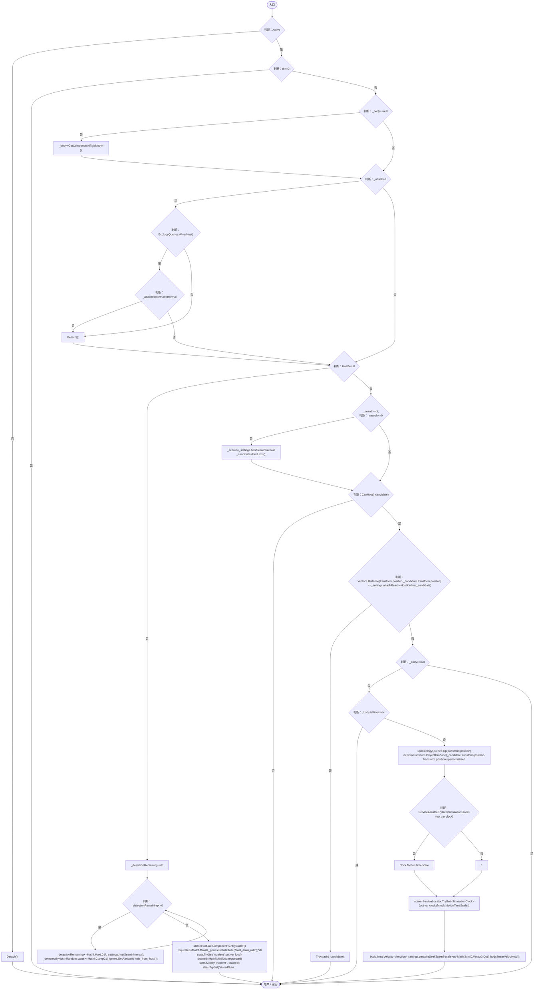

项目内调用/回调引用：

- [ParasiteBehavior.Detach · L86](ec21ecbd299caaed.md#m858d10391da0e50c)（方法）
- [EcologyQueries.Alive · L38](bdf7ccc2c9c0452f.md#mb2877c487f449970)（方法）
- [ParasiteBehavior.Host.get · L16](ec21ecbd299caaed.md#m854b55763184d078)（访问器）
- [EntityGeneController.GetAttribute · L225](7494d53178552f0e.md#mc707943b1138a009)（方法）
- [EntityStats.TryGet · L90](75aa86a368efdf24.md#m24ee1433e4a70d94)（方法）
- [EntityStats.Modify · L104](75aa86a368efdf24.md#m858c2a75d852ecc1)（方法）
- [EntityStats.Feed · L95](75aa86a368efdf24.md#mc025822ff1eb86a0)（方法）
- [ParasiteBehavior.Follow · L85](ec21ecbd299caaed.md#m773aeb15453932c0)（方法）
- [ParasiteBehavior.FindHost · L53](ec21ecbd299caaed.md#ma2477ff63c367952)（方法）
- [ParasiteBehavior.CanHost · L60](ec21ecbd299caaed.md#mfe0f00ac7c08fc7a)（方法）
- [ParasiteBehavior.HostRadius · L69](ec21ecbd299caaed.md#m502aac50801d7dc6)（方法）
- [ParasiteBehavior.TryAttach · L70](ec21ecbd299caaed.md#mbdecb89dac39aa1f)（方法）
- [EcologyQueries.Up · L41](bdf7ccc2c9c0452f.md#maca7070196f125fd)（方法）
- [ServiceLocator.TryGet · L26](f2fdbe9f9ccd93cb.md#m143b24e6d58471b0)（方法）

<a id="ma2477ff63c367952"></a>

## FindHost · L53

`private DarwinEntity FindHost()`


### Editor / Player · Roslyn编译器控制流

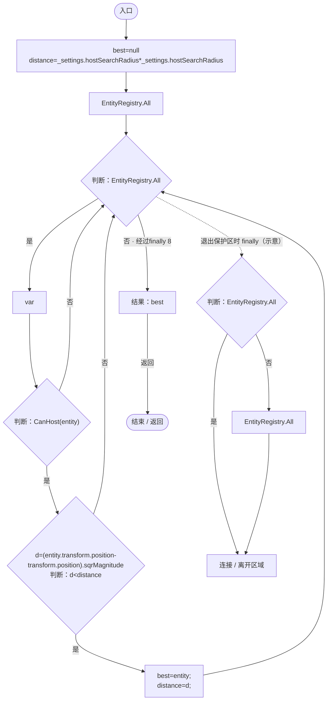

项目内调用/回调引用：

- [ParasiteBehavior.CanHost · L60](ec21ecbd299caaed.md#mfe0f00ac7c08fc7a)（方法）

<a id="mfe0f00ac7c08fc7a"></a>

## CanHost · L60

`private bool CanHost(DarwinEntity entity)`


### Editor / Player · Roslyn编译器控制流

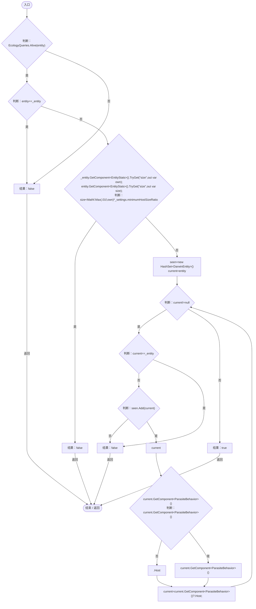

项目内调用/回调引用：

- [EcologyQueries.Alive · L38](bdf7ccc2c9c0452f.md#mb2877c487f449970)（方法）
- [EntityStats.TryGet · L90](75aa86a368efdf24.md#m24ee1433e4a70d94)（方法）
- [ParasiteBehavior.Host.get · L16](ec21ecbd299caaed.md#m854b55763184d078)（访问器）

<a id="m502aac50801d7dc6"></a>

## HostRadius · L69

`private static float HostRadius(DarwinEntity entity)`


### Editor / Player · Roslyn编译器控制流

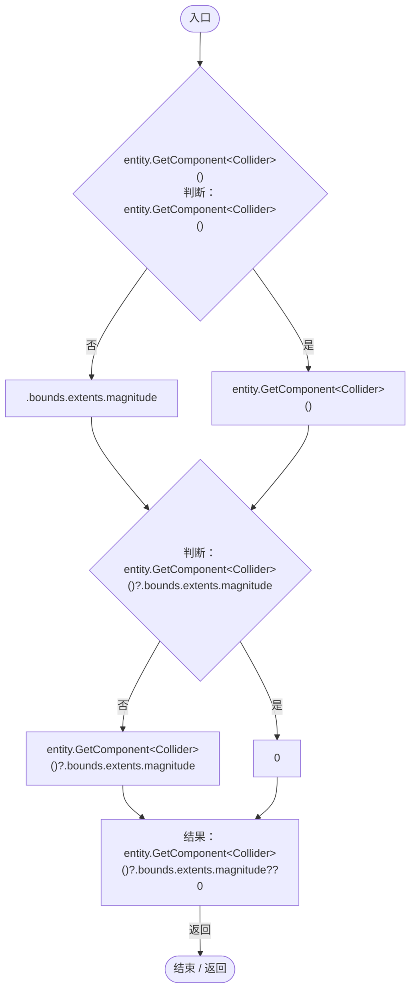

<a id="mbdecb89dac39aa1f"></a>

## TryAttach · L70

`public bool TryAttach(DarwinEntity host,bool restoring=false,Vector3 savedOffset=default,bool originalKinematic=false)`


### Editor / Player · Roslyn编译器控制流

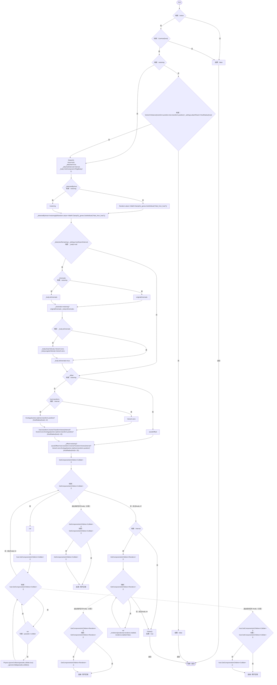

项目内调用/回调引用：

- [ParasiteBehavior.CanHost · L60](ec21ecbd299caaed.md#mfe0f00ac7c08fc7a)（方法）
- [ParasiteBehavior.HostRadius · L69](ec21ecbd299caaed.md#m502aac50801d7dc6)（方法）
- [ParasiteBehavior.Detach · L86](ec21ecbd299caaed.md#m858d10391da0e50c)（方法）
- [ParasiteBehavior.Host.set · L16](ec21ecbd299caaed.md#mb11b1f8f75e0ff5c)（访问器）
- [EntityGeneController.GetAttribute · L225](7494d53178552f0e.md#mc707943b1138a009)（方法）
- [EcologyQueries.Up · L41](bdf7ccc2c9c0452f.md#maca7070196f125fd)（方法）
- [ParasiteBehavior.Follow · L85](ec21ecbd299caaed.md#m773aeb15453932c0)（方法）

<a id="mc6d24cdaa44999b8"></a>

## LateUpdate · L83

`private void LateUpdate()`


### Editor / Player · Roslyn编译器控制流

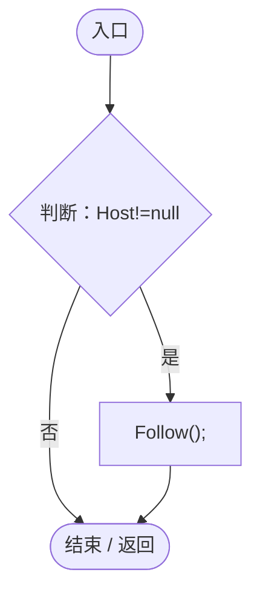

项目内调用/回调引用：

- [ParasiteBehavior.Host.get · L16](ec21ecbd299caaed.md#m854b55763184d078)（访问器）
- [ParasiteBehavior.Follow · L85](ec21ecbd299caaed.md#m773aeb15453932c0)（方法）

<a id="m773aeb15453932c0"></a>

## Follow · L85

`private void Follow()`

★ 适配：宿主跟随可能发生在基因模拟之后，及时同步空间索引。

### Editor / Player · Roslyn编译器控制流

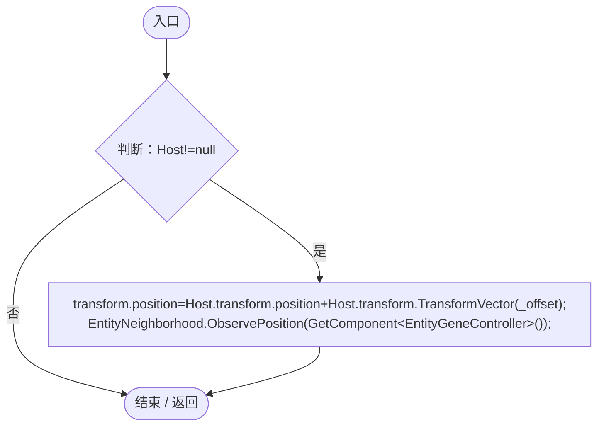

项目内调用/回调引用：

- [ParasiteBehavior.Host.get · L16](ec21ecbd299caaed.md#m854b55763184d078)（访问器）
- [EntityNeighborhood.ObservePosition · L63](e5e24c4aff0395b1.md#m994f4a7ab30bcd1d)（方法）

<a id="m858d10391da0e50c"></a>

## Detach · L86

`public void Detach()`


### Editor / Player · Roslyn编译器控制流

```mermaid
flowchart TD
  b0(["入口"])
  b1["_ignored"]
  b2{"判断：_ignored"}
  b3{"var<br/>判断：pair.parasite!=null"}
  b4{"判断：pair.host!=null"}
  b5["Physics.IgnoreCollision(pair.parasite,pair.host,false);"]
  b6["_ignored"]
  b7["_ignored.Clear();"]
  b8["_renderers"]
  b9{"判断：_renderers"}
  b10{"var<br/>判断：pair.Key!=null"}
  b11["pair.Key.enabled=pair.Value;"]
  b12["_renderers"]
  b13{"_renderers.Clear();<br/>判断：_body!=null"}
  b14{"判断：_attached"}
  b15{"_body.isKinematic=_kinematic;<br/>判断：_body.isKinematic"}
  b16["_body.linearVelocity=Vector3.zero;"]
  b17["_attached=false;<br/>Host=null;<br/>_candidate=null;<br/>_search=0;"]
  b18(["结束 / 返回"])
  b0 --> b1
  b1 --> b2
  b2 -->|"是"| b3
  b2 -->|"否 · 经过finally 6"| b7
  b3 -->|"是"| b4
  b3 -->|"否"| b2
  b4 -->|"是"| b5
  b4 -->|"否"| b2
  b5 --> b2
  b7 --> b8
  b8 --> b9
  b9 -->|"是"| b10
  b9 -->|"否 · 经过finally 12"| b13
  b10 -->|"是"| b11
  b10 -->|"否"| b9
  b11 --> b9
  b13 -->|"是"| b14
  b13 -->|"否"| b17
  b14 -->|"是"| b15
  b14 -->|"否"| b17
  b15 -->|"否"| b16
  b15 -->|"是"| b17
  b16 --> b17
  b17 --> b18
  b2 -. "退出保护区时 finally（示意）" .-> b6
  b9 -. "退出保护区时 finally（示意）" .-> b12

```

项目内调用/回调引用：

- [ParasiteBehavior.Host.set · L16](ec21ecbd299caaed.md#mb11b1f8f75e0ff5c)（访问器）
