# PopulationCharts.cs

[返回总索引](../README.md) · `Runtime` · `Assets/DarwinPark/UI/PopulationCharts.cs`

[源文件](../../../Assets/DarwinPark/UI/PopulationCharts.cs) · 源码校验：`a925eb90617ab910a8f405dea9d4c30d806166af5e12c15c97140b7426d34e04`

方法按源文件位置排列。事件/回调引用不表示立即执行；分支与异常说明见总索引。完整源码与可点击关系图请打开离线手册。

## Genes · L15

`public static List<PopulationChartValue> Genes(string id,bool expressed)`

### Editor / Player · Roslyn编译器控制流

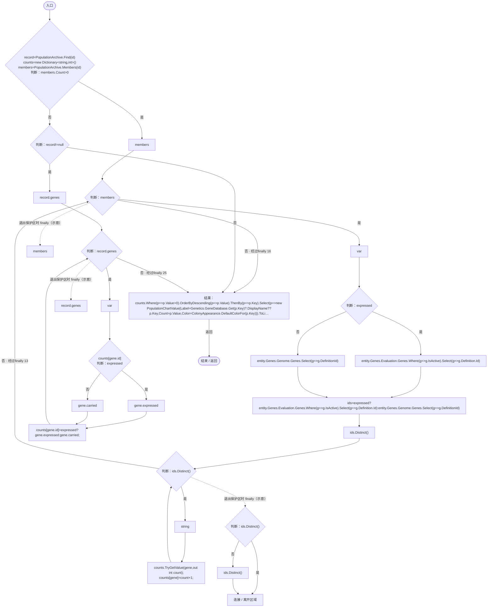

项目内调用/回调引用：

- [PopulationArchive.Find · L49](084e119b69cdd751.md#mf1aef4e3d3c3efca)（方法）
- [PopulationArchive.Members · L67](084e119b69cdd751.md#mdcf18c899b26b92b)（方法）
- [EntityGeneController.Evaluation.get · L18](7494d53178552f0e.md#mc0039c100a31b455)（访问器）
- [DarwinEntity.Genes.get · L14](70798dde169f2e8b.md#m622eb1adf401d431)（访问器）
- [PopulationDistributions.回调@20 · L20](eed554ca8394b767.md#m5b75a728748df70f)（回调/委托）
- [PopulationDistributions.回调@20 · L20](eed554ca8394b767.md#m3040472b0ebede18)（回调/委托）
- [PopulationDistributions.回调@20 · L20](eed554ca8394b767.md#m9d4203e9ff261337)（回调/委托）
- [PopulationDistributions.回调@24 · L24](eed554ca8394b767.md#mc4c2f953fa7e6ae9)（回调/委托）
- [PopulationDistributions.回调@24 · L24](eed554ca8394b767.md#m974f1f82e16a9ac4)（回调/委托）
- [PopulationDistributions.回调@24 · L24](eed554ca8394b767.md#mbf3479ac05629d33)（回调/委托）
- [PopulationDistributions.回调@24 · L24](eed554ca8394b767.md#m13482e984ab07815)（回调/委托）

## 回调@20 · L20

`g … => 回调`

### Editor / Player · Roslyn编译器控制流

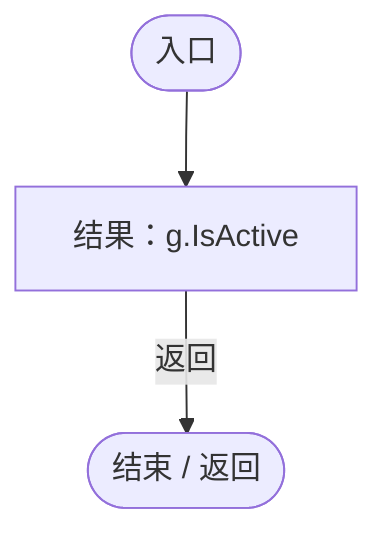

## 回调@20 · L20

`g … => 回调`

### Editor / Player · Roslyn编译器控制流

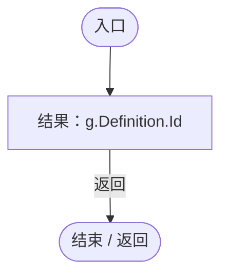

## 回调@20 · L20

`g … => 回调`

### Editor / Player · Roslyn编译器控制流

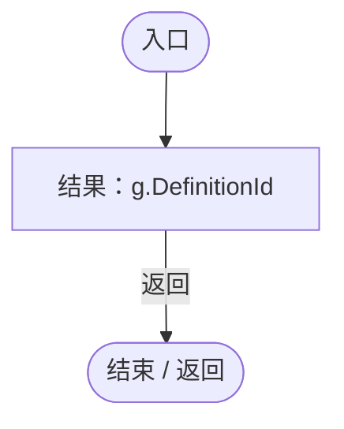

## 回调@24 · L24

`p … => 回调`

### Editor / Player · Roslyn编译器控制流

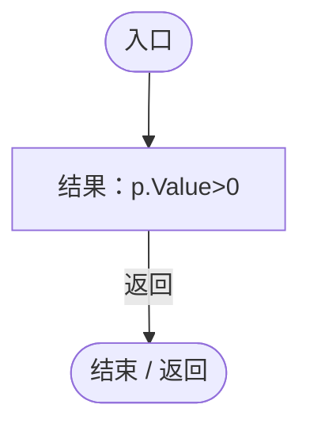

## 回调@24 · L24

`p … => 回调`

### Editor / Player · Roslyn编译器控制流

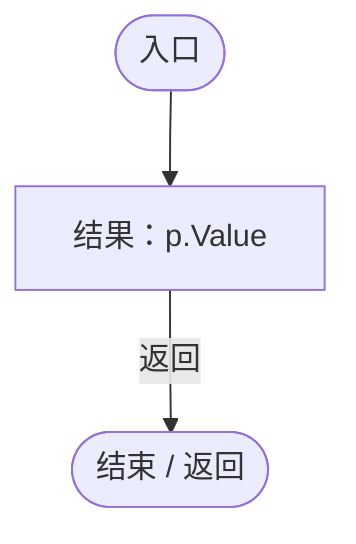

## 回调@24 · L24

`p … => 回调`

### Editor / Player · Roslyn编译器控制流

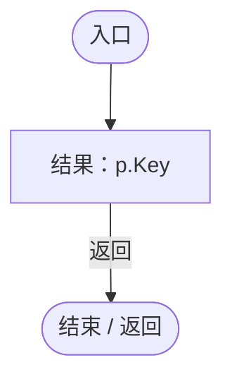

## 回调@24 · L24

`p … => 回调`

### Editor / Player · Roslyn编译器控制流

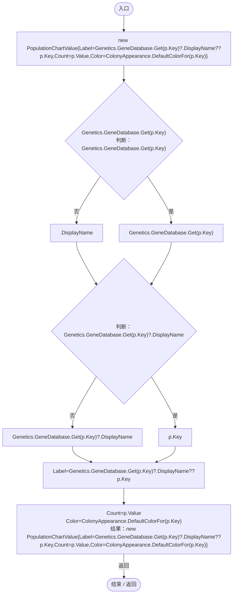

项目内调用/回调引用：

- [GeneDatabase.Get · L135](ec0a03483435a863.md#m8f3bbfb35f3ca397)（方法）
- [ColonyAppearance.DefaultColorFor · L11](e51c7c842d87a26d.md#mcedf0484b3bf132c)（方法）

## Ages · L26

`public static List<PopulationChartValue> Ages(string id)`

### Editor / Player · Roslyn编译器控制流

```mermaid
flowchart TD
  b0(["入口"])
  b1{"record=PopulationArchive.Find(id)<br/>members=PopulationArchive.Members(id)<br/>判断：members.Count&gt;0"}
  b2["infants=members.Count(e=&gt;e.Genes.CurrentAge==AgeState.Infant);<br/>adults=members.Count(e=&gt;e.Genes.CurrentAge==AgeState.Adult);<br/>elders=members.Count-infants-adults;"]
  b3["infants"]
  b4{"record<br/>判断：record"}
  b5[".infants"]
  b6["record"]
  b7{"判断：record?.infants"}
  b8["record?.infants"]
  b9["0"]
  b10["infants=record?.infants??0;"]
  b11["adults"]
  b12{"record<br/>判断：record"}
  b13[".adults"]
  b14["record"]
  b15{"判断：record?.adults"}
  b16["record?.adults"]
  b17["0"]
  b18["adults=record?.adults??0;"]
  b19["elders"]
  b20{"record<br/>判断：record"}
  b21[".elders"]
  b22["record"]
  b23{"判断：record?.elders"}
  b24["record?.elders"]
  b25["0"]
  b26["elders=record?.elders??0;"]
  b27["new List&lt;PopulationChartValue&gt;{new PopulationChartValue{Label=&quot;幼年&quot;,Count=infants,Color=new Color(.3f,.85f,.6f)},new PopulationChartValue{Label=&quot;成年&quot;,Count=adults,Color=new Color(.3f,.65f,1)},new PopulationChartValue{Label=&quot;老年&quot;,Count=elder…"]
  b28["new PopulationChartValue{Label=&quot;幼年&quot;,Count=infants,Color=new Color(.3f,.85f,.6f)}<br/>Label=&quot;幼年&quot;<br/>Count=infants<br/>Color=new Color(.3f,.85f,.6f)"]
  b29["new PopulationChartValue{Label=&quot;成年&quot;,Count=adults,Color=new Color(.3f,.65f,1)}<br/>Label=&quot;成年&quot;<br/>Count=adults<br/>Color=new Color(.3f,.65f,1)"]
  b30["new PopulationChartValue{Label=&quot;老年&quot;,Count=elders,Color=new Color(1,.65f,.3f)}<br/>Label=&quot;老年&quot;<br/>Count=elders<br/>Color=new Color(1,.65f,.3f)"]
  b31["结果：new List&lt;PopulationChartValue&gt;{new PopulationChartValue{Label=&quot;幼年&quot;,Count=infants,Color=new Color(.3f,.85f,.6f)},new PopulationChartValue{Label=&quot;成年&quot;,Count=adults,Color=new Color(.3f,.65f,1)},new PopulationChartValue{Label=&quot;老年&quot;,Count=el…"]
  b32(["结束 / 返回"])
  b0 --> b1
  b1 -->|"是"| b2
  b1 -->|"否"| b3
  b2 --> b27
  b3 --> b4
  b4 -->|"否"| b5
  b4 -->|"是"| b6
  b5 --> b7
  b6 --> b7
  b7 -->|"否"| b8
  b7 -->|"是"| b9
  b8 --> b10
  b9 --> b10
  b10 --> b11
  b11 --> b12
  b12 -->|"否"| b13
  b12 -->|"是"| b14
  b13 --> b15
  b14 --> b15
  b15 -->|"否"| b16
  b15 -->|"是"| b17
  b16 --> b18
  b17 --> b18
  b18 --> b19
  b19 --> b20
  b20 -->|"否"| b21
  b20 -->|"是"| b22
  b21 --> b23
  b22 --> b23
  b23 -->|"否"| b24
  b23 -->|"是"| b25
  b24 --> b26
  b25 --> b26
  b26 --> b27
  b27 --> b28
  b28 --> b29
  b29 --> b30
  b30 --> b31
  b31 -->|"返回"| b32

```

项目内调用/回调引用：

- [PopulationArchive.Find · L49](084e119b69cdd751.md#mf1aef4e3d3c3efca)（方法）
- [PopulationArchive.Members · L67](084e119b69cdd751.md#mdcf18c899b26b92b)（方法）
- [PopulationDistributions.回调@29 · L29](eed554ca8394b767.md#m8a9dd62c392b0c5b)（回调/委托）
- [PopulationDistributions.回调@29 · L29](eed554ca8394b767.md#mfe9ad15b91d35686)（回调/委托）

## 回调@29 · L29

`e … => 回调`

### Editor / Player · Roslyn编译器控制流

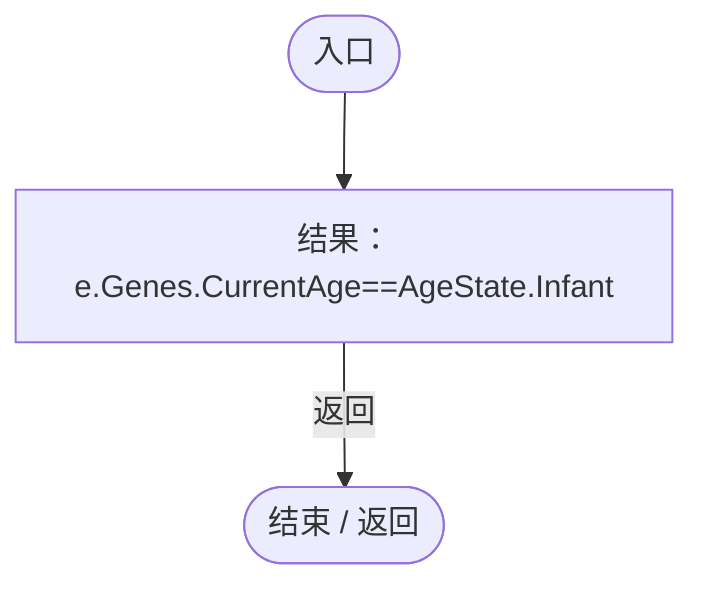

项目内调用/回调引用：

- [EntityGeneController.CurrentAge.get · L34](7494d53178552f0e.md#m83a42c16950b22a4)（访问器）
- [DarwinEntity.Genes.get · L14](70798dde169f2e8b.md#m622eb1adf401d431)（访问器）

## 回调@29 · L29

`e … => 回调`

### Editor / Player · Roslyn编译器控制流

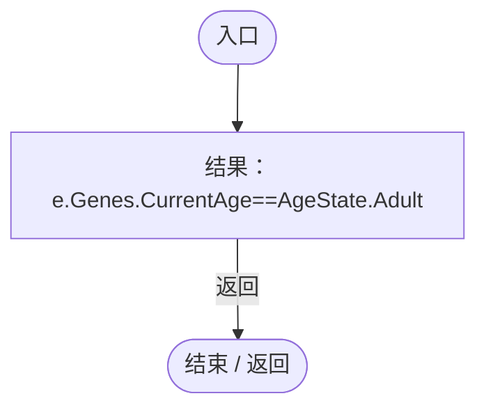

项目内调用/回调引用：

- [EntityGeneController.CurrentAge.get · L34](7494d53178552f0e.md#m83a42c16950b22a4)（访问器）
- [DarwinEntity.Genes.get · L14](70798dde169f2e8b.md#m622eb1adf401d431)（访问器）

## Draw · L38

`public void Draw(Rect area,IReadOnlyList<PopulationChartValue> values,bool pie,float labelWidth=140)`

### Editor / Player · Roslyn编译器控制流

```mermaid
flowchart TD
  b0(["入口"])
  b1{"判断：values.Sum(v=&gt;v.Count)==0"}
  b2["GUI.Label(area,&quot;暂无可统计数据&quot;);"]
  b3{"判断：pie"}
  b4{"signature=string.Join(&quot;&#124;&quot;,values.Select(v=&gt;v.Label+&quot;:&quot;+v.Count+&quot;:&quot;+v.Color))<br/>判断：_pie==null"}
  b5{"判断：_signature!=signature"}
  b6["BuildPie(values);<br/>_signature=signature;"]
  b7["side=Mathf.Min(area.width,area.height)<br/>GUI.DrawTexture(new Rect(area.x+(area.width-side)/2,area.y,side,side),_pie,ScaleMode.ScaleToFit,true);"]
  b8["labelWidth=Mathf.Min(labelWidth,Mathf.Max(0,area.width-100));<br/>maximum=Mathf.Max(1,values.Max(v=&gt;v.Count))<br/>row=Mathf.Max(22,Mathf.Min(32,area.height/values.Count))"]
  b9["i=0"]
  b10{"判断：i&lt;values.Count"}
  b11["value=values[i]<br/>y=area.y+i*row<br/>GUI.Label(new Rect(area.x,y,labelWidth,row),value.Label);<br/>old=GUI.color<br/>GUI.color=value.Color;<br/>GUI.DrawTexture(new Rect(area.x+labelWidth+5,y+5,Mathf.Max(1,(area.width-labelWidth-65)*value.Count/maximum),ro…"]
  b12["i++"]
  b13(["结束 / 返回"])
  b0 --> b1
  b1 -->|"是"| b2
  b1 -->|"否"| b3
  b2 --> b13
  b3 -->|"是"| b4
  b3 -->|"否"| b8
  b4 -->|"否"| b5
  b4 -->|"是"| b6
  b5 -->|"是"| b6
  b5 -->|"否"| b7
  b6 --> b7
  b7 --> b13
  b8 --> b9
  b9 --> b10
  b10 -->|"是"| b11
  b10 -->|"否"| b13
  b11 --> b12
  b12 --> b10

```

项目内调用/回调引用：

- [PopulationCharts.BuildPie · L57](eed554ca8394b767.md#mfc276366fae21a91)（方法）
- [PopulationCharts.回调@40 · L40](eed554ca8394b767.md#me12813fa2eb39490)（回调/委托）
- [PopulationCharts.回调@43 · L43](eed554ca8394b767.md#mf79975cd5136af3d)（回调/委托）
- [PopulationCharts.回调@49 · L49](eed554ca8394b767.md#m0ba966862f8eff8d)（回调/委托）

## 回调@40 · L40

`v … => 回调`

### Editor / Player · Roslyn编译器控制流

## 回调@43 · L43

`v … => 回调`

### Editor / Player · Roslyn编译器控制流

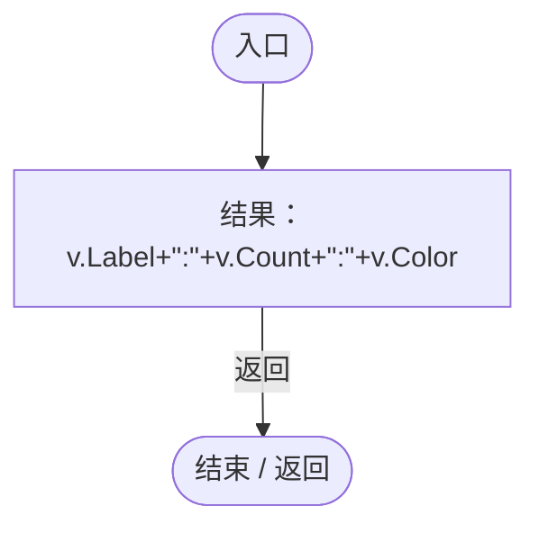

## 回调@49 · L49

`v … => 回调`

### Editor / Player · Roslyn编译器控制流

## BuildPie · L57

`private void BuildPie(IReadOnlyList<PopulationChartValue> values)`

### Editor / Player · Roslyn编译器控制流

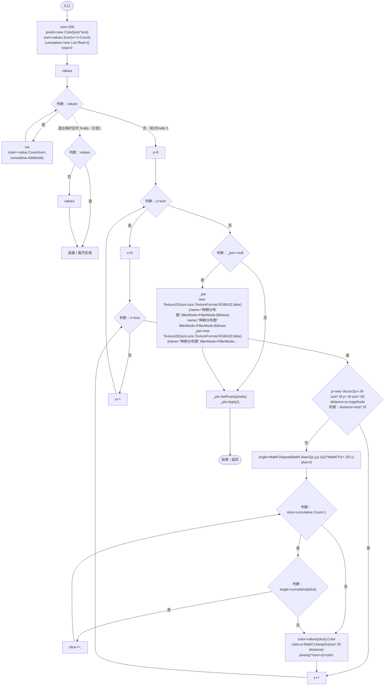

项目内调用/回调引用：

- [PopulationCharts.回调@59 · L59](eed554ca8394b767.md#m572617a400842202)（回调/委托）

## 回调@59 · L59

`v … => 回调`

### Editor / Player · Roslyn编译器控制流

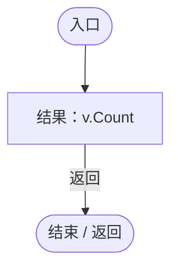

## Dispose · L69

`public void Dispose()`

### Editor / Player · Roslyn编译器控制流

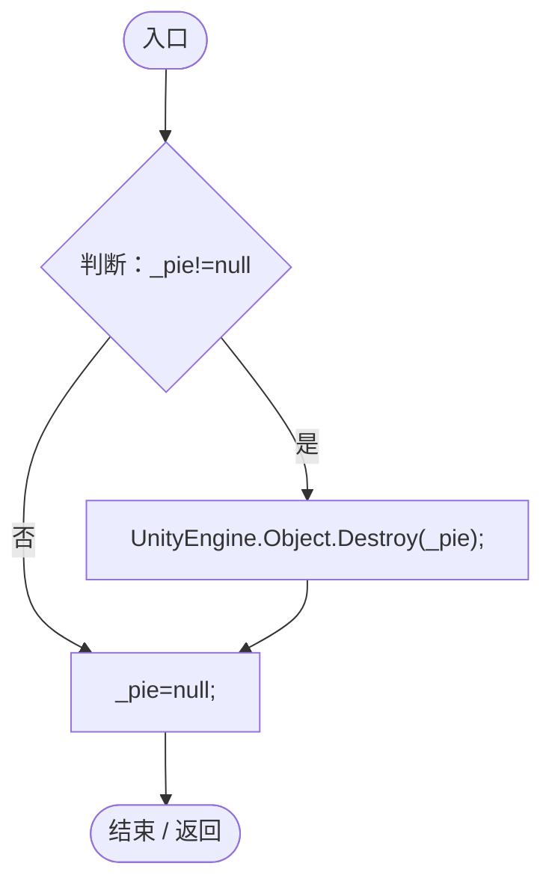
