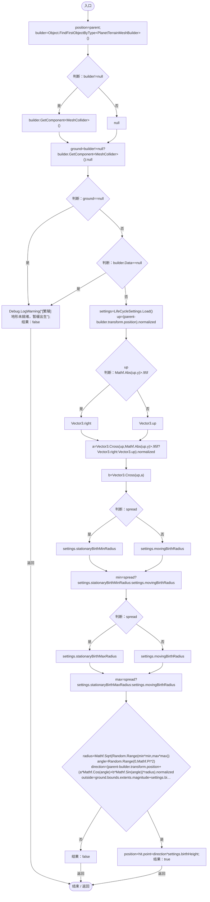

# OffspringPlacement.cs

[返回总索引](../README.md) · `Runtime` · `Assets/DarwinPark/Entities/OffspringPlacement.cs`

[源文件](../../../Assets/DarwinPark/Entities/OffspringPlacement.cs) · 源码校验：`b8b729db0f39224194e4c412f061a403e41176f6ae2ed8fbbe24fd4d6a464738`

方法按源文件位置排列。事件/回调引用不表示立即执行；分支与异常说明见总索引。完整源码与可点击关系图请打开离线手册。

## TryGetPosition · L9

`public static bool TryGetPosition(Vector3 parent,bool spread,out Vector3 position)`

### Editor / Player · Roslyn编译器控制流

项目内调用/回调引用：

- [PlanetTerrainMeshBuilder.Data.get · L78](415285cf043354a9.md#m8382f579717fbc6d)（访问器）
- [LifeCycleSettings.Load · L16](ace76969fe8f61de.md#mbd2925785484f343)（方法）
