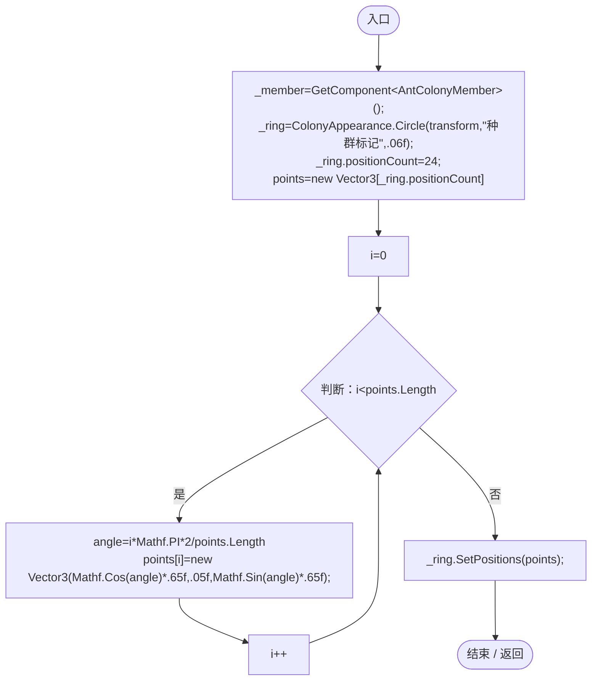
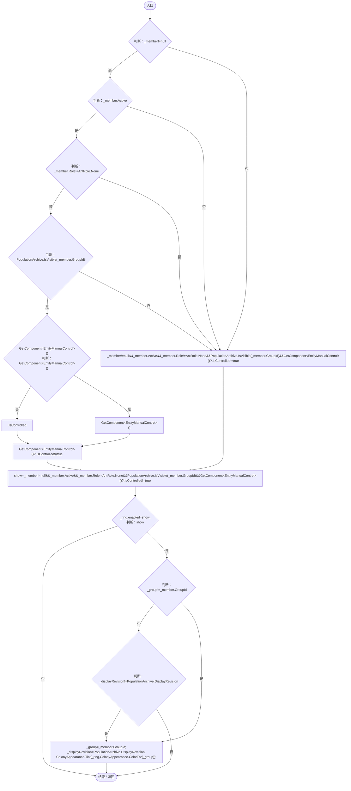
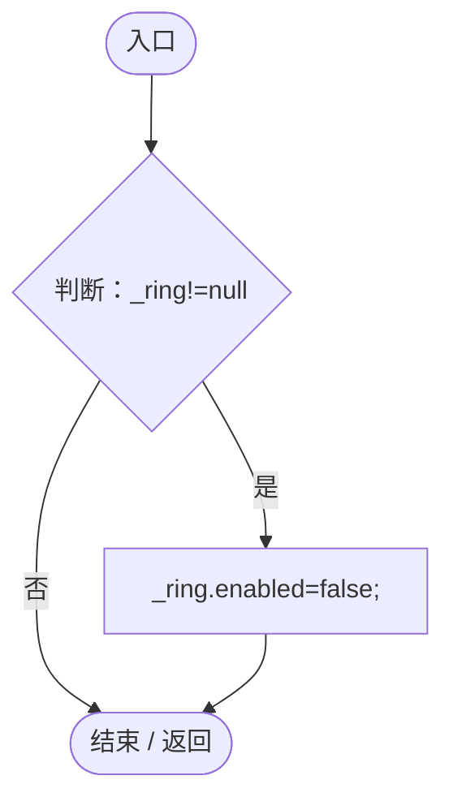

# ColonyMemberMarker.cs

[返回总索引](../README.md) · `Runtime` · `Assets/DarwinPark/Entities/Ecology/ColonyMemberMarker.cs`

[源文件](../../../Assets/DarwinPark/Entities/Ecology/ColonyMemberMarker.cs) · 源码校验：`0b8cbb6a3c685cf1b54b6f7674d2ca5b144df5beca644b2c5b6dcf151640b9fa`

方法按源文件位置排列。事件/回调引用不表示立即执行；分支与异常说明见总索引。完整源码与可点击关系图请打开离线手册。

## Awake · L11

`private void Awake()`

### Editor / Player · Roslyn编译器控制流

项目内调用/回调引用：

- [ColonyAppearance.Circle · L19](e51c7c842d87a26d.md#m944f582dc511e626)（方法）

## LateUpdate · L17

`private void LateUpdate()`

### Editor / Player · Roslyn编译器控制流

项目内调用/回调引用：

- [AntColonyMember.Role.get · L33](baebd85c05598377.md#mdf6df89f7116c7a3)（访问器）
- [PopulationArchive.IsVisible · L109](084e119b69cdd751.md#m452bdf5931b09c11)（方法）
- [EntityManualControl.IsControlled.get · L12](a6969896da35e1f0.md#m125d8f7da7ab33bf)（访问器）
- [PopulationArchive.DisplayRevision.get · L46](084e119b69cdd751.md#m52d7e8d0a842a0c3)（访问器）
- [ColonyAppearance.Tint · L14](e51c7c842d87a26d.md#mf0584eef05092701)（方法）
- [ColonyAppearance.ColorFor · L9](e51c7c842d87a26d.md#m0ea090c43edf8334)（方法）

## OnDisable · L23

`private void OnDisable()`

### Editor / Player · Roslyn编译器控制流

