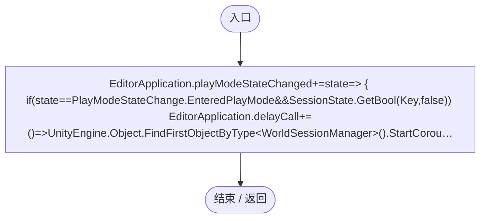
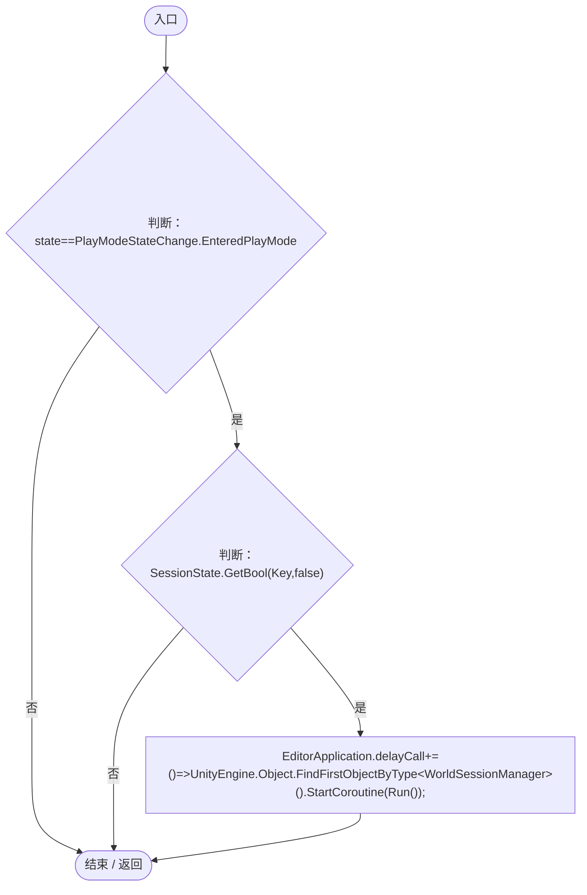
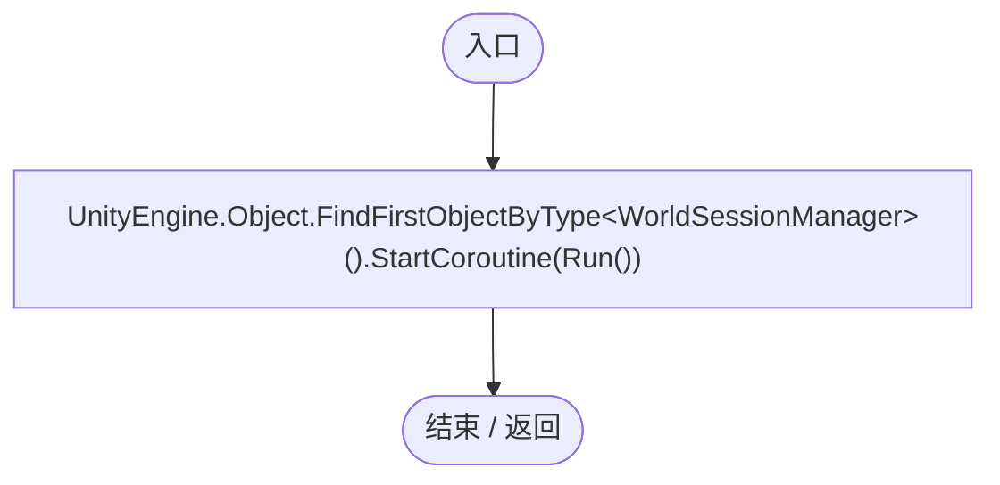
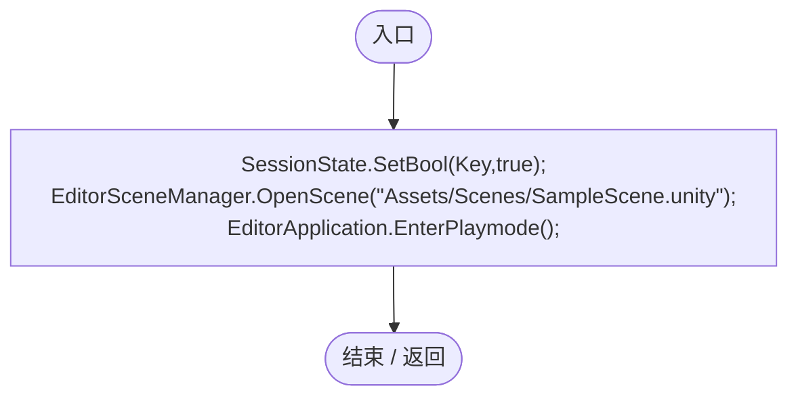
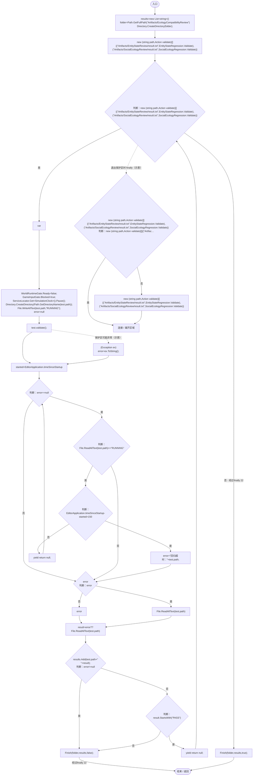
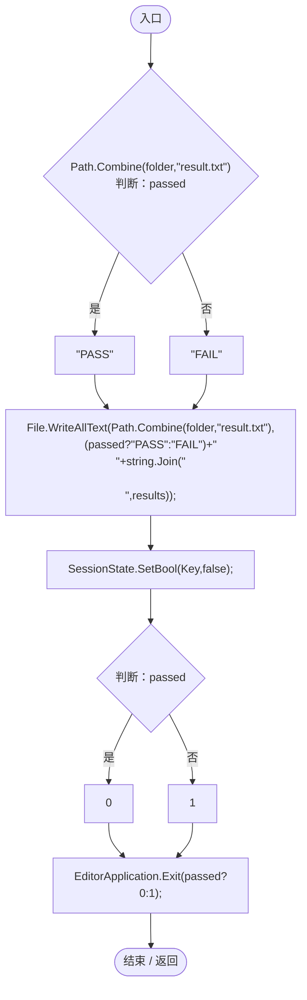

# EcologyCompatibilityBatch.cs

[返回总索引](../README.md) · `Editor` · `Assets/DarwinPark/Editor/EcologyCompatibilityBatch.cs`

[源文件](../../../Assets/DarwinPark/Editor/EcologyCompatibilityBatch.cs) · 源码校验：`c20437955d1a3f2bab20479aae3313ba449c31236a9afe09e89acecd1f83b01f`

方法按源文件位置排列。事件/回调引用不表示立即执行；分支与异常说明见总索引。完整源码与可点击关系图请打开离线手册。

## EcologyCompatibilityBatch.ctor · L18

`static EcologyCompatibilityBatch()`

### Editor · Roslyn编译器控制流

项目内调用/回调引用：

- [EcologyCompatibilityBatch.回调@20 · L20](f06a5e7cb329977c.md#m7db6122683076ac5)（回调/委托）

## 回调@20 · L20

`state … => 回调`

### Editor · Roslyn编译器控制流

项目内调用/回调引用：

- [EcologyCompatibilityBatch.回调@23 · L23](f06a5e7cb329977c.md#m81772d5924eab9f4)（回调/委托）

## 回调@23 · L23

`( … => 回调`

### Editor · Roslyn编译器控制流

项目内调用/回调引用：

- [EcologyCompatibilityBatch.Run · L30](f06a5e7cb329977c.md#m5f62acc5c452d7a3)（方法）

## RunBatch · L26

`public static void RunBatch()`

### Editor · Roslyn编译器控制流

## Run · L30

`private static IEnumerator Run()`

### Editor · Roslyn编译器控制流

项目内调用/回调引用：

- [GameInputGate.Blocked.set · L8](52955daae7e592ab.md#m578697f6379686f4)（访问器）
- [SimulationClock.Pause · L79](a8f444aec9614b0a.md#m30929d45a885d0f1)（方法）
- [ServiceLocator.Get · L33](f2fdbe9f9ccd93cb.md#m2ae625299520c56d)（方法）
- [EcologyCompatibilityBatch.Finish · L50](f06a5e7cb329977c.md#m24c27792cd932354)（方法）
- [EntityStateRegression.Validate · L35](cbb314f2877cdcfa.md#m3b72bea1a79f877c)（方法）
- [SocialEcologyRegression.Validate · L40](217494895b1b18ec.md#m1d3596c41e5076f1)（方法）

## Finish · L50

`private static void Finish(string folder,List<string> results,bool passed)`

### Editor · Roslyn编译器控制流

