# ColonyFeedingLiveRegression.cs

[返回总索引](../README.md) · `Editor` · `Assets/DarwinPark/Editor/ColonyFeedingLiveRegression.cs`

[源文件](../../../Assets/DarwinPark/Editor/ColonyFeedingLiveRegression.cs) · 源码校验：`afcd837bde1600991258b21e2f4656a5c54f24a4a4083d7ca47cef2d66c07b0e`

方法按源文件位置排列。事件/回调引用不表示立即执行；分支与异常说明见总索引。完整源码与可点击关系图请打开离线手册。

## Folder.get · L25

`private static string Folder`

### Editor · 语法控制结构 / 声明（非CFG）

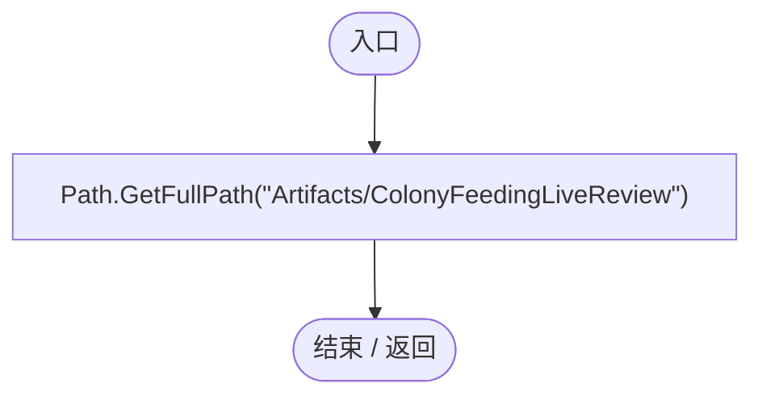

## ColonyFeedingLiveRegression.ctor · L26

`static ColonyFeedingLiveRegression()`

### Editor · Roslyn编译器控制流

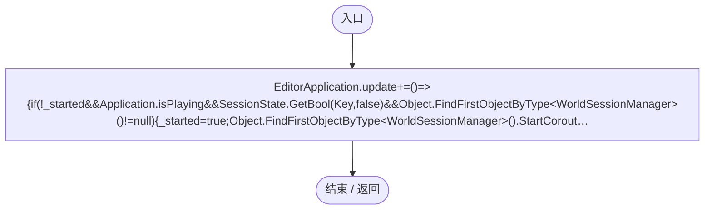

项目内调用/回调引用：

- [ColonyFeedingLiveRegression.回调@26 · L26](f0f27807f77705fe.md#m303f44f9e667381a)（回调/委托）

## 回调@26 · L26

`( … => 回调`

### Editor · Roslyn编译器控制流

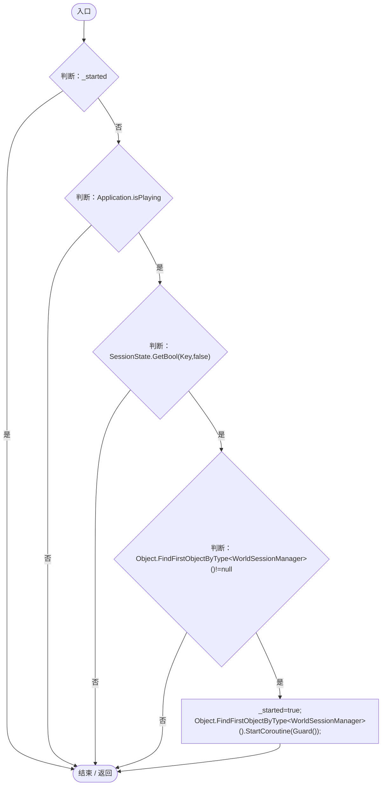

项目内调用/回调引用：

- [ColonyFeedingLiveRegression.Guard · L35](f0f27807f77705fe.md#mf27e60cf0fb4fd2a)（方法）

## RunBatch · L27

`public static void RunBatch()`

### Editor · Roslyn编译器控制流

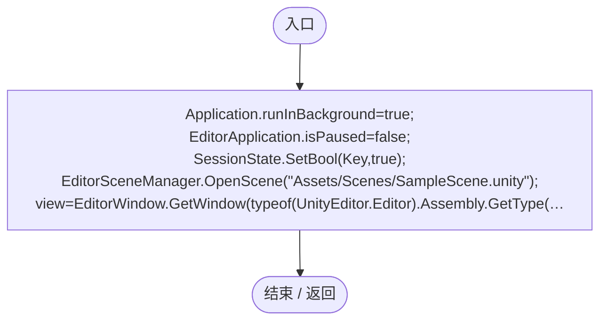

## Check · L33

`private static void Check(bool condition,string message)`

### Editor · Roslyn编译器控制流

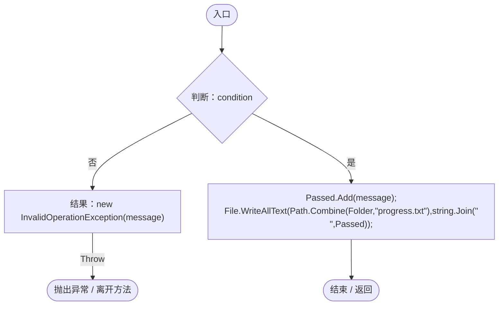

## Food · L34

`private static float Food(AntColonyMember member)`

### Editor · Roslyn编译器控制流

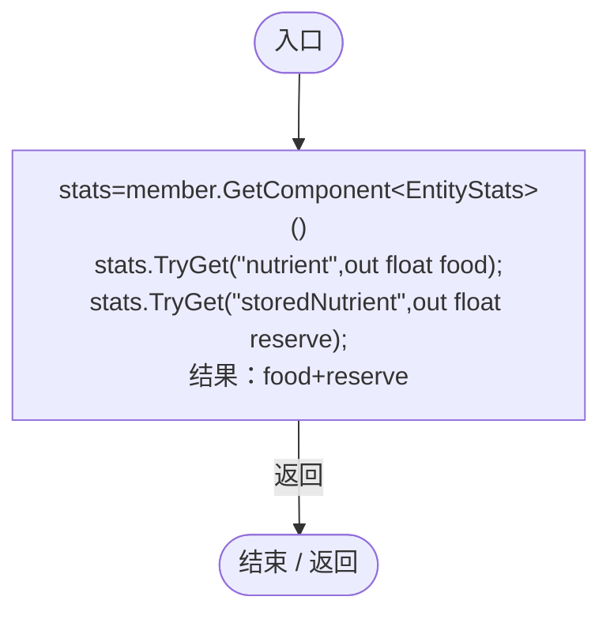

项目内调用/回调引用：

- [EntityStats.TryGet · L90](75aa86a368efdf24.md#m24ee1433e4a70d94)（方法）

## Guard · L35

`private static IEnumerator Guard()`

### Editor · Roslyn编译器控制流

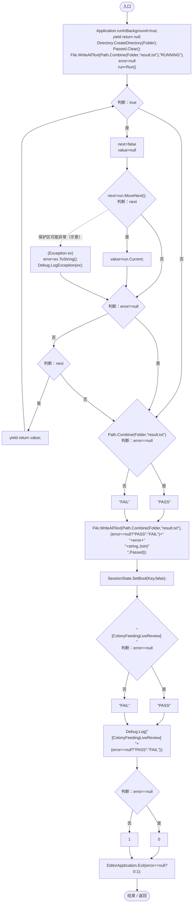

项目内调用/回调引用：

- [ColonyFeedingLiveRegression.Run · L43](f0f27807f77705fe.md#m5294f76a487724bc)（方法）

## Run · L43

`private static IEnumerator Run()`

### Editor · Roslyn编译器控制流

```mermaid
flowchart TD
  b0(["入口"])
  b1["session=Object.FindFirstObjectByType&lt;WorldSessionManager&gt;()<br/>clock=ServiceLocator.Get&lt;SimulationClock&gt;()<br/>data=WorldSaveStore.Read(Path.Combine(Folder,&quot;repro-world.json&quot;))<br/>data.id=Guid.NewGuid().ToString(&quot;N&quot;);<br/>data.name=&quot;废弃补给与操控独立验证&quot;;<br/>data…"]
  b2{"判断：session.Busy"}
  b3{"判断：EditorApplication.timeSinceStartup-start&gt;180"}
  b4["结果：new TimeoutException(session.Status)"]
  x4(["抛出异常 / 离开方法"])
  b5["yield return null;"]
  b6["Check(session.Current!=null,&quot;真实存档完整地形与实体加载成功&quot;);<br/>clock.Pause();<br/>queen=AntColonyMember.All.Single(m=&gt;m.Role==AntRole.Queen)<br/>child=queen.Group.Single(m=&gt;m.Young)"]
  b7["EntityRegistry.All"]
  b8{"判断：EntityRegistry.All"}
  b9["var<br/>entity.Genes.mutationChance=0;"]
  b10{"判断：EntityRegistry.All"}
  b11["EntityRegistry.All"]
  b12["连接 / 离开区域"]
  b13["queenId=queen.Id<br/>childId=child.Id<br/>original=queen.transform.position"]
  b14{"判断：Food(queen)==0"}
  b15["Food(child)==0"]
  b16["Food(queen)==0"]
  b17["Check(Food(queen)==0&amp;&amp;Food(child)==0,&quot;复现王后和幼体均无营养的存档状态&quot;);"]
  b18["abandoned=ColonyFeeding.Find(queen,false)"]
  b19{"判断：abandoned!=null"}
  b20{"判断：abandoned.State.group!=queen.GroupId"}
  b21["!ColonyResourceOwnership.HasOwner(abandoned.State.group)"]
  b22["abandoned!=null&amp;&amp;abandoned.State.group!=queen.GroupId&amp;&amp;!ColonyResourceOwnership.HasOwner(abandoned.State.group)"]
  b23["Check(abandoned!=null&amp;&amp;abandoned.State.group!=queen.GroupId&amp;&amp;!ColonyResourceOwnership.HasOwner(abandoned.State.group),&quot;复现旧群灭绝、能量仍锁在旧群的归属问题&quot;);"]
  b24["queen.Destination(out var destination,out var target,out _);"]
  b25{"判断：target==null"}
  b26["EcologyQueries.Distance(destination,abandoned.transform.position)&lt;=AntColonySettings.Current.feedRadius"]
  b27["target==null"]
  b28["Check(target==null&amp;&amp;EcologyQueries.Distance(destination,abandoned.transform.position)&lt;=AntColonySettings.Current.feedRadius,&quot;饥饿王后的实际目的地指向废弃育幼块&quot;);"]
  b29["resourceState=abandoned.State<br/>resourcePoint=abandoned.transform.position<br/>beforeEnergy=resourceState.energy<br/>clock.SetTimeScale(4);<br/>clock.Play();<br/>before=clock.GameTime<br/>start=EditorApplication.timeSinceStartup;<br/>report=0"]
  b30{"判断：queen!=null"}
  b31{"判断：child!=null"}
  b32{"判断：Food(queen)&lt;=0"}
  b33{"判断：Food(child)&lt;=0"}
  b34{"判断：resourceState.group!=queen.GroupId"}
  b35{"判断：resourceState.energy&gt;=beforeEnergy"}
  b36{"判断：clock.GameTime-before&gt;=report"}
  b37["report+=5;<br/>Debug.Log(&quot;[LiveFeeding] t=&quot;+(clock.GameTime-before)+&quot; food=&quot;+Food(queen)+&quot; child=&quot;+Food(child)+&quot; distance=&quot;+EcologyQueries.Distance(queen.transform.position,resourcePoint)+&quot; speed=&quot;+queen.Genes.GetAttribute(&quot;moveSpeed&quot;)+&quot; act…"]
  b38{"判断：clock.GameTime-before&gt;100"}
  b39{"判断：EditorApplication.timeSinceStartup-start&gt;50"}
  b40{"&quot;实际进食未完成：queen=&quot;<br/>判断：queen!=null"}
  b41["Food(queen)"]
  b42["-1"]
  b43["&quot;实际进食未完成：queen=&quot;+(queen!=null?Food(queen):-1)+&quot; child=&quot;"]
  b44{"判断：child!=null"}
  b45["Food(child)"]
  b46["-1"]
  b47["&quot;实际进食未完成：queen=&quot;+(queen!=null?Food(queen):-1)+&quot; child=&quot;+(child!=null?Food(child):-1)+&quot; distance=&quot;"]
  b48{"判断：queen!=null"}
  b49["EcologyQueries.Distance(queen.transform.position,resourcePoint)"]
  b50["-1"]
  b51["&quot;实际进食未完成：queen=&quot;+(queen!=null?Food(queen):-1)+&quot; child=&quot;+(child!=null?Food(child):-1)+&quot; distance=&quot;+(queen!=null?EcologyQueries.Distance(queen.transform.position,resourcePoint):-1)+&quot; speed=&quot;"]
  b52{"判断：queen!=null"}
  b53["queen.Genes.GetAttribute(&quot;moveSpeed&quot;)"]
  b54["-1"]
  b55["结果：new TimeoutException(&quot;实际进食未完成：queen=&quot;+(queen!=null?Food(queen):-1)+&quot; child=&quot;+(child!=null?Food(child):-1)+&quot; distance=&quot;+(queen!=null?EcologyQueries.Distance(queen.transform.position,resourcePoint):-1)+&quot; speed=&quot;+(queen!=null?queen.Genes…"]
  x55(["抛出异常 / 离开方法"])
  b56["yield return null;"]
  b57["clock.Pause();"]
  b58{"判断：queen!=null"}
  b59{"判断：child!=null"}
  b60{"判断：Food(queen)&gt;0"}
  b61["Food(child)&gt;0"]
  b62["queen!=null&amp;&amp;child!=null&amp;&amp;Food(queen)&gt;0&amp;&amp;Food(child)&gt;0"]
  b63["Check(queen!=null&amp;&amp;child!=null&amp;&amp;Food(queen)&gt;0&amp;&amp;Food(child)&gt;0,&quot;完整更新和物理步中王后与幼体自主进食且存活&quot;);"]
  b64{"判断：EcologyQueries.Distance(original,queen.transform.position)&gt;.2f"}
  b65["resourceState.energy&lt;beforeEnergy"]
  b66["EcologyQueries.Distance(original,queen.transform.position)&gt;.2f"]
  b67["Check(EcologyQueries.Distance(original,queen.transform.position)&gt;.2f&amp;&amp;resourceState.energy&lt;beforeEnergy,&quot;王后实际移动接近能量块且能量被扣除&quot;);"]
  b68["Check(resourceState.group==queen.GroupId,&quot;废弃块在实际进食后归入新群&quot;);<br/>view=EntityViewController.Instance<br/>Check(view.EnterView(queen.Entity),&quot;双击操控的实际入口可进入王后视角&quot;);<br/>yield return null;<br/>input=view.GetComponent&lt;EntityPossessionInput&gt;()<br/>hotkey=Object.FindF…"]
  b69{"判断：hotkey.HandlePauseKey(KeyCode.P,true,false)"}
  b70["clock.IsRunning"]
  b71["hotkey.HandlePauseKey(KeyCode.P,true,false)"]
  b72["Check(hotkey.HandlePauseKey(KeyCode.P,true,false)&amp;&amp;clock.IsRunning,&quot;操控中P可启动&quot;);"]
  b73{"判断：hotkey.HandlePauseKey(KeyCode.Space,true,false)"}
  b74["clock.IsRunning"]
  b75["!hotkey.HandlePauseKey(KeyCode.Space,true,false)"]
  b76["Check(!hotkey.HandlePauseKey(KeyCode.Space,true,false)&amp;&amp;clock.IsRunning,&quot;操控中空格只保留跳跃不切换暂停&quot;);"]
  b77{"判断：hotkey.HandlePauseKey(KeyCode.P,true,false)"}
  b78["!clock.IsRunning"]
  b79["hotkey.HandlePauseKey(KeyCode.P,true,false)"]
  b80["Check(hotkey.HandlePauseKey(KeyCode.P,true,false)&amp;&amp;!clock.IsRunning,&quot;操控中P可暂停&quot;);"]
  b81["yield return null;<br/>Check(view.Target==queen.Entity,&quot;P暂停保留操控目标&quot;);"]
  b82{"判断：hotkey.HandlePauseKey(KeyCode.P,true,true)"}
  b83["!clock.IsRunning"]
  b84["!hotkey.HandlePauseKey(KeyCode.P,true,true)"]
  b85["Check(!hotkey.HandlePauseKey(KeyCode.P,true,true)&amp;&amp;!clock.IsRunning,&quot;输入框输入P不会启动模拟&quot;);"]
  b86["utilization=NutrientUtilizationRegression.Verify(Check)"]
  b87{"判断：utilization.MoveNext()"}
  b88["yield return utilization.Current;"]
  b89["input.Suspend();<br/>Canvas.ForceUpdateCanvases();<br/>yield return new WaitForEndOfFrame();<br/>ScreenCapture.CaptureScreenshot(Path.Combine(Folder,&quot;possession-controls.png&quot;));<br/>yield return null;<br/>view.ExitView();<br/>session.SaveNow(false);<br/>saved=World…"]
  b90{"判断：session.Busy"}
  b91{"判断：EditorApplication.timeSinceStartup-start&gt;180"}
  b92["结果：new TimeoutException(session.Status)"]
  x92(["抛出异常 / 离开方法"])
  b93["yield return null;"]
  b94["clock.Pause();<br/>queen=AntColonyMember.All.Single(m=&gt;m.Id==queenId);<br/>child=AntColonyMember.All.Single(m=&gt;m.Id==childId);"]
  b95{"判断：Mathf.Abs(ColonyResource.All.Sum(r=&gt;r.State.energy)-savedEnergy)&lt;.01f"}
  b96{"判断：Food(queen)&gt;0"}
  b97["Food(child)&gt;0"]
  b98["Mathf.Abs(ColonyResource.All.Sum(r=&gt;r.State.energy)-savedEnergy)&lt;.01f&amp;&amp;Food(queen)&gt;0&amp;&amp;Food(child)&gt;0"]
  b99["Check(Mathf.Abs(ColonyResource.All.Sum(r=&gt;r.State.energy)-savedEnergy)&lt;.01f&amp;&amp;Food(queen)&gt;0&amp;&amp;Food(child)&gt;0,&quot;重新读档保留回收归属、新增能量和已进食状态&quot;);"]
  b100["restored=EcologyIdentity.Find(NutrientUtilizationRegression.ActorId)"]
  b101{"判断：restored!=null"}
  b102{"restored.GetComponent&lt;EnergyBlockMetabolism&gt;()<br/>判断：restored.GetComponent&lt;EnergyBlockMetabolism&gt;()"}
  b103[".Active"]
  b104["restored.GetComponent&lt;EnergyBlockMetabolism&gt;()"]
  b105{"判断：restored.GetComponent&lt;EnergyBlockMetabolism&gt;()?.Active==true"}
  b106["ColonyResource.All.Any(r=&gt;r.State.kind==ColonyResourceKind.Energy)"]
  b107["restored!=null&amp;&amp;restored.GetComponent&lt;EnergyBlockMetabolism&gt;()?.Active==true&amp;&amp;ColonyResource.All.Any(r=&gt;r.State.kind==ColonyResourceKind.Energy)"]
  b108["Check(restored!=null&amp;&amp;restored.GetComponent&lt;EnergyBlockMetabolism&gt;()?.Active==true&amp;&amp;ColonyResource.All.Any(r=&gt;r.State.kind==ColonyResourceKind.Energy),&quot;独立营养利用基因与Q吐出的通用能量块均可读档恢复&quot;);"]
  b109["menu=Object.FindFirstObjectByType&lt;GameMainMenu&gt;()<br/>menu.ShowPause();<br/>menu.ReturnToMainMenu();<br/>yield return null;"]
  b110(["结束 / 返回"])
  b0 --> b1
  b1 --> b2
  b2 -->|"是"| b3
  b2 -->|"否"| b6
  b3 -->|"是"| b4
  b3 -->|"否"| b5
  b4 -->|"Throw"| x4
  b5 --> b2
  b6 --> b7
  b7 --> b8
  b8 -->|"是"| b9
  b8 -->|"否 · 经过finally 10"| b13
  b9 --> b8
  b10 -->|"否"| b11
  b10 -->|"是"| b12
  b11 --> b12
  b13 --> b14
  b14 -->|"是"| b15
  b14 -->|"否"| b16
  b15 --> b17
  b16 --> b17
  b17 --> b18
  b18 --> b19
  b19 -->|"是"| b20
  b19 -->|"否"| b22
  b20 -->|"是"| b21
  b20 -->|"否"| b22
  b21 --> b23
  b22 --> b23
  b23 --> b24
  b24 --> b25
  b25 -->|"是"| b26
  b25 -->|"否"| b27
  b26 --> b28
  b27 --> b28
  b28 --> b29
  b29 --> b30
  b30 -->|"是"| b31
  b30 -->|"否"| b57
  b31 -->|"是"| b32
  b31 -->|"否"| b57
  b32 -->|"否"| b33
  b32 -->|"是"| b36
  b33 -->|"否"| b34
  b33 -->|"是"| b36
  b34 -->|"否"| b35
  b34 -->|"是"| b36
  b35 -->|"是"| b36
  b35 -->|"否"| b57
  b36 -->|"是"| b37
  b36 -->|"否"| b38
  b37 --> b38
  b38 -->|"否"| b39
  b38 -->|"是"| b40
  b39 -->|"是"| b40
  b39 -->|"否"| b56
  b40 -->|"是"| b41
  b40 -->|"否"| b42
  b41 --> b43
  b42 --> b43
  b43 --> b44
  b44 -->|"是"| b45
  b44 -->|"否"| b46
  b45 --> b47
  b46 --> b47
  b47 --> b48
  b48 -->|"是"| b49
  b48 -->|"否"| b50
  b49 --> b51
  b50 --> b51
  b51 --> b52
  b52 -->|"是"| b53
  b52 -->|"否"| b54
  b53 --> b55
  b54 --> b55
  b55 -->|"Throw"| x55
  b56 --> b30
  b57 --> b58
  b58 -->|"是"| b59
  b58 -->|"否"| b62
  b59 -->|"是"| b60
  b59 -->|"否"| b62
  b60 -->|"是"| b61
  b60 -->|"否"| b62
  b61 --> b63
  b62 --> b63
  b63 --> b64
  b64 -->|"是"| b65
  b64 -->|"否"| b66
  b65 --> b67
  b66 --> b67
  b67 --> b68
  b68 --> b69
  b69 -->|"是"| b70
  b69 -->|"否"| b71
  b70 --> b72
  b71 --> b72
  b72 --> b73
  b73 -->|"否"| b74
  b73 -->|"是"| b75
  b74 --> b76
  b75 --> b76
  b76 --> b77
  b77 -->|"是"| b78
  b77 -->|"否"| b79
  b78 --> b80
  b79 --> b80
  b80 --> b81
  b81 --> b82
  b82 -->|"否"| b83
  b82 -->|"是"| b84
  b83 --> b85
  b84 --> b85
  b85 --> b86
  b86 --> b87
  b87 -->|"是"| b88
  b87 -->|"否"| b89
  b88 --> b87
  b89 --> b90
  b90 -->|"是"| b91
  b90 -->|"否"| b94
  b91 -->|"是"| b92
  b91 -->|"否"| b93
  b92 -->|"Throw"| x92
  b93 --> b90
  b94 --> b95
  b95 -->|"是"| b96
  b95 -->|"否"| b98
  b96 -->|"是"| b97
  b96 -->|"否"| b98
  b97 --> b99
  b98 --> b99
  b99 --> b100
  b100 --> b101
  b101 -->|"是"| b102
  b101 -->|"否"| b107
  b102 -->|"否"| b103
  b102 -->|"是"| b104
  b103 --> b105
  b104 --> b105
  b105 -->|"是"| b106
  b105 -->|"否"| b107
  b106 --> b108
  b107 --> b108
  b108 --> b109
  b109 --> b110
  b8 -. "退出保护区时 finally（示意）" .-> b10

```

项目内调用/回调引用：

- [ServiceLocator.Get · L33](f2fdbe9f9ccd93cb.md#m2ae625299520c56d)（方法）
- [WorldSaveStore.Read · L72](d67a35e5e3814c15.md#mca362c7675a5800c)（方法）
- [WorldSessionManager.Open · L58](08741c7b7b9d9344.md#m0a8e69a8a4fbc512)（方法）
- [WorldSessionManager.Busy.get · L24](08741c7b7b9d9344.md#m4483e2e4f28f7c85)（访问器）
- [WorldSessionManager.Status.get · L23](08741c7b7b9d9344.md#mc9040fb24bb00a63)（访问器）
- [ColonyFeedingLiveRegression.Check · L33](f0f27807f77705fe.md#m6f9f4df179c4982c)（方法）
- [WorldSessionManager.Current.get · L21](08741c7b7b9d9344.md#m5d26a5eb846a8504)（访问器）
- [SimulationClock.Pause · L79](a8f444aec9614b0a.md#m30929d45a885d0f1)（方法）
- [DarwinEntity.Genes.get · L14](70798dde169f2e8b.md#m622eb1adf401d431)（访问器）
- [ColonyFeedingLiveRegression.Food · L34](f0f27807f77705fe.md#m6cc54f79b15c43fe)（方法）
- [ColonyFeeding.Find · L18](2cb56c08d08ff8ec.md#me471fba86317bbb2)（方法）
- [ColonyResource.State.get · L22](293dbaecfff4b585.md#m341a1355f4d657bf)（访问器）
- [ColonyResourceOwnership.HasOwner · L14](2988679fde59fc87.md#mc9fb9c75e5ef3aa5)（方法）
- [AntColonyMember.Destination · L134](baebd85c05598377.md#m8fbd14b933818c86)（方法）
- [EcologyQueries.Distance · L42](bdf7ccc2c9c0452f.md#mba9c3e3c95d0f2dd)（方法）
- [AntColonySettings.Current.get · L31](cb0a937e97c8fbb3.md#mcd121159f407ccdf)（访问器）
- [SimulationClock.SetTimeScale · L81](a8f444aec9614b0a.md#mecaa463a0561aca3)（方法）
- [SimulationClock.Play · L78](a8f444aec9614b0a.md#m7aa9e64b7de60ed0)（方法）
- [SimulationClock.GameTime.get · L23](a8f444aec9614b0a.md#m74adfa39a896652f)（访问器）
- [EntityGeneController.GetAttribute · L225](7494d53178552f0e.md#mc707943b1138a009)（方法）
- [AntColonyMember.Genes.get · L28](baebd85c05598377.md#m3b8445af6c82650a)（访问器）
- [AntColonyMember.Activity.get · L43](baebd85c05598377.md#m033aa4a066e4fd8c)（访问器）
- [EntityViewController.Instance.get · L15](0ad0345f83229ef0.md#mb3b8144b56e80842)（访问器）
- [EntityViewController.EnterView · L73](0ad0345f83229ef0.md#mbd7be6d2bbd0ec83)（方法）
- [AntColonyMember.Entity.get · L29](baebd85c05598377.md#m4a0664814e72f13c)（访问器）
- [SimulationPauseHotkey.HandlePauseKey · L37](cc79d402ad5d8117.md#m55d4ba3aff20b57d)（方法）
- [SimulationClock.IsRunning.get · L22](a8f444aec9614b0a.md#m10f4fe307faca0f0)（访问器）
- [EntityViewController.Target.get · L16](0ad0345f83229ef0.md#m87ca090092a884ab)（访问器）
- [NutrientUtilizationRegression.Verify · L25](5280b7c1dd3cc658.md#ma331dd9fa9e34e73)（方法）
- [EntityPossessionInput.Suspend · L98](4c12d3ae76941d37.md#m782dbd96037fc73f)（方法）
- [EntityViewController.ExitView · L105](0ad0345f83229ef0.md#mca8619c7f27942c9)（方法）
- [WorldSessionManager.SaveNow · L157](08741c7b7b9d9344.md#mbecd8b5c222ba46b)（方法）
- [WorldSaveStore.FileFor · L48](d67a35e5e3814c15.md#m419a625e2bcc70f8)（方法）
- [EcologyIdentity.Find · L20](bdf7ccc2c9c0452f.md#m58f756a3ba9ec990)（方法）
- [NutrientUtilizationRegression.ActorId.get · L20](5280b7c1dd3cc658.md#m4374692ed48b51c7)（访问器）
- [GameMainMenu.ShowPause · L89](a1f1791f9e7a8035.md#m953d85f379a39458)（方法）
- [GameMainMenu.ReturnToMainMenu · L278](a1f1791f9e7a8035.md#m1fdc747e6f1c67d2)（方法）
- [ColonyFeedingLiveRegression.回调@50 · L50](f0f27807f77705fe.md#meffd69874d5ae598)（回调/委托）
- [ColonyFeedingLiveRegression.回调@50 · L50](f0f27807f77705fe.md#mbf4c087ff07a9991)（回调/委托）
- [ColonyFeedingLiveRegression.回调@81 · L81](f0f27807f77705fe.md#m749aff4ee17a86f5)（回调/委托）
- [ColonyFeedingLiveRegression.回调@83 · L83](f0f27807f77705fe.md#mb4d5a3deeec1044f)（回调/委托）
- [ColonyFeedingLiveRegression.回调@83 · L83](f0f27807f77705fe.md#m3296123af4205e19)（回调/委托）
- [ColonyFeedingLiveRegression.回调@84 · L84](f0f27807f77705fe.md#me55190913793ec5a)（回调/委托）
- [ColonyFeedingLiveRegression.回调@86 · L86](f0f27807f77705fe.md#me622499c72b731d0)（回调/委托）

## 回调@50 · L50

`m … => 回调`

### Editor · Roslyn编译器控制流

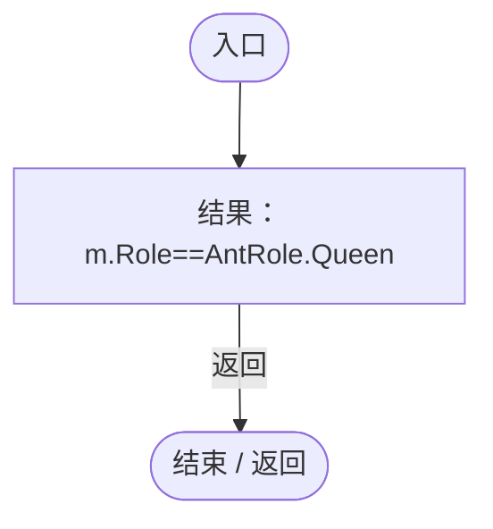

项目内调用/回调引用：

- [AntColonyMember.Role.get · L33](baebd85c05598377.md#mdf6df89f7116c7a3)（访问器）

## 回调@50 · L50

`m … => 回调`

### Editor · Roslyn编译器控制流

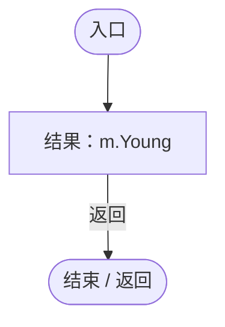

## 回调@81 · L81

`r … => 回调`

### Editor · Roslyn编译器控制流

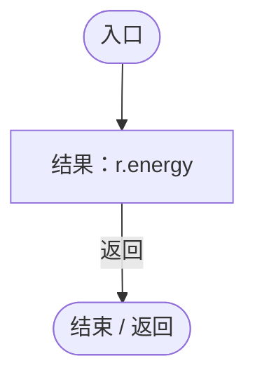

## 回调@83 · L83

`m … => 回调`

### Editor · Roslyn编译器控制流

## 回调@83 · L83

`m … => 回调`

### Editor · Roslyn编译器控制流

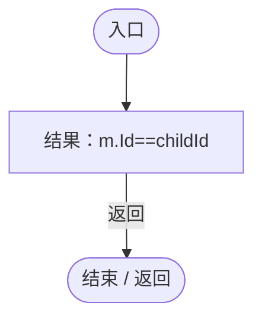

## 回调@84 · L84

`r … => 回调`

### Editor · Roslyn编译器控制流

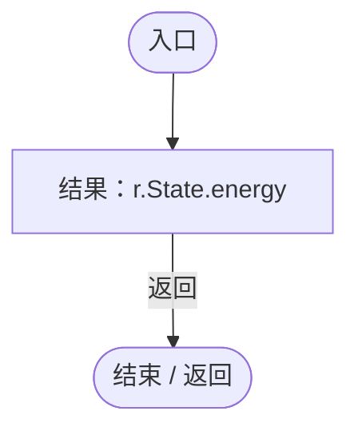

项目内调用/回调引用：

- [ColonyResource.State.get · L22](293dbaecfff4b585.md#m341a1355f4d657bf)（访问器）

## 回调@86 · L86

`r … => 回调`

### Editor · Roslyn编译器控制流

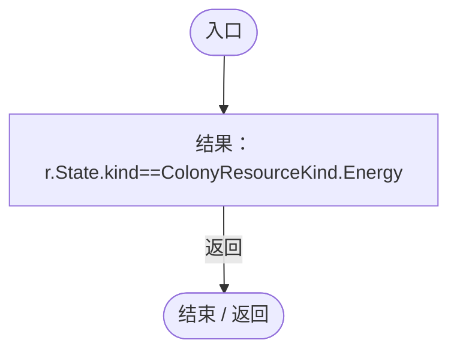

项目内调用/回调引用：

- [ColonyResource.State.get · L22](293dbaecfff4b585.md#m341a1355f4d657bf)（访问器）
