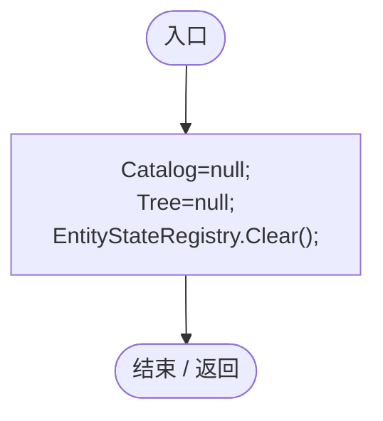

# GeneRuntimeProfile.cs

[返回总索引](../README.md) · `Runtime` · `Assets/DarwinPark/Genetics/GeneRuntimeProfile.cs`

[源文件](../../../Assets/DarwinPark/Genetics/GeneRuntimeProfile.cs) · 源码校验：`4285d1533e166013917ebc00aff392dd1ec437a0302ee6bac8829706a89c6abb`

方法按源文件位置排列。事件/回调引用不表示立即执行；分支与异常说明见总索引。完整源码与可点击关系图请打开离线手册。

## Clear · L9

`[UnityEngine.RuntimeInitializeOnLoadMethod(UnityEngine.RuntimeInitializeLoadType.SubsystemRegistration)] // ★ 适配：离开世界必须一起释放状态规则快照，下一世界不能串用上个世界的规则。 public static void Clear()`

### Editor / Player · Roslyn编译器控制流

项目内调用/回调引用：

- [EntityStateRegistry.Clear · L55](440408d2db5c7d96.md#m5fc8abc9b81cad68)（方法）
