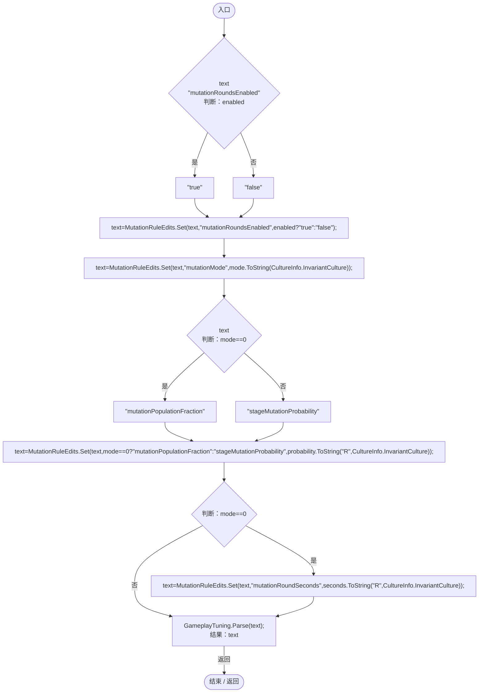
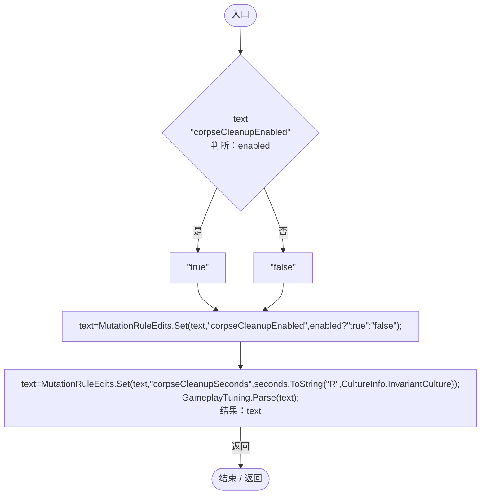
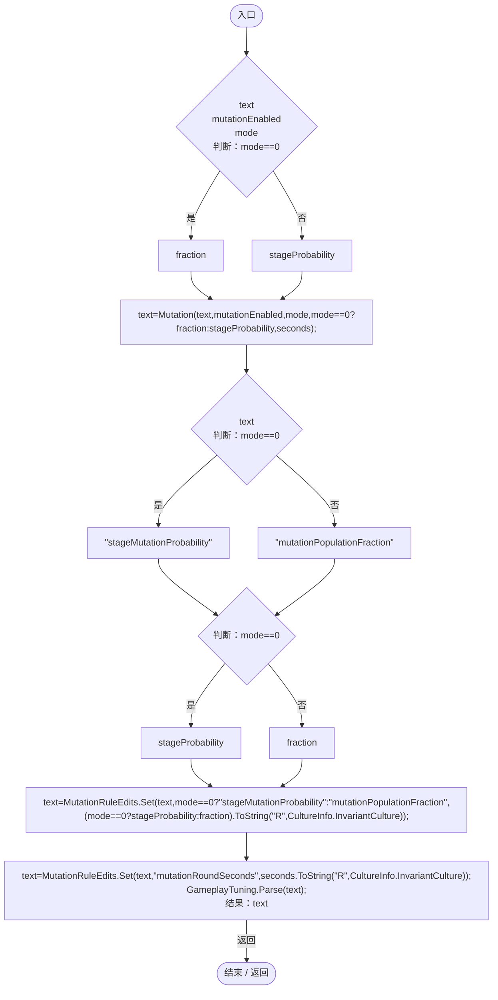
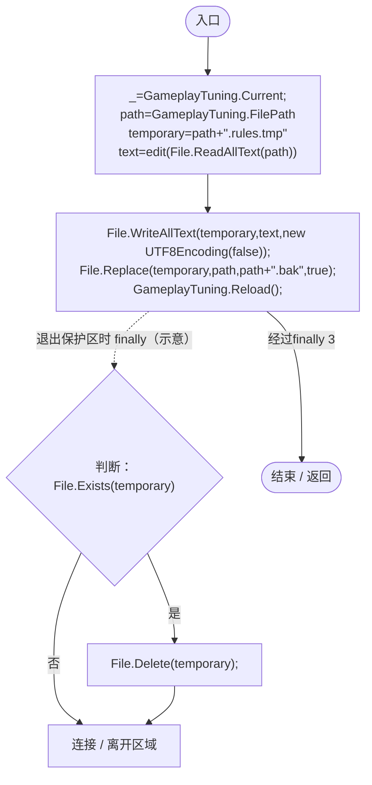

# RuleSelectionEdits.cs

[返回总索引](../README.md) · `Runtime` · `Assets/DarwinPark/Core/RuleSelectionEdits.cs`

[源文件](../../../Assets/DarwinPark/Core/RuleSelectionEdits.cs) · 源码校验：`2990bc49efac907a027062f44ee7e6b801082c19b7b9a96e56a24c5461ba9eb4`

方法按源文件位置排列。事件/回调引用不表示立即执行；分支与异常说明见总索引。完整源码与可点击关系图请打开离线手册。

## Mutation · L10

`public static string Mutation(string text,bool enabled,int mode,float probability,float seconds)`

### Editor / Player · Roslyn编译器控制流

项目内调用/回调引用：

- [MutationRuleEdits.Set · L17](063e584187dad139.md#mb57ff937cff59680)（方法）
- [GameplayTuning.Parse · L47](db546e5713b32d53.md#ma257d3ec126af87c)（方法）

## Cleanup · L16

`public static string Cleanup(string text,bool enabled,float seconds)`

### Editor / Player · Roslyn编译器控制流

项目内调用/回调引用：

- [MutationRuleEdits.Set · L17](063e584187dad139.md#mb57ff937cff59680)（方法）
- [GameplayTuning.Parse · L47](db546e5713b32d53.md#ma257d3ec126af87c)（方法）

## MutationModes · L18

`public static string MutationModes(string text,bool mutationEnabled,int mode,float fraction,float stageProbability,float seconds)`

### Editor / Player · Roslyn编译器控制流

项目内调用/回调引用：

- [RuleSelectionEdits.Mutation · L10](f1d4e0eb3e10983c.md#m13b44db10ebf55a2)（方法）
- [MutationRuleEdits.Set · L17](063e584187dad139.md#mb57ff937cff59680)（方法）
- [GameplayTuning.Parse · L47](db546e5713b32d53.md#ma257d3ec126af87c)（方法）

## Save · L24

`public static void Save(Func<string,string> edit)`

### Editor / Player · Roslyn编译器控制流

项目内调用/回调引用：

- [GameplayTuning.Current.get · L46](db546e5713b32d53.md#m4fa691bd8a3b9618)（访问器）
- [GameplayTuning.Reload · L61](db546e5713b32d53.md#ma781fa66f3a16705)（方法）
