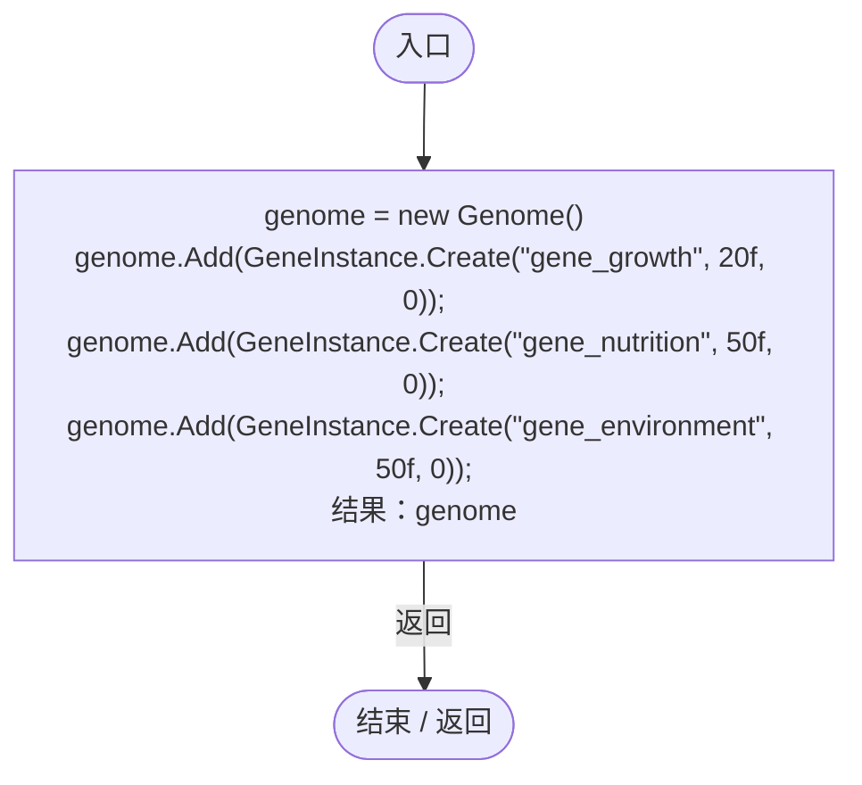
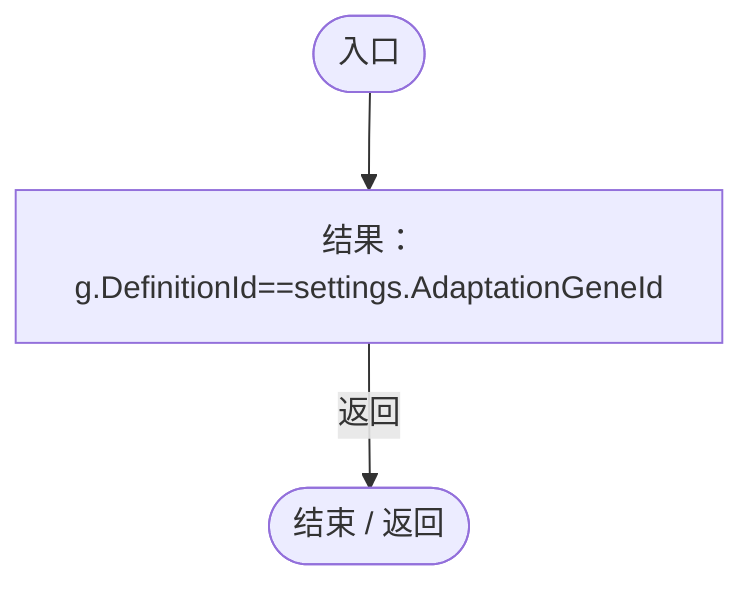
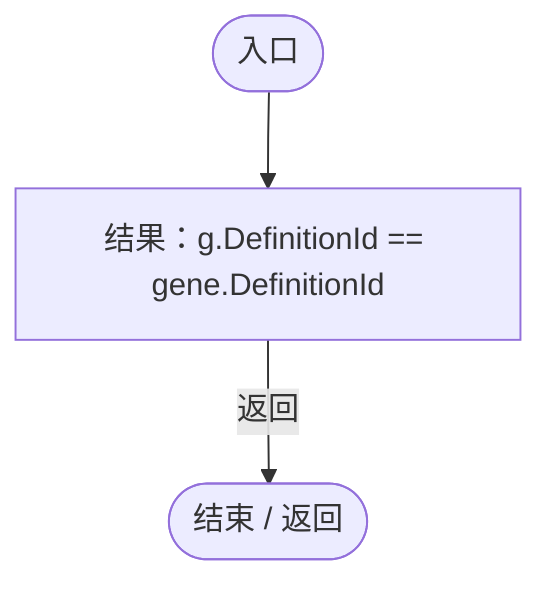

```mermaid
flowchart TD
  b0(["入口"])
  b1{"判断：genome.Genes.Count == 0"}
  b2["结果：MutationResult.Fail(&quot;基因组为空&quot;)"]
  b3{"判断：settings == null"}
  b4["settings = new GeneMutationSettings();"]
  b5["gene = null"]
  b6{"判断：string.IsNullOrEmpty(settings.AdaptationGeneId)"}
  b7{"判断：settings.AdaptationMutationChance &gt; 0f"}
  b8["Random.value &lt; settings.AdaptationMutationChance"]
  b9["!string.IsNullOrEmpty(settings.AdaptationGeneId) &amp;&amp; settings.AdaptationMutationChance &gt; 0f &amp;&amp; Random.value &lt; settings.AdaptationMutationChance"]
  b10["preferAdaptation = !string.IsNullOrEmpty(settings.AdaptationGeneId) &amp;&amp; settings.AdaptationMutationChance &gt; 0f &amp;&amp; Random.value &lt; settings.AdaptationMutationChance"]
  b11{"判断：preferAdaptation"}
  b12["gene=genome.Genes.Find(g=&gt;g.DefinitionId==settings.AdaptationGeneId);"]
  b13{"判断：gene == null"}
  b14["index = Random.Range(0, genome.Genes.Count)<br/>gene = genome.Genes[index];"]
  b15{"total=Mathf.Max(0,settings.ErrorWeight)+Mathf.Max(0,settings.DuplicateWeight)+Mathf.Max(0,settings.DeletionWeight)<br/>判断：total&lt;=0"}
  b16["结果：MutationResult.Fail(&quot;变异权重之和必须大于零&quot;)"]
  b17{"roll = Random.value*total<br/>判断：roll &lt; settings.ErrorWeight"}
  b18{"errorTarget=GeneTreeStorage.Successor(gene.DefinitionId,&quot;error&quot;,gene.Value,genome)<br/>判断：errorTarget!=null"}
  b19["gene.DefinitionId=errorTarget;<br/>gene.Tier=GeneDatabase.Get(errorTarget).Tier;"]
  b20{"delta = Random.Range(-settings.MaxErrorDelta, settings.MaxErrorDelta)<br/>判断：preferAdaptation"}
  b21{"判断：settings.AdaptationTargetValue&gt;=0"}
  b22{"判断：gene.DefinitionId==settings.AdaptationGeneId"}
  b23["delta=Mathf.Abs(delta)*Mathf.Sign(settings.AdaptationTargetValue-gene.Value);"]
  b24["gene.Value = Mathf.Clamp(gene.Value + delta, 0f, 100f);<br/>结果：MutationResult.Ok(MutationType.Error, $&quot;{gene.DefinitionId} 偏移到 {gene.Value:F1}&quot;)"]
  b25{"判断：roll &lt; settings.ErrorWeight+settings.DuplicateWeight"}
  b26["copy = GeneInstance.Create(gene.DefinitionId, gene.Value, gene.Tier)<br/>copy.CopyStrength = Random.Range(settings.DuplicateMinStrength, settings.DuplicateMaxStrength);<br/>def = GeneDatabase.Get(gene.DefinitionId)"]
  b27{"def<br/>判断：def"}
  b28[".ResolveState(gene.Value, gene.MissingStateIds)"]
  b29["def"]
  b30["currentState = def?.ResolveState(gene.Value, gene.MissingStateIds)"]
  b31{"判断：currentState != null"}
  b32{"判断：currentState.StateId == &quot;fast_growth&quot;"}
  b33{"判断：Random.value &lt; 0.4f"}
  b34["copy.DefinitionId = &quot;gene_repair&quot;;<br/>Debug.Log(&quot;[变异] 生长基因补充了修复基因！&quot;);"]
  b35{"判断：currentState.StateId == &quot;hetero&quot;"}
  b36{"判断：Random.value &lt; 0.3f"}
  b37["copy.DefinitionId = &quot;gene_storage&quot;;<br/>Debug.Log(&quot;[变异] 营养基因变异为储存基因！&quot;);"]
  b38{"next=GeneTreeStorage.Successor(gene.DefinitionId,&quot;evolution&quot;,gene.Value,genome)<br/>判断：next!=null"}
  b39["copy.DefinitionId=next;<br/>copy.Tier=GeneDatabase.Get(next).Tier;"]
  b40["genome.Add(copy);<br/>结果：MutationResult.Ok(MutationType.Duplicate, $&quot;复制出了 {copy.DefinitionId}&quot;)"]
  b41{"coreGenes = { &quot;gene_growth&quot;, &quot;gene_reproduction&quot;, &quot;gene_nutrition&quot; }<br/>判断：System.Array.IndexOf(coreGenes, gene.DefinitionId) &gt;= 0"}
  b42{"count = genome.Genes.Count(g =&gt; g.DefinitionId == gene.DefinitionId)<br/>判断：count &lt;= 1"}
  b43["结果：MutationResult.Fail($&quot;{gene.DefinitionId} 是唯一的基础基因，无法缺失！&quot;)"]
  b44["genome.Remove(gene.InstanceId);<br/>结果：MutationResult.Ok(MutationType.Deletion, $&quot;缺失了 {gene.DefinitionId}&quot;)"]
  b45(["结束 / 返回"])
  b0 --> b1
  b1 -->|"是"| b2
  b1 -->|"否"| b3
  b2 -->|"返回"| b45
  b3 -->|"是"| b4
  b3 -->|"否"| b5
  b4 --> b5
  b5 --> b6
  b6 -->|"否"| b7
  b6 -->|"是"| b9
  b7 -->|"是"| b8
  b7 -->|"否"| b9
  b8 --> b10
  b9 --> b10
  b10 --> b11
  b11 -->|"是"| b12
  b11 -->|"否"| b13
  b12 --> b13
  b13 -->|"是"| b14
  b13 -->|"否"| b15
  b14 --> b15
  b15 -->|"是"| b16
  b15 -->|"否"| b17
  b16 -->|"返回"| b45
  b17 -->|"是"| b18
  b17 -->|"否"| b25
  b18 -->|"是"| b19
  b18 -->|"否"| b20
  b19 --> b20
  b20 -->|"是"| b21
  b20 -->|"否"| b24
  b21 -->|"是"| b22
  b21 -->|"否"| b24
  b22 -->|"是"| b23
  b22 -->|"否"| b24
  b23 --> b24
  b24 -->|"返回"| b45
  b25 -->|"是"| b26
  b25 -->|"否"| b41
  b26 --> b27
  b27 -->|"否"| b28
  b27 -->|"是"| b29
  b28 --> b30
  b29 --> b30
  b30 --> b31
  b31 -->|"是"| b32
  b31 -->|"否"| b38
  b32 -->|"是"| b33
  b32 -->|"否"| b35
  b33 -->|"是"| b34
  b33 -->|"否"| b35
  b34 --> b38
  b35 -->|"是"| b36
  b35 -->|"否"| b38
  b36 -->|"是"| b37
  b36 -->|"否"| b38
  b37 --> b38
  b38 -->|"是"| b39
  b38 -->|"否"| b40
  b39 --> b40
  b40 -->|"返回"| b45
  b41 -->|"是"| b42
  b41 -->|"否"| b44
  b42 -->|"是"| b43
  b42 -->|"否"| b44
  b43 -->|"返回"| b45
  b44 -->|"返回"| b45

```

# GeneMutator.cs

[返回总索引](../README.md) · `Runtime` · `Assets/DarwinPark/Genetics/Mutation/GeneMutator.cs`

[源文件](../../../Assets/DarwinPark/Genetics/Mutation/GeneMutator.cs) · 源码校验：`c4f5f9feb6949c93754a26d3ec42a40c22b40b9a48c1f97ebb6e3985a39119b7`

方法按源文件位置排列。事件/回调引用不表示立即执行；分支与异常说明见总索引。完整源码与可点击关系图请打开离线手册。

## CreateBaseGenome · L8

`public static Genome CreateBaseGenome()`

### Editor / Player · Roslyn编译器控制流

项目内调用/回调引用：

- [Genome.Add · L19](a2ef23f865bc7ee8.md#md9cfdc94b8b8d40f)（方法）
- [GeneInstance.Create · L20](f82e1498d67f5afd.md#m72e94c278de3cf8b)（方法）

## Mutate · L18

`public static MutationResult Mutate(Genome genome, GeneMutationSettings settings)`

### Editor / Player · Roslyn编译器控制流

项目内调用/回调引用：

- [MutationResult.Fail · L12](5f57b52059148da9.md#m14be42b2c3e424d3)（方法）
- [GeneTreeStorage.Successor · L122](a885bad0d7dedee8.md#m5b6c0b3324290975)（方法）
- [GeneDatabase.Get · L135](ec0a03483435a863.md#m8f3bbfb35f3ca397)（方法）
- [MutationResult.Ok · L15](5f57b52059148da9.md#m4c90cf67054dec65)（方法）
- [GeneInstance.Create · L20](f82e1498d67f5afd.md#m72e94c278de3cf8b)（方法）
- [GeneDefinition.ResolveState · L83](07f99d5784e3dadb.md#mbaf2c5b1eb1045c5)（方法）
- [Genome.Add · L19](a2ef23f865bc7ee8.md#md9cfdc94b8b8d40f)（方法）
- [Genome.Remove · L25](a2ef23f865bc7ee8.md#m4be725b72eafb11a)（方法）
- [GeneMutator.回调@30 · L30](f297edbfb98ef475.md#maa72545c6748a99c)（回调/委托）
- [GeneMutator.回调@88 · L88](f297edbfb98ef475.md#mae57b5caceba245a)（回调/委托）

## 回调@30 · L30

`g … => 回调`

### Editor / Player · Roslyn编译器控制流

## 回调@88 · L88

`g … => 回调`

### Editor / Player · Roslyn编译器控制流

