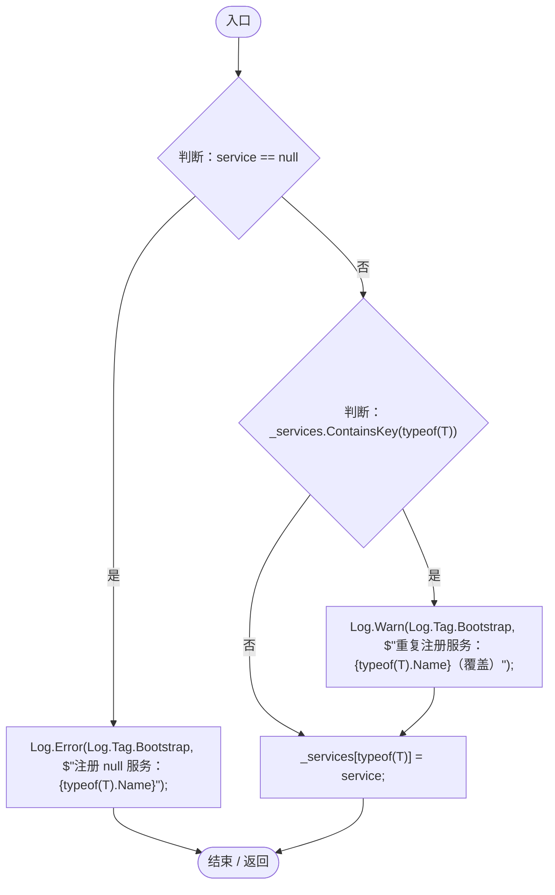
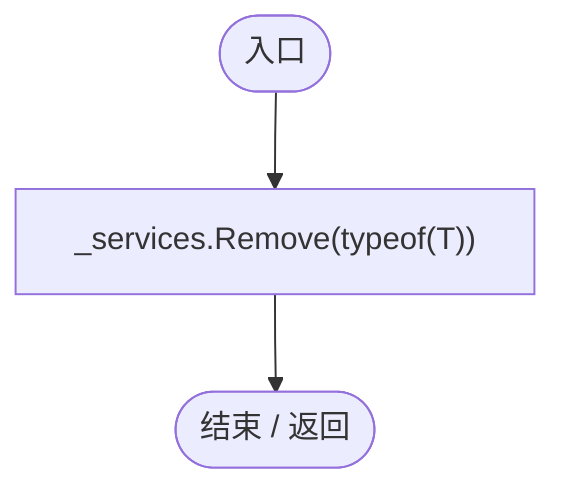
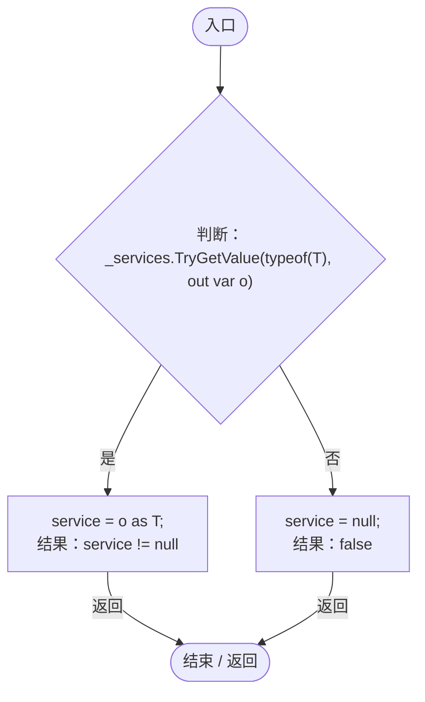
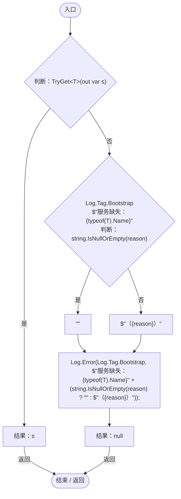
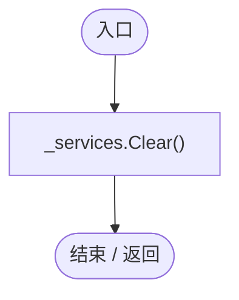

# ServiceLocator.cs

[返回总索引](../README.md) · `Runtime` · `Assets/DarwinPark/Core/Services/ServiceLocator.cs`

[源文件](../../../Assets/DarwinPark/Core/Services/ServiceLocator.cs) · 源码校验：`087a0ed7a14b7c9cd9fadf79388f3e0f7eef9913aaf5aaecf6538f76b9d43131`

方法按源文件位置排列。事件/回调引用不表示立即执行；分支与异常说明见总索引。完整源码与可点击关系图请打开离线手册。

## Register · L16

`public static void Register<T>(T service) where T : class`

### Editor / Player · Roslyn编译器控制流

项目内调用/回调引用：

- [Log.Error · L43](735e5abf0df2bddc.md#m2addd5e1d74b000d)（方法）
- [Log.Warn · L37](735e5abf0df2bddc.md#m25a5d11252901de1)（方法）

## Unregister · L24

`public static void Unregister<T>() where T : class`

### Editor / Player · Roslyn编译器控制流

## TryGet · L26

`public static bool TryGet<T>(out T service) where T : class`

### Editor / Player · Roslyn编译器控制流

## Get · L33

`public static T Get<T>(string reason = null) where T : class`

### Editor / Player · Roslyn编译器控制流

项目内调用/回调引用：

- [ServiceLocator.TryGet · L26](f2fdbe9f9ccd93cb.md#m143b24e6d58471b0)（方法）
- [Log.Error · L43](735e5abf0df2bddc.md#m2addd5e1d74b000d)（方法）

## Clear · L41

`public static void Clear()`

### Editor / Player · Roslyn编译器控制流

