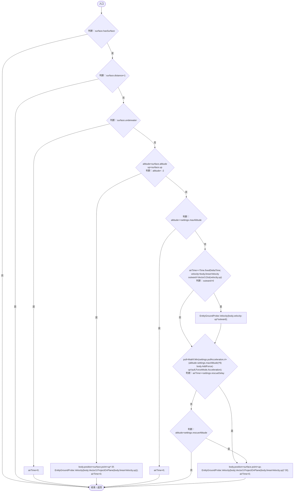

# SurfaceAnchorPhysics.cs

[返回总索引](../README.md) · `Runtime` · `Assets/DarwinPark/Entities/SurfaceAnchorPhysics.cs`

[源文件](../../../Assets/DarwinPark/Entities/SurfaceAnchorPhysics.cs) · 源码校验：`095ee09814c84e4e0b9f95d372693b2d6bb2b044b22b21cd88df426edc071875`

方法按源文件位置排列。事件/回调引用不表示立即执行；分支与异常说明见总索引。完整源码与可点击关系图请打开离线手册。

## Advance · L7

`public static void Advance(EntitySurfaceAnchor settings,Rigidbody body,EntityGroundSample surface,ref float airTime)`

### Editor / Player · Roslyn编译器控制流

项目内调用/回调引用：

- [EntityGroundProbe.Velocity · L35](6cefee808441951d.md#mdc5d4538aa1ee338)（方法）
