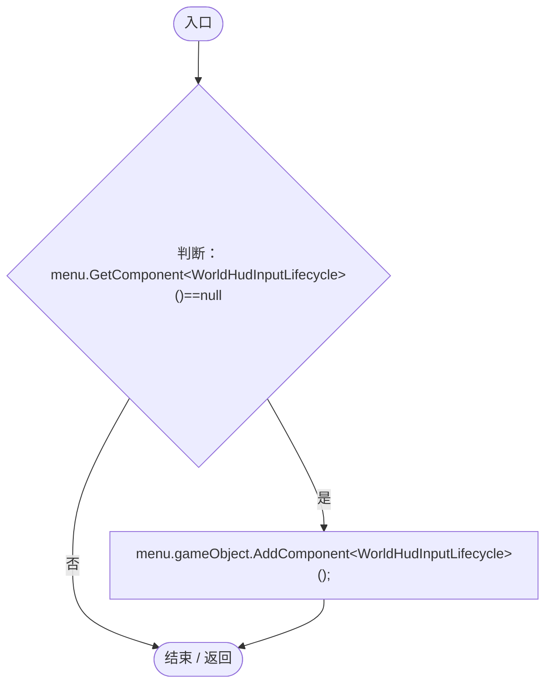
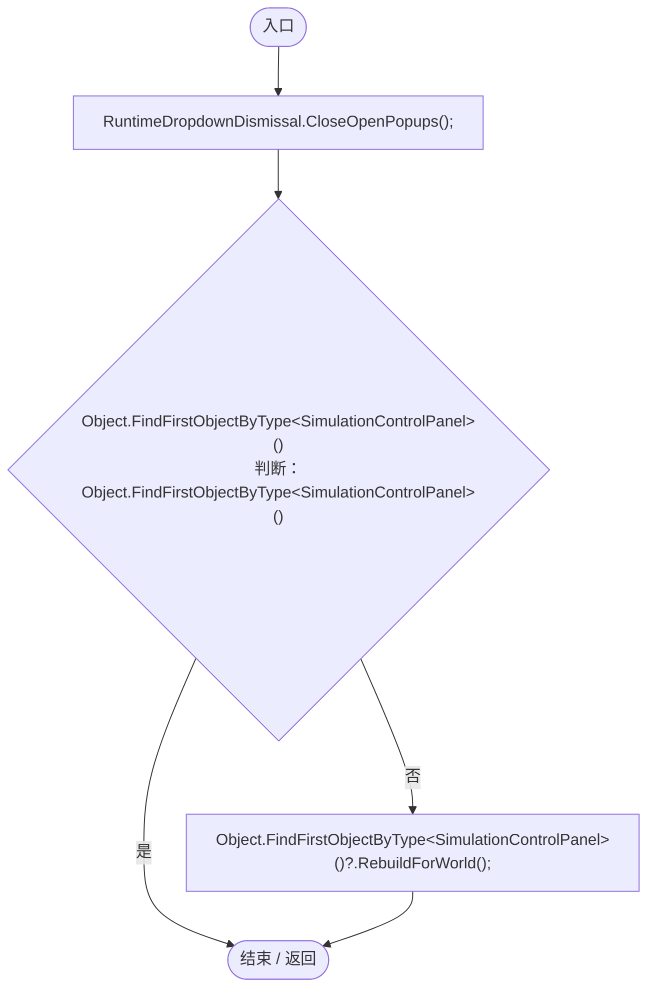
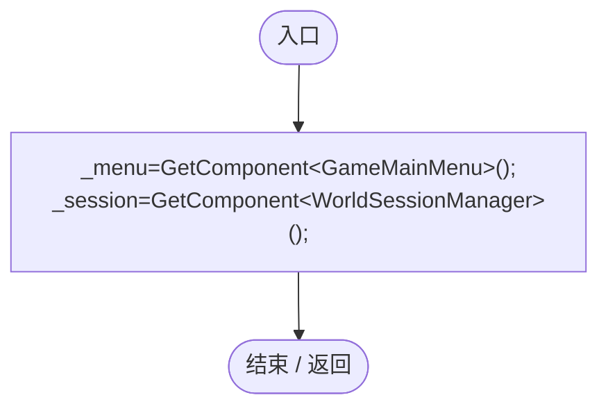
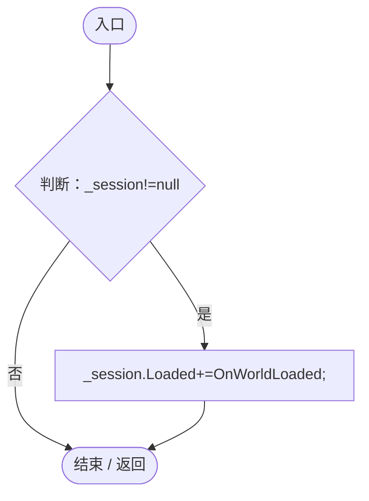
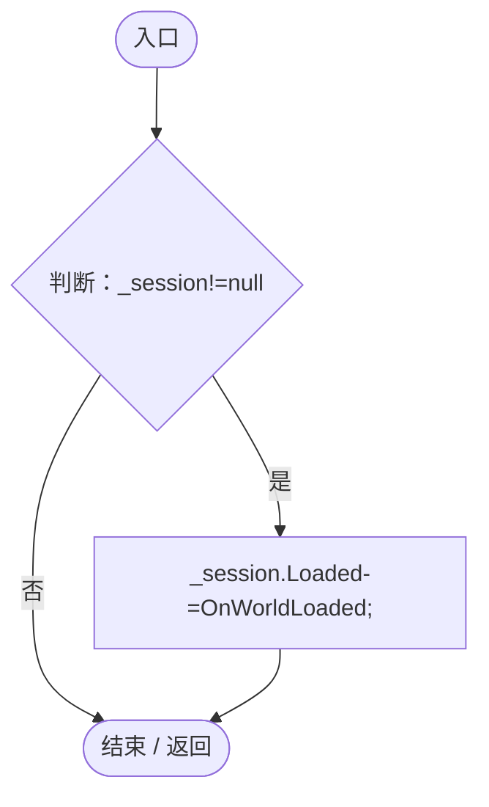
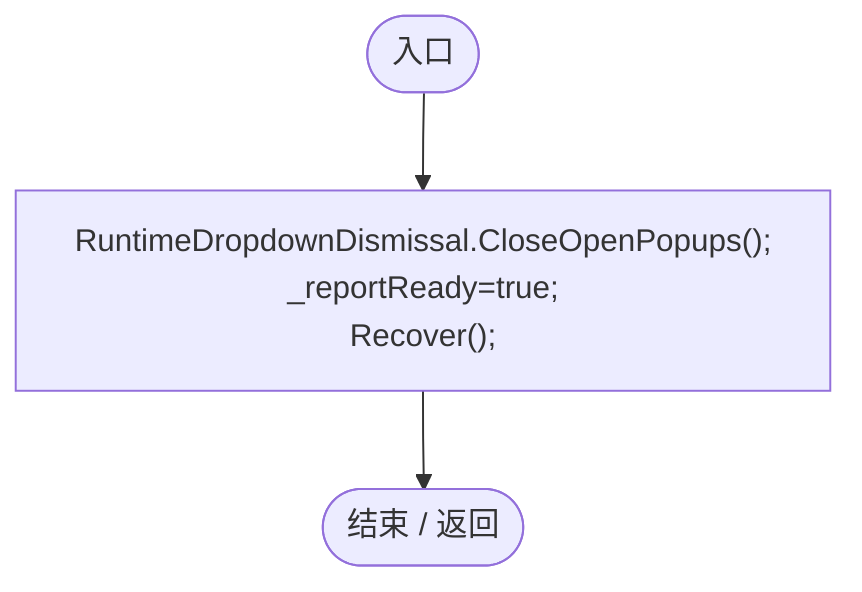
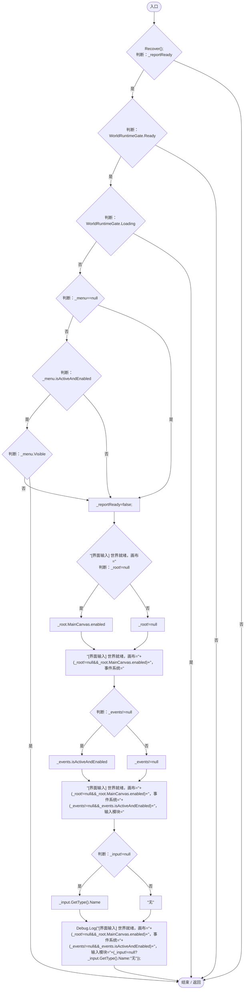

```mermaid
flowchart TD
  b0(["入口"])
  b1{"判断：WorldRuntimeGate.Ready"}
  b2{"判断：WorldRuntimeGate.Loading"}
  b3{"判断：WorldRuntimeGate.Recording"}
  b4{"判断：_menu!=null"}
  b5{"判断：_menu.isActiveAndEnabled"}
  b6{"判断：_menu.Visible"}
  b7{"WorldParameterUpdate.Instance<br/>判断：WorldParameterUpdate.Instance"}
  b8[".Busy"]
  b9["WorldParameterUpdate.Instance"]
  b10{"判断：WorldParameterUpdate.Instance?.Busy==true"}
  b11{"判断：_root==null"}
  b12{"判断：ServiceLocator.TryGet(out _root)"}
  b13{"判断：_root==null"}
  b14{"判断：_root.isActiveAndEnabled"}
  b15{"判断：_root.MainCanvas==null"}
  b16{"_repairs.Clear();<br/>判断：_root.MainCanvas.enabled"}
  b17["_root.MainCanvas.enabled=true;<br/>_repairs.Add(&quot;HUD画布&quot;);"]
  b18{"raycaster=_root.MainCanvas.GetComponent&lt;GraphicRaycaster&gt;()<br/>判断：raycaster==null"}
  b19["raycaster=_root.MainCanvas.gameObject.AddComponent&lt;GraphicRaycaster&gt;();<br/>_repairs.Add(&quot;点击射线组件&quot;);"]
  b20{"判断：raycaster.enabled"}
  b21["raycaster.enabled=true;<br/>_repairs.Add(&quot;点击射线开关&quot;);"]
  b22["EnsureEvents();"]
  b23{"EntityEditPopup.Instance<br/>判断：EntityEditPopup.Instance"}
  b24[".Visible"]
  b25["EntityEditPopup.Instance"]
  b26{"判断：EntityEditPopup.Instance?.Visible==true"}
  b27{"PopulationWorkbench.Instance<br/>判断：PopulationWorkbench.Instance"}
  b28[".Visible"]
  b29["PopulationWorkbench.Instance"]
  b30{"判断：PopulationWorkbench.Instance?.Visible==true"}
  b31{"RandomSpawnWorkbench.Instance<br/>判断：RandomSpawnWorkbench.Instance"}
  b32[".Visible"]
  b33["RandomSpawnWorkbench.Instance"]
  b34{"判断：RandomSpawnWorkbench.Instance?.Visible==true"}
  b35{"WorldGameSettingsPanel.Instance<br/>判断：WorldGameSettingsPanel.Instance"}
  b36[".Visible"]
  b37["WorldGameSettingsPanel.Instance"]
  b38["WorldGameSettingsPanel.Instance?.Visible==true"]
  b39["EntityEditPopup.Instance?.Visible==true&#124;&#124;PopulationWorkbench.Instance?.Visible==true&#124;&#124;RandomSpawnWorkbench.Instance?.Visible==true&#124;&#124;WorldGameSettingsPanel.Instance?.Visible==true"]
  b40["modal=EntityEditPopup.Instance?.Visible==true&#124;&#124;PopulationWorkbench.Instance?.Visible==true&#124;&#124;RandomSpawnWorkbench.Instance?.Visible==true&#124;&#124;WorldGameSettingsPanel.Instance?.Visible==true"]
  b41{"LanSession.Instance<br/>判断：LanSession.Instance"}
  b42[".IsClient"]
  b43["LanSession.Instance"]
  b44{"判断：LanSession.Instance?.IsClient==true"}
  b45["string.IsNullOrEmpty(LanSession.Instance.OwnedEntityId)"]
  b46["LanSession.Instance?.IsClient==true"]
  b47["choosing=LanSession.Instance?.IsClient==true&amp;&amp;string.IsNullOrEmpty(LanSession.Instance.OwnedEntityId)"]
  b48{"判断：modal"}
  b49{"判断：choosing"}
  b50{"判断：GameInputGate.Blocked"}
  b51{"GameInputGate.Blocked=false;<br/>判断：GameInputGate.Blocked"}
  b52["_repairs.Add(&quot;遗留输入门控&quot;);"]
  b53{"判断：_repairs.Count&gt;0"}
  b54["Debug.LogWarning(&quot;[界面输入] 已恢复：&quot;+string.Join(&quot;、&quot;,_repairs));"]
  b55(["结束 / 返回"])
  b0 --> b1
  b1 -->|"是"| b2
  b1 -->|"否"| b55
  b2 -->|"否"| b3
  b2 -->|"是"| b55
  b3 -->|"否"| b4
  b3 -->|"是"| b55
  b4 -->|"是"| b5
  b4 -->|"否"| b7
  b5 -->|"是"| b6
  b5 -->|"否"| b7
  b6 -->|"否"| b7
  b6 -->|"是"| b55
  b7 -->|"否"| b8
  b7 -->|"是"| b9
  b8 --> b10
  b9 --> b10
  b10 -->|"是"| b55
  b10 -->|"否"| b11
  b11 -->|"是"| b12
  b11 -->|"否"| b13
  b12 -->|"是"| b13
  b12 -->|"否"| b55
  b13 -->|"否"| b14
  b13 -->|"是"| b55
  b14 -->|"是"| b15
  b14 -->|"否"| b55
  b15 -->|"是"| b55
  b15 -->|"否"| b16
  b16 -->|"否"| b17
  b16 -->|"是"| b18
  b17 --> b18
  b18 -->|"是"| b19
  b18 -->|"否"| b20
  b19 --> b22
  b20 -->|"否"| b21
  b20 -->|"是"| b22
  b21 --> b22
  b22 --> b23
  b23 -->|"否"| b24
  b23 -->|"是"| b25
  b24 --> b26
  b25 --> b26
  b26 -->|"否"| b27
  b26 -->|"是"| b39
  b27 -->|"否"| b28
  b27 -->|"是"| b29
  b28 --> b30
  b29 --> b30
  b30 -->|"否"| b31
  b30 -->|"是"| b39
  b31 -->|"否"| b32
  b31 -->|"是"| b33
  b32 --> b34
  b33 --> b34
  b34 -->|"否"| b35
  b34 -->|"是"| b39
  b35 -->|"否"| b36
  b35 -->|"是"| b37
  b36 --> b38
  b37 --> b38
  b38 --> b40
  b39 --> b40
  b40 --> b41
  b41 -->|"否"| b42
  b41 -->|"是"| b43
  b42 --> b44
  b43 --> b44
  b44 -->|"是"| b45
  b44 -->|"否"| b46
  b45 --> b47
  b46 --> b47
  b47 --> b48
  b48 -->|"否"| b49
  b48 -->|"是"| b53
  b49 -->|"否"| b50
  b49 -->|"是"| b53
  b50 -->|"是"| b51
  b50 -->|"否"| b53
  b51 -->|"否"| b52
  b51 -->|"是"| b53
  b52 --> b53
  b53 -->|"是"| b54
  b53 -->|"否"| b55
  b54 --> b55

```

```mermaid
flowchart TD
  b0(["入口"])
  b1{"判断：EventSystem.current!=null"}
  b2{"判断：EventSystem.current.isActiveAndEnabled"}
  b3["_events=EventSystem.current;"]
  b4{"判断：_events==null"}
  b5["_events=_root.GetComponentInChildren&lt;EventSystem&gt;(true);"]
  b6{"判断：_events==null"}
  b7["_events=Object.FindFirstObjectByType&lt;EventSystem&gt;();"]
  b8{"判断：_events==null"}
  b9["host=new GameObject(&quot;EventSystem&quot;,typeof(EventSystem),typeof(StandaloneInputModule))<br/>host.transform.SetParent(_root.transform,false);<br/>_events=host.GetComponent&lt;EventSystem&gt;();<br/>_repairs.Add(&quot;事件系统&quot;);"]
  b10{"判断：_events.gameObject.activeSelf"}
  b11["_events.gameObject.SetActive(true);<br/>_repairs.Add(&quot;事件节点&quot;);"]
  b12{"判断：_events.enabled"}
  b13["_events.enabled=true;<br/>_repairs.Add(&quot;事件系统开关&quot;);"]
  b14{"判断：EventSystem.current==null"}
  b15{"判断：EventSystem.current.isActiveAndEnabled"}
  b16["EventSystem.current=_events;"]
  b17{"判断：_input==null"}
  b18{"判断：_input.gameObject!=_events.gameObject"}
  b19{"判断：_input.isActiveAndEnabled"}
  b20["_input=null;<br/>existing=null"]
  b21["_events.GetComponents&lt;BaseInputModule&gt;()"]
  b22{"判断：_events.GetComponents&lt;BaseInputModule&gt;()"}
  b23{"var<br/>判断：existing==null"}
  b24["existing=module;"]
  b25{"判断：module.isActiveAndEnabled"}
  b26["_input=module;"]
  b27{"_events.GetComponents&lt;BaseInputModule&gt;()<br/>判断：_events.GetComponents&lt;BaseInputModule&gt;()"}
  b28["_events.GetComponents&lt;BaseInputModule&gt;()"]
  b29["连接 / 离开区域"]
  b30{"判断：_input==null"}
  b31{"_input<br/>判断：existing!=null"}
  b32["existing"]
  b33["_events.gameObject.AddComponent&lt;StandaloneInputModule&gt;()"]
  b34["_input=existing!=null?existing:_events.gameObject.AddComponent&lt;StandaloneInputModule&gt;();"]
  b35["_input.enabled=true;<br/>_repairs.Add(&quot;UI输入模块&quot;);"]
  b36{"判断：Application.isFocused"}
  b37{"判断：_events.isFocused"}
  b38["_events.SendMessage(&quot;OnApplicationFocus&quot;,true,SendMessageOptions.DontRequireReceiver);<br/>_repairs.Add(&quot;UI焦点同步&quot;);"]
  b39(["结束 / 返回"])
  b0 --> b1
  b1 -->|"是"| b2
  b1 -->|"否"| b4
  b2 -->|"是"| b3
  b2 -->|"否"| b4
  b3 --> b4
  b4 -->|"是"| b5
  b4 -->|"否"| b6
  b5 --> b6
  b6 -->|"是"| b7
  b6 -->|"否"| b8
  b7 --> b8
  b8 -->|"是"| b9
  b8 -->|"否"| b10
  b9 --> b10
  b10 -->|"否"| b11
  b10 -->|"是"| b12
  b11 --> b12
  b12 -->|"否"| b13
  b12 -->|"是"| b14
  b13 --> b14
  b14 -->|"否"| b15
  b14 -->|"是"| b16
  b15 -->|"否"| b16
  b15 -->|"是"| b17
  b16 --> b17
  b17 -->|"否"| b18
  b17 -->|"是"| b20
  b18 -->|"否"| b19
  b18 -->|"是"| b20
  b19 -->|"否"| b20
  b19 -->|"是"| b36
  b20 --> b21
  b21 --> b22
  b22 -->|"是"| b23
  b22 -->|"否 · 经过finally 27"| b30
  b23 -->|"是"| b24
  b23 -->|"否"| b25
  b24 --> b25
  b25 -->|"是"| b26
  b25 -->|"否"| b22
  b26 -->|"经过finally 27"| b30
  b27 -->|"否"| b28
  b27 -->|"是"| b29
  b28 --> b29
  b30 -->|"是"| b31
  b30 -->|"否"| b36
  b31 -->|"是"| b32
  b31 -->|"否"| b33
  b32 --> b34
  b33 --> b34
  b34 --> b35
  b35 --> b36
  b36 -->|"是"| b37
  b36 -->|"否"| b39
  b37 -->|"否"| b38
  b37 -->|"是"| b39
  b38 --> b39
  b22 -. "退出保护区时 finally（示意）" .-> b27

```

# WorldHudInputLifecycle.cs

[返回总索引](../README.md) · `Runtime` · `Assets/DarwinPark/UI/WorldHudInputLifecycle.cs`

[源文件](../../../Assets/DarwinPark/UI/WorldHudInputLifecycle.cs) · 源码校验：`3ad5c89b6cae6e0cd1299f0bfc38f2fbd78ad521e8137e05b92876d10ff5c211`

方法按源文件位置排列。事件/回调引用不表示立即执行；分支与异常说明见总索引。完整源码与可点击关系图请打开离线手册。

## Ensure · L15

`public static void Ensure(GameMainMenu menu)`

### Editor / Player · Roslyn编译器控制流

## PrepareWorldControls · L17

`public static void PrepareWorldControls()`

### Editor / Player · Roslyn编译器控制流

项目内调用/回调引用：

- [RuntimeDropdownDismissal.CloseOpenPopups · L39](bab72c915cc299c5.md#m4e050bc4c4e0bef0)（方法）
- [SimulationControlPanel.RebuildForWorld · L76](76bc7add9187fd1f.md#m13acea3f30f8c6ef)（方法）

## Awake · L22

`private void Awake()`

### Editor / Player · Roslyn编译器控制流

## OnEnable · L23

`private void OnEnable()`

### Editor / Player · Roslyn编译器控制流

项目内调用/回调引用：

- [WorldHudInputLifecycle.OnWorldLoaded · L25](f3fd2d972c3899f1.md#mcac02a20c7803979)（方法）

## OnDisable · L24

`private void OnDisable()`

### Editor / Player · Roslyn编译器控制流

项目内调用/回调引用：

- [WorldHudInputLifecycle.OnWorldLoaded · L25](f3fd2d972c3899f1.md#mcac02a20c7803979)（方法）

## OnWorldLoaded · L25

`private void OnWorldLoaded()`

### Editor / Player · Roslyn编译器控制流

项目内调用/回调引用：

- [RuntimeDropdownDismissal.CloseOpenPopups · L39](bab72c915cc299c5.md#m4e050bc4c4e0bef0)（方法）
- [WorldHudInputLifecycle.Recover · L38](f3fd2d972c3899f1.md#m40e06b669b6b6e31)（方法）

## LateUpdate · L30

`private void LateUpdate()`

### Editor / Player · Roslyn编译器控制流

项目内调用/回调引用：

- [WorldHudInputLifecycle.Recover · L38](f3fd2d972c3899f1.md#m40e06b669b6b6e31)（方法）
- [UIRoot.MainCanvas.get · L14](9c1421378791f0e0.md#maa2cc9baf1248477)（访问器）

## Recover · L38

`public void Recover()`

### Editor / Player · Roslyn编译器控制流

项目内调用/回调引用：

- [WorldParameterUpdate.Instance.get · L19](4087d9be2a65e96f.md#m32aebfe3914ccd0e)（访问器）
- [WorldParameterUpdate.Busy.get · L20](4087d9be2a65e96f.md#mec2ac85b8ff3f127)（访问器）
- [ServiceLocator.TryGet · L26](f2fdbe9f9ccd93cb.md#m143b24e6d58471b0)（方法）
- [UIRoot.MainCanvas.get · L14](9c1421378791f0e0.md#maa2cc9baf1248477)（访问器）
- [WorldHudInputLifecycle.EnsureEvents · L58](f3fd2d972c3899f1.md#mea750083d45561af)（方法）
- [EntityEditPopup.Instance.get · L16](79ed73ecd9855f79.md#m1636d1f5295f3a28)（访问器）
- [PopulationWorkbench.Instance.get · L14](6ca6fcae89e529ec.md#m82395c4f7e743e70)（访问器）
- [PopulationWorkbench.Visible.get · L15](6ca6fcae89e529ec.md#mbe13c2d3e85c0b85)（访问器）
- [RandomSpawnWorkbench.Instance.get · L19](0763b7475b3c75db.md#m6f18ab57fe0cbfad)（访问器）
- [RandomSpawnWorkbench.Visible.get · L19](0763b7475b3c75db.md#mfc1adb76149ae015)（访问器）
- [WorldGameSettingsPanel.Instance.get · L11](6df051f7f7177d08.md#mcccf01908bb54d27)（访问器）
- [LanSession.Instance.get · L23](9fb633eebffe669c.md#mbf83306994878383)（访问器）
- [LanSession.OwnedEntityId.get · L30](9fb633eebffe669c.md#m5adc535c48d20cbe)（访问器）
- [GameInputGate.Blocked.get · L8](52955daae7e592ab.md#m765763b665829633)（访问器）
- [GameInputGate.Blocked.set · L8](52955daae7e592ab.md#m578697f6379686f4)（访问器）

## EnsureEvents · L58

`private void EnsureEvents()`

### Editor / Player · Roslyn编译器控制流

