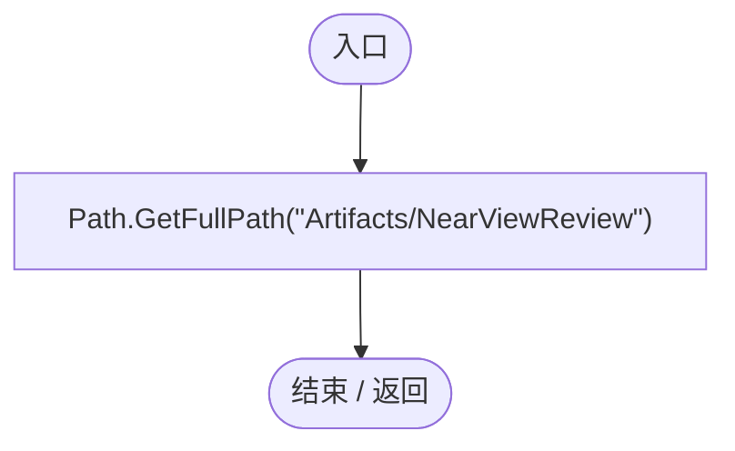
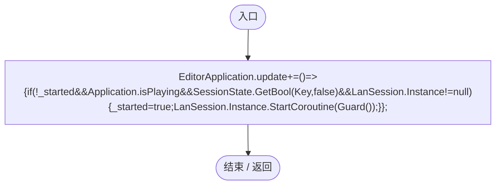
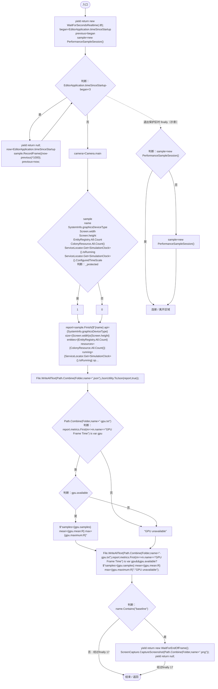
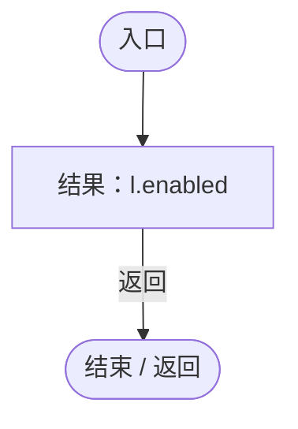
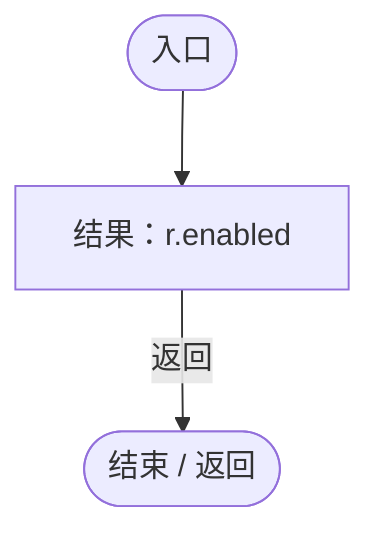
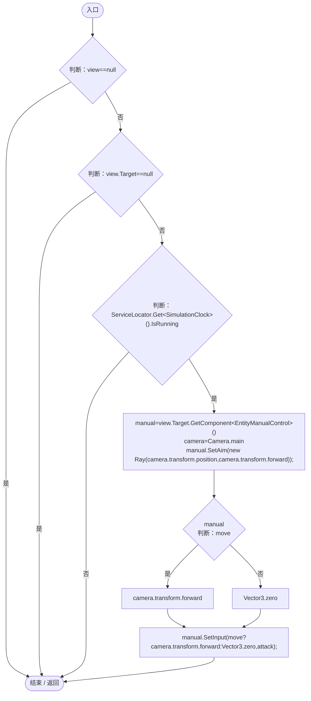
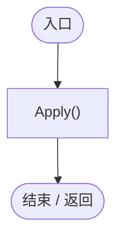

```mermaid
flowchart TD
  b0(["入口"])
  b1["world=WorldSaveStore.Read(Path.Combine(Folder,&quot;input/world.json&quot;))<br/>session=Object.FindFirstObjectByType&lt;WorldSessionManager&gt;()<br/>session.autoSaveInterval=36000;<br/>session.Open(world);"]
  b2{"判断：session.Busy"}
  b3["yield return null;"]
  b4["clock=ServiceLocator.Get&lt;SimulationClock&gt;()<br/>clock.Pause();<br/>FramePacingSettings.SetLimit(0);<br/>camera=Camera.main<br/>orbit=camera.GetComponent&lt;OrbitCamera&gt;()<br/>orbit.enabled=false;<br/>planet=EcologyQueries.Planet<br/>weather=planet.GetComponent&lt;PlanetW…"]
  b5{"-up<br/>判断：Mathf.Abs(up.y)&gt;.99f"}
  b6["Vector3.right"]
  b7["Vector3.up"]
  b8["rotation=Quaternion.LookRotation(-up,Mathf.Abs(up.y)&gt;.99f?Vector3.right:Vector3.up)"]
  b9{"camera.transform.SetPositionAndRotation(center+up*800,rotation);<br/>yield return Sample(&quot;far-paused-baseline&quot;);<br/>camera.transform.SetPositionAndRotation(point+up*10,rotation);<br/>yield return Sample(&quot;near-paused-baseline&quot;);<br/>clock.Play();<br/>yield …"}
  b10["camera.transform.SetPositionAndRotation(point+up*10,rotation);<br/>clock.SetTimeScale(16);<br/>clock.Play();<br/>yield return Sample(&quot;budget-05&quot;);<br/>clock.Pause();<br/>clock.maximumGameDelta=.1f;<br/>yield return Sample(&quot;budget-01&quot;);"]
  b11{"view=Object.FindFirstObjectByType&lt;EntityViewController&gt;()<br/>判断：view.EnterView(target)"}
  b12["结果：new InvalidOperationException(&quot;control rejected&quot;)"]
  x12(["抛出异常 / 离开方法"])
  b13{"input=view.GetComponent&lt;EntityPossessionInput&gt;()<br/>pitch=typeof(EntityPossessionInput).GetField(&quot;_pitch&quot;,BindingFlags.NonPublic&#124;BindingFlags.Instance)<br/>pitch.SetValue(input,0f);<br/>yield return Sample(&quot;control-horizon-paused-baseline&quot;);<br/>clock.…"}
  b14["结果：new InvalidOperationException(&quot;控制目标在输入样本中死亡，不能把退出镜头当控制结果&quot;)"]
  x14(["抛出异常 / 离开方法"])
  b15["Object.FindFirstObjectByType&lt;GeneInspectorUI&gt;().ShowEntityInfo(target);<br/>yield return Sample(&quot;control-inspector-paused&quot;);<br/>Object.FindFirstObjectByType&lt;GeneInspectorUI&gt;().HideEntityInfo();<br/>scheduler=Object.FindFirstObjectByType&lt;ResourceVis…"]
  b16["lights"]
  b17{"判断：lights"}
  b18["var<br/>l.enabled=false;"]
  b19{"lights<br/>判断：lights"}
  b20["lights"]
  b21["连接 / 离开区域"]
  b22["yield return Sample(&quot;control-no-resource-lights&quot;);"]
  b23["i=0"]
  b24{"判断：i&lt;lights.Length"}
  b25["lights[i].enabled=lightStates[i];<br/>i++"]
  b26["scheduler.enabled=true;<br/>shells=planet.GetComponentsInChildren&lt;Renderer&gt;(true).Where(r=&gt;r.name==&quot;AtmosphericScattering&quot;&#124;&#124;r.name==&quot;OceanSurface&quot;&#124;&#124;r.name==&quot;CloudVolume&quot;).ToArray()<br/>shellStates=shells.Select(r=&gt;r.enabled).ToArray()"]
  b27["shells"]
  b28{"判断：shells"}
  b29["var<br/>r.enabled=false;"]
  b30{"shells<br/>判断：shells"}
  b31["shells"]
  b32["连接 / 离开区域"]
  b33["yield return Sample(&quot;control-no-weather&quot;);"]
  b34["i=0"]
  b35{"判断：i&lt;shells.Length"}
  b36["shells[i].enabled=shellStates[i];<br/>i++"]
  b37{"surface=planet.GetComponent&lt;MeshRenderer&gt;()<br/>original=surface.sharedMaterial<br/>simple=new Material(Shader.Find(&quot;Universal Render Pipeline/Unlit&quot;))<br/>surface.sharedMaterial=simple;<br/>yield return Sample(&quot;control-simple-terrain&quot;);<br/>surface.sharedM…"}
  b38["old=scale.GetValue(pipeline)<br/>scale.SetValue(pipeline,.5f);<br/>yield return Sample(&quot;control-half-resolution&quot;);<br/>scale.SetValue(pipeline,old);"]
  b39["view.ExitView();<br/>orbit.RestoreView(center+up*800,rotation,800);<br/>orbit.enabled=true;<br/>clock.Play();<br/>orbit.FocusOn(point);<br/>yield return Sample(&quot;zoom-transition-running&quot;);<br/>clock.Pause();<br/>orbit.enabled=false;<br/>camera.transform.SetPositionAndRo…"]
  b40(["结束 / 返回"])
  b0 --> b1
  b1 --> b2
  b2 -->|"是"| b3
  b2 -->|"否"| b4
  b3 --> b2
  b4 --> b5
  b5 -->|"是"| b6
  b5 -->|"否"| b7
  b6 --> b8
  b7 --> b8
  b8 --> b9
  b9 -->|"是"| b10
  b9 -->|"否"| b11
  b10 --> b40
  b11 -->|"否"| b12
  b11 -->|"是"| b13
  b12 -->|"Throw"| x12
  b13 -->|"否"| b14
  b13 -->|"是"| b15
  b14 -->|"Throw"| x14
  b15 --> b16
  b16 --> b17
  b17 -->|"是"| b18
  b17 -->|"否 · 经过finally 19"| b22
  b18 --> b17
  b19 -->|"否"| b20
  b19 -->|"是"| b21
  b20 --> b21
  b22 --> b23
  b23 --> b24
  b24 -->|"是"| b25
  b24 -->|"否"| b26
  b25 --> b24
  b26 --> b27
  b27 --> b28
  b28 -->|"是"| b29
  b28 -->|"否 · 经过finally 30"| b33
  b29 --> b28
  b30 -->|"否"| b31
  b30 -->|"是"| b32
  b31 --> b32
  b33 --> b34
  b34 --> b35
  b35 -->|"是"| b36
  b35 -->|"否"| b37
  b36 --> b35
  b37 -->|"是"| b38
  b37 -->|"否"| b39
  b38 --> b39
  b39 --> b40
  b17 -. "退出保护区时 finally（示意）" .-> b19
  b28 -. "退出保护区时 finally（示意）" .-> b30

```

```mermaid
flowchart TD
  b0(["入口"])
  b1{"判断：r.name==&quot;AtmosphericScattering&quot;"}
  b2{"判断：r.name==&quot;OceanSurface&quot;"}
  b3["r.name==&quot;CloudVolume&quot;"]
  b4["r.name==&quot;AtmosphericScattering&quot;&#124;&#124;r.name==&quot;OceanSurface&quot;&#124;&#124;r.name==&quot;CloudVolume&quot;"]
  b5["结果：r.name==&quot;AtmosphericScattering&quot;&#124;&#124;r.name==&quot;OceanSurface&quot;&#124;&#124;r.name==&quot;CloudVolume&quot;"]
  b6(["结束 / 返回"])
  b0 --> b1
  b1 -->|"否"| b2
  b1 -->|"是"| b4
  b2 -->|"否"| b3
  b2 -->|"是"| b4
  b3 --> b5
  b4 --> b5
  b5 -->|"返回"| b6

```

# NearViewPerformanceAudit.cs

[返回总索引](../README.md) · `Editor` · `Assets/DarwinPark/Editor/NearViewPerformanceAudit.cs`

[源文件](../../../Assets/DarwinPark/Editor/NearViewPerformanceAudit.cs) · 源码校验：`841f5475b912bc2eaa8c7a2424fef474528bd66333a34cdec90e6f327fba93f4`

方法按源文件位置排列。事件/回调引用不表示立即执行；分支与异常说明见总索引。完整源码与可点击关系图请打开离线手册。

## Folder.get · L23

`private static string Folder`

### Editor · 语法控制结构 / 声明（非CFG）

## NearViewPerformanceAudit.ctor · L24

`static NearViewPerformanceAudit()`

### Editor · Roslyn编译器控制流

项目内调用/回调引用：

- [NearViewPerformanceAudit.回调@24 · L24](f44d9a167c505ecf.md#m1dd33f2d0c9c0cb1)（回调/委托）

## 回调@24 · L24

`( … => 回调`

### Editor · Roslyn编译器控制流

项目内调用/回调引用：

- [LanSession.Instance.get · L23](9fb633eebffe669c.md#mbf83306994878383)（访问器）
- [NearViewPerformanceAudit.Guard · L31](f44d9a167c505ecf.md#m4a1467d8c71ffdab)（方法）

## RunBatch · L25

`public static void RunBatch()`

### Editor · Roslyn编译器控制流

项目内调用/回调引用：

- [NearViewPerformanceAudit.MatchView · L27](f44d9a167c505ecf.md#me21a87c4c633c29d)（方法）

## MatchView · L27

`private static void MatchView(EditorWindow view)`

★ 新增：用已记录的用户Game视口尺寸对照DX12，不能把不同视野/渲染量混为同一帧数。

### Editor · Roslyn编译器控制流

```mermaid
flowchart TD
  b0(["入口"])
  b1["assembly=typeof(UnityEditor.Editor).Assembly<br/>sizesType=assembly.GetType(&quot;UnityEditor.GameViewSizes&quot;)<br/>sizes=sizesType.GetProperty(&quot;instance&quot;,BindingFlags.Public&#124;BindingFlags.Static&#124;BindingFlags.FlattenHierarchy).GetValue(null)<br/>get=sizesTy…"]
  b2(["结束 / 返回"])
  b0 --> b1
  b1 --> b2

```

## Guard · L31

`private static IEnumerator Guard()`

### Editor · Roslyn编译器控制流

项目内调用/回调引用：

- [NearViewPerformanceAudit.Run · L44](f44d9a167c505ecf.md#m663e8429ea5e1f74)（方法）

## Sample · L37

`private static IEnumerator Sample(string name)`

### Editor · Roslyn编译器控制流

项目内调用/回调引用：

- [PerformanceSampleSession.PerformanceSampleSession.ctor · L42](a8403a4c7503726d.md#m7edb727de35dd4e0)（构造函数）
- [PerformanceSampleSession.RecordFrame · L50](a8403a4c7503726d.md#md8103bcb92ec1d0b)（方法）
- [PerformanceSampleSession.Finish · L54](a8403a4c7503726d.md#mbe1d31dc542eeb76)（方法）
- [SimulationClock.IsRunning.get · L22](a8f444aec9614b0a.md#m10f4fe307faca0f0)（访问器）
- [ServiceLocator.Get · L33](f2fdbe9f9ccd93cb.md#m2ae625299520c56d)（方法）
- [PopulationRangeLayer.ActiveCircleCount.get · L17](7ad316e94c5af908.md#mdf5ce69158592d87)（访问器）
- [NearViewPerformanceAudit.回调@41 · L41](f44d9a167c505ecf.md#mbbd89b394ea8ab73)（回调/委托）

## 回调@41 · L41

`m … => 回调`

### Editor · Roslyn编译器控制流

## Run · L44

`private static IEnumerator Run()`

### Editor · Roslyn编译器控制流

项目内调用/回调引用：

- [WorldSaveStore.Read · L74](d67a35e5e3814c15.md#mde52fadbe0185af1)（方法）
- [WorldSessionManager.Open · L60](08741c7b7b9d9344.md#m7bd56ef45131b4e5)（方法）
- [WorldSessionManager.Busy.get · L24](08741c7b7b9d9344.md#m4483e2e4f28f7c85)（访问器）
- [ServiceLocator.Get · L33](f2fdbe9f9ccd93cb.md#m2ae625299520c56d)（方法）
- [SimulationClock.Pause · L79](a8f444aec9614b0a.md#m30929d45a885d0f1)（方法）
- [FramePacingSettings.SetLimit · L19](8a946f816b77d4b6.md#mff17d0cc654b6a7f)（方法）
- [PopulationRangeLayer.SetVisible · L18](7ad316e94c5af908.md#m224360ff57b7a890)（方法）
- [NearViewPerformanceAudit.Sample · L37](f44d9a167c505ecf.md#m4e1cb6a7ab3dfb23)（方法）
- [SimulationClock.Play · L78](a8f444aec9614b0a.md#m7aa9e64b7de60ed0)（方法）
- [EntityLifeCycle.RestoreProgress · L52](9f4138bfbae654b7.md#m007c73a0c714c238)（方法）
- [EntityStats.SetMax · L130](75aa86a368efdf24.md#m18595937fb6d0d34)（方法）
- [EntityStats.Modify · L111](75aa86a368efdf24.md#m9c837be197158240)（方法）
- [SimulationClock.SetTimeScale · L81](a8f444aec9614b0a.md#mecaa463a0561aca3)（方法）
- [EntityViewController.EnterView · L73](0ad0345f83229ef0.md#mbd7be6d2bbd0ec83)（方法）
- [OrbitCamera.EntityViewActive.get · L39](42eb429559b42bcb.md#m4b320edff61e06a5)（访问器）
- [GeneInspectorUI.ShowEntityInfo · L387](924e27c34e7b1f0a.md#mfbae827fa8eb1ff1)（方法）
- [GeneInspectorUI.HideEntityInfo · L317](924e27c34e7b1f0a.md#mc9346c30e59e03d7)（方法）
- [EntityViewController.ExitView · L105](0ad0345f83229ef0.md#mca8619c7f27942c9)（方法）
- [OrbitCamera.RestoreView · L42](42eb429559b42bcb.md#m8ee0579d9414ca2c)（方法）
- [OrbitCamera.FocusOn · L172](42eb429559b42bcb.md#m1f87e8c62262b27b)（方法）
- [NearViewPerformanceAudit.回调@48 · L48](f44d9a167c505ecf.md#m064f962df34b7b02)（回调/委托）
- [NearViewPerformanceAudit.回调@48 · L48](f44d9a167c505ecf.md#m20100f444c051f2a)（回调/委托）
- [NearViewPerformanceAudit.回调@60 · L60](f44d9a167c505ecf.md#m922fc92ac9522002)（回调/委托）
- [NearViewPerformanceAudit.回调@60 · L60](f44d9a167c505ecf.md#m94b203f1082b640e)（回调/委托）
- [NearViewPerformanceAudit.回调@61 · L61](f44d9a167c505ecf.md#mee46142e7c5284ed)（回调/委托）
- [NearViewPerformanceAudit.回调@61 · L61](f44d9a167c505ecf.md#me594a47c8bfb0b69)（回调/委托）

## 回调@48 · L48

`e … => 回调`

### Editor · Roslyn编译器控制流

项目内调用/回调引用：

- [EcologyQueries.Alive · L38](bdf7ccc2c9c0452f.md#mb2877c487f449970)（方法）
- [EntityGeneController.GetAttribute · L286](7494d53178552f0e.md#m18bff2b38f95b556)（方法）
- [DarwinEntity.Genes.get · L14](70798dde169f2e8b.md#m622eb1adf401d431)（访问器）
- [PlanetTerrainMeshBuilder.IsSubmerged · L104](415285cf043354a9.md#m248d0b8c4773814f)（方法）

## 回调@48 · L48

`e … => 回调`

### Editor · Roslyn编译器控制流

## 回调@60 · L60

`r … => 回调`

### Editor · Roslyn编译器控制流

## 回调@60 · L60

`l … => 回调`

### Editor · Roslyn编译器控制流

## 回调@61 · L61

`r … => 回调`

### Editor · Roslyn编译器控制流

## 回调@61 · L61

`r … => 回调`

### Editor · Roslyn编译器控制流

## Apply · L72

`private void Apply()`

### Editor · Roslyn编译器控制流

项目内调用/回调引用：

- [EntityViewController.Target.get · L16](0ad0345f83229ef0.md#m87ca090092a884ab)（访问器）
- [SimulationClock.IsRunning.get · L22](a8f444aec9614b0a.md#m10f4fe307faca0f0)（访问器）
- [ServiceLocator.Get · L33](f2fdbe9f9ccd93cb.md#m2ae625299520c56d)（方法）
- [EntityManualControl.SetAim · L27](a6969896da35e1f0.md#m70f09d0090a1fa41)（方法）
- [EntityManualControl.SetInput · L33](a6969896da35e1f0.md#mb1079fe9e2dced13)（方法）

## Update · L73

`private void Update()`

### Editor · Roslyn编译器控制流

项目内调用/回调引用：

- [NearViewInputFixture.Apply · L72](f44d9a167c505ecf.md#m98c7cbc6f8d08c1d)（方法）

## FixedUpdate · L73

`private void FixedUpdate()`

### Editor · Roslyn编译器控制流

项目内调用/回调引用：

- [NearViewInputFixture.Apply · L72](f44d9a167c505ecf.md#m98c7cbc6f8d08c1d)（方法）
