# NearViewPerformanceAudit.cs

[返回总索引](../README.md) · `Editor` · `Assets/DarwinPark/Editor/NearViewPerformanceAudit.cs`

[源文件](../../../Assets/DarwinPark/Editor/NearViewPerformanceAudit.cs) · 源码校验：`149dc632b25b9da2ece68cc10dbd5206548bdc788b0f64c41029196e17d6dcf9`

方法按源文件位置排列。事件/回调引用不表示立即执行；分支与异常说明见总索引。完整源码与可点击关系图请打开离线手册。

<a id="m53646d1c8247a9b4"></a>

## Folder.get · L23

`private static string Folder`


### Editor · 语法控制结构 / 声明（非CFG）


<a id="m10c7ea24a1e88a87"></a>

## NearViewPerformanceAudit.ctor · L24

`static NearViewPerformanceAudit()`


### Editor · Roslyn编译器控制流


项目内调用/回调引用：

- [NearViewPerformanceAudit.回调@24 · L24](f44d9a167c505ecf.md#m1dd33f2d0c9c0cb1)（回调/委托）

<a id="m1dd33f2d0c9c0cb1"></a>

## 回调@24 · L24

`( … => 回调`


### Editor · Roslyn编译器控制流

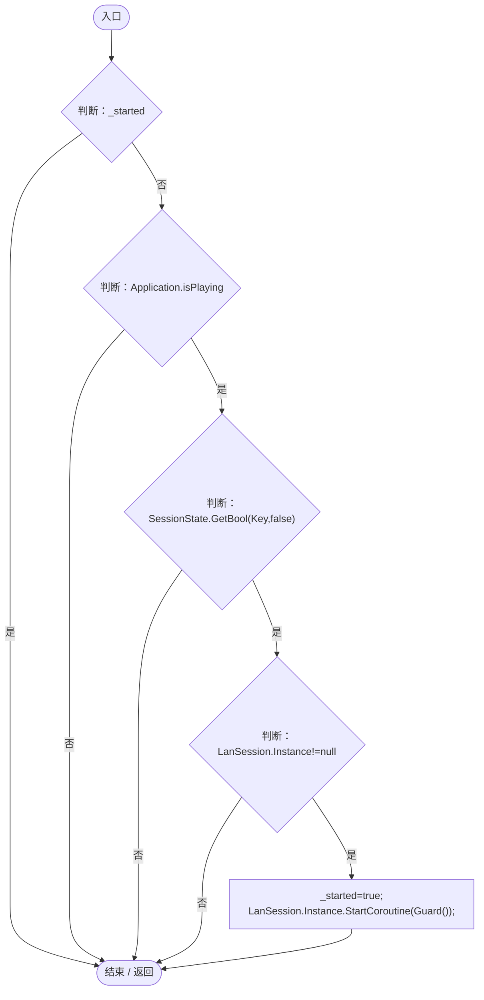

项目内调用/回调引用：

- [LanSession.Instance.get · L23](9fb633eebffe669c.md#mbf83306994878383)（访问器）
- [NearViewPerformanceAudit.Guard · L35](f44d9a167c505ecf.md#md3b95a193a98e5c9)（方法）

<a id="m20a73a3261df950b"></a>

## Arguments.get · L26

`private static string[] Arguments`

★ 新增：正常Hub启动的独立回归也能复现指定报告，不读取或复用授权启动参数。

### Editor · 语法控制结构 / 声明（非CFG）

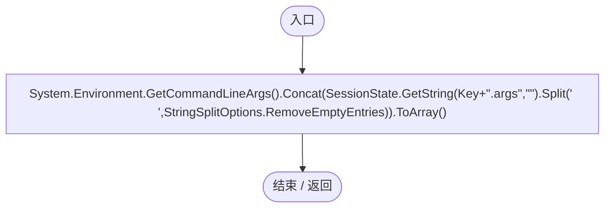

<a id="m21ac46b63e916b93"></a>

## RunLatestBatch · L27

`public static void RunLatestBatch()`


### Editor · Roslyn编译器控制流

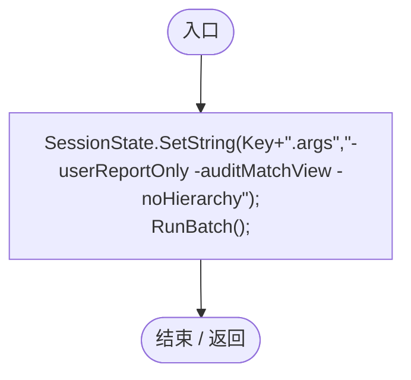

项目内调用/回调引用：

- [NearViewPerformanceAudit.RunBatch · L29](f44d9a167c505ecf.md#mdec8e373c8cd3684)（方法）

<a id="m3ba90b30d386784e"></a>

## RunLatestTraceBatch · L28

`public static void RunLatestTraceBatch()`


### Editor · Roslyn编译器控制流

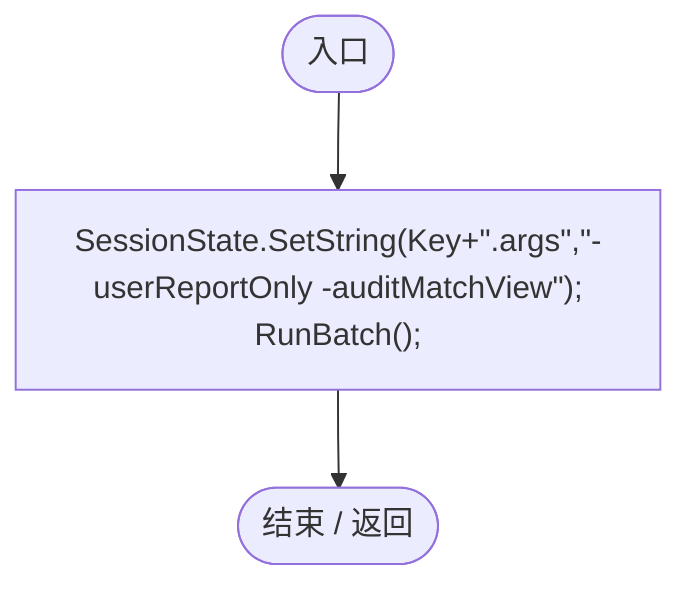

项目内调用/回调引用：

- [NearViewPerformanceAudit.RunBatch · L29](f44d9a167c505ecf.md#mdec8e373c8cd3684)（方法）

<a id="mdec8e373c8cd3684"></a>

## RunBatch · L29

`public static void RunBatch()`


### Editor · Roslyn编译器控制流

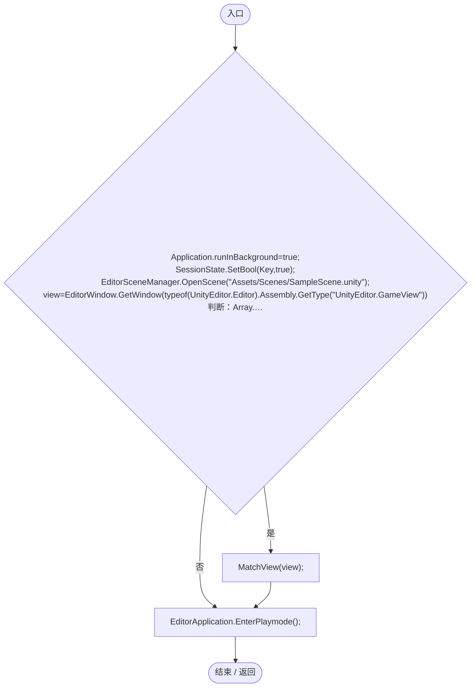

项目内调用/回调引用：

- [NearViewPerformanceAudit.MatchView · L31](f44d9a167c505ecf.md#mbeb7508b3d0052b3)（方法）

<a id="mbeb7508b3d0052b3"></a>

## MatchView · L31

`private static void MatchView(EditorWindow view)`

★ 新增：用已记录的用户Game视口尺寸对照DX12，不能把不同视野/渲染量混为同一帧数。

### Editor · Roslyn编译器控制流

```mermaid
flowchart TD
  b0(["入口"])
  b1["report=JsonUtility.FromJson&lt;PerformanceReport&gt;(File.ReadAllText(Path.Combine(Folder,&quot;user-report.json&quot;)))"]
  b2{"report.viewWorst<br/>判断：report.viewWorst"}
  b3["report.viewWorst"]
  b4["report.viewStart"]
  b5["viewport=report.viewWorst??report.viewStart"]
  b6["assembly=typeof(UnityEditor.Editor).Assembly<br/>sizesType=assembly.GetType(&quot;UnityEditor.GameViewSizes&quot;)<br/>sizes=sizesType.GetProperty(&quot;instance&quot;,BindingFlags.Public&#124;BindingFlags.Static&#124;BindingFlags.FlattenHierarchy).GetValue(null)<br/>get=sizesTy…"]
  b7(["结束 / 返回"])
  b0 --> b1
  b1 --> b2
  b2 -->|"否"| b3
  b2 -->|"是"| b4
  b3 --> b5
  b4 --> b5
  b5 --> b6
  b6 --> b7

```

<a id="md3b95a193a98e5c9"></a>

## Guard · L35

`private static IEnumerator Guard()`


### Editor · Roslyn编译器控制流

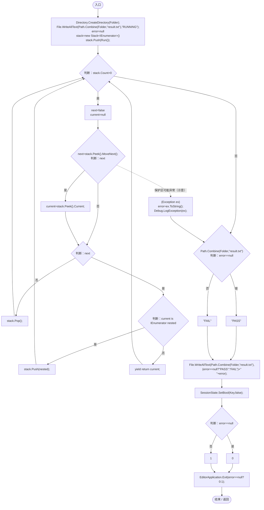

项目内调用/回调引用：

- [NearViewPerformanceAudit.Run · L50](f44d9a167c505ecf.md#md674c0d17d862943)（方法）

<a id="mfa1fe3d608579b44"></a>

## Sample · L42

`private static IEnumerator Sample(string name,bool warm=true,Action transition=null)`

★ 适配：与玩家8秒报告采用同样长度，并附缓存/批次证据。

### Editor · Roslyn编译器控制流

```mermaid
flowchart TD
  b0(["入口"])
  b1{"判断：warm"}
  b2["yield return new WaitForSecondsRealtime(.8f);"]
  b3["initialPopulation=EntityRegistry.All.Count<br/>began=EditorApplication.timeSinceStartup<br/>previous=began<br/>hits=ColonyFoodQueryCache.Hits<br/>searches=ColonyFoodQueryCache.Searches<br/>direct=EntityGroundProbe.DirectSamples<br/>reused=EntityGroundProbe.Cros…"]
  b4{"transition<br/>判断：transition"}
  b5["transition?.Invoke();"]
  b6{"判断：EditorApplication.timeSinceStartup-began&lt;8"}
  b7["yield return null;<br/>now=EditorApplication.timeSinceStartup<br/>sample.RecordFrame((now-previous)*1000);<br/>previous=now;"]
  b8["camera=Camera.main"]
  b9{"sample<br/>name<br/>SystemInfo.graphicsDeviceType<br/>Screen.width<br/>Screen.height<br/>initialPopulation<br/>Object.FindFirstObjectByType&lt;RandomPlanetSpawner&gt;().PlacementAttempts<br/>Object.FindFirstObjectByType&lt;RandomPlanetSpawner&gt;().GlobalFallbacks<br/>Object.FindF…"}
  b10["1"]
  b11["0"]
  b12["report=sample.Finish($&quot;{name} api={SystemInfo.graphicsDeviceType} size={Screen.width}x{Screen.height} initialEntities={initialPopulation} spawnAttempts={Object.FindFirstObjectByType&lt;RandomPlanetSpawner&gt;().PlacementAttempts} globalFallbac…"]
  b13["report.context+=$&quot; foodCacheHits={ColonyFoodQueryCache.Hits-hits} foodSearches={ColonyFoodQueryCache.Searches-searches} groundDirect={EntityGroundProbe.DirectSamples-direct} groundCrossReuse={EntityGroundProbe.CrossStepReused-reused} res…"]
  b14{"Path.Combine(Folder,name+&quot;-gpu.txt&quot;)<br/>判断：report.metrics.First(m=&gt;m.name==&quot;GPU Frame Time&quot;) is var gpu"}
  b15{"判断：gpu.available"}
  b16["$&quot;samples={gpu.samples} mean={gpu.mean:R} max={gpu.maximum:R}&quot;"]
  b17["&quot;GPU unavailable&quot;"]
  b18["File.WriteAllText(Path.Combine(Folder,name+&quot;-gpu.txt&quot;),report.metrics.First(m=&gt;m.name==&quot;GPU Frame Time&quot;) is var gpu&amp;&amp;gpu.available?$&quot;samples={gpu.samples} mean={gpu.mean:R} max={gpu.maximum:R}&quot;:&quot;GPU unavailable&quot;);"]
  b19{"判断：name.Contains(&quot;baseline&quot;)"}
  b20["yield return new WaitForEndOfFrame();<br/>ScreenCapture.CaptureScreenshot(Path.Combine(Folder,name+&quot;.png&quot;));<br/>yield return null;"]
  b21{"判断：sample=new PerformanceSampleSession()"}
  b22["sample=new PerformanceSampleSession()"]
  b23["连接 / 离开区域"]
  b24(["结束 / 返回"])
  b0 --> b1
  b1 -->|"是"| b2
  b1 -->|"否"| b3
  b2 --> b3
  b3 --> b4
  b4 -->|"否"| b5
  b4 -->|"是"| b6
  b5 --> b6
  b6 -->|"是"| b7
  b6 -->|"否"| b8
  b7 --> b6
  b8 --> b9
  b9 -->|"是"| b10
  b9 -->|"否"| b11
  b10 --> b12
  b11 --> b12
  b12 --> b13
  b13 --> b14
  b14 -->|"是"| b15
  b14 -->|"否"| b17
  b15 -->|"是"| b16
  b15 -->|"否"| b17
  b16 --> b18
  b17 --> b18
  b18 --> b19
  b19 -->|"是"| b20
  b19 -->|"否 · 经过finally 21"| b24
  b20 -->|"经过finally 21"| b24
  b21 -->|"否"| b22
  b21 -->|"是"| b23
  b22 --> b23
  b4 -. "退出保护区时 finally（示意）" .-> b21

```

项目内调用/回调引用：

- [ColonyFoodQueryCache.Hits.get · L16](63cd90165719dbff.md#m871ae7a0cf96f22d)（访问器）
- [ColonyFoodQueryCache.Searches.get · L16](63cd90165719dbff.md#m2faafc4a4fd9a504)（访问器）
- [ResourceCoordinates.Rebuilds.get · L24](93d731ac01e3af48.md#m8d7daf91ba26e421)（访问器）
- [CorpseInstanceRenderer.InstanceWrites.get · L47](29964f1f6c300ac9.md#m9330ca4e2a209288)（访问器）
- [PerformanceSampleSession.PerformanceSampleSession.ctor · L42](a8403a4c7503726d.md#mdb6c2d364ec2e182)（构造函数）
- [PerformanceSampleSession.RecordFrame · L50](a8403a4c7503726d.md#mffe46035e5d5ed6a)（方法）
- [PerformanceSampleSession.Finish · L54](a8403a4c7503726d.md#md4418226b9a88150)（方法）
- [RandomPlanetSpawner.PlacementAttempts.get · L22](1c13222a547b265c.md#m7105c7741d0a27a1)（访问器）
- [RandomPlanetSpawner.GlobalFallbacks.get · L22](1c13222a547b265c.md#m088d7c36b4b1b2ed)（访问器）
- [RandomPlanetSpawner.YieldedSlices.get · L22](1c13222a547b265c.md#m333178b68c3cece9)（访问器）
- [SimulationClock.IsRunning.get · L22](a8f444aec9614b0a.md#m10f4fe307faca0f0)（访问器）
- [ServiceLocator.Get · L33](f2fdbe9f9ccd93cb.md#m2ae625299520c56d)（方法）
- [PopulationRangeLayer.ActiveCircleCount.get · L17](7ad316e94c5af908.md#mdf5ce69158592d87)（访问器）
- [CorpseInstanceRenderer.LastInstances.get · L50](29964f1f6c300ac9.md#mc48fbcf8c606dd25)（访问器）
- [CorpseInstanceRenderer.LastBatches.get · L49](29964f1f6c300ac9.md#mb8773097c387985e)（访问器）
- [NearViewPerformanceAudit.回调@47 · L47](f44d9a167c505ecf.md#mee31b88dcde8c343)（回调/委托）

<a id="mee31b88dcde8c343"></a>

## 回调@47 · L47

`m … => 回调`


### Editor · Roslyn编译器控制流

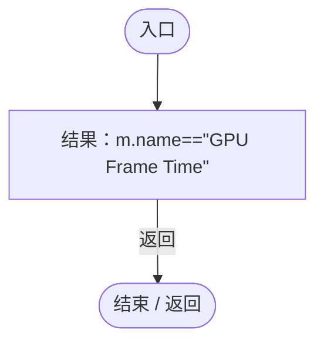

<a id="md674c0d17d862943"></a>

## Run · L50

`private static IEnumerator Run()`


### Editor · Roslyn编译器控制流

```mermaid
flowchart TD
  b0(["入口"])
  b1{"world=WorldSaveStore.Read(Path.Combine(Folder,&quot;input/world.json&quot;))<br/>args=Arguments<br/>countArg=Array.IndexOf(args,&quot;-populationCount&quot;)<br/>判断：countArg&gt;=0"}
  b2["keep=int.Parse(args[countArg+1])<br/>world.entities=world.entities.OrderByDescending(e=&gt;e.ecology?.ant?.role==&quot;Queen&quot;).Take(keep).ToList();<br/>world.running=false;"]
  b3["session=Object.FindFirstObjectByType&lt;WorldSessionManager&gt;()<br/>session.autoSaveInterval=36000;<br/>session.Open(world);"]
  b4{"判断：session.Busy"}
  b5["yield return null;"]
  b6{"clock=ServiceLocator.Get&lt;SimulationClock&gt;()<br/>clock.Pause();<br/>FramePacingSettings.SetLimit(0);<br/>camera=Camera.main<br/>orbit=camera.GetComponent&lt;OrbitCamera&gt;()<br/>orbit.enabled=false;<br/>planet=EcologyQueries.Planet<br/>weather=planet.GetComponent&lt;PlanetW…"}
  b7["saved=JsonUtility.FromJson&lt;PerformanceReport&gt;(File.ReadAllText(Path.Combine(Folder,&quot;user-report.json&quot;)))"]
  b8{"saved.viewWorst<br/>判断：saved.viewWorst"}
  b9["saved.viewWorst"]
  b10["saved.viewStart"]
  b11["capturedView=saved.viewWorst??saved.viewStart"]
  b12{"camera.transform.SetPositionAndRotation(capturedView.position,capturedView.rotation);<br/>camera.fieldOfView=capturedView.fieldOfView;<br/>camera.nearClipPlane=capturedView.nearClip;<br/>camera.farClipPlane=capturedView.farClip;<br/>clock.SetTimeScale(1…"}
  b13{"automatic=Object.FindFirstObjectByType&lt;RandomPlanetSpawner&gt;()<br/>automatic.Cancel();<br/>automatic.enabled=false;<br/>判断：Array.IndexOf(args,&quot;-rejectLanding&quot;)&gt;=0"}
  b14["automatic.landClearance=100000;"]
  b15{"rules=PopulationMaintenance.Capture()<br/>producerRule=rules.rules.First(r=&gt;r.category==PopulationRuleCategory.Producers)<br/>producerRule.enabled=true;<br/>producerRule.minimumCount=100000;<br/>PopulationMaintenance.Restore(rules);<br/>producerRule=Populat…"}
  b16["结果：new InvalidOperationException(&quot;强制投放缺口未启动&quot;)"]
  x16(["抛出异常 / 离开方法"])
  b17{"判断：Array.IndexOf(args,&quot;-noAutoSpawn&quot;)&gt;=0"}
  b18["automatic=Object.FindFirstObjectByType&lt;RandomPlanetSpawner&gt;()<br/>automatic.Cancel();<br/>automatic.enabled=false;"]
  b19{"判断：Array.IndexOf(args,&quot;-noNaturalBirth&quot;)&gt;=0"}
  b20["EntityRegistry.All"]
  b21{"判断：EntityRegistry.All"}
  b22["var"]
  b23["actor.Genes.Genome.Genes"]
  b24{"判断：actor.Genes.Genome.Genes"}
  b25["var"]
  b26{"判断：actor.Genes.GetLogic(gene) is DarwinPark.Entities.Logic.ReproductionGeneLogic logic"}
  b27["typeof(DarwinPark.Entities.Logic.ReproductionGeneLogic).GetField(&quot;_cooldownTimer&quot;,BindingFlags.NonPublic&#124;BindingFlags.Instance).SetValue(logic,100000f);"]
  b28["actor.Genes.Genome.Genes"]
  b29{"member=actor.GetComponent&lt;AntColonyMember&gt;()<br/>判断：member!=null"}
  b30["member.State.reproductionTimer=100000;<br/>member.State.reproductionCooldown=100000;"]
  b31{"判断：EntityRegistry.All"}
  b32["EntityRegistry.All"]
  b33["连接 / 离开区域"]
  b34{"trace=Array.IndexOf(Arguments,&quot;-noHierarchy&quot;)&lt;0<br/>判断：trace"}
  b35["UserFrameHierarchyAudit.Start();"]
  b36{"clock.Play();<br/>yield return Sample(&quot;user-running&quot;,Array.IndexOf(args,&quot;-forceDeficit&quot;)&lt;0);<br/>判断：trace"}
  b37["UserFrameHierarchyAudit.Finish(Folder);"]
  b38["clock.Pause();<br/>yield return Sample(&quot;user-paused&quot;);"]
  b39["target=EntityRegistry.All.Where(e=&gt;EcologyQueries.Alive(e)&amp;&amp;e.Genes.GetAttribute(&quot;moveSpeed&quot;)&gt;0&amp;&amp;!planet.IsSubmerged(e.transform.position)).OrderBy(e=&gt;(e.transform.position-camera.transform.position).sqrMagnitude).First()<br/>point=target.tr…"]
  b40{"-up<br/>判断：Mathf.Abs(up.y)&gt;.99f"}
  b41["Vector3.right"]
  b42["Vector3.up"]
  b43["rotation=Quaternion.LookRotation(-up,Mathf.Abs(up.y)&gt;.99f?Vector3.right:Vector3.up)"]
  b44{"判断：Array.IndexOf(Arguments,&quot;-coldOnly&quot;)&gt;=0"}
  b45["_protected=true;<br/>target.GetComponent&lt;EntityLifeCycle&gt;().RestoreProgress(40);<br/>health=target.GetComponent&lt;DarwinPark.Entities.Stats.EntityStats&gt;()<br/>health.SetMax(&quot;health&quot;,1000000);<br/>health.Modify(&quot;health&quot;,1000000,false);<br/>clock.SetTimeScale(1…"]
  b46{"camera.transform.SetPositionAndRotation(center+up*800,rotation);<br/>yield return Sample(&quot;far-paused-baseline&quot;);<br/>camera.transform.SetPositionAndRotation(point+up*10,rotation);<br/>yield return Sample(&quot;near-paused-baseline&quot;);<br/>clock.Play();<br/>yield …"}
  b47["camera.transform.SetPositionAndRotation(point+up*10,rotation);<br/>clock.SetTimeScale(16);<br/>clock.Play();<br/>yield return Sample(&quot;budget-05&quot;);<br/>clock.Pause();<br/>clock.maximumGameDelta=.1f;<br/>yield return Sample(&quot;budget-01&quot;);"]
  b48{"view=Object.FindFirstObjectByType&lt;EntityViewController&gt;()<br/>判断：view.EnterView(target)"}
  b49["结果：new InvalidOperationException(&quot;control rejected&quot;)"]
  x49(["抛出异常 / 离开方法"])
  b50{"input=view.GetComponent&lt;EntityPossessionInput&gt;()<br/>pitch=typeof(EntityPossessionInput).GetField(&quot;_pitch&quot;,BindingFlags.NonPublic&#124;BindingFlags.Instance)<br/>pitch.SetValue(input,0f);<br/>yield return Sample(&quot;control-horizon-paused-baseline&quot;);<br/>clock.…"}
  b51["结果：new InvalidOperationException(&quot;控制目标在输入样本中死亡，不能把退出镜头当控制结果&quot;)"]
  x51(["抛出异常 / 离开方法"])
  b52["Object.FindFirstObjectByType&lt;GeneInspectorUI&gt;().ShowEntityInfo(target);<br/>yield return Sample(&quot;control-inspector-paused&quot;);<br/>Object.FindFirstObjectByType&lt;GeneInspectorUI&gt;().HideEntityInfo();<br/>scheduler=Object.FindFirstObjectByType&lt;ResourceVis…"]
  b53["lights"]
  b54{"判断：lights"}
  b55["var<br/>l.enabled=false;"]
  b56{"lights<br/>判断：lights"}
  b57["lights"]
  b58["连接 / 离开区域"]
  b59["yield return Sample(&quot;control-no-resource-lights&quot;);"]
  b60["i=0"]
  b61{"判断：i&lt;lights.Length"}
  b62["lights[i].enabled=lightStates[i];<br/>i++"]
  b63["scheduler.enabled=true;<br/>shells=planet.GetComponentsInChildren&lt;Renderer&gt;(true).Where(r=&gt;r.name==&quot;AtmosphericScattering&quot;&#124;&#124;r.name==&quot;OceanSurface&quot;&#124;&#124;r.name==&quot;CloudVolume&quot;).ToArray()<br/>shellStates=shells.Select(r=&gt;r.enabled).ToArray()"]
  b64["shells"]
  b65{"判断：shells"}
  b66["var<br/>r.enabled=false;"]
  b67{"shells<br/>判断：shells"}
  b68["shells"]
  b69["连接 / 离开区域"]
  b70["yield return Sample(&quot;control-no-weather&quot;);"]
  b71["i=0"]
  b72{"判断：i&lt;shells.Length"}
  b73["shells[i].enabled=shellStates[i];<br/>i++"]
  b74{"surface=planet.GetComponent&lt;MeshRenderer&gt;()<br/>original=surface.sharedMaterial<br/>simple=new Material(Shader.Find(&quot;Universal Render Pipeline/Unlit&quot;))<br/>surface.sharedMaterial=simple;<br/>yield return Sample(&quot;control-simple-terrain&quot;);<br/>surface.sharedM…"}
  b75["old=scale.GetValue(pipeline)<br/>scale.SetValue(pipeline,.5f);<br/>yield return Sample(&quot;control-half-resolution&quot;);<br/>scale.SetValue(pipeline,old);"]
  b76["view.ExitView();<br/>orbit.RestoreView(center+up*800,rotation,800);<br/>orbit.enabled=true;<br/>clock.Play();<br/>orbit.FocusOn(point);<br/>yield return Sample(&quot;zoom-transition-running&quot;);<br/>clock.Pause();<br/>orbit.enabled=false;<br/>camera.transform.SetPositionAndRo…"]
  b77(["结束 / 返回"])
  b0 --> b1
  b1 -->|"是"| b2
  b1 -->|"否"| b3
  b2 --> b3
  b3 --> b4
  b4 -->|"是"| b5
  b4 -->|"否"| b6
  b5 --> b4
  b6 -->|"是"| b7
  b6 -->|"否"| b39
  b7 --> b8
  b8 -->|"否"| b9
  b8 -->|"是"| b10
  b9 --> b11
  b10 --> b11
  b11 --> b12
  b12 -->|"是"| b13
  b12 -->|"否"| b17
  b13 -->|"是"| b14
  b13 -->|"否"| b15
  b14 --> b15
  b15 -->|"否"| b16
  b15 -->|"是"| b17
  b16 -->|"Throw"| x16
  b17 -->|"是"| b18
  b17 -->|"否"| b19
  b18 --> b19
  b19 -->|"是"| b20
  b19 -->|"否"| b34
  b20 --> b21
  b21 -->|"是"| b22
  b21 -->|"否 · 经过finally 31"| b34
  b22 --> b23
  b23 --> b24
  b24 -->|"是"| b25
  b24 -->|"否 · 经过finally 28"| b29
  b25 --> b26
  b26 -->|"是"| b27
  b26 -->|"否"| b24
  b27 --> b24
  b29 -->|"是"| b30
  b29 -->|"否"| b21
  b30 --> b21
  b31 -->|"否"| b32
  b31 -->|"是"| b33
  b32 --> b33
  b34 -->|"是"| b35
  b34 -->|"否"| b36
  b35 --> b36
  b36 -->|"是"| b37
  b36 -->|"否"| b38
  b37 --> b38
  b38 --> b77
  b39 --> b40
  b40 -->|"是"| b41
  b40 -->|"否"| b42
  b41 --> b43
  b42 --> b43
  b43 --> b44
  b44 -->|"是"| b45
  b44 -->|"否"| b46
  b45 --> b77
  b46 -->|"是"| b47
  b46 -->|"否"| b48
  b47 --> b77
  b48 -->|"否"| b49
  b48 -->|"是"| b50
  b49 -->|"Throw"| x49
  b50 -->|"否"| b51
  b50 -->|"是"| b52
  b51 -->|"Throw"| x51
  b52 --> b53
  b53 --> b54
  b54 -->|"是"| b55
  b54 -->|"否 · 经过finally 56"| b59
  b55 --> b54
  b56 -->|"否"| b57
  b56 -->|"是"| b58
  b57 --> b58
  b59 --> b60
  b60 --> b61
  b61 -->|"是"| b62
  b61 -->|"否"| b63
  b62 --> b61
  b63 --> b64
  b64 --> b65
  b65 -->|"是"| b66
  b65 -->|"否 · 经过finally 67"| b70
  b66 --> b65
  b67 -->|"否"| b68
  b67 -->|"是"| b69
  b68 --> b69
  b70 --> b71
  b71 --> b72
  b72 -->|"是"| b73
  b72 -->|"否"| b74
  b73 --> b72
  b74 -->|"是"| b75
  b74 -->|"否"| b76
  b75 --> b76
  b76 --> b77
  b24 -. "退出保护区时 finally（示意）" .-> b28
  b21 -. "退出保护区时 finally（示意）" .-> b31
  b54 -. "退出保护区时 finally（示意）" .-> b56
  b65 -. "退出保护区时 finally（示意）" .-> b67

```

项目内调用/回调引用：

- [WorldSaveStore.Read · L74](d67a35e5e3814c15.md#mde52fadbe0185af1)（方法）
- [WorldSessionManager.Open · L60](08741c7b7b9d9344.md#m7bd56ef45131b4e5)（方法）
- [WorldSessionManager.Busy.get · L24](08741c7b7b9d9344.md#m4483e2e4f28f7c85)（访问器）
- [ServiceLocator.Get · L33](f2fdbe9f9ccd93cb.md#m2ae625299520c56d)（方法）
- [SimulationClock.Pause · L79](a8f444aec9614b0a.md#m30929d45a885d0f1)（方法）
- [FramePacingSettings.SetLimit · L19](8a946f816b77d4b6.md#mff17d0cc654b6a7f)（方法）
- [PopulationRangeLayer.SetVisible · L18](7ad316e94c5af908.md#m224360ff57b7a890)（方法）
- [SimulationClock.SetTimeScale · L81](a8f444aec9614b0a.md#mecaa463a0561aca3)（方法）
- [RandomPlanetSpawner.Cancel · L92](1c13222a547b265c.md#ma34d7509b5f0cc9a)（方法）
- [PopulationMaintenance.Capture · L147](923ccc4e86c4786c.md#m12f4b5c116f566f8)（方法）
- [PopulationMaintenance.Restore · L162](923ccc4e86c4786c.md#m23ae054ef57d2624)（方法）
- [RandomPlanetSpawner.StartRecipe · L30](1c13222a547b265c.md#m412531b3a7a7af47)（方法）
- [DarwinEntity.Genes.get · L14](70798dde169f2e8b.md#m622eb1adf401d431)（访问器）
- [EntityGeneController.GetLogic · L242](7494d53178552f0e.md#m4620848081f43ecc)（方法）
- [AntColonyMember.State.get · L34](baebd85c05598377.md#m64745194ab46f363)（访问器）
- [UserFrameHierarchyAudit.Start · L15](778dd6bf439321fc.md#m1518061a892f5d96)（方法）
- [SimulationClock.Play · L78](a8f444aec9614b0a.md#m7aa9e64b7de60ed0)（方法）
- [NearViewPerformanceAudit.Sample · L42](f44d9a167c505ecf.md#mfa1fe3d608579b44)（方法）
- [UserFrameHierarchyAudit.Finish · L16](778dd6bf439321fc.md#me98fc2ab62d614a6)（方法）
- [EntityLifeCycle.RestoreProgress · L53](9f4138bfbae654b7.md#m9ac5190ce2d7c425)（方法）
- [EntityStats.SetMax · L134](75aa86a368efdf24.md#m22eae4284df59644)（方法）
- [EntityStats.Modify · L114](75aa86a368efdf24.md#m375a3812ef990b45)（方法）
- [EntityViewController.ExitView · L105](0ad0345f83229ef0.md#mca8619c7f27942c9)（方法）
- [EntityViewController.EnterView · L73](0ad0345f83229ef0.md#mbd7be6d2bbd0ec83)（方法）
- [OrbitCamera.EntityViewActive.get · L39](42eb429559b42bcb.md#m4b320edff61e06a5)（访问器）
- [GeneInspectorUI.ShowEntityInfo · L387](924e27c34e7b1f0a.md#mfbae827fa8eb1ff1)（方法）
- [GeneInspectorUI.HideEntityInfo · L317](924e27c34e7b1f0a.md#mc9346c30e59e03d7)（方法）
- [OrbitCamera.RestoreView · L42](42eb429559b42bcb.md#m8ee0579d9414ca2c)（方法）
- [OrbitCamera.FocusOn · L172](42eb429559b42bcb.md#m1f87e8c62262b27b)（方法）
- [NearViewPerformanceAudit.回调@54 · L54](f44d9a167c505ecf.md#m6fe3a7b7d9cedbd6)（回调/委托）
- [NearViewPerformanceAudit.回调@65 · L65](f44d9a167c505ecf.md#mafb57687c5b05e9c)（回调/委托）
- [NearViewPerformanceAudit.回调@65 · L65](f44d9a167c505ecf.md#m2003719f81020625)（回调/委托）
- [NearViewPerformanceAudit.回调@79 · L79](f44d9a167c505ecf.md#m27262cdf587e064d)（回调/委托）
- [NearViewPerformanceAudit.回调@79 · L79](f44d9a167c505ecf.md#m5ec039b4de1944bf)（回调/委托）
- [NearViewPerformanceAudit.回调@84 · L84](f44d9a167c505ecf.md#mcb213cfee462660f)（回调/委托）
- [NearViewPerformanceAudit.回调@84 · L84](f44d9a167c505ecf.md#m032f0d79828a9f9a)（回调/委托）
- [NearViewPerformanceAudit.回调@97 · L97](f44d9a167c505ecf.md#mbc4ac6222ad35ee9)（回调/委托）
- [NearViewPerformanceAudit.回调@97 · L97](f44d9a167c505ecf.md#m710af27f8570c416)（回调/委托）
- [NearViewPerformanceAudit.回调@98 · L98](f44d9a167c505ecf.md#m9a38f0cdce8fe6ae)（回调/委托）
- [NearViewPerformanceAudit.回调@98 · L98](f44d9a167c505ecf.md#m04850972f9c42fd1)（回调/委托）

<a id="m6fe3a7b7d9cedbd6"></a>

## 回调@54 · L54

`e … => 回调`


### Editor · Roslyn编译器控制流

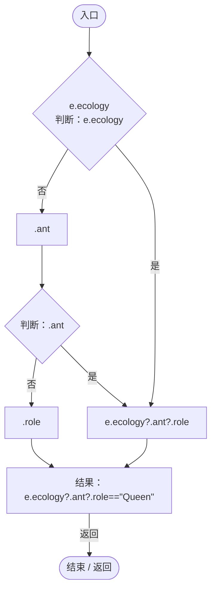

<a id="mafb57687c5b05e9c"></a>

## 回调@65 · L65

`r … => 回调`


### Editor · Roslyn编译器控制流

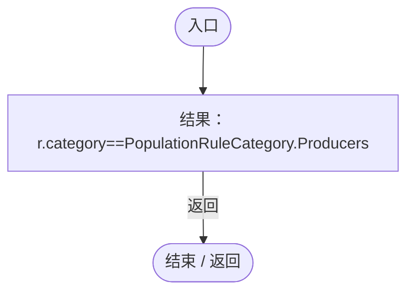

<a id="m2003719f81020625"></a>

## 回调@65 · L65

`r … => 回调`


### Editor · Roslyn编译器控制流

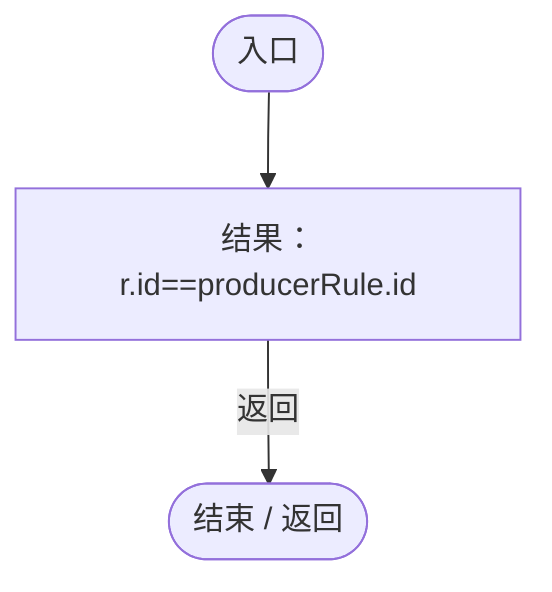

<a id="m27262cdf587e064d"></a>

## 回调@79 · L79

`e … => 回调`


### Editor · Roslyn编译器控制流

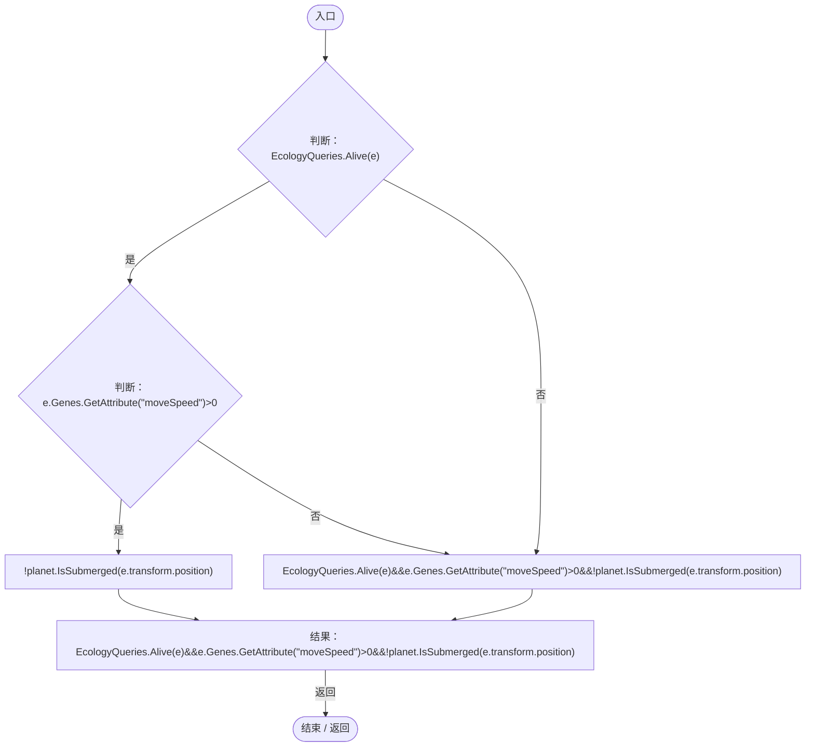

项目内调用/回调引用：

- [EcologyQueries.Alive · L39](bdf7ccc2c9c0452f.md#m8352bfacbe2996a8)（方法）
- [EntityGeneController.GetAttribute · L288](7494d53178552f0e.md#m45127bcdd833aaf5)（方法）
- [DarwinEntity.Genes.get · L14](70798dde169f2e8b.md#m622eb1adf401d431)（访问器）
- [PlanetTerrainMeshBuilder.IsSubmerged · L107](415285cf043354a9.md#m77993fefee27a702)（方法）

<a id="m5ec039b4de1944bf"></a>

## 回调@79 · L79

`e … => 回调`


### Editor · Roslyn编译器控制流

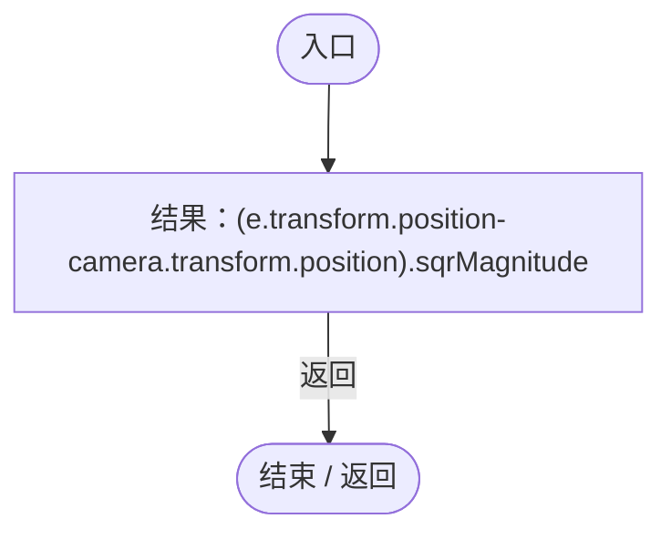

<a id="mcb213cfee462660f"></a>

## 回调@84 · L84

`( … => 回调`


### Editor · Roslyn编译器控制流

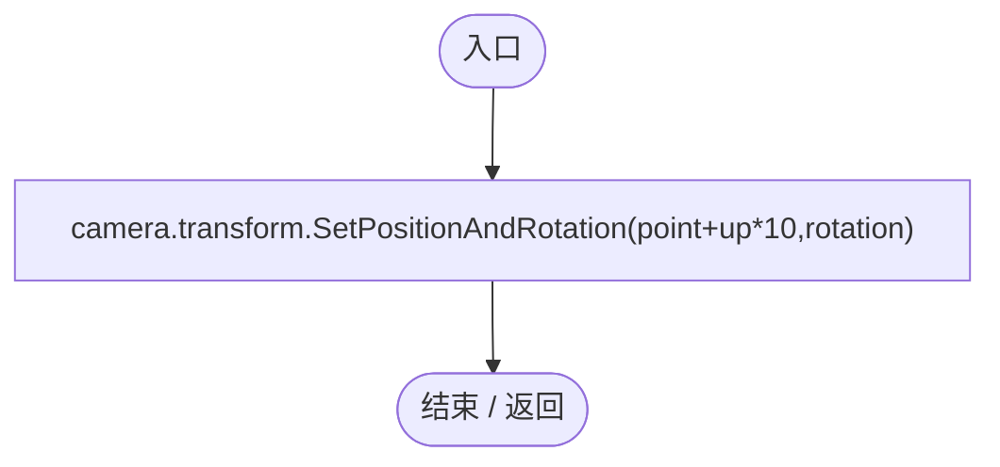

<a id="m032f0d79828a9f9a"></a>

## 回调@84 · L84

`( … => 回调`


### Editor · Roslyn编译器控制流

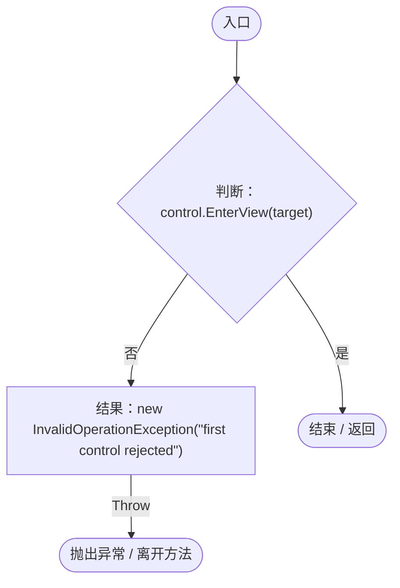

项目内调用/回调引用：

- [EntityViewController.EnterView · L73](0ad0345f83229ef0.md#mbd7be6d2bbd0ec83)（方法）

<a id="mbc4ac6222ad35ee9"></a>

## 回调@97 · L97

`r … => 回调`


### Editor · Roslyn编译器控制流

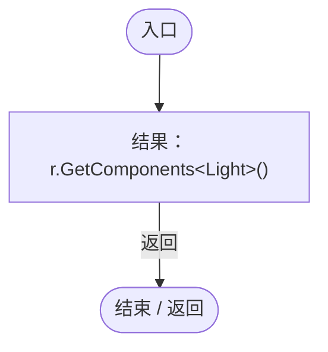

<a id="m710af27f8570c416"></a>

## 回调@97 · L97

`l … => 回调`


### Editor · Roslyn编译器控制流

```mermaid
flowchart TD
  b0(["入口"])
  b1["结果：l.enabled"]
  b2(["结束 / 返回"])
  b0 --> b1
  b1 -->|"返回"| b2

```

<a id="m9a38f0cdce8fe6ae"></a>

## 回调@98 · L98

`r … => 回调`


### Editor · Roslyn编译器控制流

```mermaid
flowchart TD
  b0(["入口"])
  b1{"判断：r.name==&quot;AtmosphericScattering&quot;"}
  b2{"判断：r.name==&quot;OceanSurface&quot;"}
  b3["r.name==&quot;CloudVolume&quot;"]
  b4["r.name==&quot;AtmosphericScattering&quot;&#124;&#124;r.name==&quot;OceanSurface&quot;&#124;&#124;r.name==&quot;CloudVolume&quot;"]
  b5["结果：r.name==&quot;AtmosphericScattering&quot;&#124;&#124;r.name==&quot;OceanSurface&quot;&#124;&#124;r.name==&quot;CloudVolume&quot;"]
  b6(["结束 / 返回"])
  b0 --> b1
  b1 -->|"否"| b2
  b1 -->|"是"| b4
  b2 -->|"否"| b3
  b2 -->|"是"| b4
  b3 --> b5
  b4 --> b5
  b5 -->|"返回"| b6

```

<a id="m04850972f9c42fd1"></a>

## 回调@98 · L98

`r … => 回调`


### Editor · Roslyn编译器控制流

```mermaid
flowchart TD
  b0(["入口"])
  b1["结果：r.enabled"]
  b2(["结束 / 返回"])
  b0 --> b1
  b1 -->|"返回"| b2

```

<a id="m4425c803561602f6"></a>

## Apply · L109

`private void Apply()`


### Editor · Roslyn编译器控制流

```mermaid
flowchart TD
  b0(["入口"])
  b1{"判断：view==null"}
  b2{"判断：view.Target==null"}
  b3{"判断：ServiceLocator.Get&lt;SimulationClock&gt;().IsRunning"}
  b4["manual=view.Target.GetComponent&lt;EntityManualControl&gt;()<br/>camera=Camera.main<br/>manual.SetAim(new Ray(camera.transform.position,camera.transform.forward));"]
  b5{"manual<br/>判断：move"}
  b6["camera.transform.forward"]
  b7["Vector3.zero"]
  b8["manual.SetInput(move?camera.transform.forward:Vector3.zero,attack);"]
  b9(["结束 / 返回"])
  b0 --> b1
  b1 -->|"否"| b2
  b1 -->|"是"| b9
  b2 -->|"否"| b3
  b2 -->|"是"| b9
  b3 -->|"否"| b9
  b3 -->|"是"| b4
  b4 --> b5
  b5 -->|"是"| b6
  b5 -->|"否"| b7
  b6 --> b8
  b7 --> b8
  b8 --> b9

```

项目内调用/回调引用：

- [EntityViewController.Target.get · L16](0ad0345f83229ef0.md#m87ca090092a884ab)（访问器）
- [SimulationClock.IsRunning.get · L22](a8f444aec9614b0a.md#m10f4fe307faca0f0)（访问器）
- [ServiceLocator.Get · L33](f2fdbe9f9ccd93cb.md#m2ae625299520c56d)（方法）
- [EntityManualControl.SetAim · L27](a6969896da35e1f0.md#m70f09d0090a1fa41)（方法）
- [EntityManualControl.SetInput · L33](a6969896da35e1f0.md#mb1079fe9e2dced13)（方法）

<a id="m296d7c0a218e82b8"></a>

## Update · L110

`private void Update()`


### Editor · Roslyn编译器控制流

```mermaid
flowchart TD
  b0(["入口"])
  b1["Apply()"]
  b2(["结束 / 返回"])
  b0 --> b1
  b1 --> b2

```

项目内调用/回调引用：

- [NearViewInputFixture.Apply · L109](f44d9a167c505ecf.md#m4425c803561602f6)（方法）

<a id="m5db0a3b44615cb2b"></a>

## FixedUpdate · L110

`private void FixedUpdate()`


### Editor · Roslyn编译器控制流

```mermaid
flowchart TD
  b0(["入口"])
  b1["Apply()"]
  b2(["结束 / 返回"])
  b0 --> b1
  b1 --> b2

```

项目内调用/回调引用：

- [NearViewInputFixture.Apply · L109](f44d9a167c505ecf.md#m4425c803561602f6)（方法）
