# ProjectOptimizationRegression.cs

[返回总索引](../README.md) · `Editor` · `Assets/DarwinPark/Editor/ProjectOptimizationRegression.cs`

[源文件](../../../Assets/DarwinPark/Editor/ProjectOptimizationRegression.cs) · 源码校验：`953d36d0d48dec16eeeaccda6c6e5faab16871a9201603a52714d55bab20aaf7`

方法按源文件位置排列。事件/回调引用不表示立即执行；分支与异常说明见总索引。完整源码与可点击关系图请打开离线手册。

<a id="m361e9386201590b9"></a>

## Folder.get · L31

`private static string Folder`


### Editor · 语法控制结构 / 声明（非CFG）

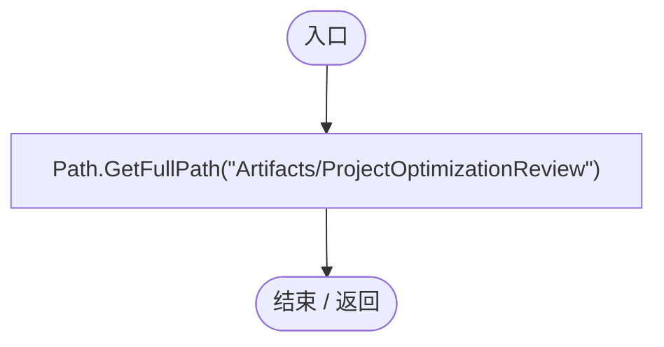

<a id="m84d1a427b0d33a7b"></a>

## ProjectOptimizationRegression.ctor · L32

`static ProjectOptimizationRegression()`


### Editor · Roslyn编译器控制流

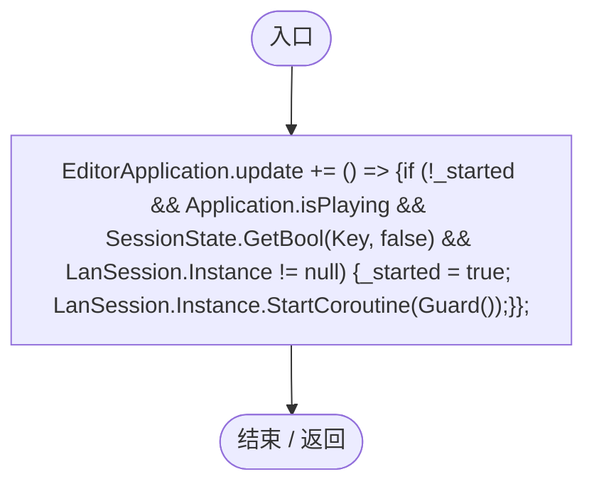

项目内调用/回调引用：

- [ProjectOptimizationRegression.回调@33 · L33](f5351f9e1fa97815.md#m5507e6fb4d989f87)（回调/委托）

<a id="m5507e6fb4d989f87"></a>

## 回调@33 · L33

`( … => 回调`


### Editor · Roslyn编译器控制流

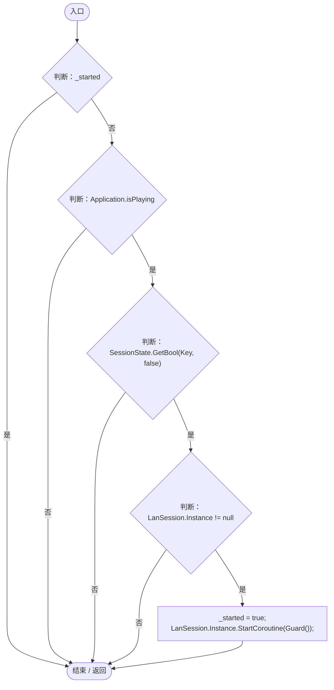

项目内调用/回调引用：

- [LanSession.Instance.get · L23](9fb633eebffe669c.md#mbf83306994878383)（访问器）
- [ProjectOptimizationRegression.Guard · L38](f5351f9e1fa97815.md#m6f6ae7922879625a)（方法）

<a id="ma2534df76e84e352"></a>

## RunBatch · L34

`public static void RunBatch()`


### Editor · Roslyn编译器控制流

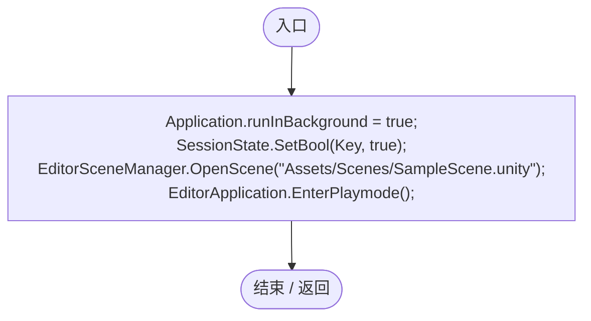

<a id="m6dd54dc2bad6d554"></a>

## Check · L36

`private static void Check(bool value, string text)`


### Editor · Roslyn编译器控制流

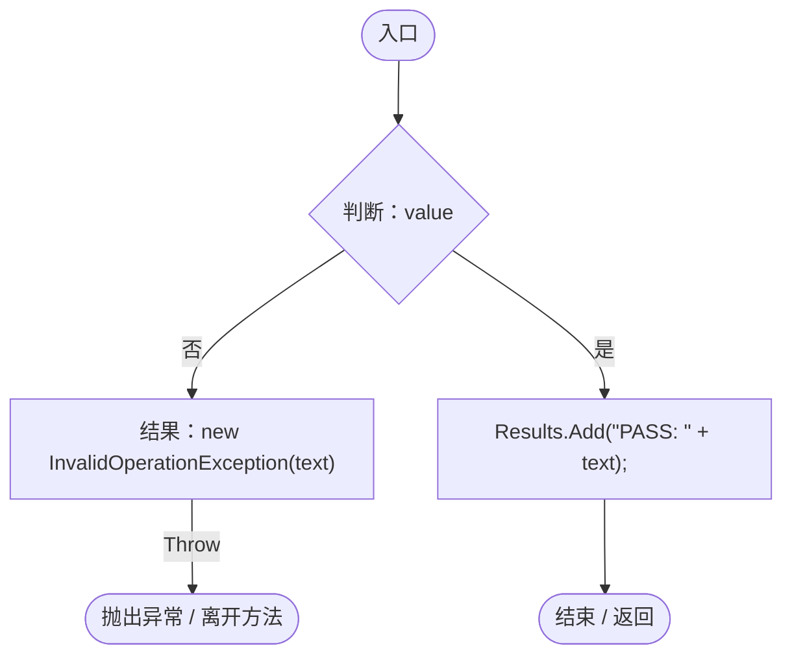

<a id="m6f6ae7922879625a"></a>

## Guard · L38

`private static IEnumerator Guard()`


### Editor · Roslyn编译器控制流

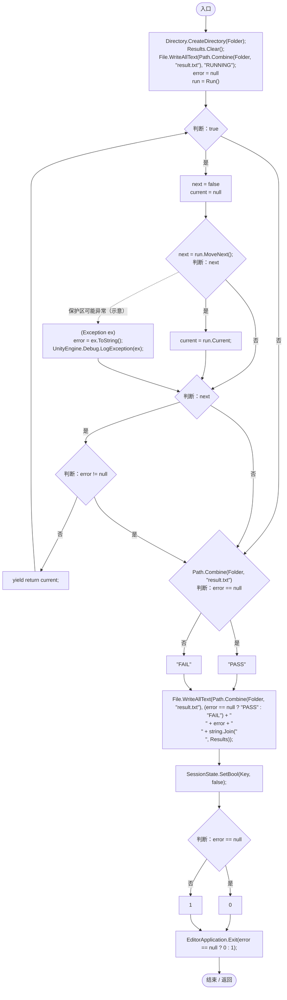

项目内调用/回调引用：

- [ProjectOptimizationRegression.Run · L117](f5351f9e1fa97815.md#m5311947a5037a31c)（方法）

<a id="m7b6933b2be3d10a2"></a>

## Genes · L52

`private static EntityGeneController Genes(params string[] ids)`


### Editor · Roslyn编译器控制流

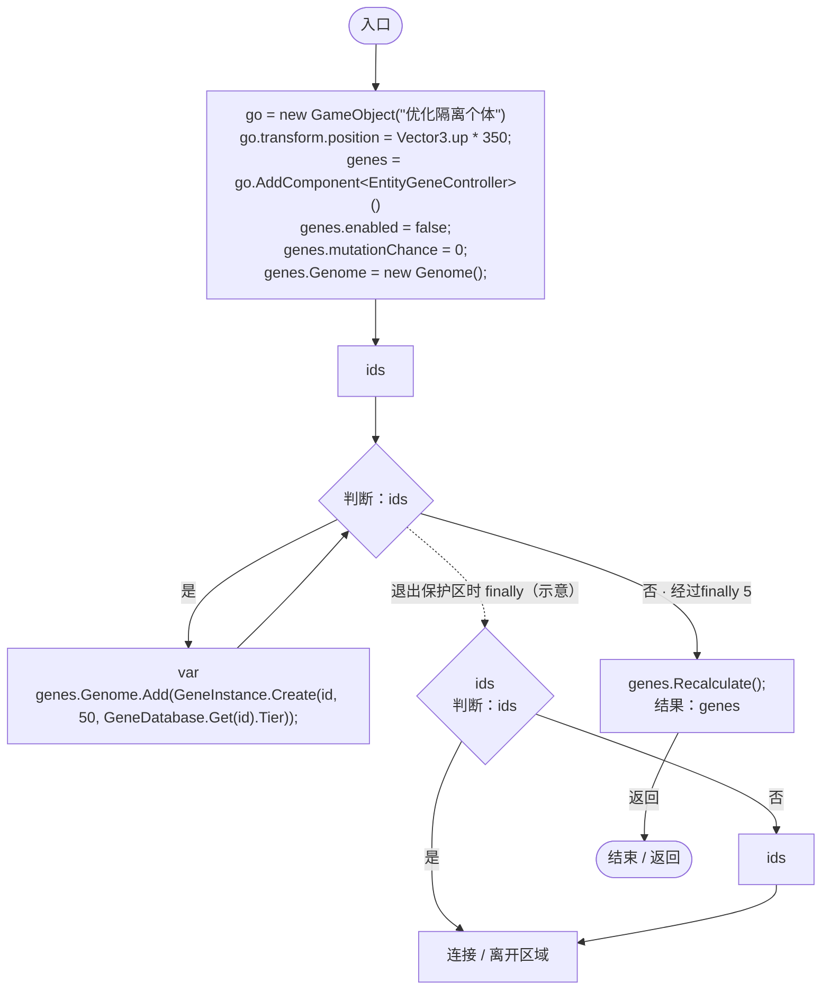

项目内调用/回调引用：

- [Genome.Add · L19](a2ef23f865bc7ee8.md#md9cfdc94b8b8d40f)（方法）
- [GeneInstance.Create · L20](f82e1498d67f5afd.md#m72e94c278de3cf8b)（方法）
- [GeneDatabase.Get · L135](ec0a03483435a863.md#m8f3bbfb35f3ca397)（方法）
- [EntityGeneController.Recalculate · L97](7494d53178552f0e.md#m65ea735c1e0e37a1)（方法）

<a id="ma17988575211878d"></a>

## Entity · L59

`private static DarwinEntity Entity(string id)`


### Editor · Roslyn编译器控制流

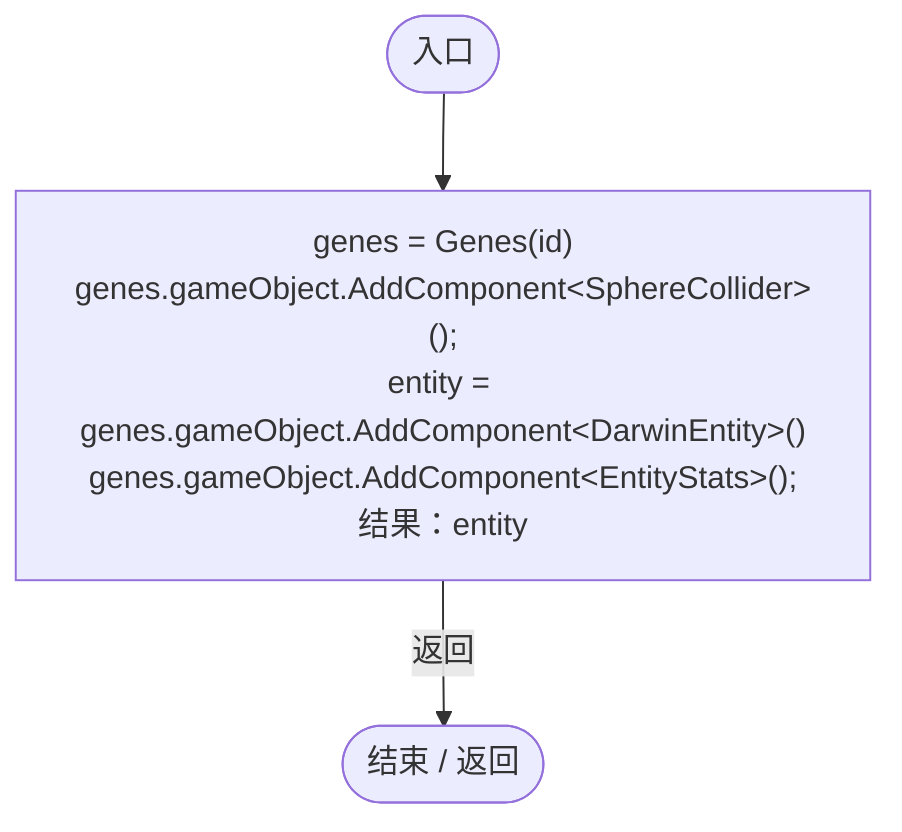

项目内调用/回调引用：

- [ProjectOptimizationRegression.Genes · L52](f5351f9e1fa97815.md#m7b6933b2be3d10a2)（方法）

<a id="m9be07b578c3e6a77"></a>

## LegacyMatches · L66

`private static bool LegacyMatches(RandomSpawnRecipe recipe, Genome genome)`

★ 新增：保留原LINQ公式仅用于对照，禁用基因仍算携带，复制基因不改变必有/必无语义。

### Editor · Roslyn编译器控制流

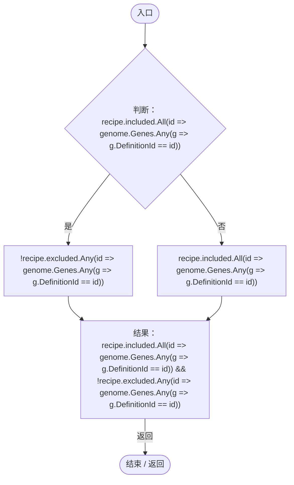

项目内调用/回调引用：

- [ProjectOptimizationRegression.回调@67 · L67](f5351f9e1fa97815.md#mfb26c66fe3a1d213)（回调/委托）
- [ProjectOptimizationRegression.回调@67 · L67](f5351f9e1fa97815.md#m727d5307c1b48402)（回调/委托）

<a id="mfb26c66fe3a1d213"></a>

## 回调@67 · L67

`id … => 回调`


### Editor · Roslyn编译器控制流


项目内调用/回调引用：

- [ProjectOptimizationRegression.回调@67 · L67](f5351f9e1fa97815.md#m12c7e3464c954635)（回调/委托）

<a id="m12c7e3464c954635"></a>

## 回调@67 · L67

`g … => 回调`


### Editor · Roslyn编译器控制流


<a id="m727d5307c1b48402"></a>

## 回调@67 · L67

`id … => 回调`


### Editor · Roslyn编译器控制流

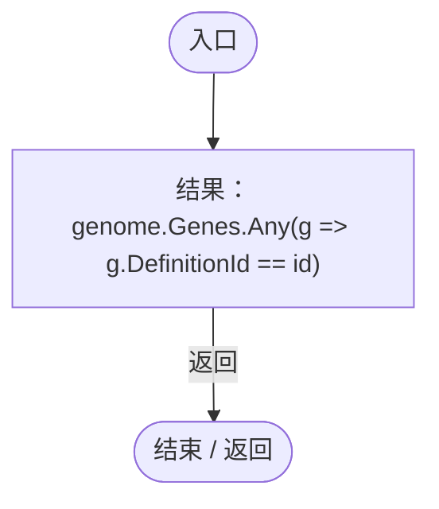

项目内调用/回调引用：

- [ProjectOptimizationRegression.回调@67 · L67](f5351f9e1fa97815.md#mbba051d104819e50)（回调/委托）

<a id="mbba051d104819e50"></a>

## 回调@67 · L67

`g … => 回调`


### Editor · Roslyn编译器控制流

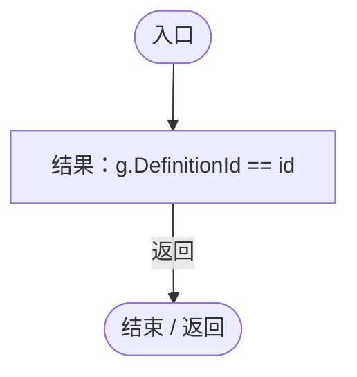

<a id="m81851490aa10e5d2"></a>

## LegacyLookup · L68

`private static GeneEvaluation LegacyLookup(EntityGeneController genes, GeneInstance gene)`


### Editor · Roslyn编译器控制流

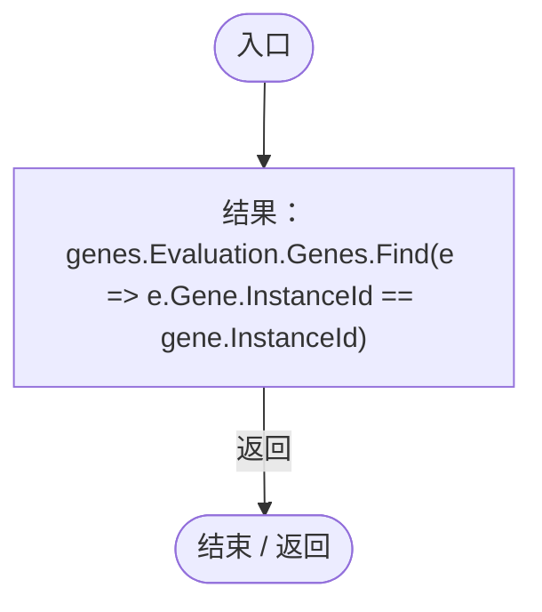

项目内调用/回调引用：

- [EntityGeneController.Evaluation.get · L18](7494d53178552f0e.md#mc0039c100a31b455)（访问器）
- [ProjectOptimizationRegression.回调@69 · L69](f5351f9e1fa97815.md#mae1e8b8379908cb1)（回调/委托）

<a id="mae1e8b8379908cb1"></a>

## 回调@69 · L69

`e … => 回调`


### Editor · Roslyn编译器控制流

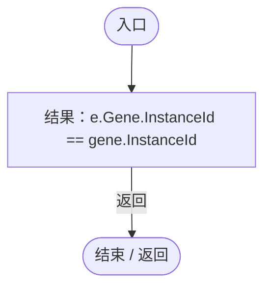

<a id="m235a062a4df9837b"></a>

## LegacyName · L70

`private static string LegacyName()`


### Editor · Roslyn编译器控制流

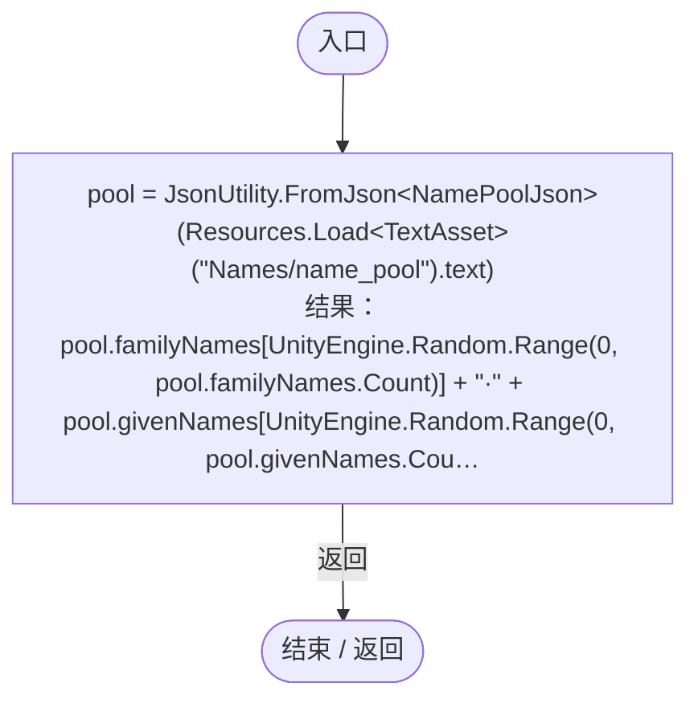

<a id="m3850ae51b8985dd9"></a>

## Measure · L75

`private static double Measure(Action action, int count)`


### Editor · Roslyn编译器控制流

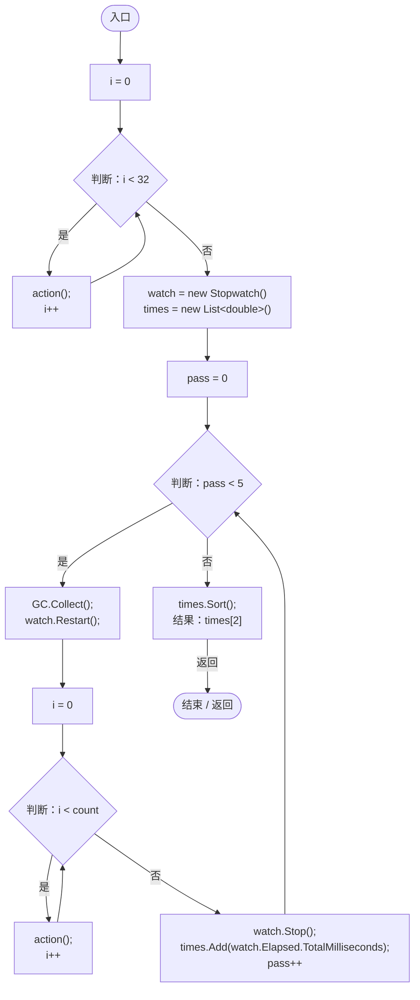

<a id="md407bae6dd51ece1"></a>

## Allocations · L88

`private static int Allocations(Action action)`

★ 修复（防Bug回归）：Unity Mono的GetAllocatedBytesForCurrentThread在本机恒为0；使用主线程GC.Alloc记录器并校验容量和旧路径阳性对照。

### Editor · Roslyn编译器控制流

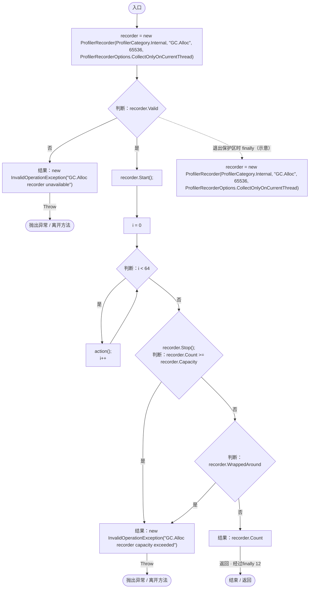

<a id="mfb43bf2475667c90"></a>

## Benchmark · L96

`private static void Benchmark(string name, Action before, Action after, int count)`


### Editor · Roslyn编译器控制流

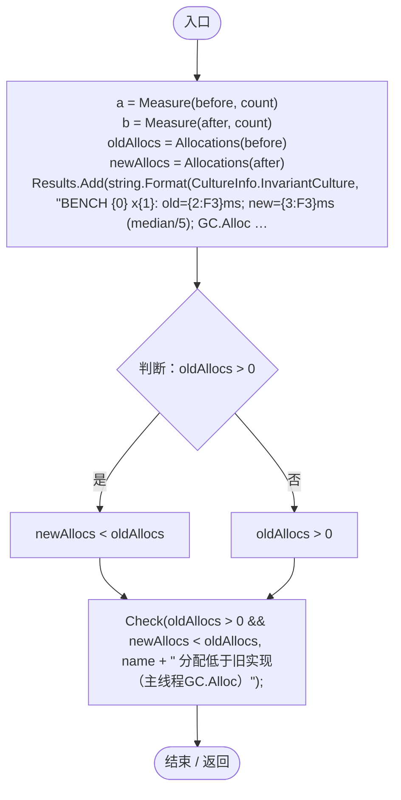

项目内调用/回调引用：

- [ProjectOptimizationRegression.Measure · L75](f5351f9e1fa97815.md#m3850ae51b8985dd9)（方法）
- [ProjectOptimizationRegression.Allocations · L88](f5351f9e1fa97815.md#md407bae6dd51ece1)（方法）
- [ProjectOptimizationRegression.Check · L36](f5351f9e1fa97815.md#m6dd54dc2bad6d554)（方法）

<a id="ma0a22c38e78f7789"></a>

## Initialize · L105

`public void Initialize(EntityGeneController c, GeneInstance g)`


### Editor · Roslyn编译器控制流

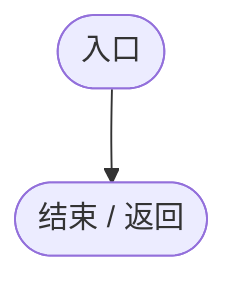

<a id="m65f54bcf2d4f496c"></a>

## OnUpdate · L106

`public void OnUpdate(float dt)`


### Editor · Roslyn编译器控制流

```mermaid
flowchart TD
  b0(["入口"])
  b1["ticks++;"]
  b2{"callback<br/>判断：callback"}
  b3["callback?.Invoke();"]
  b4(["结束 / 返回"])
  b0 --> b1
  b1 --> b2
  b2 -->|"否"| b3
  b2 -->|"是"| b4
  b3 --> b4

```

<a id="m6ac8e557fa014cf5"></a>

## GetTooltipInfo · L107

`public string GetTooltipInfo()`


### Editor · Roslyn编译器控制流

```mermaid
flowchart TD
  b0(["入口"])
  b1["结果：&quot;probe&quot;"]
  b2(["结束 / 返回"])
  b0 --> b1
  b1 -->|"返回"| b2

```

<a id="ma270b71ad3551664"></a>

## ModuleId.get · L111

`public string ModuleId`


### Editor · 语法控制结构 / 声明（非CFG）

```mermaid
flowchart TD
  n2(["入口"])
  n1["&quot;optimization_probe&quot;"]
  n0(["结束 / 返回"])
  n1 --> n0
  n2 --> n1

```

<a id="m40f01e14a914e082"></a>

## Initialize · L113

`public void Initialize(EntityAIContext context)`


### Editor · Roslyn编译器控制流

```mermaid
flowchart TD
  b0(["入口"])
  b1(["结束 / 返回"])
  b0 --> b1

```

<a id="m4a9d7d263d6d88e4"></a>

## Tick · L114

`public void Tick(float dt)`


### Editor · Roslyn编译器控制流

```mermaid
flowchart TD
  b0(["入口"])
  b1["ticks++;"]
  b2{"callback<br/>判断：callback"}
  b3["callback?.Invoke();"]
  b4(["结束 / 返回"])
  b0 --> b1
  b1 --> b2
  b2 -->|"否"| b3
  b2 -->|"是"| b4
  b3 --> b4

```

<a id="ma60467694bdeae05"></a>

## OnDisable · L115

`public void OnDisable()`


### Editor · Roslyn编译器控制流

```mermaid
flowchart TD
  b0(["入口"])
  b1["disabled++;"]
  b2(["结束 / 返回"])
  b0 --> b1
  b1 --> b2

```

<a id="m5311947a5037a31c"></a>

## Run · L117

`private static IEnumerator Run()`


### Editor · Roslyn编译器控制流

```mermaid
flowchart TD
  b0(["入口"])
  b1["clock = ServiceLocator.Get&lt;SimulationClock&gt;()<br/>clock.Pause();"]
  b2["EntityRegistry.All.ToArray()"]
  b3{"判断：EntityRegistry.All.ToArray()"}
  b4["var<br/>Object.DestroyImmediate(entity.gameObject);"]
  b5{"EntityRegistry.All.ToArray()<br/>判断：EntityRegistry.All.ToArray()"}
  b6["EntityRegistry.All.ToArray()"]
  b7["连接 / 离开区域"]
  b8["PopulationMaintenance.Restore(null);<br/>WorldAuthority.CanEdit = true;<br/>WorldAuthority.IsReplica = false;<br/>genes = Genes(&quot;gene_environment&quot;, &quot;gene_growth&quot;)<br/>duplicate = GeneInstance.Create(&quot;gene_environment&quot;, 1, 0)<br/>duplicate.InstanceId = genes…"]
  b9{"判断：genes.GetEvaluation(duplicate) == genes.Evaluation.Genes[0]"}
  b10{"判断：genes.GetEvaluation(GeneInstance.Create(&quot;gene_environment&quot;, 20, 0)) == null"}
  b11["genes.GetEvaluation(null) == null"]
  b12["genes.GetEvaluation(duplicate) == genes.Evaluation.Genes[0] &amp;&amp; genes.GetEvaluation(GeneInstance.Create(&quot;gene_environment&quot;, 20, 0)) == null &amp;&amp; genes.GetEvaluation(null) == null"]
  b13["Check(genes.GetEvaluation(duplicate) == genes.Evaluation.Genes[0] &amp;&amp; genes.GetEvaluation(GeneInstance.Create(&quot;gene_environment&quot;, 20, 0)) == null &amp;&amp; genes.GetEvaluation(null) == null, &quot;重算/禁用/未知实例的查询与旧Find一致&quot;);"]
  b14["lookup = genes.Genome.Genes.Last()<br/>Benchmark(&quot;gene-lookup&quot;, () =&gt; LegacyLookup(genes, lookup), () =&gt; genes.GetEvaluation(lookup), 100000);<br/>state = UnityEngine.Random.state<br/>UnityEngine.Random.InitState(72631);<br/>expected = Enumerable.Range(…"]
  b15["new RandomSpawnRecipe {method = RandomSpawnMethod.Genes, included = new() {&quot;gene_environment&quot;}, excluded = new() {&quot;gene_locomotion&quot;}}<br/>method = RandomSpawnMethod.Genes"]
  b16["new() {&quot;gene_environment&quot;}<br/>&quot;gene_environment&quot;<br/>included = new() {&quot;gene_environment&quot;}"]
  b17["new() {&quot;gene_locomotion&quot;}<br/>&quot;gene_locomotion&quot;<br/>excluded = new() {&quot;gene_locomotion&quot;}"]
  b18["recipe = new RandomSpawnRecipe {method = RandomSpawnMethod.Genes, included = new() {&quot;gene_environment&quot;}, excluded = new() {&quot;gene_locomotion&quot;}}"]
  b19["random = new System.Random(45)<br/>equivalent = true"]
  b20["trial = 0"]
  b21{"判断：trial &lt; 500"}
  b22["genome = new Genome()"]
  b23["new[] {&quot;gene_environment&quot;, &quot;gene_growth&quot;, &quot;gene_locomotion&quot;}"]
  b24{"判断：new[] {&quot;gene_environment&quot;, &quot;gene_growth&quot;, &quot;gene_locomotion&quot;}"}
  b25{"var<br/>判断：random.Next(2) == 1"}
  b26{"gene = GeneInstance.Create(id, random.Next(100), 0)<br/>gene.Enabled = random.Next(2) == 1;<br/>genome.Add(gene);<br/>判断：random.Next(3) == 0"}
  b27["genome.Add(GeneInstance.Create(id, 10, 0));"]
  b28{"new[] {&quot;gene_environment&quot;, &quot;gene_growth&quot;, &quot;gene_locomotion&quot;}<br/>判断：new[] {&quot;gene_environment&quot;, &quot;gene_growth&quot;, &quot;gene_locomotion&quot;}"}
  b29["new[] {&quot;gene_environment&quot;, &quot;gene_growth&quot;, &quot;gene_locomotion&quot;}"]
  b30["连接 / 离开区域"]
  b31["equivalent &amp;= recipe.Matches(genome) == LegacyMatches(recipe, genome);"]
  b32["trial++"]
  b33{"判断：equivalent"}
  b34["!recipe.Matches(null)"]
  b35["equivalent"]
  b36["Check(equivalent &amp;&amp; !recipe.Matches(null), &quot;500组复制/禁用/空基因组的条件匹配与旧公式一致&quot;);"]
  b37["Benchmark(&quot;gene-match&quot;, () =&gt; LegacyMatches(recipe, genes.Genome), () =&gt; recipe.Matches(genes.Genome), 100000);<br/>Object.DestroyImmediate(genes.gameObject);<br/>genes = Genes(&quot;gene_environment&quot;);"]
  b38{"genes.GetComponent&lt;EntityLifeCycle&gt;()<br/>判断：genes.GetComponent&lt;EntityLifeCycle&gt;()"}
  b39["genes.GetComponent&lt;EntityLifeCycle&gt;()"]
  b40["genes.gameObject.AddComponent&lt;EntityLifeCycle&gt;()"]
  b41["(genes.GetComponent&lt;EntityLifeCycle&gt;() ?? genes.gameObject.AddComponent&lt;EntityLifeCycle&gt;()).RestoreProgress(0);"]
  b42["active = (Dictionary&lt;GeneInstance, IGeneLogic&gt;) typeof(EntityGeneController).GetField(&quot;_activeLogics&quot;, Private).GetValue(genes)<br/>active.Clear();<br/>probe = new ProbeLogic()<br/>active[genes.Genome.Genes[0]] = probe;<br/>typeof(EntityGeneController).…"]
  b43["i = 0"]
  b44{"判断：i &lt; 1000"}
  b45["genes.AdvanceSimulation(.1f);<br/>i++"]
  b46{"判断：probe.ticks == 1000"}
  b47["genes.LogicSnapshotBuilds - snapshots == 1"]
  b48["probe.ticks == 1000"]
  b49["Check(probe.ticks == 1000 &amp;&amp; genes.LogicSnapshotBuilds - snapshots == 1, &quot;1000个稳定子步只建一次行为快照，Tick次数不变 (ticks=&quot; + probe.ticks + &quot;, builds=&quot; + (genes.LogicSnapshotBuilds - snapshots) + &quot;)&quot;);"]
  b50["probe.callback = () =&gt; genes.Recalculate();<br/>genes.AdvanceSimulation(.1f);"]
  b51{"判断：probe.ticks == 1001"}
  b52["genes.GetLogic(genes.Genome.Genes[0]) != probe"]
  b53["probe.ticks == 1001"]
  b54["Check(probe.ticks == 1001 &amp;&amp; genes.GetLogic(genes.Genome.Genes[0]) != probe, &quot;Tick内重算不修改遍历快照，下一子步切换到新逻辑&quot;);"]
  b55["throwing = _ =&gt; throw new InvalidOperationException(&quot;expected evaluation subscriber&quot;)<br/>genes.OnEvaluationChanged += throwing;<br/>threw = false"]
  b56["genes.Recalculate();"]
  b57["threw = true;"]
  b58["genes.OnEvaluationChanged -= throwing;"]
  b59["revision = genes.LogicRevision<br/>genes.Recalculate();"]
  b60{"判断：threw"}
  b61["genes.LogicRevision == revision + 1"]
  b62["threw"]
  b63["Check(threw &amp;&amp; genes.LogicRevision == revision + 1, &quot;表达订阅者异常后释放重算锁，下一次重算可恢复&quot;);"]
  b64["Object.DestroyImmediate(genes.gameObject);<br/>first = Entity(&quot;gene_environment&quot;)"]
  b65["new PopulationMaintenanceRule {id = Guid.NewGuid().ToString(&quot;N&quot;), source = recipe, ratio = .3f}<br/>id = Guid.NewGuid().ToString(&quot;N&quot;)<br/>source = recipe<br/>ratio = .3f<br/>rule = new PopulationMaintenanceRule {id = Guid.NewGuid().ToString(&quot;N&quot;), source…"]
  b66["applied = PopulationMaintenance.Set(rule)<br/>matched = PopulationMaintenance.Count(rule)"]
  b67{"判断：applied"}
  b68["matched == 1"]
  b69["applied"]
  b70["Check(applied &amp;&amp; matched == 1, &quot;维持计数识别初始匹配个体 (applied=&quot; + applied + &quot;, count=&quot; + matched + &quot;, total=&quot; + PopulationMaintenance.Total + &quot;, registry=&quot; + EntityRegistry.All.Count + &quot;)&quot;);"]
  b71["version = EntityRegistry.MembershipRevision<br/>Object.DestroyImmediate(first.gameObject);<br/>second = Entity(&quot;gene_growth&quot;)"]
  b72{"判断：EntityRegistry.All.Count == 1"}
  b73{"判断：EntityRegistry.MembershipRevision &gt; version"}
  b74["PopulationMaintenance.Count(rule) == 0"]
  b75["EntityRegistry.All.Count == 1 &amp;&amp; EntityRegistry.MembershipRevision &gt; version &amp;&amp; PopulationMaintenance.Count(rule) == 0"]
  b76["Check(EntityRegistry.All.Count == 1 &amp;&amp; EntityRegistry.MembershipRevision &gt; version &amp;&amp; PopulationMaintenance.Count(rule) == 0, &quot;同帧等量替换成员使维持统计缓存失效&quot;);"]
  b77["PopulationMaintenance.SuspendAll();"]
  b78{"判断：PopulationMaintenance.Needed(PopulationMaintenance.Rules[0]) == 0"}
  b79["PopulationMaintenance.BreedingScale(second.Genes) == 1"]
  b80["PopulationMaintenance.Needed(PopulationMaintenance.Rules[0]) == 0"]
  b81["Check(PopulationMaintenance.Needed(PopulationMaintenance.Rules[0]) == 0 &amp;&amp; PopulationMaintenance.BreedingScale(second.Genes) == 1, &quot;停用规则既不补充也不限制繁殖&quot;);"]
  b82["Object.DestroyImmediate(second.gameObject);<br/>PopulationMaintenance.Restore(null);<br/>genes = Genes(&quot;gene_environment&quot;);<br/>ai = genes.gameObject.AddComponent&lt;EntityAIController&gt;()<br/>yield return null;<br/>Check(!ai.enabled, &quot;没有AI模块的实体关闭空Update&quot;);<br/>def…"]
  b83["def.AiModuleId = &quot;optimization_probe&quot;;<br/>genes.Recalculate();<br/>Check(ai.enabled, &quot;表达事件自动唤醒休眠AI并通过注册表创建扩展模块&quot;);<br/>update.Invoke(ai, null);<br/>Check(module.ticks == 1, &quot;扩展模块仍获得正常模拟Tick&quot;);<br/>WorldAuthority.IsReplica = true;<br/>WorldAuthority.IsReplica = …"]
  b84{"判断：module.disabled == 1"}
  b85["!ai.enabled"]
  b86["module.disabled == 1"]
  b87["Check(module.disabled == 1 &amp;&amp; !ai.enabled, &quot;Tick内卸载模块安全且仅释放一次，兼容空模块继续休眠&quot;);"]
  b88["module = new ProbeAI();<br/>def.AiModuleId = &quot;optimization_probe&quot;;<br/>genes.Recalculate();<br/>Object.DestroyImmediate(ai);<br/>Check(module.disabled == 1, &quot;销毁控制器成对释放模块&quot;);<br/>Check(module.disabled == 1, &quot;销毁后基因事件不残留控制器订阅&quot;);"]
  b89{"判断：GeneAIModuleRegistry.Create(&quot;ai_autotroph&quot;) is IPassiveGeneAIModule"}
  b90{"判断：GeneAIModuleRegistry.Create(&quot;ai_flight&quot;) is IPassiveGeneAIModule"}
  b91["GeneAIModuleRegistry.Create(null) == null"]
  b92["GeneAIModuleRegistry.Create(&quot;ai_autotroph&quot;) is IPassiveGeneAIModule &amp;&amp; GeneAIModuleRegistry.Create(&quot;ai_flight&quot;) is IPassiveGeneAIModule &amp;&amp; GeneAIModuleRegistry.Create(null) == null"]
  b93["Check(GeneAIModuleRegistry.Create(&quot;ai_autotroph&quot;) is IPassiveGeneAIModule &amp;&amp; GeneAIModuleRegistry.Create(&quot;ai_flight&quot;) is IPassiveGeneAIModule &amp;&amp; GeneAIModuleRegistry.Create(null) == null, &quot;保留两种内置模块ID和未知工厂语义&quot;);"]
  b94["def.AiModuleId = original;<br/>WorldAuthority.IsReplica = false;<br/>delta.SetValue(clock, oldDelta);<br/>Object.DestroyImmediate(genes.gameObject);"]
  b95["scene = UnityEngine.SceneManagement.SceneManager.GetActiveScene()<br/>missingScripts = 0"]
  b96["scene.GetRootGameObjects()"]
  b97{"判断：scene.GetRootGameObjects()"}
  b98["var"]
  b99["root.GetComponentsInChildren&lt;Transform&gt;(true)"]
  b100{"判断：root.GetComponentsInChildren&lt;Transform&gt;(true)"}
  b101["var<br/>missingScripts += GameObjectUtility.GetMonoBehavioursWithMissingScriptCount(transform.gameObject);"]
  b102{"root.GetComponentsInChildren&lt;Transform&gt;(true)<br/>判断：root.GetComponentsInChildren&lt;Transform&gt;(true)"}
  b103["root.GetComponentsInChildren&lt;Transform&gt;(true)"]
  b104["连接 / 离开区域"]
  b105{"scene.GetRootGameObjects()<br/>判断：scene.GetRootGameObjects()"}
  b106["scene.GetRootGameObjects()"]
  b107["连接 / 离开区域"]
  b108{"判断：missingScripts == 0"}
  b109["!Object.FindObjectsByType&lt;DarwinPark.Planet.OreGenerator&gt;(FindObjectsInactive.Include, FindObjectsSortMode.None).Any()"]
  b110["missingScripts == 0"]
  b111["Check(missingScripts == 0 &amp;&amp; !Object.FindObjectsByType&lt;DarwinPark.Planet.OreGenerator&gt;(FindObjectsInactive.Include, FindObjectsSortMode.None).Any(), &quot;正式场景没有丢失脚本且已移除禁用的旧矿石生成器&quot;);"]
  b112(["结束 / 返回"])
  b0 --> b1
  b1 --> b2
  b2 --> b3
  b3 -->|"是"| b4
  b3 -->|"否 · 经过finally 5"| b8
  b4 --> b3
  b5 -->|"否"| b6
  b5 -->|"是"| b7
  b6 --> b7
  b8 --> b9
  b9 -->|"是"| b10
  b9 -->|"否"| b12
  b10 -->|"是"| b11
  b10 -->|"否"| b12
  b11 --> b13
  b12 --> b13
  b13 --> b14
  b14 --> b15
  b15 --> b16
  b16 --> b17
  b17 --> b18
  b18 --> b19
  b19 --> b20
  b20 --> b21
  b21 -->|"是"| b22
  b21 -->|"否"| b33
  b22 --> b23
  b23 --> b24
  b24 -->|"是"| b25
  b24 -->|"否 · 经过finally 28"| b31
  b25 -->|"是"| b26
  b25 -->|"否"| b24
  b26 -->|"是"| b27
  b26 -->|"否"| b24
  b27 --> b24
  b28 -->|"否"| b29
  b28 -->|"是"| b30
  b29 --> b30
  b31 --> b32
  b32 --> b21
  b33 -->|"是"| b34
  b33 -->|"否"| b35
  b34 --> b36
  b35 --> b36
  b36 --> b37
  b37 --> b38
  b38 -->|"否"| b39
  b38 -->|"是"| b40
  b39 --> b41
  b40 --> b41
  b41 --> b42
  b42 --> b43
  b43 --> b44
  b44 -->|"是"| b45
  b44 -->|"否"| b46
  b45 --> b44
  b46 -->|"是"| b47
  b46 -->|"否"| b48
  b47 --> b49
  b48 --> b49
  b49 --> b50
  b50 --> b51
  b51 -->|"是"| b52
  b51 -->|"否"| b53
  b52 --> b54
  b53 --> b54
  b54 --> b55
  b55 --> b56
  b56 -->|"经过finally 58"| b59
  b57 -->|"经过finally 58"| b59
  b59 --> b60
  b60 -->|"是"| b61
  b60 -->|"否"| b62
  b61 --> b63
  b62 --> b63
  b63 --> b64
  b64 --> b65
  b65 --> b66
  b66 --> b67
  b67 -->|"是"| b68
  b67 -->|"否"| b69
  b68 --> b70
  b69 --> b70
  b70 --> b71
  b71 --> b72
  b72 -->|"是"| b73
  b72 -->|"否"| b75
  b73 -->|"是"| b74
  b73 -->|"否"| b75
  b74 --> b76
  b75 --> b76
  b76 --> b77
  b77 --> b78
  b78 -->|"是"| b79
  b78 -->|"否"| b80
  b79 --> b81
  b80 --> b81
  b81 --> b82
  b82 --> b83
  b83 --> b84
  b84 -->|"是"| b85
  b84 -->|"否"| b86
  b85 --> b87
  b86 --> b87
  b87 --> b88
  b88 --> b89
  b89 -->|"是"| b90
  b89 -->|"否"| b92
  b90 -->|"是"| b91
  b90 -->|"否"| b92
  b91 --> b93
  b92 --> b93
  b93 -->|"经过finally 94"| b95
  b95 --> b96
  b96 --> b97
  b97 -->|"是"| b98
  b97 -->|"否 · 经过finally 105"| b108
  b98 --> b99
  b99 --> b100
  b100 -->|"是"| b101
  b100 -->|"否 · 经过finally 102"| b97
  b101 --> b100
  b102 -->|"否"| b103
  b102 -->|"是"| b104
  b103 --> b104
  b105 -->|"否"| b106
  b105 -->|"是"| b107
  b106 --> b107
  b108 -->|"是"| b109
  b108 -->|"否"| b110
  b109 --> b111
  b110 --> b111
  b111 --> b112
  b3 -. "退出保护区时 finally（示意）" .-> b5
  b24 -. "退出保护区时 finally（示意）" .-> b28
  b56 -. "保护区可能异常（示意）" .-> b57
  b56 -. "退出保护区时 finally（示意）" .-> b58
  b83 -. "退出保护区时 finally（示意）" .-> b94
  b100 -. "退出保护区时 finally（示意）" .-> b102
  b97 -. "退出保护区时 finally（示意）" .-> b105

```

项目内调用/回调引用：

- [ServiceLocator.Get · L33](f2fdbe9f9ccd93cb.md#m2ae625299520c56d)（方法）
- [SimulationClock.Pause · L79](a8f444aec9614b0a.md#m30929d45a885d0f1)（方法）
- [PopulationMaintenance.Restore · L147](923ccc4e86c4786c.md#mfc640b9c7ef9df02)（方法）
- [ProjectOptimizationRegression.Genes · L52](f5351f9e1fa97815.md#m7b6933b2be3d10a2)（方法）
- [GeneInstance.Create · L20](f82e1498d67f5afd.md#m72e94c278de3cf8b)（方法）
- [Genome.Add · L19](a2ef23f865bc7ee8.md#md9cfdc94b8b8d40f)（方法）
- [EntityGeneController.Recalculate · L97](7494d53178552f0e.md#m65ea735c1e0e37a1)（方法）
- [ProjectOptimizationRegression.Check · L36](f5351f9e1fa97815.md#m6dd54dc2bad6d554)（方法）
- [EntityGeneController.GetEvaluation · L208](7494d53178552f0e.md#ma17aa3d8f861a451)（方法）
- [EntityGeneController.Evaluation.get · L18](7494d53178552f0e.md#mc0039c100a31b455)（访问器）
- [ProjectOptimizationRegression.Benchmark · L96](f5351f9e1fa97815.md#mfb43bf2475667c90)（方法）
- [RandomSpawnRecipe.Matches · L34](923ccc4e86c4786c.md#mb2348b1f360c1cce)（方法）
- [ProjectOptimizationRegression.LegacyMatches · L66](f5351f9e1fa97815.md#m9be07b578c3e6a77)（方法）
- [EntityLifeCycle.RestoreProgress · L48](9f4138bfbae654b7.md#mfc75121476d49679)（方法）
- [EntityGeneController.LogicSnapshotBuilds.get · L43](7494d53178552f0e.md#mb3d3672480dfd1a7)（访问器）
- [EntityGeneController.AdvanceSimulation · L66](7494d53178552f0e.md#m477fb905eeed3e79)（方法）
- [EntityGeneController.GetLogic · L211](7494d53178552f0e.md#maadb710e89e60395)（方法）
- [EntityGeneController.LogicRevision.get · L19](7494d53178552f0e.md#me69facc1c0f1e164)（访问器）
- [ProjectOptimizationRegression.Entity · L59](f5351f9e1fa97815.md#ma17988575211878d)（方法）
- [PopulationMaintenance.Set · L124](923ccc4e86c4786c.md#m76f5780ca04e07ce)（方法）
- [PopulationMaintenance.Count · L93](923ccc4e86c4786c.md#m191ab4914025c869)（方法）
- [PopulationMaintenance.Total.get · L86](923ccc4e86c4786c.md#mbc8e99add2725b73)（访问器）
- [EntityRegistry.MembershipRevision.get · L15](2093aaf08559c9f2.md#m6afb6f184d119e11)（访问器）
- [PopulationMaintenance.SuspendAll · L131](923ccc4e86c4786c.md#m10e1fbf173d55891)（方法）
- [PopulationMaintenance.Needed · L94](923ccc4e86c4786c.md#mbdbbc144d70f3c38)（方法）
- [PopulationMaintenance.BreedingScale · L113](923ccc4e86c4786c.md#mfd919be408204ad5)（方法）
- [DarwinEntity.Genes.get · L14](70798dde169f2e8b.md#m622eb1adf401d431)（访问器）
- [GeneDatabase.Get · L135](ec0a03483435a863.md#m8f3bbfb35f3ca397)（方法）
- [GeneAIModuleRegistry.Register · L15](58bd7c2d48df02e1.md#m57270d33d3f557a6)（方法）
- [SimulationClock.GameDeltaTime.get · L26](a8f444aec9614b0a.md#me7f11abae18a4f2d)（访问器）
- [GeneAIModuleRegistry.Create · L17](58bd7c2d48df02e1.md#me23b2681b42c7371)（方法）
- [ProjectOptimizationRegression.回调@126 · L126](f5351f9e1fa97815.md#m232e69530831e79c)（回调/委托）
- [ProjectOptimizationRegression.回调@130 · L130](f5351f9e1fa97815.md#m90cf3c1b492ff993)（回调/委托）
- [ProjectOptimizationRegression.回调@130 · L130](f5351f9e1fa97815.md#m39162751bbe77c37)（回调/委托）
- [ProjectOptimizationRegression.回调@131 · L131](f5351f9e1fa97815.md#m5955d4de295b1506)（回调/委托）
- [ProjectOptimizationRegression.回调@132 · L132](f5351f9e1fa97815.md#m5f01941cffd8e0e0)（回调/委托）
- [ProjectOptimizationRegression.回调@134 · L134](f5351f9e1fa97815.md#m3f2dadfd47c22354)（回调/委托）
- [ProjectOptimizationRegression.回调@134 · L134](f5351f9e1fa97815.md#m796903fb59094442)（回调/委托）
- [ProjectOptimizationRegression.回调@143 · L143](f5351f9e1fa97815.md#m19a2b5ae1eefdd2a)（回调/委托）
- [ProjectOptimizationRegression.回调@143 · L143](f5351f9e1fa97815.md#m94ce915ccaf159f8)（回调/委托）
- [ProjectOptimizationRegression.回调@153 · L153](f5351f9e1fa97815.md#mf43a7d9b0ad80e3c)（回调/委托）
- [ProjectOptimizationRegression.回调@155 · L155](f5351f9e1fa97815.md#m6ecbc677dc4df995)（回调/委托）
- [ProjectOptimizationRegression.回调@168 · L168](f5351f9e1fa97815.md#mdbe51ab7db983be6)（回调/委托）
- [ProjectOptimizationRegression.回调@178 · L178](f5351f9e1fa97815.md#m6f0cb55dd01ff1d7)（回调/委托）

<a id="m232e69530831e79c"></a>

## 回调@126 · L126

`g … => 回调`


### Editor · Roslyn编译器控制流

```mermaid
flowchart TD
  b0(["入口"])
  b1["结果：ReferenceEquals(genes.GetEvaluation(g), genes.Evaluation.Genes.Find(e =&gt; e.Gene.InstanceId == g.InstanceId))"]
  b2(["结束 / 返回"])
  b0 --> b1
  b1 -->|"返回"| b2

```

项目内调用/回调引用：

- [EntityGeneController.GetEvaluation · L208](7494d53178552f0e.md#ma17aa3d8f861a451)（方法）
- [EntityGeneController.Evaluation.get · L18](7494d53178552f0e.md#mc0039c100a31b455)（访问器）
- [ProjectOptimizationRegression.回调@126 · L126](f5351f9e1fa97815.md#m6468b7990b981bae)（回调/委托）

<a id="m6468b7990b981bae"></a>

## 回调@126 · L126

`e … => 回调`


### Editor · Roslyn编译器控制流

```mermaid
flowchart TD
  b0(["入口"])
  b1["结果：e.Gene.InstanceId == g.InstanceId"]
  b2(["结束 / 返回"])
  b0 --> b1
  b1 -->|"返回"| b2

```

<a id="m90cf3c1b492ff993"></a>

## 回调@130 · L130

`( … => 回调`


### Editor · Roslyn编译器控制流

```mermaid
flowchart TD
  b0(["入口"])
  b1["LegacyLookup(genes, lookup)"]
  b2(["结束 / 返回"])
  b0 --> b1
  b1 --> b2

```

项目内调用/回调引用：

- [ProjectOptimizationRegression.LegacyLookup · L68](f5351f9e1fa97815.md#m81851490aa10e5d2)（方法）

<a id="m39162751bbe77c37"></a>

## 回调@130 · L130

`( … => 回调`


### Editor · Roslyn编译器控制流

```mermaid
flowchart TD
  b0(["入口"])
  b1["genes.GetEvaluation(lookup)"]
  b2(["结束 / 返回"])
  b0 --> b1
  b1 --> b2

```

项目内调用/回调引用：

- [EntityGeneController.GetEvaluation · L208](7494d53178552f0e.md#ma17aa3d8f861a451)（方法）

<a id="m5955d4de295b1506"></a>

## 回调@131 · L131

`_ … => 回调`


### Editor · Roslyn编译器控制流

```mermaid
flowchart TD
  b0(["入口"])
  b1["结果：LegacyName()"]
  b2(["结束 / 返回"])
  b0 --> b1
  b1 -->|"返回"| b2

```

项目内调用/回调引用：

- [ProjectOptimizationRegression.LegacyName · L70](f5351f9e1fa97815.md#m235a062a4df9837b)（方法）

<a id="m5f01941cffd8e0e0"></a>

## 回调@132 · L132

`_ … => 回调`


### Editor · Roslyn编译器控制流

```mermaid
flowchart TD
  b0(["入口"])
  b1["结果：genes.GetRandomName()"]
  b2(["结束 / 返回"])
  b0 --> b1
  b1 -->|"返回"| b2

```

项目内调用/回调引用：

- [EntityGeneController.GetRandomName · L242](7494d53178552f0e.md#meef08ed0f4b99e2d)（方法）

<a id="m3f2dadfd47c22354"></a>

## 回调@134 · L134

`( … => 回调`


### Editor · Roslyn编译器控制流

```mermaid
flowchart TD
  b0(["入口"])
  b1["LegacyName()"]
  b2(["结束 / 返回"])
  b0 --> b1
  b1 --> b2

```

项目内调用/回调引用：

- [ProjectOptimizationRegression.LegacyName · L70](f5351f9e1fa97815.md#m235a062a4df9837b)（方法）

<a id="m796903fb59094442"></a>

## 回调@134 · L134

`( … => 回调`


### Editor · Roslyn编译器控制流

```mermaid
flowchart TD
  b0(["入口"])
  b1["genes.GetRandomName()"]
  b2(["结束 / 返回"])
  b0 --> b1
  b1 --> b2

```

项目内调用/回调引用：

- [EntityGeneController.GetRandomName · L242](7494d53178552f0e.md#meef08ed0f4b99e2d)（方法）

<a id="m19a2b5ae1eefdd2a"></a>

## 回调@143 · L143

`( … => 回调`


### Editor · Roslyn编译器控制流

```mermaid
flowchart TD
  b0(["入口"])
  b1["LegacyMatches(recipe, genes.Genome)"]
  b2(["结束 / 返回"])
  b0 --> b1
  b1 --> b2

```

项目内调用/回调引用：

- [ProjectOptimizationRegression.LegacyMatches · L66](f5351f9e1fa97815.md#m9be07b578c3e6a77)（方法）

<a id="m94ce915ccaf159f8"></a>

## 回调@143 · L143

`( … => 回调`


### Editor · Roslyn编译器控制流

```mermaid
flowchart TD
  b0(["入口"])
  b1["recipe.Matches(genes.Genome)"]
  b2(["结束 / 返回"])
  b0 --> b1
  b1 --> b2

```

项目内调用/回调引用：

- [RandomSpawnRecipe.Matches · L34](923ccc4e86c4786c.md#mb2348b1f360c1cce)（方法）

<a id="mf43a7d9b0ad80e3c"></a>

## 回调@153 · L153

`( … => 回调`


### Editor · Roslyn编译器控制流

```mermaid
flowchart TD
  b0(["入口"])
  b1["genes.Recalculate()"]
  b2(["结束 / 返回"])
  b0 --> b1
  b1 --> b2

```

项目内调用/回调引用：

- [EntityGeneController.Recalculate · L97](7494d53178552f0e.md#m65ea735c1e0e37a1)（方法）

<a id="m6ecbc677dc4df995"></a>

## 回调@155 · L155

`_ … => 回调`


### Editor · Roslyn编译器控制流

```mermaid
flowchart TD
  b0(["入口"])
  b1["结果：new InvalidOperationException(&quot;expected evaluation subscriber&quot;)"]
  x1(["抛出异常 / 离开方法"])
  b2(["结束 / 返回"])
  b0 --> b1
  b1 -->|"Throw"| x1

```

<a id="mdbe51ab7db983be6"></a>

## 回调@168 · L168

`( … => 回调`


### Editor · Roslyn编译器控制流

```mermaid
flowchart TD
  b0(["入口"])
  b1["结果：module"]
  b2(["结束 / 返回"])
  b0 --> b1
  b1 -->|"返回"| b2

```

<a id="m6f0cb55dd01ff1d7"></a>

## 回调@178 · L178

`( … => 回调`


### Editor · Roslyn编译器控制流

```mermaid
flowchart TD
  b0(["入口"])
  b1["def.AiModuleId = &quot;ai_flight&quot;;<br/>genes.Recalculate();"]
  b2(["结束 / 返回"])
  b0 --> b1
  b1 --> b2

```

项目内调用/回调引用：

- [EntityGeneController.Recalculate · L97](7494d53178552f0e.md#m65ea735c1e0e37a1)（方法）
