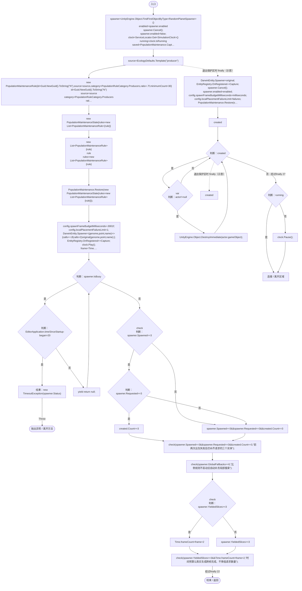
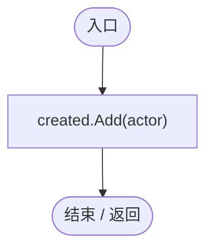
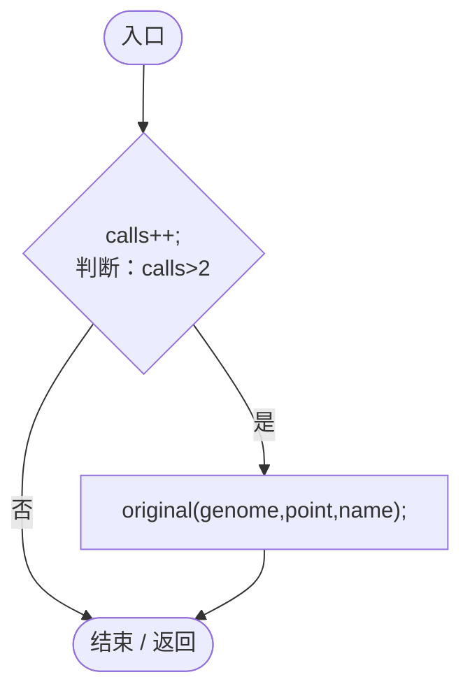

# SpawnBudgetChecks.cs

[返回总索引](../README.md) · `Editor` · `Assets/DarwinPark/Editor/SpawnBudgetChecks.cs`

[源文件](../../../Assets/DarwinPark/Editor/SpawnBudgetChecks.cs) · 源码校验：`33a6a94d74112d47b9bf2d77e70344172dc039c935f54e2d3d3ce2e36a895648`

方法按源文件位置排列。事件/回调引用不表示立即执行；分支与异常说明见总索引。完整源码与可点击关系图请打开离线手册。

## Verify · L16

`internal static IEnumerator Verify(Action<bool,string> check)`

### Editor · Roslyn编译器控制流

项目内调用/回调引用：

- [RandomPlanetSpawner.Cancel · L92](1c13222a547b265c.md#ma34d7509b5f0cc9a)（方法）
- [ServiceLocator.Get · L33](f2fdbe9f9ccd93cb.md#m2ae625299520c56d)（方法）
- [SimulationClock.IsRunning.get · L22](a8f444aec9614b0a.md#m10f4fe307faca0f0)（访问器）
- [PopulationMaintenance.Capture · L147](923ccc4e86c4786c.md#m12f4b5c116f566f8)（方法）
- [SimulationOptimization.Current.get · L30](11c9091e70893352.md#mcfa8eb2e650e57b1)（访问器）
- [EcologyDefaults.Template · L68](5b565b57de741d98.md#m98d16ffadd19320f)（方法）
- [PopulationMaintenance.Restore · L162](923ccc4e86c4786c.md#m23ae054ef57d2624)（方法）
- [SimulationClock.Play · L78](a8f444aec9614b0a.md#m7aa9e64b7de60ed0)（方法）
- [RandomPlanetSpawner.StartRecipe · L30](1c13222a547b265c.md#m412531b3a7a7af47)（方法）
- [RandomPlanetSpawner.IsBusy.get · L19](1c13222a547b265c.md#mfcbb58f20e164d8c)（访问器）
- [RandomPlanetSpawner.Status.get · L23](1c13222a547b265c.md#m38063d5e8e571678)（访问器）
- [RandomPlanetSpawner.Spawned.get · L20](1c13222a547b265c.md#m13c03b28f6d59b03)（访问器）
- [RandomPlanetSpawner.Requested.get · L21](1c13222a547b265c.md#m58b5953b0d655a20)（访问器）
- [RandomPlanetSpawner.GlobalFallbacks.get · L22](1c13222a547b265c.md#m088d7c36b4b1b2ed)（访问器）
- [RandomPlanetSpawner.YieldedSlices.get · L22](1c13222a547b265c.md#m333178b68c3cece9)（访问器）
- [SimulationClock.Pause · L79](a8f444aec9614b0a.md#m30929d45a885d0f1)（方法）
- [SpawnBudgetChecks.Capture · L20](f53ba9f0d0261dd8.md#m4713312e610dad20)（局部函数）
- [SpawnBudgetChecks.回调@24 · L24](f53ba9f0d0261dd8.md#ma93be4a2ec6c07c1)（回调/委托）

## Capture · L20

`void Capture(DarwinEntity actor)`

### Editor · Roslyn编译器控制流

## 回调@24 · L24

`( … => 回调`

### Editor · Roslyn编译器控制流

