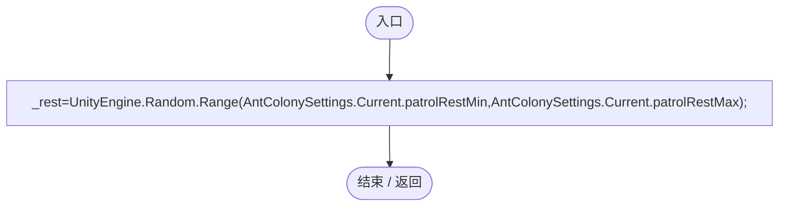
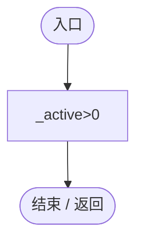
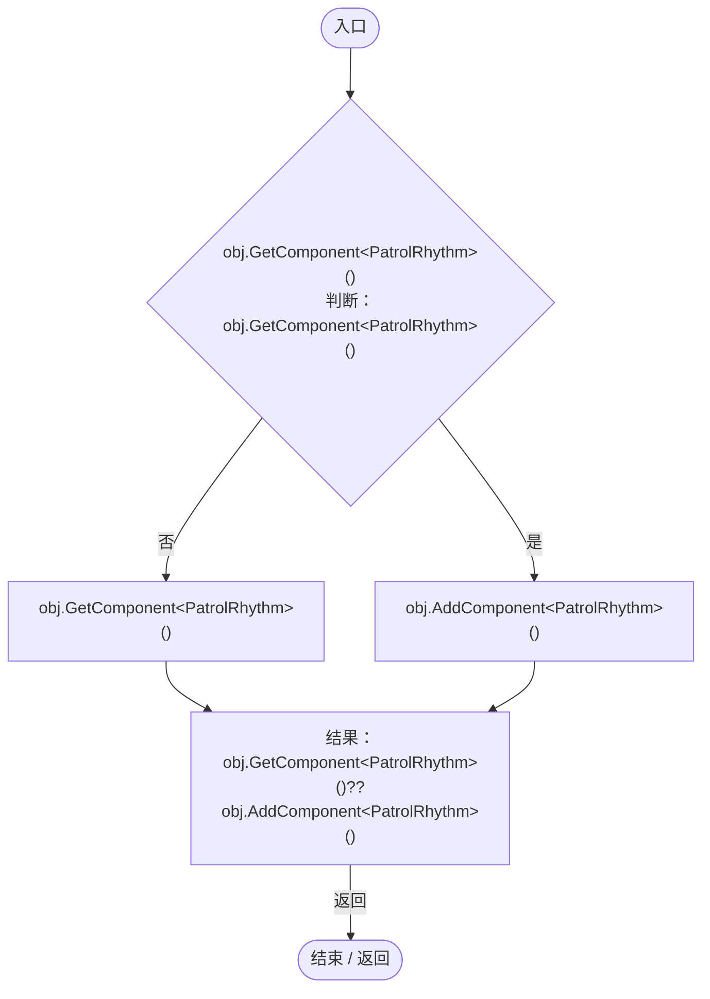
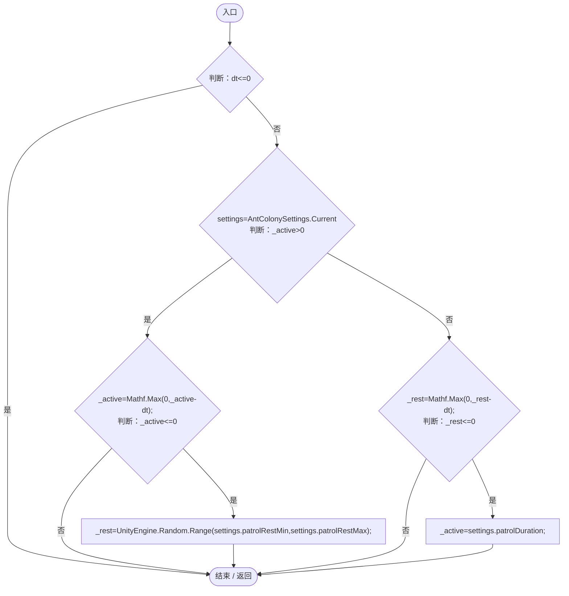
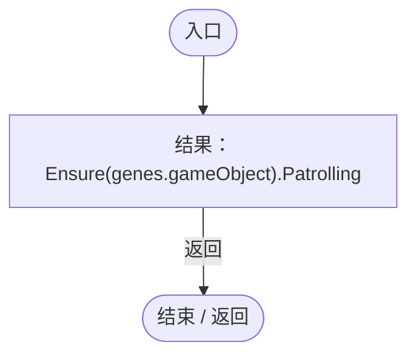
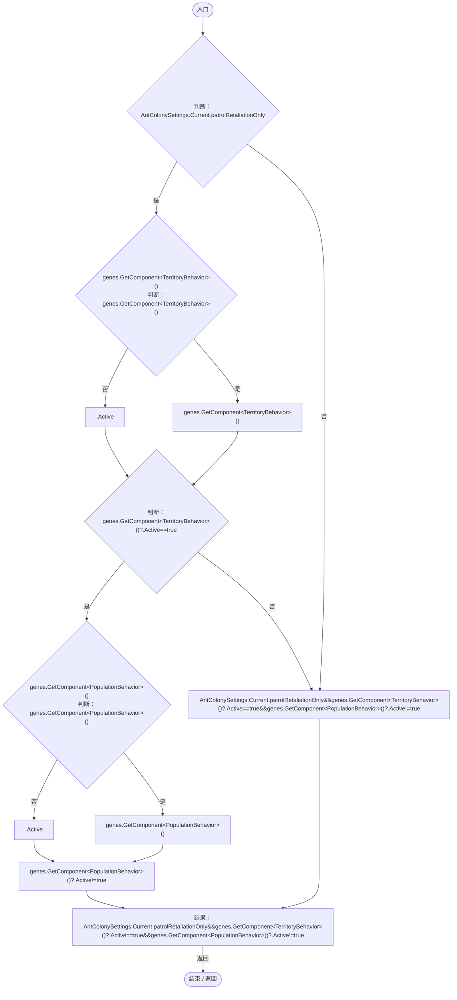
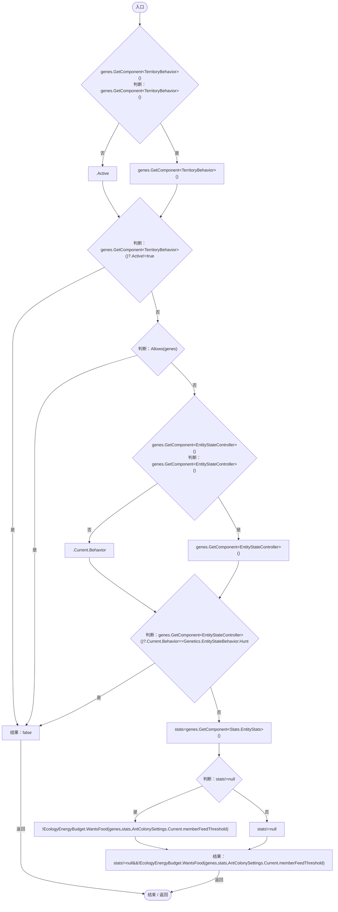
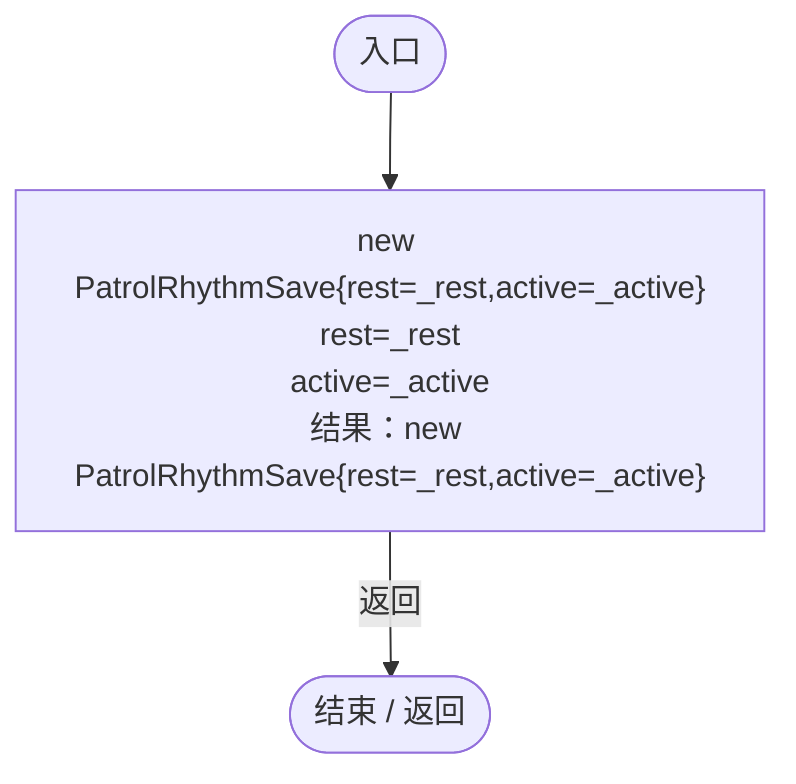
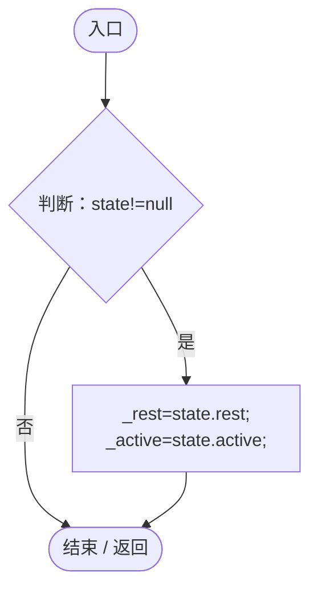

```mermaid
flowchart TD
  b0(["入口"])
  b1{"判断：state.Behavior==Genetics.EntityStateBehavior.Hunt"}
  b2{"判断：Defensive(genes)"}
  b3["结果：false"]
  b4{"判断：state.Behavior!=Genetics.EntityStateBehavior.TerritoryPatrol"}
  b5["Allows(genes)"]
  b6["state.Behavior!=Genetics.EntityStateBehavior.TerritoryPatrol"]
  b7["结果：state.Behavior!=Genetics.EntityStateBehavior.TerritoryPatrol&#124;&#124;Allows(genes)"]
  b8(["结束 / 返回"])
  b0 --> b1
  b1 -->|"是"| b2
  b1 -->|"否"| b4
  b2 -->|"是"| b3
  b2 -->|"否"| b4
  b3 -->|"返回"| b8
  b4 -->|"否"| b5
  b4 -->|"是"| b6
  b5 --> b7
  b6 --> b7
  b7 -->|"返回"| b8

```

# PatrolRhythm.cs

[返回总索引](../README.md) · `Runtime` · `Assets/DarwinPark/Entities/Ecology/PatrolRhythm.cs`

[源文件](../../../Assets/DarwinPark/Entities/Ecology/PatrolRhythm.cs) · 源码校验：`33604eba4239c5c07bbc0cb4df634772bd5396b1ec3fb92f4e12242842de1fa3`

方法按源文件位置排列。事件/回调引用不表示立即执行；分支与异常说明见总索引。完整源码与可点击关系图请打开离线手册。

## Awake · L11

`private void Awake()`

### Editor / Player · Roslyn编译器控制流

项目内调用/回调引用：

- [AntColonySettings.Current.get · L31](cb0a937e97c8fbb3.md#mcd121159f407ccdf)（访问器）

## Patrolling.get · L12

`public bool Patrolling`

### Editor / Player · 语法控制结构 / 声明（非CFG）

## Ensure · L13

`public static PatrolRhythm Ensure(GameObject obj)`

### Editor / Player · Roslyn编译器控制流

## Advance · L14

`public void Advance(float dt)`

### Editor / Player · Roslyn编译器控制流

项目内调用/回调引用：

- [AntColonySettings.Current.get · L31](cb0a937e97c8fbb3.md#mcd121159f407ccdf)（访问器）

## Allows · L21

`public static bool Allows(EntityGeneController genes)`

### Editor / Player · Roslyn编译器控制流

项目内调用/回调引用：

- [PatrolRhythm.Ensure · L13](f55940fd5773d413.md#m47ee8c1a397958a4)（方法）

## Defensive · L23

`public static bool Defensive(EntityGeneController genes)`

★ 修复（防Bug回归）：普通领地巡逻仅受击反击，附近捕猎倾向和饥饿状态不能自行授予攻击目标；群体仍执行自己的分工。

### Editor / Player · Roslyn编译器控制流

项目内调用/回调引用：

- [AntColonySettings.Current.get · L31](cb0a937e97c8fbb3.md#mcd121159f407ccdf)（访问器）

## Eligible · L24

`public static bool Eligible(EntityGeneController genes,Genetics.EntityStateDefinition state)`

### Editor / Player · Roslyn编译器控制流

项目内调用/回调引用：

- [PatrolRhythm.Defensive · L23](f55940fd5773d413.md#m1a2fd45e07d72554)（方法）
- [PatrolRhythm.Allows · L21](f55940fd5773d413.md#m54f51941f18cc808)（方法）

## Resting · L29

`public static bool Resting(EntityGeneController genes)`

### Editor / Player · Roslyn编译器控制流

项目内调用/回调引用：

- [PatrolRhythm.Allows · L21](f55940fd5773d413.md#m54f51941f18cc808)（方法）
- [EcologyEnergyBudget.WantsFood · L14](06a91c8201f26593.md#mc0262b05e0fd6456)（方法）
- [AntColonySettings.Current.get · L31](cb0a937e97c8fbb3.md#mcd121159f407ccdf)（访问器）

## Capture · L34

`public PatrolRhythmSave Capture()`

### Editor / Player · Roslyn编译器控制流

## Restore · L35

`public void Restore(PatrolRhythmSave state)`

### Editor / Player · Roslyn编译器控制流

