# MenuUpgradeRegression.cs

[返回总索引](../README.md) · `Editor` · `Assets/DarwinPark/Editor/MenuUpgradeRegression.cs`

[源文件](../../../Assets/DarwinPark/Editor/MenuUpgradeRegression.cs) · 源码校验：`e1466d533c21a5e57bc22123ae392bf2224bb357cbc3b256fbc9e864180bdcb5`

方法按源文件位置排列。事件/回调引用不表示立即执行；分支与异常说明见总索引。完整源码与可点击关系图请打开离线手册。

## Folder.get · L23

`private static string Folder`

### Editor · 语法控制结构 / 声明（非CFG）

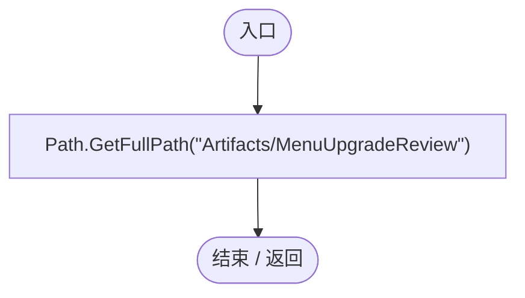

## Check · L24

`private static void Check(bool condition,string message)`

### Editor · Roslyn编译器控制流

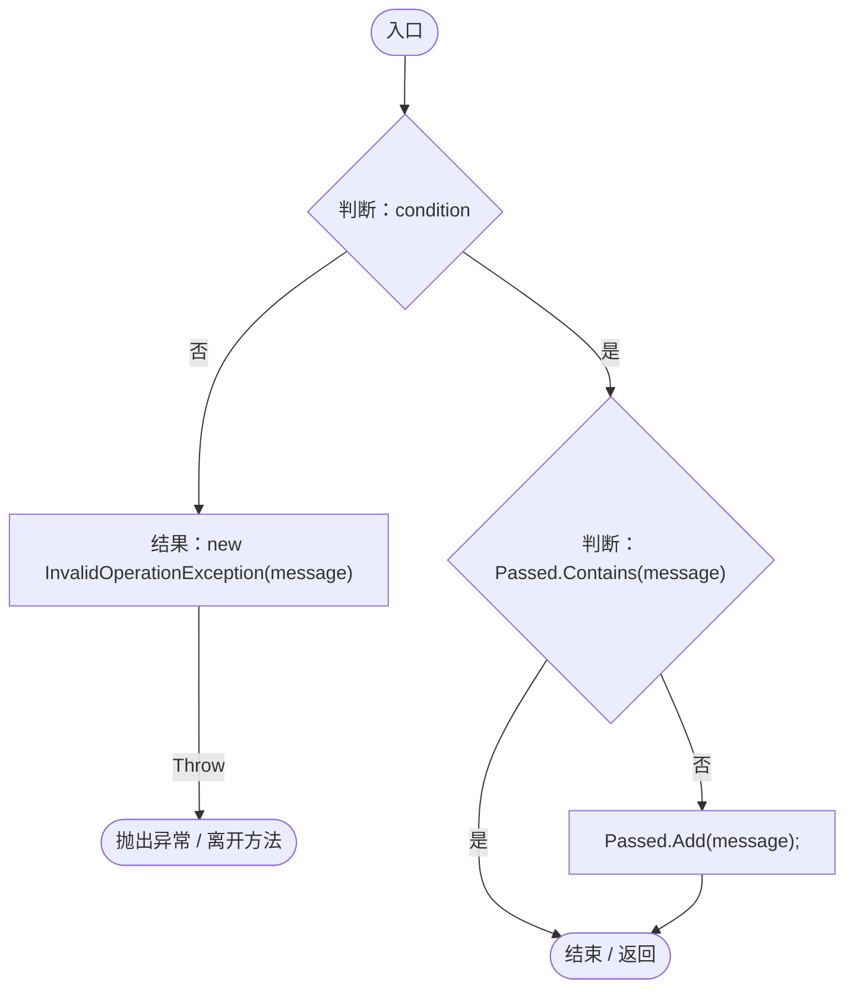

## Field · L26

`private static object Field(object value,string name)`

### Editor · Roslyn编译器控制流

```mermaid
flowchart TD
  b0(["入口"])
  b1["结果：value.GetType().GetField(name,BindingFlags.NonPublic&#124;BindingFlags.Instance).GetValue(value)"]
  b2(["结束 / 返回"])
  b0 --> b1
  b1 -->|"返回"| b2

```

## Validate · L27

`[MenuItem("Tools/Darwin Park/Validate Menu Upgrades %&F9")] public static void Validate()`

### Editor · Roslyn编译器控制流

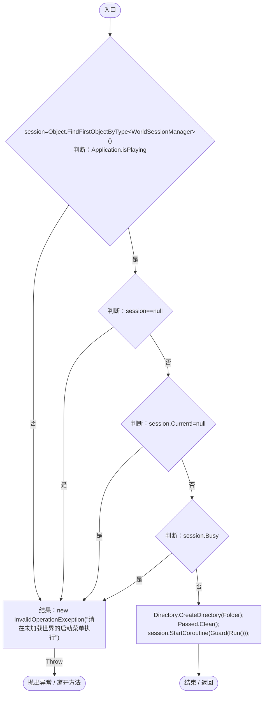

项目内调用/回调引用：

- [WorldSessionManager.Current.get · L21](08741c7b7b9d9344.md#m5d26a5eb846a8504)（访问器）
- [WorldSessionManager.Busy.get · L24](08741c7b7b9d9344.md#m4483e2e4f28f7c85)（访问器）
- [MenuUpgradeRegression.Guard · L34](f55a1b1542251c77.md#m75300910442a7a82)（方法）
- [MenuUpgradeRegression.Run · L45](f55a1b1542251c77.md#m4c611a653e3901f0)（方法）

## Guard · L34

`private static IEnumerator Guard(IEnumerator operation)`

### Editor · Roslyn编译器控制流

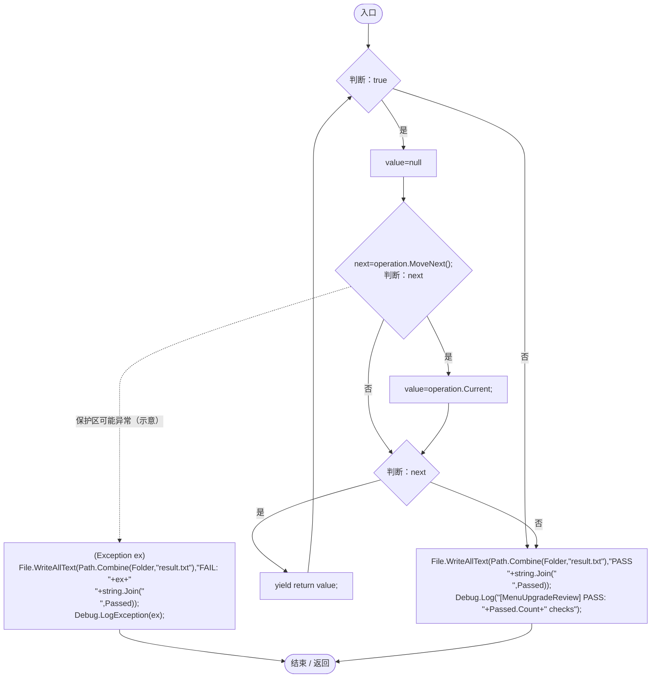

## Run · L45

`private static IEnumerator Run()`

### Editor · Roslyn编译器控制流

```mermaid
flowchart TD
  b0(["入口"])
  b1["view=new GeneGraphViewport()<br/>anchor=new Vector2(180,120)<br/>view.Scroll=new Vector2(250,200);<br/>point=view.ToGraph(anchor)<br/>view.SetZoom(.5f,anchor);<br/>Check(Vector2.Distance(point,view.ToGraph(anchor))&lt;.001f,&quot;滚轮缩放保留鼠标下的图坐标&quot;);<br/>view.SetZoom(100,V…"]
  b2["tree.nodes<br/>new GeneTreeNode{id=first,position=new Vector2(777,333)}<br/>id=first<br/>position=new Vector2(777,333)<br/>tree.nodes.Add(new GeneTreeNode{id=first,position=new Vector2(777,333)});"]
  b3{"判断：GeneCatalogExpansion.Expand(old,tree)==all.Count-7"}
  b4["old.Count==all.Count"]
  b5["GeneCatalogExpansion.Expand(old,tree)==all.Count-7"]
  b6["Check(GeneCatalogExpansion.Expand(old,tree)==all.Count-7&amp;&amp;old.Count==all.Count,&quot;旧库增量补齐全部新基因&quot;);"]
  b7{"判断：old[first]==customized"}
  b8["tree.nodes.First(n=&gt;n.id==first).position==new Vector2(777,333)"]
  b9["old[first]==customized"]
  b10["Check(old[first]==customized&amp;&amp;tree.nodes.First(n=&gt;n.id==first).position==new Vector2(777,333),&quot;保留旧世界同名配置和节点坐标&quot;);"]
  b11{"判断：tree.edges.Any(e=&gt;e.from==&quot;gene_oviparous&quot;&amp;&amp;e.to==&quot;gene_parasitic&quot;&amp;&amp;e.kind==&quot;error&quot;)"}
  b12["tree.edges.Any(e=&gt;e.from==&quot;gene_territory&quot;&amp;&amp;e.to==&quot;gene_population&quot;)"]
  b13["tree.edges.Any(e=&gt;e.from==&quot;gene_oviparous&quot;&amp;&amp;e.to==&quot;gene_parasitic&quot;&amp;&amp;e.kind==&quot;error&quot;)"]
  b14["Check(tree.edges.Any(e=&gt;e.from==&quot;gene_oviparous&quot;&amp;&amp;e.to==&quot;gene_parasitic&quot;&amp;&amp;e.kind==&quot;error&quot;)&amp;&amp;tree.edges.Any(e=&gt;e.from==&quot;gene_territory&quot;&amp;&amp;e.to==&quot;gene_population&quot;),&quot;补库同步新增演化关系&quot;);"]
  b15["Check(GeneCatalogExpansion.Expand(old,tree)==0,&quot;重复补库不新增重复节点或边&quot;);"]
  b16["new WorldSaveData{id=Guid.NewGuid().ToString(&quot;N&quot;),name=&quot;目录迁移回归&quot;,terrainParameters=&quot;{}&quot;,environmentParameters=&quot;{}&quot;,ore=new float[1],oreResolution=1,definitions=old.Select(d=&gt;new SavedGeneDefinition{id=d.Key,json=d.Value}).ToList(),tree=tr…"]
  b17["root=Path.Combine(Folder,Guid.NewGuid().ToString(&quot;N&quot;))<br/>legacy=Path.Combine(root,data.id+&quot;.json&quot;)<br/>current=Path.Combine(root,data.id,&quot;world.json&quot;)<br/>WorldSaveStore.Write(data,legacy);<br/>data.gameTime=13;<br/>Check(WorldSaveStore.ListFrom(root).Sin…"]
  b18{"判断：File.Exists(legacy)"}
  b19{"判断：File.Exists(Path.Combine(root,data.id,&quot;legacy.json&quot;))"}
  b20["File.Exists(Path.Combine(root,data.id,&quot;legacy.json.bak&quot;))"]
  b21["!File.Exists(legacy)&amp;&amp;File.Exists(Path.Combine(root,data.id,&quot;legacy.json&quot;))&amp;&amp;File.Exists(Path.Combine(root,data.id,&quot;legacy.json.bak&quot;))"]
  b22["Check(!File.Exists(legacy)&amp;&amp;File.Exists(Path.Combine(root,data.id,&quot;legacy.json&quot;))&amp;&amp;File.Exists(Path.Combine(root,data.id,&quot;legacy.json.bak&quot;)),&quot;旧档与旧备份在新目录内保留&quot;);"]
  b23{"判断：WorldSaveStore.ListFrom(root).Count==1"}
  b24["WorldSaveStore.ListFrom(root)[0].path==current"]
  b25["WorldSaveStore.ListFrom(root).Count==1"]
  b26["Check(WorldSaveStore.ListFrom(root).Count==1&amp;&amp;WorldSaveStore.ListFrom(root)[0].path==current,&quot;每个世界只显示一条新目录存档&quot;);"]
  b27["WorldSaveStore.Write(data,legacy);<br/>Check(WorldSaveStore.ListFrom(root).Count==1,&quot;新旧同标识文件去重&quot;);<br/>data.gameTime=27;<br/>WorldSaveStore.Write(data,current);"]
  b28{"判断：WorldSaveStore.Read(current+&quot;.bak&quot;).gameTime==13"}
  b29["WorldSaveStore.Read(current).gameTime==27"]
  b30["WorldSaveStore.Read(current+&quot;.bak&quot;).gameTime==13"]
  b31["Check(WorldSaveStore.Read(current+&quot;.bak&quot;).gameTime==13&amp;&amp;WorldSaveStore.Read(current).gameTime==27,&quot;新目录存档原子替换及备份往返&quot;);"]
  b32["File.WriteAllText(Path.Combine(root,data.id,&quot;future-extension.json&quot;),&quot;扩展文件&quot;);<br/>Check(WorldSaveStore.ListFrom(root).Count==1,&quot;扩展文件不会误判为世界存档&quot;);<br/>Check(Path.GetDirectoryName(Path.GetDirectoryName(WorldSaveStore.FileFor(data.id)))==GamePaths.S…"]
  b33{"判断：session.Busy"}
  b34{"判断：clock.IsRunning"}
  b35["clock.GameTime==0"]
  b36["!clock.IsRunning"]
  b37["Check(!clock.IsRunning&amp;&amp;clock.GameTime==0,&quot;新建加载期间不计时&quot;);"]
  b38["yield return null;"]
  b39{"判断：session.Current!=null"}
  b40{"判断：WorldRuntimeGate.Ready"}
  b41["!menu.Visible"]
  b42["session.Current!=null&amp;&amp;WorldRuntimeGate.Ready&amp;&amp;!menu.Visible"]
  b43["Check(session.Current!=null&amp;&amp;WorldRuntimeGate.Ready&amp;&amp;!menu.Visible,&quot;新建后进入游戏&quot;);"]
  b44["genome=new Genome()<br/>genome.Add(GeneInstance.Create(&quot;gene_growth&quot;,50,0));<br/>DarwinEntity.Spawner(genome,builder.transform.position+Vector3.up*(builder.WaterRadius+3),&quot;菜单回归实体&quot;);<br/>yield return null;<br/>entity=EntityRegistry.All.Single()<br/>EntityFav…"]
  b45["session.ReturnToMenu(true);"]
  b46["rejected=true;"]
  b47["session.Current.id=id;"]
  b48{"判断：rejected"}
  b49{"判断：session.Current!=null"}
  b50{"判断：WorldRuntimeGate.Ready"}
  b51["entity.isActiveAndEnabled"]
  b52["rejected&amp;&amp;session.Current!=null&amp;&amp;WorldRuntimeGate.Ready&amp;&amp;entity.isActiveAndEnabled"]
  b53["Check(rejected&amp;&amp;session.Current!=null&amp;&amp;WorldRuntimeGate.Ready&amp;&amp;entity.isActiveAndEnabled,&quot;保存失败保留当前世界和实体&quot;);"]
  b54["menu.ReturnToMainMenu();"]
  b55{"判断：session.Current==null"}
  b56{"判断：WorldRuntimeGate.Ready"}
  b57{"判断：GameInputGate.Blocked"}
  b58{"判断：menu.Visible"}
  b59["!clock.IsRunning"]
  b60["session.Current==null&amp;&amp;!WorldRuntimeGate.Ready&amp;&amp;GameInputGate.Blocked&amp;&amp;menu.Visible&amp;&amp;!clock.IsRunning"]
  b61["Check(session.Current==null&amp;&amp;!WorldRuntimeGate.Ready&amp;&amp;GameInputGate.Blocked&amp;&amp;menu.Visible&amp;&amp;!clock.IsRunning,&quot;保存并返回主界面清除会话并保持菜单输入&quot;);"]
  b62{"判断：EntityRegistry.All.Count==0"}
  b63{"判断：GeneRuntimeProfile.Catalog==null"}
  b64["!EntityFavoritesManager.Instance.IsFavorite(entity)"]
  b65["EntityRegistry.All.Count==0&amp;&amp;GeneRuntimeProfile.Catalog==null&amp;&amp;!EntityFavoritesManager.Instance.IsFavorite(entity)"]
  b66["Check(EntityRegistry.All.Count==0&amp;&amp;GeneRuntimeProfile.Catalog==null&amp;&amp;!EntityFavoritesManager.Instance.IsFavorite(entity),&quot;离开世界清理实体、收藏和基因快照&quot;);"]
  b67{"判断：EntityViewController.Instance.Target==null"}
  b68["!Camera.main.GetComponent&lt;OrbitCamera&gt;().EntityViewActive"]
  b69["EntityViewController.Instance.Target==null"]
  b70["Check(EntityViewController.Instance.Target==null&amp;&amp;!Camera.main.GetComponent&lt;OrbitCamera&gt;().EntityViewActive,&quot;返回主界面退出实体操控&quot;);"]
  b71["Check(!((GameObject)Field(inspector,&quot;_panel&quot;)).activeSelf,&quot;离开世界关闭实体面板&quot;);<br/>path=WorldSaveStore.FileFor(id)<br/>data=WorldSaveStore.Read(path);"]
  b72{"判断：data.entities.Count==1"}
  b73{"判断：data.gameTime==time"}
  b74["data.running"]
  b75["data.entities.Count==1&amp;&amp;data.gameTime==time&amp;&amp;data.running"]
  b76["Check(data.entities.Count==1&amp;&amp;data.gameTime==time&amp;&amp;data.running,&quot;返回主界面前保留实体、时钟与运行状态&quot;);"]
  b77["data.definitions=data.definitions.Where(d=&gt;JsonUtility.FromJson&lt;GeneDefinitionJson&gt;(d.json).tier==0).ToList();<br/>data.tree=new GeneTreeDocument();<br/>session.Open(data);"]
  b78{"判断：session.Busy"}
  b79{"判断：clock.IsRunning"}
  b80["clock.GameTime==time"]
  b81["!clock.IsRunning"]
  b82["Check(!clock.IsRunning&amp;&amp;clock.GameTime==time,&quot;旧档加载不推进时钟&quot;);"]
  b83["yield return null;"]
  b84{"判断：session.Current!=null"}
  b85{"判断：menu.Visible"}
  b86["GeneDatabase.All.Count()==all.Count"]
  b87["session.Current!=null&amp;&amp;!menu.Visible&amp;&amp;GeneDatabase.All.Count()==all.Count"]
  b88["Check(session.Current!=null&amp;&amp;!menu.Visible&amp;&amp;GeneDatabase.All.Count()==all.Count,&quot;主界面重新进入旧七基因世界时补齐基因库&quot;);"]
  b89["entity=EntityRegistry.All.Single();<br/>inspector.ShowEntityInfo(entity);<br/>typeof(GeneInspectorUI).GetMethod(&quot;ShowAddGeneMenu&quot;,BindingFlags.NonPublic&#124;BindingFlags.Instance).Invoke(inspector,null);<br/>yield return null;<br/>panel=(GameObject)Field(in…"]
  b90{"判断：panel.GetComponentInChildren&lt;ScrollRect&gt;().verticalScrollbar!=null"}
  b91["panel.GetComponentInChildren&lt;ScrollRect&gt;().content.rect.height&gt;panel.GetComponentInChildren&lt;ScrollRect&gt;().viewport.rect.height"]
  b92["panel.GetComponentInChildren&lt;ScrollRect&gt;().verticalScrollbar!=null"]
  b93["Check(panel.GetComponentInChildren&lt;ScrollRect&gt;().verticalScrollbar!=null&amp;&amp;panel.GetComponentInChildren&lt;ScrollRect&gt;().content.rect.height&gt;panel.GetComponentInChildren&lt;ScrollRect&gt;().viewport.rect.height,&quot;添加列表可滚动且有滚动条&quot;);"]
  b94["ScreenCapture.CaptureScreenshot(Path.Combine(Folder,&quot;add-genes.png&quot;));<br/>yield return new WaitForEndOfFrame();<br/>list.Find(&quot;Btn_gene_population&quot;).GetComponent&lt;Button&gt;().onClick.Invoke();<br/>Check(entity.Genes.Genome.Genes.Any(g=&gt;g.DefinitionId=…"]
  b95{"判断：session.Current==null"}
  b96["EntityRegistry.All.Count==0"]
  b97["session.Current==null"]
  b98["Check(session.Current==null&amp;&amp;EntityRegistry.All.Count==0,&quot;再次返回主界面无残留&quot;);"]
  b99["Check(!WorldSaveStore.Read(path).running,&quot;暂停中的世界返回主界面保留暂停状态&quot;);"]
  b100(["结束 / 返回"])
  b0 --> b1
  b1 --> b2
  b2 --> b3
  b3 -->|"是"| b4
  b3 -->|"否"| b5
  b4 --> b6
  b5 --> b6
  b6 --> b7
  b7 -->|"是"| b8
  b7 -->|"否"| b9
  b8 --> b10
  b9 --> b10
  b10 --> b11
  b11 -->|"是"| b12
  b11 -->|"否"| b13
  b12 --> b14
  b13 --> b14
  b14 --> b15
  b15 --> b16
  b16 --> b17
  b17 --> b18
  b18 -->|"否"| b19
  b18 -->|"是"| b21
  b19 -->|"是"| b20
  b19 -->|"否"| b21
  b20 --> b22
  b21 --> b22
  b22 --> b23
  b23 -->|"是"| b24
  b23 -->|"否"| b25
  b24 --> b26
  b25 --> b26
  b26 --> b27
  b27 --> b28
  b28 -->|"是"| b29
  b28 -->|"否"| b30
  b29 --> b31
  b30 --> b31
  b31 --> b32
  b32 --> b33
  b33 -->|"是"| b34
  b33 -->|"否"| b39
  b34 -->|"否"| b35
  b34 -->|"是"| b36
  b35 --> b37
  b36 --> b37
  b37 --> b38
  b38 --> b33
  b39 -->|"是"| b40
  b39 -->|"否"| b42
  b40 -->|"是"| b41
  b40 -->|"否"| b42
  b41 --> b43
  b42 --> b43
  b43 --> b44
  b44 --> b45
  b45 -->|"经过finally 47"| b48
  b46 -->|"经过finally 47"| b48
  b48 -->|"是"| b49
  b48 -->|"否"| b52
  b49 -->|"是"| b50
  b49 -->|"否"| b52
  b50 -->|"是"| b51
  b50 -->|"否"| b52
  b51 --> b53
  b52 --> b53
  b53 --> b54
  b54 --> b55
  b55 -->|"是"| b56
  b55 -->|"否"| b60
  b56 -->|"否"| b57
  b56 -->|"是"| b60
  b57 -->|"是"| b58
  b57 -->|"否"| b60
  b58 -->|"是"| b59
  b58 -->|"否"| b60
  b59 --> b61
  b60 --> b61
  b61 --> b62
  b62 -->|"是"| b63
  b62 -->|"否"| b65
  b63 -->|"是"| b64
  b63 -->|"否"| b65
  b64 --> b66
  b65 --> b66
  b66 --> b67
  b67 -->|"是"| b68
  b67 -->|"否"| b69
  b68 --> b70
  b69 --> b70
  b70 --> b71
  b71 --> b72
  b72 -->|"是"| b73
  b72 -->|"否"| b75
  b73 -->|"是"| b74
  b73 -->|"否"| b75
  b74 --> b76
  b75 --> b76
  b76 --> b77
  b77 --> b78
  b78 -->|"是"| b79
  b78 -->|"否"| b84
  b79 -->|"否"| b80
  b79 -->|"是"| b81
  b80 --> b82
  b81 --> b82
  b82 --> b83
  b83 --> b78
  b84 -->|"是"| b85
  b84 -->|"否"| b87
  b85 -->|"否"| b86
  b85 -->|"是"| b87
  b86 --> b88
  b87 --> b88
  b88 --> b89
  b89 --> b90
  b90 -->|"是"| b91
  b90 -->|"否"| b92
  b91 --> b93
  b92 --> b93
  b93 --> b94
  b94 --> b95
  b95 -->|"是"| b96
  b95 -->|"否"| b97
  b96 --> b98
  b97 --> b98
  b98 --> b99
  b99 --> b100
  b45 -. "保护区可能异常（示意）" .-> b46
  b45 -. "退出保护区时 finally（示意）" .-> b47

```

项目内调用/回调引用：

- [GeneGraphViewport.ToGraph · L13](744cdf6c09e0913f.md#mf035f77e839965a2)（方法）
- [GeneGraphViewport.SetZoom · L14](744cdf6c09e0913f.md#m7c73dc5d30283c69)（方法）
- [MenuUpgradeRegression.Check · L24](f55a1b1542251c77.md#m2ca748c85fd71aa7)（方法）
- [GeneGraphViewport.Zoom.get · L11](744cdf6c09e0913f.md#mffc365eff8c66b68)（访问器）
- [GeneTreeStorage.ReadCatalog · L27](a885bad0d7dedee8.md#m89083f320ec287c0)（方法）
- [GeneTreeStorage.Load · L53](a885bad0d7dedee8.md#m60e52e1c6f841f94)（方法）
- [GeneGraphViewport.Fit · L19](744cdf6c09e0913f.md#m8fd9f841573cb608)（方法）
- [GeneCatalogExpansion.Expand · L10](03ab59525607c3f7.md#mbc54a236ebee1b97)（方法）
- [WorldSaveStore.Write · L117](d67a35e5e3814c15.md#m793b97a7ba7d2029)（方法）
- [WorldSaveStore.ListFrom · L59](d67a35e5e3814c15.md#m378328ae174525db)（方法）
- [WorldSaveStore.ArchiveLegacy · L127](d67a35e5e3814c15.md#m10a3480fee036783)（方法）
- [WorldSaveStore.Read · L72](d67a35e5e3814c15.md#mca362c7675a5800c)（方法）
- [WorldSaveStore.FileFor · L48](d67a35e5e3814c15.md#m419a625e2bcc70f8)（方法）
- [ServiceLocator.Get · L33](f2fdbe9f9ccd93cb.md#m2ae625299520c56d)（方法）
- [PlanetClimateMap.Instance.get · L16](b4e9726c1bcf4c37.md#m3add54a419aeef9f)（访问器）
- [PlanetOreSystem.Instance.get · L8](86b3fbb4d9436121.md#m53f6a6af4b6dc252)（访问器）
- [WorldSessionManager.Create · L41](08741c7b7b9d9344.md#m6aadfeee8b90aacd)（方法）
- [WorldSessionManager.Busy.get · L24](08741c7b7b9d9344.md#m4483e2e4f28f7c85)（访问器）
- [SimulationClock.IsRunning.get · L22](a8f444aec9614b0a.md#m10f4fe307faca0f0)（访问器）
- [SimulationClock.GameTime.get · L23](a8f444aec9614b0a.md#m74adfa39a896652f)（访问器）
- [WorldSessionManager.Current.get · L21](08741c7b7b9d9344.md#m5d26a5eb846a8504)（访问器）
- [Genome.Add · L19](a2ef23f865bc7ee8.md#md9cfdc94b8b8d40f)（方法）
- [GeneInstance.Create · L20](f82e1498d67f5afd.md#m72e94c278de3cf8b)（方法）
- [PlanetTerrainMeshBuilder.WaterRadius.get · L94](415285cf043354a9.md#m28d8809083881ec1)（访问器）
- [EntityFavoritesManager.ToggleFavorite · L55](b60fb973e9d3815a.md#m20d366a69a0f5fdd)（方法）
- [EntityFavoritesManager.Instance.get · L10](b60fb973e9d3815a.md#m0dac2feb106bac97)（访问器）
- [GeneInspectorUI.ShowEntityInfo · L385](924e27c34e7b1f0a.md#mea69a0457b885287)（方法）
- [EntityViewController.EnterView · L73](0ad0345f83229ef0.md#mbd7be6d2bbd0ec83)（方法）
- [EntityViewController.Instance.get · L15](0ad0345f83229ef0.md#mb3b8144b56e80842)（访问器）
- [GameMainMenu.ShowPause · L89](a1f1791f9e7a8035.md#m953d85f379a39458)（方法）
- [WorldSessionManager.ReturnToMenu · L136](08741c7b7b9d9344.md#m6b1d0d11a045709c)（方法）
- [GameMainMenu.ReturnToMainMenu · L278](a1f1791f9e7a8035.md#m1fdc747e6f1c67d2)（方法）
- [GameInputGate.Blocked.get · L8](52955daae7e592ab.md#m765763b665829633)（访问器）
- [EntityFavoritesManager.IsFavorite · L46](b60fb973e9d3815a.md#m441337ce7ee05333)（方法）
- [EntityViewController.Target.get · L16](0ad0345f83229ef0.md#m87ca090092a884ab)（访问器）
- [OrbitCamera.EntityViewActive.get · L39](42eb429559b42bcb.md#m4b320edff61e06a5)（访问器）
- [MenuUpgradeRegression.Field · L26](f55a1b1542251c77.md#m53e422fb657206cf)（方法）
- [WorldSessionManager.Open · L58](08741c7b7b9d9344.md#m0a8e69a8a4fbc512)（方法）
- [GeneDatabase.All.get · L128](ec0a03483435a863.md#m0a367ed24734f426)（访问器）
- [DarwinEntity.Genes.get · L14](70798dde169f2e8b.md#m622eb1adf401d431)（访问器）
- [WorldSessionManager.SaveNow · L157](08741c7b7b9d9344.md#mbecd8b5c222ba46b)（方法）
- [SimulationClock.Pause · L79](a8f444aec9614b0a.md#m30929d45a885d0f1)（方法）
- [MenuUpgradeRegression.回调@54 · L54](f55a1b1542251c77.md#macb886a7846c033a)（回调/委托）
- [MenuUpgradeRegression.回调@55 · L55](f55a1b1542251c77.md#ma3f0a304f81746a4)（回调/委托）
- [MenuUpgradeRegression.回调@55 · L55](f55a1b1542251c77.md#m5dfc2e8000371401)（回调/委托）
- [MenuUpgradeRegression.回调@55 · L55](f55a1b1542251c77.md#m240be36da7205f70)（回调/委托）
- [MenuUpgradeRegression.回调@60 · L60](f55a1b1542251c77.md#m4864dc947e50ad9f)（回调/委托）
- [MenuUpgradeRegression.回调@61 · L61](f55a1b1542251c77.md#mdaeac267e5487e5f)（回调/委托）
- [MenuUpgradeRegression.回调@61 · L61](f55a1b1542251c77.md#m638c001b9d83d71f)（回调/委托）
- [MenuUpgradeRegression.回调@64 · L64](f55a1b1542251c77.md#m14c56fff3d0bda26)（回调/委托）
- [MenuUpgradeRegression.回调@102 · L102](f55a1b1542251c77.md#mff35dc2119b2b112)（回调/委托）
- [MenuUpgradeRegression.回调@109 · L109](f55a1b1542251c77.md#mb7d7c61459c43296)（回调/委托）
- [MenuUpgradeRegression.回调@113 · L113](f55a1b1542251c77.md#m47f0ff41c52c473a)（回调/委托）

## 回调@54 · L54

`n … => 回调`

### Editor · Roslyn编译器控制流

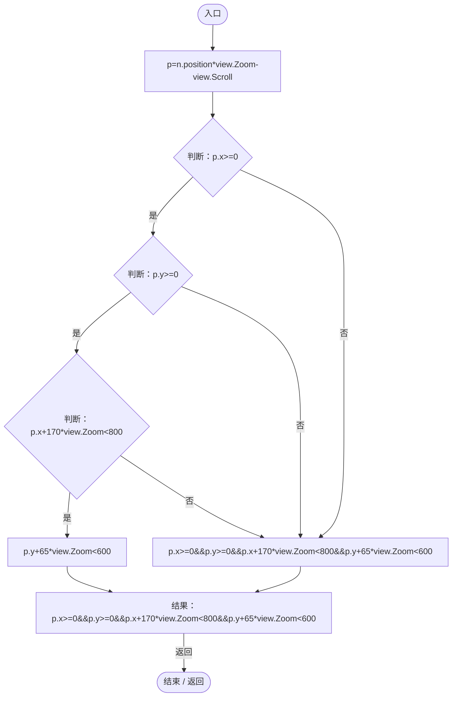

项目内调用/回调引用：

- [GeneGraphViewport.Zoom.get · L11](744cdf6c09e0913f.md#mffc365eff8c66b68)（访问器）

## 回调@55 · L55

`p … => 回调`

### Editor · Roslyn编译器控制流

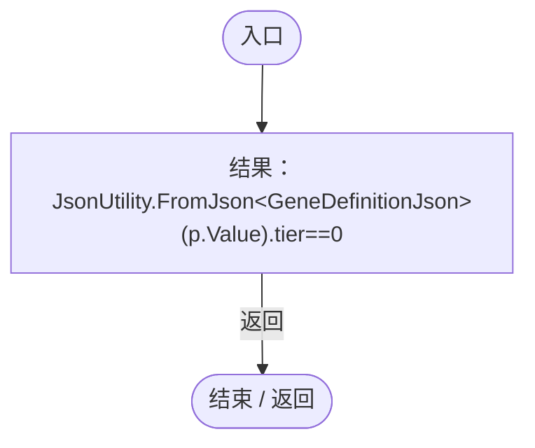

## 回调@55 · L55

`p … => 回调`

### Editor · Roslyn编译器控制流

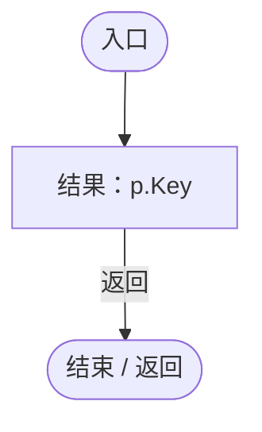

## 回调@55 · L55

`p … => 回调`

### Editor · Roslyn编译器控制流

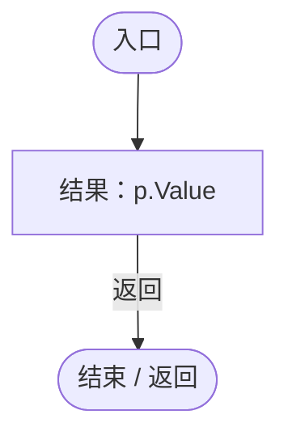

## 回调@60 · L60

`n … => 回调`

### Editor · Roslyn编译器控制流

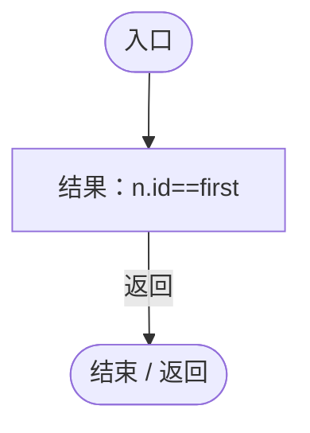

## 回调@61 · L61

`e … => 回调`

### Editor · Roslyn编译器控制流

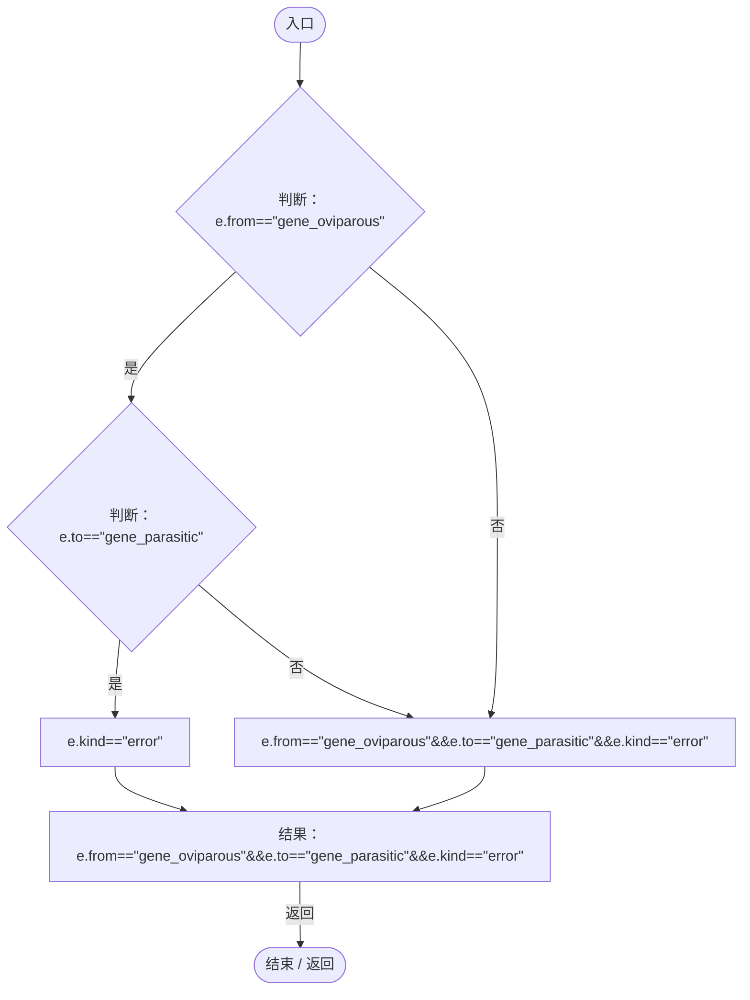

## 回调@61 · L61

`e … => 回调`

### Editor · Roslyn编译器控制流

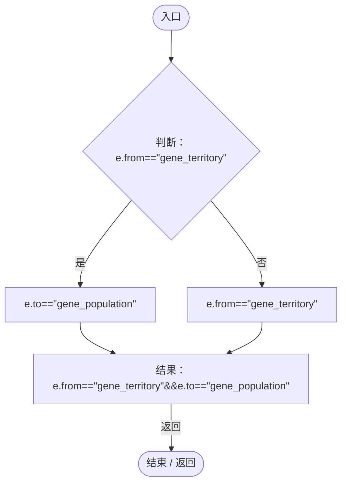

## 回调@64 · L64

`d … => 回调`

### Editor · Roslyn编译器控制流

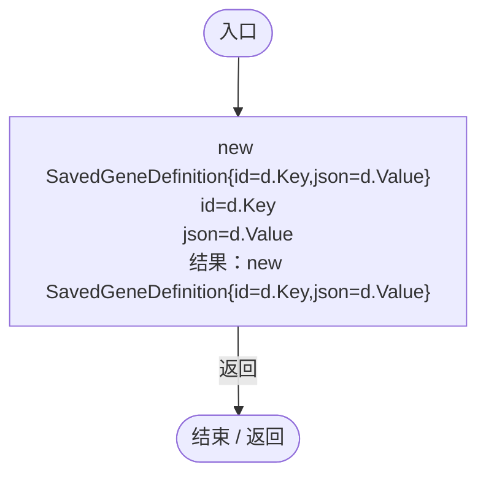

## 回调@102 · L102

`d … => 回调`

### Editor · Roslyn编译器控制流

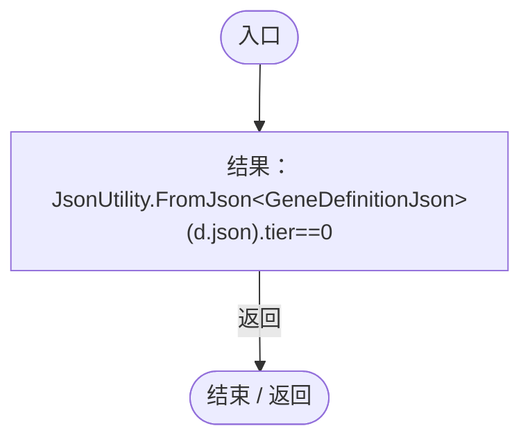

## 回调@109 · L109

`t … => 回调`

### Editor · Roslyn编译器控制流

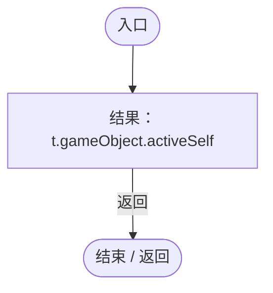

## 回调@113 · L113

`g … => 回调`

### Editor · Roslyn编译器控制流

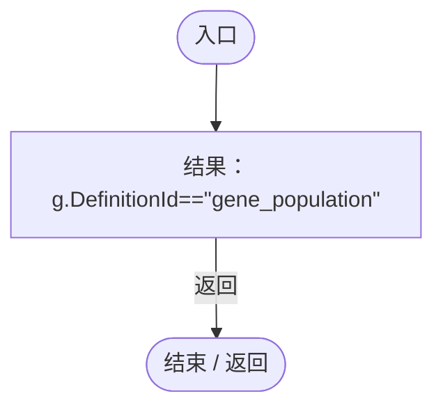
