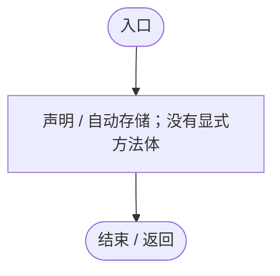
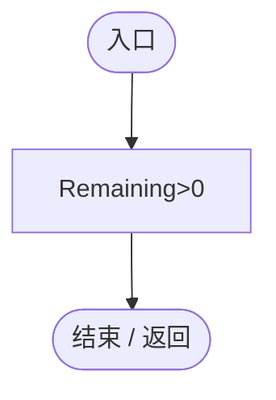
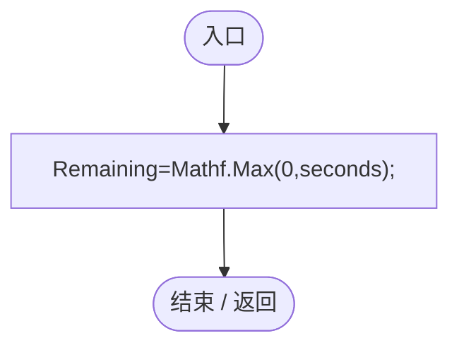
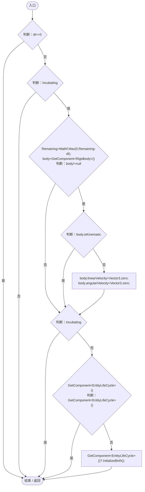

# EggIncubation.cs

[返回总索引](../README.md) · `Runtime` · `Assets/DarwinPark/Entities/Ecology/EggIncubation.cs`

[源文件](../../../Assets/DarwinPark/Entities/Ecology/EggIncubation.cs) · 源码校验：`33eeb1be97ec086966228cece54da7e2272a2018e600dafece0fd449c4bd5056`

方法按源文件位置排列。事件/回调引用不表示立即执行；分支与异常说明见总索引。完整源码与可点击关系图请打开离线手册。

## Remaining.get · L7

`get`

### Editor / Player · 语法控制结构 / 声明（非CFG）

## Remaining.set · L7

`private set`

### Editor / Player · 语法控制结构 / 声明（非CFG）

## Incubating.get · L8

`public bool Incubating`

### Editor / Player · 语法控制结构 / 声明（非CFG）

项目内调用/回调引用：

- [EggIncubation.Remaining.get · L7](f5a647fca719706f.md#m0ecf83a56f86b68f)（访问器）

## Begin · L9

`public void Begin(float seconds)`

### Editor / Player · Roslyn编译器控制流

项目内调用/回调引用：

- [EggIncubation.Remaining.set · L7](f5a647fca719706f.md#m8231c97086c1a00a)（访问器）

## Advance · L10

`public void Advance(float dt)`

### Editor / Player · Roslyn编译器控制流

项目内调用/回调引用：

- [EggIncubation.Remaining.set · L7](f5a647fca719706f.md#m8231c97086c1a00a)（访问器）
- [EggIncubation.Remaining.get · L7](f5a647fca719706f.md#m0ecf83a56f86b68f)（访问器）
- [EntityLifeCycle.InitializeBirth · L17](9f4138bfbae654b7.md#m76374fa073e2a603)（方法）
