```mermaid
flowchart TD
  b0(["入口"])
  b1{"判断：g==null"}
  b2{"判断：catalog.Contains(g.DefinitionId)"}
  b3{"判断：float.IsFinite(g.Value)"}
  b4["g.MissingStateIds==null"]
  b5["g==null&#124;&#124;!catalog.Contains(g.DefinitionId)&#124;&#124;!float.IsFinite(g.Value)&#124;&#124;g.MissingStateIds==null"]
  b6["结果：g==null&#124;&#124;!catalog.Contains(g.DefinitionId)&#124;&#124;!float.IsFinite(g.Value)&#124;&#124;g.MissingStateIds==null"]
  b7(["结束 / 返回"])
  b0 --> b1
  b1 -->|"否"| b2
  b1 -->|"是"| b5
  b2 -->|"是"| b3
  b2 -->|"否"| b5
  b3 -->|"是"| b4
  b3 -->|"否"| b5
  b4 --> b6
  b5 --> b6
  b6 -->|"返回"| b7

```

# NutritionSaveValidation.cs

[返回总索引](../README.md) · `Runtime` · `Assets/DarwinPark/Entities/Ecology/NutritionSaveValidation.cs`

[源文件](../../../Assets/DarwinPark/Entities/Ecology/NutritionSaveValidation.cs) · 源码校验：`c87fce124439eaa79ea592b644470f9e5b1423b74eaa63cbfb009d885156be82`

方法按源文件位置排列。事件/回调引用不表示立即执行；分支与异常说明见总索引。完整源码与可点击关系图请打开离线手册。

## Validate · L11

`public static void Validate(EcologySaveState state,ICollection<string> catalog)`

### Editor / Player · Roslyn编译器控制流

```mermaid
flowchart TD
  b0(["入口"])
  b1{"判断：state==null"}
  b2{"判断：state.nutritionParasiteCount&lt;0"}
  b3{"state.nutritionParasite<br/>判断：state.nutritionParasite"}
  b4[".host"]
  b5["state.nutritionParasite"]
  b6{"判断：string.IsNullOrEmpty(state.nutritionParasite?.host)"}
  b7{"判断：Guid.TryParseExact(state.nutritionParasite.host,&quot;N&quot;,out _)"}
  b8{"判断：state.nutritionParasite.host==state.id"}
  b9["结果：new InvalidDataException(&quot;营养寄生宿主标识或数量无效&quot;)"]
  x9(["抛出异常 / 离开方法"])
  b10{"判断：state.foreignEggs==null"}
  b11["state.foreignEggs"]
  b12{"判断：state.foreignEggs"}
  b13{"var<br/>判断：egg==null"}
  b14{"判断：float.IsFinite(egg.remaining)"}
  b15{"判断：egg.remaining&lt;0"}
  b16{"判断：Guid.TryParseExact(egg.parent,&quot;N&quot;,out _)"}
  b17{"egg.genome<br/>判断：egg.genome"}
  b18[".Genes"]
  b19["egg.genome"]
  b20{"判断：egg.genome?.Genes==null"}
  b21{"判断：egg.genome.Genes.Count==0"}
  b22{"判断：egg.genome.Genes.Any(g=&gt;g==null&#124;&#124;!catalog.Contains(g.DefinitionId)&#124;&#124;!float.IsFinite(g.Value)&#124;&#124;g.MissingStateIds==null)"}
  b23["结果：new InvalidDataException(&quot;卵寄生载荷的亲本、计时或基因组无效&quot;)"]
  x23(["抛出异常 / 离开方法"])
  b24["state.foreignEggs"]
  b25(["结束 / 返回"])
  b0 --> b1
  b1 -->|"是"| b25
  b1 -->|"否"| b2
  b2 -->|"否"| b3
  b2 -->|"是"| b9
  b3 -->|"否"| b4
  b3 -->|"是"| b5
  b4 --> b6
  b5 --> b6
  b6 -->|"否"| b7
  b6 -->|"是"| b10
  b7 -->|"是"| b8
  b7 -->|"否"| b9
  b8 -->|"是"| b9
  b8 -->|"否"| b10
  b9 -->|"Throw"| x9
  b10 -->|"是"| b25
  b10 -->|"否"| b11
  b11 --> b12
  b12 -->|"是"| b13
  b12 -->|"否 · 经过finally 24"| b25
  b13 -->|"否"| b14
  b13 -->|"是"| b23
  b14 -->|"是"| b15
  b14 -->|"否"| b23
  b15 -->|"否"| b16
  b15 -->|"是"| b23
  b16 -->|"是"| b17
  b16 -->|"否"| b23
  b17 -->|"否"| b18
  b17 -->|"是"| b19
  b18 --> b20
  b19 --> b20
  b20 -->|"否"| b21
  b20 -->|"是"| b23
  b21 -->|"否"| b22
  b21 -->|"是"| b23
  b22 -->|"是"| b23
  b22 -->|"否"| b12
  b23 -->|"Throw"| x23
  b12 -. "退出保护区时 finally（示意）" .-> b24

```

项目内调用/回调引用：

- [NutritionSaveValidation.回调@17 · L17](f62a3371065beeb4.md#m9389b547815ae7fb)（回调/委托）

## 回调@17 · L17

`g … => 回调`

### Editor / Player · Roslyn编译器控制流

