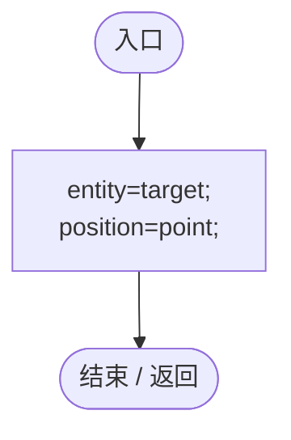
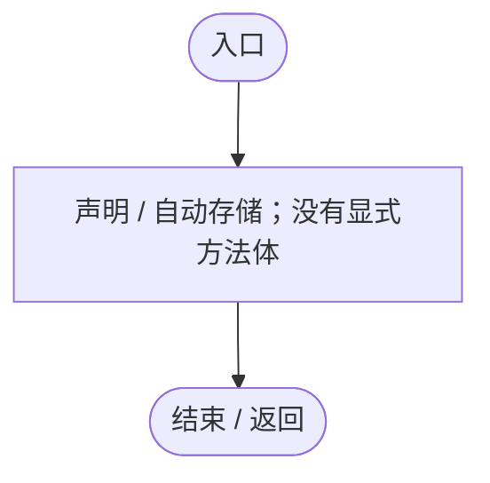
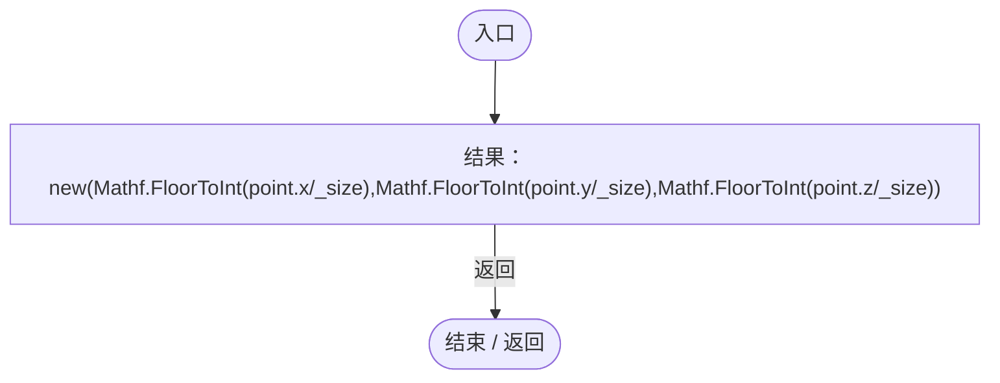
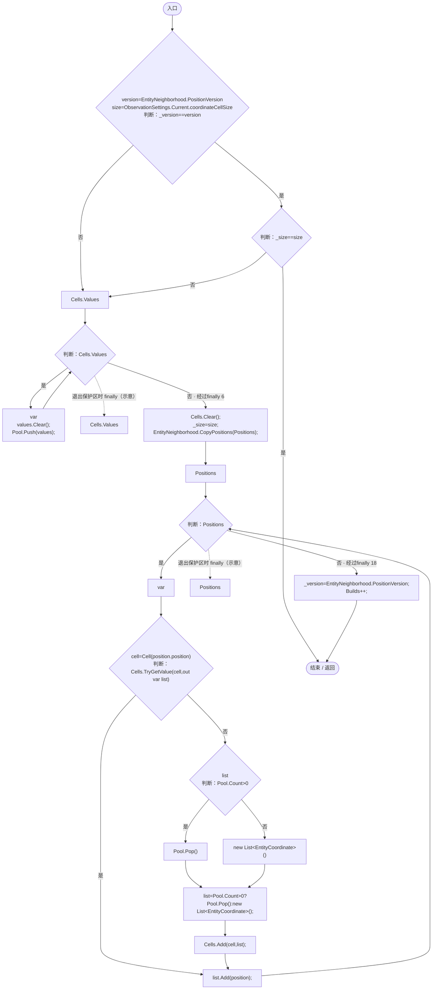
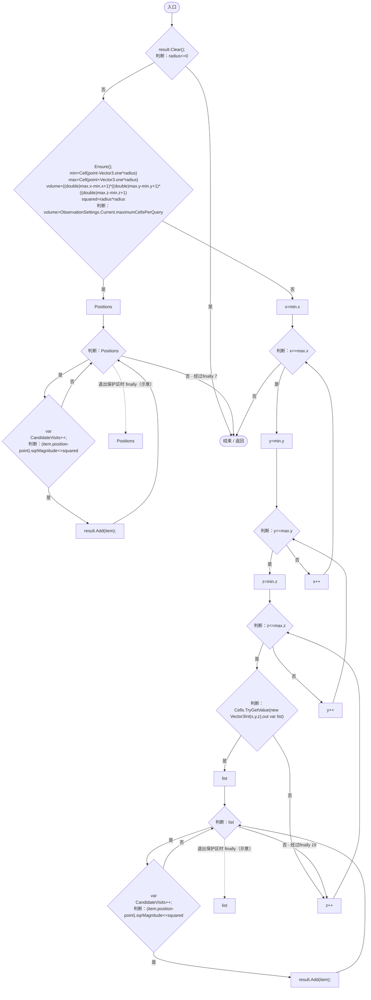
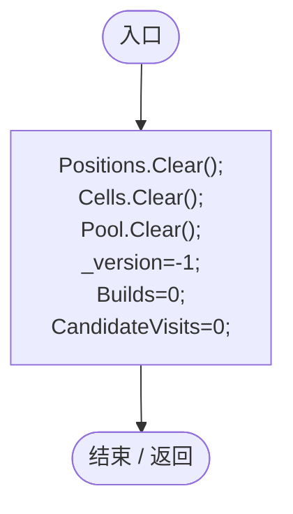
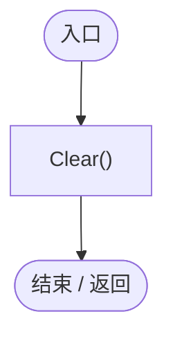

# EntityCoordinateGrid.cs

[返回总索引](../README.md) · `Runtime` · `Assets/DarwinPark/Entities/Ecology/EntityCoordinateGrid.cs`

[源文件](../../../Assets/DarwinPark/Entities/Ecology/EntityCoordinateGrid.cs) · 源码校验：`68ec710dec1c4ba5999335d951040e44cefb0987fe591dda7809b9408a6ef73f`

方法按源文件位置排列。事件/回调引用不表示立即执行；分支与异常说明见总索引。完整源码与可点击关系图请打开离线手册。

## EntityCoordinate.ctor · L9

`public EntityCoordinate(DarwinEntity target,Vector3 point)`

### Editor / Player · Roslyn编译器控制流

## CandidateVisits.get · L16

`get`

### Editor / Player · 语法控制结构 / 声明（非CFG）

## CandidateVisits.set · L16

`private set`

### Editor / Player · 语法控制结构 / 声明（非CFG）

## Builds.get · L16

`get`

### Editor / Player · 语法控制结构 / 声明（非CFG）

## Builds.set · L16

`private set`

### Editor / Player · 语法控制结构 / 声明（非CFG）

## Cell · L17

`private static Vector3Int Cell(Vector3 point)`

### Editor / Player · Roslyn编译器控制流

## Ensure · L18

`private static void Ensure()`

### Editor / Player · Roslyn编译器控制流

项目内调用/回调引用：

- [EntityNeighborhood.PositionVersion.get · L21](e5e24c4aff0395b1.md#m86c5d31e61daaf59)（访问器）
- [ObservationSettings.Current.get · L16](fde4b9e3a289b4e6.md#m3eb41cdee2818913)（访问器）
- [EntityNeighborhood.CopyPositions · L87](e5e24c4aff0395b1.md#m075d2fa8c4021c3a)（方法）
- [EntityCoordinateGrid.Cell · L17](f6d0404a662a5d5c.md#mac3f9782a4f273ce)（方法）
- [EntityCoordinateGrid.Builds.set · L16](f6d0404a662a5d5c.md#m5d35e7b04f2d2cea)（访问器）
- [EntityCoordinateGrid.Builds.get · L16](f6d0404a662a5d5c.md#mf75ff28fb0fffeb0)（访问器）

## Query · L26

`public static void Query(Vector3 point,float radius,List<EntityCoordinate> result)`

### Editor / Player · Roslyn编译器控制流

项目内调用/回调引用：

- [EntityCoordinateGrid.Ensure · L18](f6d0404a662a5d5c.md#m11644b2ff0a2291f)（方法）
- [EntityCoordinateGrid.Cell · L17](f6d0404a662a5d5c.md#mac3f9782a4f273ce)（方法）
- [ObservationSettings.Current.get · L16](fde4b9e3a289b4e6.md#m3eb41cdee2818913)（访问器）
- [EntityCoordinateGrid.CandidateVisits.set · L16](f6d0404a662a5d5c.md#m642503bd188c5742)（访问器）
- [EntityCoordinateGrid.CandidateVisits.get · L16](f6d0404a662a5d5c.md#m06517dd1e7dd190f)（访问器）

## Clear · L33

`public static void Clear()`

### Editor / Player · Roslyn编译器控制流

项目内调用/回调引用：

- [EntityCoordinateGrid.Builds.set · L16](f6d0404a662a5d5c.md#m5d35e7b04f2d2cea)（访问器）
- [EntityCoordinateGrid.CandidateVisits.set · L16](f6d0404a662a5d5c.md#m642503bd188c5742)（访问器）

## Reset · L34

`[RuntimeInitializeOnLoadMethod(RuntimeInitializeLoadType.SubsystemRegistration)]private static void Reset()`

### Editor / Player · Roslyn编译器控制流

项目内调用/回调引用：

- [EntityCoordinateGrid.Clear · L33](f6d0404a662a5d5c.md#m2f8c9144ba3b3c91)（方法）
