```mermaid
flowchart TD
  b0(["入口"])
  b1{"判断：resource!=null"}
  b2{"判断：resource.State.kind==ColonyResourceKind.Corpse"}
  b3{"判断：string.IsNullOrEmpty(resource.State.group)"}
  b4{"判断：resource.State.group==worker.GroupId"}
  b5["!ColonyResourceOwnership.HasOwner(resource.State.group)"]
  b6["string.IsNullOrEmpty(resource.State.group)&#124;&#124;resource.State.group==worker.GroupId&#124;&#124;!ColonyResourceOwnership.HasOwner(resource.State.group)"]
  b7["resource!=null&amp;&amp;resource.State.kind==ColonyResourceKind.Corpse&amp;&amp; (string.IsNullOrEmpty(resource.State.group)&#124;&#124;resource.State.group==worker.GroupId&#124;&#124;!ColonyResourceOwnership.HasOwner(resource.State.group))"]
  b8["结果：resource!=null&amp;&amp;resource.State.kind==ColonyResourceKind.Corpse&amp;&amp; (string.IsNullOrEmpty(resource.State.group)&#124;&#124;resource.State.group==worker.GroupId&#124;&#124;!ColonyResourceOwnership.HasOwner(resource.State.group))"]
  b9(["结束 / 返回"])
  b0 --> b1
  b1 -->|"是"| b2
  b1 -->|"否"| b7
  b2 -->|"是"| b3
  b2 -->|"否"| b7
  b3 -->|"否"| b4
  b3 -->|"是"| b6
  b4 -->|"否"| b5
  b4 -->|"是"| b6
  b5 --> b8
  b6 --> b8
  b7 --> b8
  b8 -->|"返回"| b9

```

```mermaid
flowchart TD
  b0(["入口"])
  b1{"EcologyIdentity.Find(resource.State.claim)<br/>判断：EcologyIdentity.Find(resource.State.claim)"}
  b2[".GetComponent&lt;AntColonyMember&gt;()"]
  b3["EcologyIdentity.Find(resource.State.claim)"]
  b4["worker=EcologyIdentity.Find(resource.State.claim)?.GetComponent&lt;AntColonyMember&gt;()"]
  b5{"判断：worker!=null"}
  b6{"判断：worker.Active"}
  b7{"判断：worker.Role==AntRole.Worker"}
  b8{"判断：worker.State.resourceTarget==resource.State.id"}
  b9["worker.State.carriedResource==resource.State.id"]
  b10["worker.State.resourceTarget==resource.State.id"]
  b11["worker!=null&amp;&amp;worker.Active&amp;&amp;worker.Role==AntRole.Worker&amp;&amp;(worker.State.resourceTarget==resource.State.id&#124;&#124;worker.State.carriedResource==resource.State.id)"]
  b12["结果：worker!=null&amp;&amp;worker.Active&amp;&amp;worker.Role==AntRole.Worker&amp;&amp;(worker.State.resourceTarget==resource.State.id&#124;&#124;worker.State.carriedResource==resource.State.id)"]
  b13(["结束 / 返回"])
  b0 --> b1
  b1 -->|"否"| b2
  b1 -->|"是"| b3
  b2 --> b4
  b3 --> b4
  b4 --> b5
  b5 -->|"是"| b6
  b5 -->|"否"| b11
  b6 -->|"是"| b7
  b6 -->|"否"| b11
  b7 -->|"是"| b8
  b7 -->|"否"| b11
  b8 -->|"否"| b9
  b8 -->|"是"| b10
  b9 --> b12
  b10 --> b12
  b11 --> b12
  b12 -->|"返回"| b13

```

# ColonyCorpseAccess.cs

[返回总索引](../README.md) · `Runtime` · `Assets/DarwinPark/Entities/Ecology/ColonyCorpseAccess.cs`

[源文件](../../../Assets/DarwinPark/Entities/Ecology/ColonyCorpseAccess.cs) · 源码校验：`f759c959281dae48d292bd8617dd53cd0669c3dbe77753272bacedef92f1d610`

方法按源文件位置排列。事件/回调引用不表示立即执行；分支与异常说明见总索引。完整源码与可点击关系图请打开离线手册。

## Available · L6

`public static bool Available(ColonyResource resource,AntColonyMember worker)`

### Editor / Player · Roslyn编译器控制流

项目内调用/回调引用：

- [ColonyResource.State.get · L22](293dbaecfff4b585.md#m341a1355f4d657bf)（访问器）
- [ColonyResourceOwnership.HasOwner · L14](2988679fde59fc87.md#mc9fb9c75e5ef3aa5)（方法）

## HasLiveClaim · L8

`public static bool HasLiveClaim(ColonyResource resource)`

### Editor / Player · Roslyn编译器控制流

项目内调用/回调引用：

- [EcologyIdentity.Find · L20](bdf7ccc2c9c0452f.md#m58f756a3ba9ec990)（方法）
- [ColonyResource.State.get · L22](293dbaecfff4b585.md#m341a1355f4d657bf)（访问器）
- [AntColonyMember.Role.get · L33](baebd85c05598377.md#mdf6df89f7116c7a3)（访问器）
- [AntColonyMember.State.get · L27](baebd85c05598377.md#mc8282e8cc823ceeb)（访问器）
