```mermaid
flowchart TD
  b0(["入口"])
  b1{"判断：resource!=null"}
  b2{"判断：resource.State.kind==ColonyResourceKind.Corpse"}
  b3{"判断：string.IsNullOrEmpty(resource.State.group)"}
  b4{"判断：resource.State.group==worker.GroupId"}
  b5["!ColonyResourceOwnership.HasOwner(resource.State.group)"]
  b6["string.IsNullOrEmpty(resource.State.group)&#124;&#124;resource.State.group==worker.GroupId&#124;&#124;!ColonyResourceOwnership.HasOwner(resource.State.group)"]
  b7["resource!=null&amp;&amp;resource.State.kind==ColonyResourceKind.Corpse&amp;&amp; (string.IsNullOrEmpty(resource.State.group)&#124;&#124;resource.State.group==worker.GroupId&#124;&#124;!ColonyResourceOwnership.HasOwner(resource.State.group))"]
  b8["结果：resource!=null&amp;&amp;resource.State.kind==ColonyResourceKind.Corpse&amp;&amp; (string.IsNullOrEmpty(resource.State.group)&#124;&#124;resource.State.group==worker.GroupId&#124;&#124;!ColonyResourceOwnership.HasOwner(resource.State.group))"]
  b9(["结束 / 返回"])
  b0 --> b1
  b1 -->|"是"| b2
  b1 -->|"否"| b7
  b2 -->|"是"| b3
  b2 -->|"否"| b7
  b3 -->|"否"| b4
  b3 -->|"是"| b6
  b4 -->|"否"| b5
  b4 -->|"是"| b6
  b5 --> b8
  b6 --> b8
  b7 --> b8
  b8 -->|"返回"| b9

```

```mermaid
flowchart TD
  b0(["入口"])
  b1{"EcologyIdentity.Find(resource.State.claim)<br/>判断：EcologyIdentity.Find(resource.State.claim)"}
  b2[".GetComponent&lt;AntColonyMember&gt;()"]
  b3["EcologyIdentity.Find(resource.State.claim)"]
  b4["worker=EcologyIdentity.Find(resource.State.claim)?.GetComponent&lt;AntColonyMember&gt;()"]
  b5{"判断：worker!=null"}
  b6{"判断：worker.Active"}
  b7{"判断：worker.Role==AntRole.Worker"}
  b8{"判断：ColonyFoundingSupport.Collecting(worker)"}
  b9{"判断：worker.State.resourceTarget==resource.State.id"}
  b10["worker.State.carriedResource==resource.State.id"]
  b11["worker.State.resourceTarget==resource.State.id"]
  b12["worker!=null&amp;&amp;worker.Active&amp;&amp;(worker.Role==AntRole.Worker&#124;&#124;ColonyFoundingSupport.Collecting(worker))&amp;&amp;(worker.State.resourceTarget==resource.State.id&#124;&#124;worker.State.carriedResource==resource.State.id)"]
  b13["结果：worker!=null&amp;&amp;worker.Active&amp;&amp;(worker.Role==AntRole.Worker&#124;&#124;ColonyFoundingSupport.Collecting(worker))&amp;&amp;(worker.State.resourceTarget==resource.State.id&#124;&#124;worker.State.carriedResource==resource.State.id)"]
  b14(["结束 / 返回"])
  b0 --> b1
  b1 -->|"否"| b2
  b1 -->|"是"| b3
  b2 --> b4
  b3 --> b4
  b4 --> b5
  b5 -->|"是"| b6
  b5 -->|"否"| b12
  b6 -->|"是"| b7
  b6 -->|"否"| b12
  b7 -->|"否"| b8
  b7 -->|"是"| b9
  b8 -->|"是"| b9
  b8 -->|"否"| b12
  b9 -->|"否"| b10
  b9 -->|"是"| b11
  b10 --> b13
  b11 --> b13
  b12 --> b13
  b13 -->|"返回"| b14

```

# ColonyCorpseAccess.cs

[返回总索引](../README.md) · `Runtime` · `Assets/DarwinPark/Entities/Ecology/ColonyCorpseAccess.cs`

[源文件](../../../Assets/DarwinPark/Entities/Ecology/ColonyCorpseAccess.cs) · 源码校验：`28393ca21faf1d9f6f1ff8147dd99c91fabf5452447af1ecad29a578aa913407`

方法按源文件位置排列。事件/回调引用不表示立即执行；分支与异常说明见总索引。完整源码与可点击关系图请打开离线手册。

## Available · L6

`public static bool Available(ColonyResource resource,AntColonyMember worker)`

### Editor / Player · Roslyn编译器控制流

项目内调用/回调引用：

- [ColonyResource.State.get · L24](293dbaecfff4b585.md#m41824f1a0e160aa5)（访问器）
- [ColonyResourceOwnership.HasOwner · L14](2988679fde59fc87.md#mc9fb9c75e5ef3aa5)（方法）

## HasLiveClaim · L8

`public static bool HasLiveClaim(ColonyResource resource)`

### Editor / Player · Roslyn编译器控制流

项目内调用/回调引用：

- [EcologyIdentity.Find · L21](bdf7ccc2c9c0452f.md#mb670b64dc2baff58)（方法）
- [ColonyResource.State.get · L24](293dbaecfff4b585.md#m41824f1a0e160aa5)（访问器）
- [AntColonyMember.Role.get · L40](baebd85c05598377.md#m382545c3d4092bf1)（访问器）
- [ColonyFoundingSupport.Collecting · L13](404bb05c7f82518a.md#m9dbfa09daab029b1)（方法）
- [AntColonyMember.State.get · L34](baebd85c05598377.md#m64745194ab46f363)（访问器）
