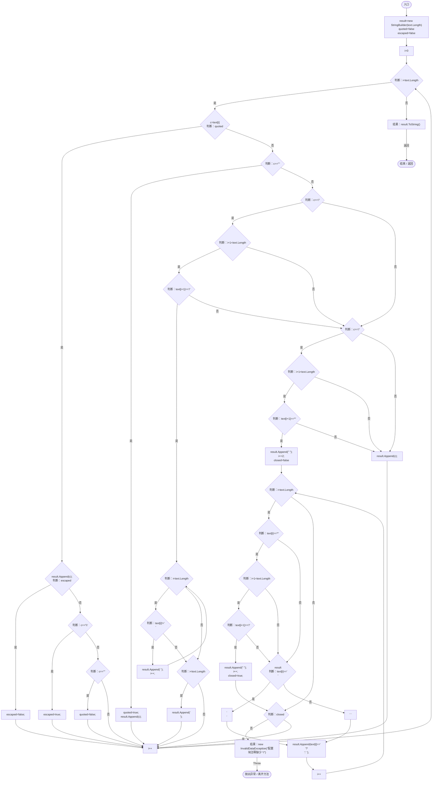

# CommentedJson.cs

[返回总索引](../README.md) · `Runtime` · `Assets/DarwinPark/Core/CommentedJson.cs`

[源文件](../../../Assets/DarwinPark/Core/CommentedJson.cs) · 源码校验：`fd25efee8da37e243eea6ca1ba655b2c265c862fecbb518eb49075a108617692`

方法按源文件位置排列。事件/回调引用不表示立即执行；分支与异常说明见总索引。完整源码与可点击关系图请打开离线手册。

## Strip · L9

`public static string Strip(string text)`

### Editor / Player · Roslyn编译器控制流

