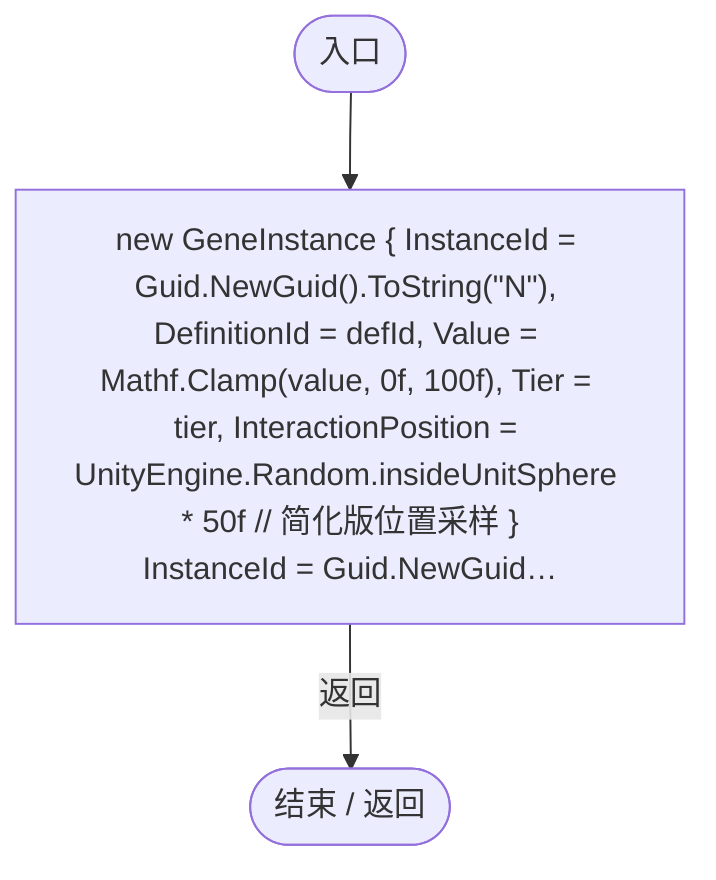

# GeneInstance.cs

[返回总索引](../README.md) · `Runtime` · `Assets/DarwinPark/Genetics/Data/GeneInstance.cs`

[源文件](../../../Assets/DarwinPark/Genetics/Data/GeneInstance.cs) · 源码校验：`b2fd030cf01aa5247aa53b5da03d1aef41fefac5a7282660d565700abfc44338`

方法按源文件位置排列。事件/回调引用不表示立即执行；分支与异常说明见总索引。完整源码与可点击关系图请打开离线手册。

## Create · L20

`public static GeneInstance Create(string defId, float value, int tier)`

### Editor / Player · Roslyn编译器控制流

