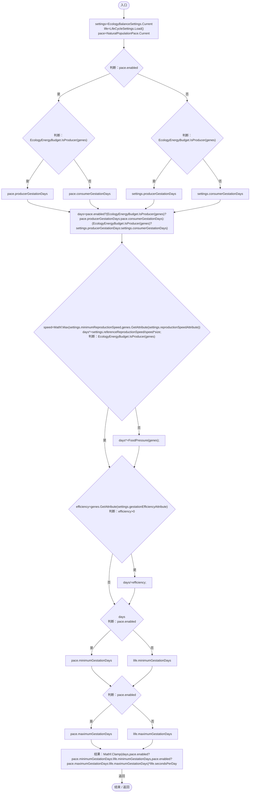
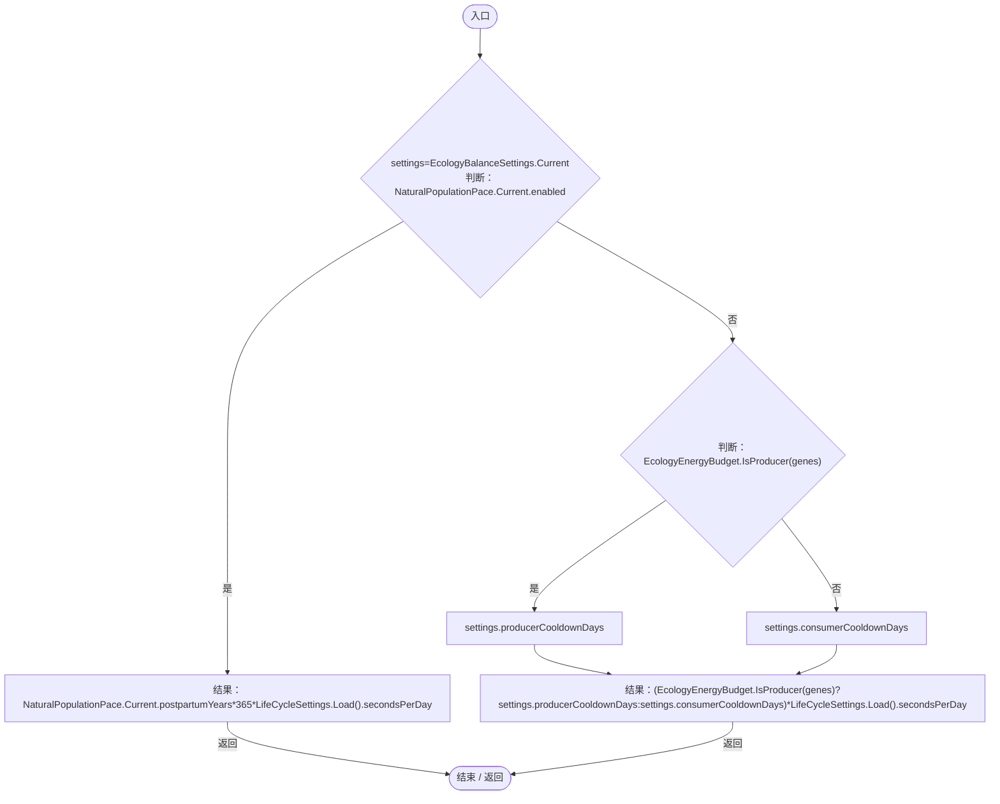
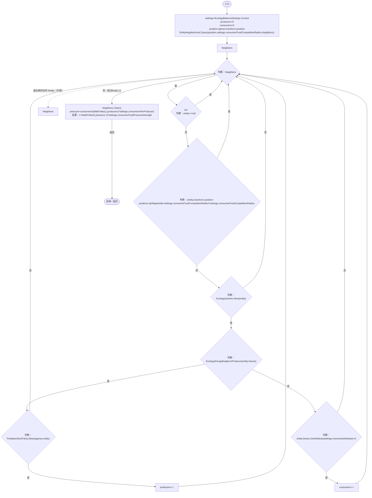

# EcologyReproductionTiming.cs

[返回总索引](../README.md) · `Runtime` · `Assets/DarwinPark/Entities/Ecology/EcologyReproductionTiming.cs`

[源文件](../../../Assets/DarwinPark/Entities/Ecology/EcologyReproductionTiming.cs) · 源码校验：`ea585e01a18f04893619c3170dcd60f37f296d7be0433c88ddc56ece493ccf82`

方法按源文件位置排列。事件/回调引用不表示立即执行；分支与异常说明见总索引。完整源码与可点击关系图请打开离线手册。

## GestationSeconds · L11

`public static float GestationSeconds(EntityGeneController genes,float size)`

### Editor / Player · Roslyn编译器控制流

项目内调用/回调引用：

- [EcologyBalanceSettings.Current.get · L29](5a37bc79f15f6238.md#md33d4c4b8f82540b)（访问器）
- [LifeCycleSettings.Load · L16](ace76969fe8f61de.md#m6fe263852e5a8989)（方法）
- [NaturalPopulationPace.Current.get · L19](bb501fbca2e1b01f.md#m902ff80ab222d2ce)（访问器）
- [EcologyEnergyBudget.IsProducer · L27](06a91c8201f26593.md#mdf11c493dfe1c754)（方法）
- [EntityGeneController.GetAttribute · L288](7494d53178552f0e.md#m45127bcdd833aaf5)（方法）
- [EcologyReproductionTiming.FoodPressure · L25](f834876424538fa9.md#m33c01d48a5edb8fd)（方法）

## CooldownSeconds · L22

`public static float CooldownSeconds(EntityGeneController genes)`

### Editor / Player · Roslyn编译器控制流

项目内调用/回调引用：

- [EcologyBalanceSettings.Current.get · L29](5a37bc79f15f6238.md#md33d4c4b8f82540b)（访问器）
- [NaturalPopulationPace.Current.get · L19](bb501fbca2e1b01f.md#m902ff80ab222d2ce)（访问器）
- [LifeCycleSettings.Load · L16](ace76969fe8f61de.md#m6fe263852e5a8989)（方法）
- [EcologyEnergyBudget.IsProducer · L27](06a91c8201f26593.md#mdf11c493dfe1c754)（方法）

## FoodPressure · L25

`public static float FoodPressure(EntityGeneController genes)`

★ 新增：附近可食生产者不足时减慢孕育，避免已有储粮在食物衰退期间继续造成数量过冲；不直接增删实体。

### Editor / Player · Roslyn编译器控制流

项目内调用/回调引用：

- [EcologyBalanceSettings.Current.get · L29](5a37bc79f15f6238.md#md33d4c4b8f82540b)（访问器）
- [EntityNeighborhood.Query · L103](e5e24c4aff0395b1.md#m5eeb82894923b7f4)（方法）
- [EcologyQueries.Alive · L39](bdf7ccc2c9c0452f.md#m8352bfacbe2996a8)（方法）
- [EcologyEnergyBudget.IsProducer · L27](06a91c8201f26593.md#mdf11c493dfe1c754)（方法）
- [DarwinEntity.Genes.get · L14](70798dde169f2e8b.md#m622eb1adf401d431)（访问器）
- [PredationSizePolicy.Allows · L9](80ea865fb0f12053.md#m70764380d885d2d4)（方法）
- [EntityGeneController.GetAttribute · L288](7494d53178552f0e.md#m45127bcdd833aaf5)（方法）
