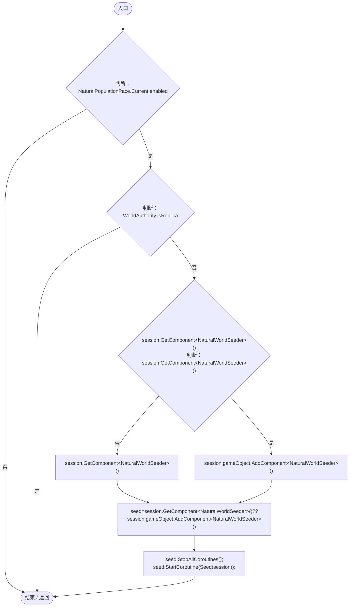
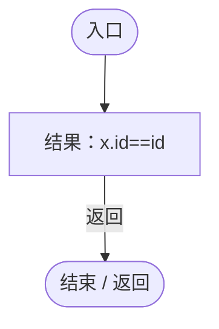
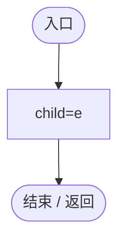

```mermaid
flowchart TD
  b0(["入口"])
  b1["world=session.Current.id<br/>cfg=NaturalPopulationPace.Current<br/>planet=EcologyQueries.Planet<br/>home=Vector3.zero<br/>found=false"]
  b2["i=0"]
  b3{"判断：i&lt;512"}
  b4{"y=1-2*(i+.5f)/512<br/>angle=i*2.39996323f<br/>up=new Vector3(Mathf.Sqrt(1-y*y)*Mathf.Cos(angle),y,Mathf.Sqrt(1-y*y)*Mathf.Sin(angle))<br/>point=EcologyQueries.Surface(planet.transform.position+up*(planet.radius+planet.heightScale))<br/>climate=PlanetCli…"}
  b5{"判断：climate.Temperature&gt;8"}
  b6{"判断：climate.Temperature&lt;32"}
  b7["home=point;<br/>found=true;"]
  b8{"判断：i%32==31"}
  b9["yield return null;"]
  b10["i++"]
  b11{"判断：found"}
  b12["Debug.LogWarning(&quot;[自然种源] 没有适宜陆地，保留空世界供手动投放&quot;);"]
  b13["producers=Mathf.RoundToInt(cfg.initialPopulation*EcologyDefaults.Current.producerRatio)<br/>made=0<br/>templates=EcologyDefaults.Current.templates"]
  b14["attempt=0"]
  b15{"判断：made&lt;cfg.initialPopulation"}
  b16{"判断：attempt&lt;cfg.initialPopulation*64"}
  b17{"session.Current<br/>判断：session.Current"}
  b18[".id"]
  b19["session.Current"]
  b20{"判断：session.Current?.id!=world"}
  b21{"判断：WorldRuntimeGate.Ready"}
  b22{"判断：EntityPopulationLimit.CanSpawn"}
  b23{"判断：DarwinEntity.Spawner==null"}
  b24{"direction=EcologyQueries.Up(home)<br/>tangent=Vector3.ProjectOnPlane(Random.onUnitSphere,direction).normalized<br/>point=EcologyQueries.Surface(home+tangent*(4+Mathf.Sqrt(attempt+1)*3))<br/>判断：(point-planet.transform.position).magnitude&lt;=planet.Loca…"}
  b25{"判断：made&lt;producers"}
  b26["cfg.producerTemplate"]
  b27["cfg.mobileTemplate"]
  b28["id=made&lt;producers?cfg.producerTemplate:cfg.mobileTemplate"]
  b29{"template=templates.FirstOrDefault(x=&gt;x.id==id)<br/>判断：template==null"}
  b30["bundled=Resources.Load&lt;TextAsset&gt;(&quot;Entities/ecology_defaults&quot;)"]
  b31{"template<br/>判断：bundled==null"}
  b32["null"]
  b33["EcologyDefaults.Parse(bundled.text).templates.FirstOrDefault(x=&gt;x.id==id)"]
  b34["template=bundled==null?null:EcologyDefaults.Parse(bundled.text).templates.FirstOrDefault(x=&gt;x.id==id);"]
  b35{"判断：template==null"}
  b36["Debug.LogWarning(&quot;[自然种源] 缺少初始模板：&quot;+id);"]
  b37["Debug.LogWarning(&quot;[自然种源] 世界模板缺少&quot;+id+&quot;，使用内置同名种源；不覆盖世界模板&quot;);"]
  b38["genome=template.Recipe().CreateGenome()<br/>child=null<br/>EntityRegistry.OnRegistered+=Capture;"]
  b39["DarwinEntity.Spawner(genome,point,template.name);"]
  b40["EntityRegistry.OnRegistered-=Capture;"]
  b41{"判断：child!=null"}
  b42["child.GetComponent&lt;EntityLifeCycle&gt;().RestoreProgress(0);<br/>child.Genes.RestoreStageState(DarwinPark.Entities.AgeState.Infant,1,1);<br/>child.Genes.Recalculate();<br/>made++;"]
  b43["yield return null;"]
  b44["attempt++"]
  b45{"session.Current<br/>判断：session.Current"}
  b46[".id"]
  b47["session.Current"]
  b48{"判断：session.Current?.id==world"}
  b49["session.SaveNow();<br/>Debug.Log(&quot;[自然种源] 已建立初始种源 &quot;+made+&quot;；后续依靠自然繁殖&quot;);"]
  b50(["结束 / 返回"])
  b0 --> b1
  b1 --> b2
  b2 --> b3
  b3 -->|"是"| b4
  b3 -->|"否"| b11
  b4 -->|"是"| b5
  b4 -->|"否"| b8
  b5 -->|"是"| b6
  b5 -->|"否"| b8
  b6 -->|"是"| b7
  b6 -->|"否"| b8
  b7 --> b11
  b8 -->|"是"| b9
  b8 -->|"否"| b10
  b9 --> b10
  b10 --> b3
  b11 -->|"否"| b12
  b11 -->|"是"| b13
  b12 --> b50
  b13 --> b14
  b14 --> b15
  b15 -->|"是"| b16
  b15 -->|"否"| b45
  b16 -->|"是"| b17
  b16 -->|"否"| b45
  b17 -->|"否"| b18
  b17 -->|"是"| b19
  b18 --> b20
  b19 --> b20
  b20 -->|"否"| b21
  b20 -->|"是"| b50
  b21 -->|"否"| b50
  b21 -->|"是"| b22
  b22 -->|"是"| b23
  b22 -->|"否"| b45
  b23 -->|"是"| b45
  b23 -->|"否"| b24
  b24 -->|"是"| b44
  b24 -->|"否"| b25
  b25 -->|"是"| b26
  b25 -->|"否"| b27
  b26 --> b28
  b27 --> b28
  b28 --> b29
  b29 -->|"是"| b30
  b29 -->|"否"| b38
  b30 --> b31
  b31 -->|"是"| b32
  b31 -->|"否"| b33
  b32 --> b34
  b33 --> b34
  b34 --> b35
  b35 -->|"是"| b36
  b35 -->|"否"| b37
  b36 --> b45
  b37 --> b38
  b38 --> b39
  b39 -->|"经过finally 40"| b41
  b41 -->|"是"| b42
  b41 -->|"否"| b43
  b42 --> b43
  b43 --> b44
  b44 --> b15
  b45 -->|"否"| b46
  b45 -->|"是"| b47
  b46 --> b48
  b47 --> b48
  b48 -->|"是"| b49
  b48 -->|"否"| b50
  b49 --> b50
  b39 -. "退出保护区时 finally（示意）" .-> b40

```

# NaturalWorldSeeder.cs

[返回总索引](../README.md) · `Runtime` · `Assets/DarwinPark/UI/NaturalWorldSeeder.cs`

[源文件](../../../Assets/DarwinPark/UI/NaturalWorldSeeder.cs) · 源码校验：`024f2c7b4ca8751d83a4c1791647fe0a5528ac97b319cf70629add263189a50d`

方法按源文件位置排列。事件/回调引用不表示立即执行；分支与异常说明见总索引。完整源码与可点击关系图请打开离线手册。

## Begin · L13

`public static void Begin(WorldSessionManager session)`

### Editor / Player · Roslyn编译器控制流

项目内调用/回调引用：

- [NaturalPopulationPace.Current.get · L19](bb501fbca2e1b01f.md#m902ff80ab222d2ce)（访问器）
- [NaturalWorldSeeder.Seed · L19](f898fb42eef1f19e.md#m3bd72140a569793b)（方法）

## Seed · L19

`private static IEnumerator Seed(WorldSessionManager session)`

### Editor / Player · Roslyn编译器控制流

项目内调用/回调引用：

- [WorldSessionManager.Current.get · L21](08741c7b7b9d9344.md#m5d26a5eb846a8504)（访问器）
- [NaturalPopulationPace.Current.get · L19](bb501fbca2e1b01f.md#m902ff80ab222d2ce)（访问器）
- [EcologyQueries.Surface · L48](bdf7ccc2c9c0452f.md#m40ee3e975d7f5137)（方法）
- [PlanetClimateSystem.GetClimateAt · L70](ba86e31da9b7d0a5.md#mbe769f9a547808a4)（方法）
- [PlanetClimateSystem.Instance.get · L33](ba86e31da9b7d0a5.md#md8b21cc929db37b1)（访问器）
- [PlanetTerrainMeshBuilder.LocalWaterRadius · L113](415285cf043354a9.md#m5d141fd984c0caf8)（方法）
- [EcologyDefaults.Current.get · L35](5b565b57de741d98.md#m75cb60b88e3cc1c7)（访问器）
- [EcologyQueries.Up · L42](bdf7ccc2c9c0452f.md#ma73e6bbbc726282f)（方法）
- [EcologyDefaults.Parse · L43](5b565b57de741d98.md#me86e89216d317f4b)（方法）
- [RandomSpawnRecipe.CreateGenome · L25](923ccc4e86c4786c.md#m2612c79fe3848e08)（方法）
- [EcologyDefaultTemplate.Recipe · L16](5b565b57de741d98.md#m17d9ba8f434671b9)（方法）
- [EntityLifeCycle.RestoreProgress · L51](9f4138bfbae654b7.md#mec34c953ece464ab)（方法）
- [EntityGeneController.RestoreStageState · L56](7494d53178552f0e.md#m37c1dbfa64e7c2ce)（方法）
- [DarwinEntity.Genes.get · L14](70798dde169f2e8b.md#m622eb1adf401d431)（访问器）
- [EntityGeneController.Recalculate · L118](7494d53178552f0e.md#m707d9a56b0c7c609)（方法）
- [WorldSessionManager.SaveNow · L169](08741c7b7b9d9344.md#m43f61078d8513f73)（方法）
- [NaturalWorldSeeder.回调@34 · L34](f898fb42eef1f19e.md#m93a7cc601d57e120)（回调/委托）
- [NaturalWorldSeeder.回调@37 · L37](f898fb42eef1f19e.md#mbf651d7c3ae02a77)（回调/委托）
- [NaturalWorldSeeder.Capture · L41](f898fb42eef1f19e.md#me41d09a45307bb46)（局部函数）

## 回调@34 · L34

`x … => 回调`

### Editor / Player · Roslyn编译器控制流

## 回调@37 · L37

`x … => 回调`

### Editor / Player · Roslyn编译器控制流

## Capture · L41

`void Capture(DarwinEntity e)`

### Editor / Player · Roslyn编译器控制流

