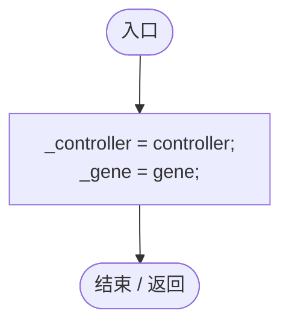
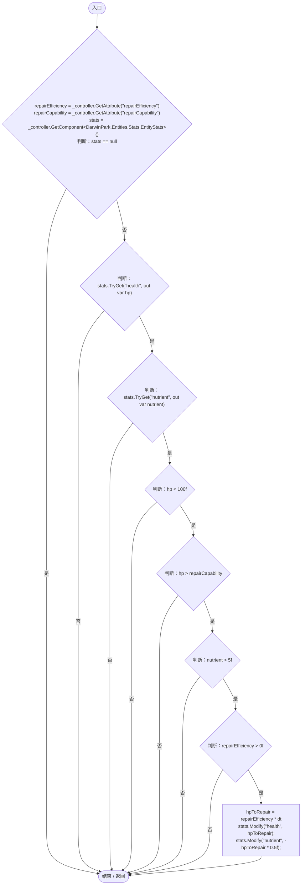
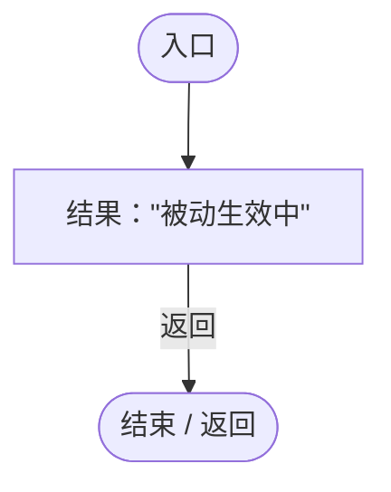

# RepairGeneLogic.cs

[返回总索引](../README.md) · `Runtime` · `Assets/DarwinPark/Entities/Logic/RepairGeneLogic.cs`

[源文件](../../../Assets/DarwinPark/Entities/Logic/RepairGeneLogic.cs) · 源码校验：`8a8b59b970929952e7a0e9aed7ca8ee4c3cd4d3ab37c73dff62b8060dd2a1ac5`

方法按源文件位置排列。事件/回调引用不表示立即执行；分支与异常说明见总索引。完整源码与可点击关系图请打开离线手册。

## Initialize · L11

`public void Initialize(EntityGeneController controller, GeneInstance gene)`

### Editor / Player · Roslyn编译器控制流

## OnUpdate · L17

`public void OnUpdate(float dt)`

### Editor / Player · Roslyn编译器控制流

项目内调用/回调引用：

- [EntityGeneController.GetAttribute · L225](7494d53178552f0e.md#mc707943b1138a009)（方法）
- [EntityStats.TryGet · L90](75aa86a368efdf24.md#m24ee1433e4a70d94)（方法）
- [EntityStats.Modify · L104](75aa86a368efdf24.md#m858c2a75d852ecc1)（方法）

## GetTooltipInfo · L37

`public string GetTooltipInfo()`

### Editor / Player · Roslyn编译器控制流

