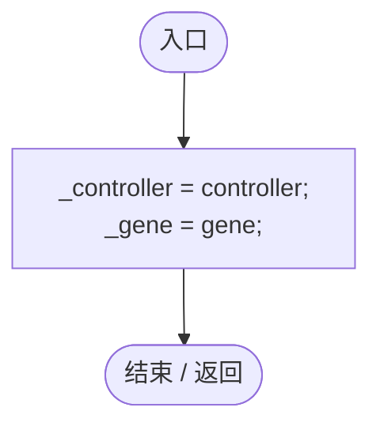
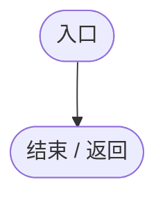
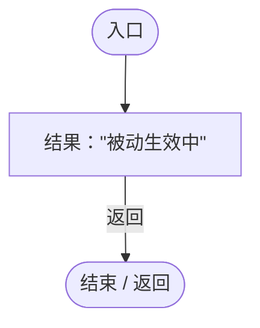

# RepairGeneLogic.cs

[返回总索引](../README.md) · `Runtime` · `Assets/DarwinPark/Entities/Logic/RepairGeneLogic.cs`

[源文件](../../../Assets/DarwinPark/Entities/Logic/RepairGeneLogic.cs) · 源码校验：`6be55a3ca0d4dc081d1a126c8de224d3716a0e70925b1e447e1cbdf004476c68`

方法按源文件位置排列。事件/回调引用不表示立即执行；分支与异常说明见总索引。完整源码与可点击关系图请打开离线手册。

## Initialize · L11

`public void Initialize(EntityGeneController controller, GeneInstance gene)`

### Editor / Player · Roslyn编译器控制流

## OnUpdate · L18

`public void OnUpdate(float dt)`

★ 修复（防Bug回归）：EntityVitals已经统一修复，基因再次修复会重复扣粮并绕过溺水限制。

### Editor / Player · Roslyn编译器控制流

## GetTooltipInfo · L20

`public string GetTooltipInfo()`

### Editor / Player · Roslyn编译器控制流

