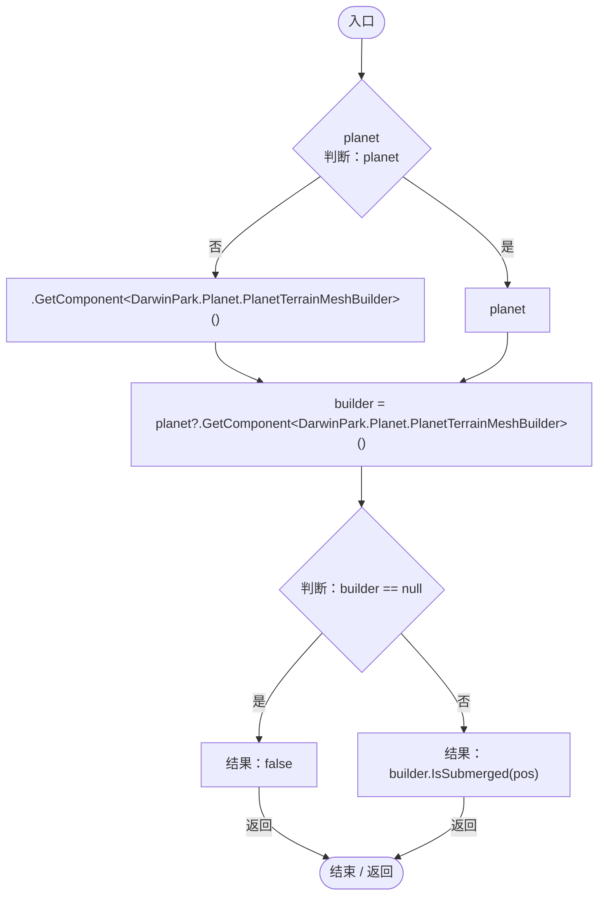
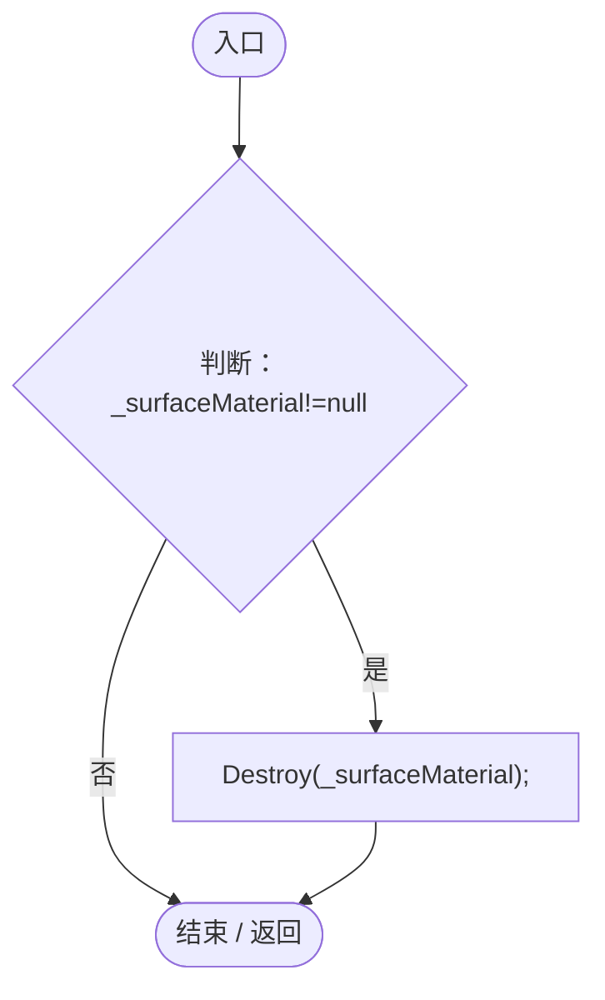

```mermaid
flowchart TD
  b0(["入口"])
  b1{"判断：_rb==null"}
  b2{"判断：_rb.isKinematic"}
  b3{"判断：ServiceLocator.TryGet&lt;SimulationClock&gt;(out var clock)"}
  b4{"判断：clock.IsRunning"}
  b5["_rb.linearVelocity = Vector3.zero;<br/>_rb.angularVelocity = Vector3.zero;"]
  b6{"判断：planet == null"}
  b7{"genes = GetComponent&lt;EntityGeneController&gt;()<br/>判断：StationaryBodyRest.RemainsAsleep(_rb,genes)"}
  b8{"判断：genes != null"}
  b9["genes.GetAttribute(&quot;moveSpeed&quot;)"]
  b10["0f"]
  b11["moveSpeed = genes != null ? genes.GetAttribute(&quot;moveSpeed&quot;) : 0f"]
  b12{"判断：_surfaceMaterial!=null"}
  b13["motion=DarwinPark.Entities.Logic.LocomotionSettings.Load()<br/>radial=(transform.position-planet.position).normalized"]
  b14{"判断：moveSpeed&gt;0"}
  b15["Vector3.ProjectOnPlane(_rb.linearVelocity,radial).sqrMagnitude&gt;motion.frictionMotionThreshold*motion.frictionMotionThreshold"]
  b16["moveSpeed&gt;0"]
  b17["moving=moveSpeed&gt;0&amp;&amp;Vector3.ProjectOnPlane(_rb.linearVelocity,radial).sqrMagnitude&gt;motion.frictionMotionThreshold*motion.frictionMotionThreshold"]
  b18{"_surfaceMaterial.staticFriction<br/>_surfaceMaterial.dynamicFriction<br/>判断：moving"}
  b19["motion.movingFriction"]
  b20["motion.stationaryFriction"]
  b21["_surfaceMaterial.staticFriction=_surfaceMaterial.dynamicFriction=moving?motion.movingFriction:motion.stationaryFriction;"]
  b22["_surfaceMaterial.frictionCombine=PhysicsMaterialCombine.Minimum;"]
  b23{"isInWater = IsUnderWater(transform.position)<br/>dirToCenter = planet.position - transform.position<br/>distance = dirToCenter.magnitude<br/>dirToCenter.Normalize();<br/>gravityMultiplier = Mathf.Clamp(Mathf.Pow(planetRadius / Mathf.Max(distance, planet…"}
  b24{"判断：distance &gt; planetRadius + 60f"}
  b25["highAltitudeAssist = Mathf.Min(20f, (distance - planetRadius - 60f) * 0.25f);"]
  b26{"_rb.AddForce(dirToCenter * (finalGravity * gravityMultiplier + highAltitudeAssist), ForceMode.Acceleration);<br/>判断：isInWater"}
  b27["_rb.linearVelocity=dirToCenter*Mathf.Max(0,Vector3.Dot(_rb.linearVelocity,dirToCenter));"]
  b28{"判断：_ground==null"}
  b29["_ground=planet.GetComponent&lt;MeshCollider&gt;();"]
  b30{"判断：_ground!=null"}
  b31{"判断：_ground.Raycast(new Ray(transform.position,dirToCenter),out RaycastHit hit,20f)"}
  b32{"判断：_col != null"}
  b33["_col.bounds.extents.y"]
  b34["1f"]
  b35["radius = _col != null ? _col.bounds.extents.y : 1f"]
  b36{"判断：hit.distance &lt;= radius + 0.5f"}
  b37{"判断：moveSpeed &lt;= 0f"}
  b38{"velocity = _rb.linearVelocity<br/>vn = Vector3.Dot(velocity, hit.normal)<br/>tangentVelocity = velocity - hit.normal * vn<br/>判断：tangentVelocity.sqrMagnitude &gt; 0.01f"}
  b39["_rb.linearVelocity -= tangentVelocity * 0.9f;"]
  b40["targetRot = Quaternion.FromToRotation(transform.up, hit.normal) * transform.rotation<br/>transform.rotation = Quaternion.Slerp(transform.rotation, targetRot, Time.fixedDeltaTime * 15f);<br/>StationaryBodyRest.TryRest(_rb,genes,_col,hit,planet);"]
  b41["targetRot = Quaternion.FromToRotation(transform.up, -dirToCenter) * transform.rotation<br/>transform.rotation = Quaternion.Slerp(transform.rotation, targetRot, Time.fixedDeltaTime * 5f);"]
  b42(["结束 / 返回"])
  b0 --> b1
  b1 -->|"否"| b2
  b1 -->|"是"| b42
  b2 -->|"是"| b42
  b2 -->|"否"| b3
  b3 -->|"是"| b4
  b3 -->|"否"| b6
  b4 -->|"否"| b5
  b4 -->|"是"| b6
  b5 --> b42
  b6 -->|"是"| b42
  b6 -->|"否"| b7
  b7 -->|"是"| b42
  b7 -->|"否"| b8
  b8 -->|"是"| b9
  b8 -->|"否"| b10
  b9 --> b11
  b10 --> b11
  b11 --> b12
  b12 -->|"是"| b13
  b12 -->|"否"| b23
  b13 --> b14
  b14 -->|"是"| b15
  b14 -->|"否"| b16
  b15 --> b17
  b16 --> b17
  b17 --> b18
  b18 -->|"是"| b19
  b18 -->|"否"| b20
  b19 --> b21
  b20 --> b21
  b21 --> b22
  b22 --> b23
  b23 -->|"否"| b24
  b23 -->|"是"| b26
  b24 -->|"是"| b25
  b24 -->|"否"| b26
  b25 --> b26
  b26 -->|"是"| b27
  b26 -->|"否"| b28
  b27 --> b28
  b28 -->|"是"| b29
  b28 -->|"否"| b30
  b29 --> b30
  b30 -->|"是"| b31
  b30 -->|"否"| b42
  b31 -->|"是"| b32
  b31 -->|"否"| b42
  b32 -->|"是"| b33
  b32 -->|"否"| b34
  b33 --> b35
  b34 --> b35
  b35 --> b36
  b36 -->|"是"| b37
  b36 -->|"否"| b41
  b37 -->|"是"| b38
  b37 -->|"否"| b40
  b38 -->|"是"| b39
  b38 -->|"否"| b40
  b39 --> b40
  b40 --> b42
  b41 --> b42

```

# PlanetGravity.cs

[返回总索引](../README.md) · `Runtime` · `Assets/DarwinPark/Entities/PlanetGravity.cs`

[源文件](../../../Assets/DarwinPark/Entities/PlanetGravity.cs) · 源码校验：`5042a07f3c4815f1848af735f943b478df959c4d5652fd5ccf540bb0b55c8ad0`

方法按源文件位置排列。事件/回调引用不表示立即执行；分支与异常说明见总索引。完整源码与可点击关系图请打开离线手册。

## Start · L18

`void Start()`

### Editor / Player · Roslyn编译器控制流

```mermaid
flowchart TD
  b0(["入口"])
  b1{"判断：planet == null"}
  b2["planet"]
  b3{"GameObject.Find(&quot;Planet&quot;)<br/>判断：GameObject.Find(&quot;Planet&quot;)"}
  b4[".transform"]
  b5["GameObject.Find(&quot;Planet&quot;)"]
  b6["planet = GameObject.Find(&quot;Planet&quot;)?.transform;"]
  b7{"_rb = GetComponent&lt;Rigidbody&gt;();<br/>_col = GetComponent&lt;Collider&gt;();<br/>_rb.useGravity = false;<br/>_rb.constraints = RigidbodyConstraints.FreezeRotationX &#124; RigidbodyConstraints.FreezeRotationZ;<br/>_rb.collisionDetectionMode = CollisionDetectionMode.…"}
  b8["mat = new PhysicsMaterial(&quot;PlanetHighFriction&quot;)<br/>mat.dynamicFriction = 1.0f;<br/>mat.staticFriction = 1.0f;<br/>mat.bounciness = 0f;<br/>_col.material = mat;<br/>_surfaceMaterial=mat;"]
  b9(["结束 / 返回"])
  b0 --> b1
  b1 -->|"是"| b2
  b1 -->|"否"| b7
  b2 --> b3
  b3 -->|"否"| b4
  b3 -->|"是"| b5
  b4 --> b6
  b5 --> b6
  b6 --> b7
  b7 -->|"是"| b8
  b7 -->|"否"| b9
  b8 --> b9

```

## FixedUpdate · L41

`void FixedUpdate()`

### Editor / Player · Roslyn编译器控制流

项目内调用/回调引用：

- [ServiceLocator.TryGet · L26](f2fdbe9f9ccd93cb.md#m143b24e6d58471b0)（方法）
- [SimulationClock.IsRunning.get · L22](a8f444aec9614b0a.md#m10f4fe307faca0f0)（访问器）
- [StationaryBodyRest.RemainsAsleep · L19](19e6d310d5522440.md#m8ed63efa4f5918b0)（方法）
- [EntityGeneController.GetAttribute · L225](7494d53178552f0e.md#mc707943b1138a009)（方法）
- [LocomotionSettings.Load · L17](8cce83c7d4563cf0.md#m06b74c04dd63fb4a)（方法）
- [PlanetGravity.IsUnderWater · L120](f9e84b7108c465c2.md#m0fd9c1332bd7b493)（方法）
- [StationaryBodyRest.TryRest · L24](19e6d310d5522440.md#meec3c690446ce2fc)（方法）

## IsUnderWater · L120

`private bool IsUnderWater(Vector3 pos)`

### Editor / Player · Roslyn编译器控制流

项目内调用/回调引用：

- [PlanetTerrainMeshBuilder.IsSubmerged · L102](415285cf043354a9.md#mba37dcd70e29e11a)（方法）

## OnDestroy · L128

`private void OnDestroy()`

### Editor / Player · Roslyn编译器控制流

