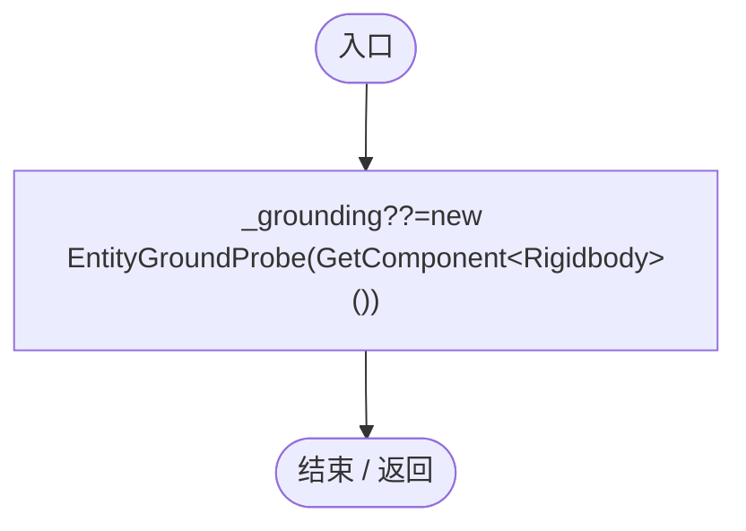
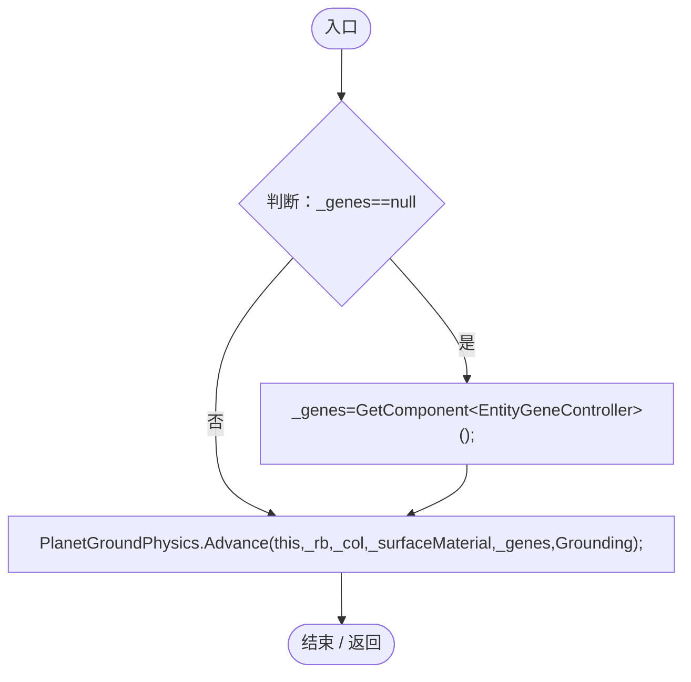

# PlanetGravity.cs

[返回总索引](../README.md) · `Runtime` · `Assets/DarwinPark/Entities/PlanetGravity.cs`

[源文件](../../../Assets/DarwinPark/Entities/PlanetGravity.cs) · 源码校验：`e3ecb93bea86ca102afdeae1ccc964711183155c314be9ddaf66f1b43b950d91`

方法按源文件位置排列。事件/回调引用不表示立即执行；分支与异常说明见总索引。完整源码与可点击关系图请打开离线手册。

## Grounding.get · L18

`public EntityGroundProbe Grounding`

### Editor / Player · 语法控制结构 / 声明（非CFG）

项目内调用/回调引用：

- [EntityGroundProbe.EntityGroundProbe.ctor · L17](6cefee808441951d.md#mc22b17280aeb06a7)（构造函数）

## Start · L20

`void Start()`

### Editor / Player · Roslyn编译器控制流

## FixedUpdate · L43

`void FixedUpdate()`

### Editor / Player · Roslyn编译器控制流

项目内调用/回调引用：

- [PlanetGroundPhysics.Advance · L9](231de97ac6543a96.md#mdfc814d5c2924cd2)（方法）

## OnDestroy · L50

`private void OnDestroy()`

### Editor / Player · Roslyn编译器控制流

