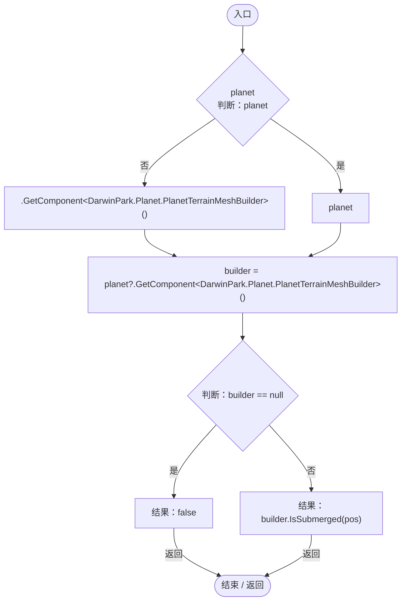
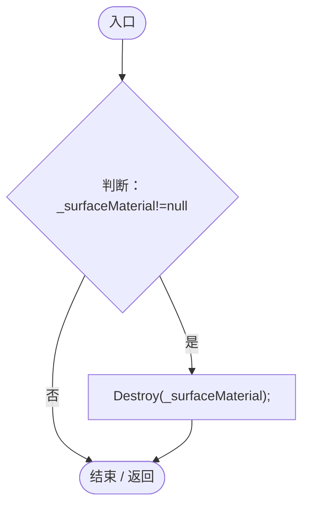

```mermaid
flowchart TD
  b0(["入口"])
  b1["performance=DarwinPark.Core.PerformanceTimings.Measure(DarwinPark.Core.PerformanceTimings.Area.Gravity)"]
  b2{"判断：_rb==null"}
  b3{"判断：_rb.isKinematic"}
  b4{"判断：ServiceLocator.TryGet&lt;SimulationClock&gt;(out var clock)"}
  b5{"判断：clock.IsRunning"}
  b6["_rb.linearVelocity = Vector3.zero;<br/>_rb.angularVelocity = Vector3.zero;"]
  b7{"判断：planet == null"}
  b8{"genes = GetComponent&lt;EntityGeneController&gt;()<br/>判断：StationaryBodyRest.RemainsAsleep(_rb,genes)"}
  b9{"判断：genes != null"}
  b10["genes.GetAttribute(&quot;moveSpeed&quot;)"]
  b11["0f"]
  b12["moveSpeed = genes != null ? genes.GetAttribute(&quot;moveSpeed&quot;) : 0f"]
  b13{"判断：_surfaceMaterial!=null"}
  b14["motion=DarwinPark.Entities.Logic.LocomotionSettings.Load()<br/>radial=(transform.position-planet.position).normalized"]
  b15{"判断：moveSpeed&gt;0"}
  b16["Vector3.ProjectOnPlane(_rb.linearVelocity,radial).sqrMagnitude&gt;motion.frictionMotionThreshold*motion.frictionMotionThreshold"]
  b17["moveSpeed&gt;0"]
  b18["moving=moveSpeed&gt;0&amp;&amp;Vector3.ProjectOnPlane(_rb.linearVelocity,radial).sqrMagnitude&gt;motion.frictionMotionThreshold*motion.frictionMotionThreshold"]
  b19{"_surfaceMaterial.staticFriction<br/>_surfaceMaterial.dynamicFriction<br/>判断：moving"}
  b20["motion.movingFriction"]
  b21["motion.stationaryFriction"]
  b22["_surfaceMaterial.staticFriction=_surfaceMaterial.dynamicFriction=moving?motion.movingFriction:motion.stationaryFriction;"]
  b23["_surfaceMaterial.frictionCombine=PhysicsMaterialCombine.Minimum;"]
  b24{"isInWater = IsUnderWater(transform.position)<br/>dirToCenter = planet.position - transform.position<br/>distance = dirToCenter.magnitude<br/>dirToCenter.Normalize();<br/>gravityMultiplier = Mathf.Clamp(Mathf.Pow(planetRadius / Mathf.Max(distance, planet…"}
  b25{"判断：distance &gt; planetRadius + 60f"}
  b26["highAltitudeAssist = Mathf.Min(20f, (distance - planetRadius - 60f) * 0.25f);"]
  b27{"_rb.AddForce(dirToCenter * (finalGravity * gravityMultiplier + highAltitudeAssist), ForceMode.Acceleration);<br/>判断：isInWater"}
  b28["_rb.linearVelocity=dirToCenter*Mathf.Max(0,Vector3.Dot(_rb.linearVelocity,dirToCenter));"]
  b29{"判断：_ground==null"}
  b30["_ground=planet.GetComponent&lt;MeshCollider&gt;();"]
  b31{"判断：_ground!=null"}
  b32{"判断：_ground.Raycast(new Ray(transform.position,dirToCenter),out RaycastHit hit,20f)"}
  b33{"判断：_col != null"}
  b34["_col.bounds.extents.y"]
  b35["1f"]
  b36["radius = _col != null ? _col.bounds.extents.y : 1f"]
  b37{"判断：hit.distance &lt;= radius + 0.5f"}
  b38{"判断：moveSpeed &lt;= 0f"}
  b39{"velocity = _rb.linearVelocity<br/>vn = Vector3.Dot(velocity, hit.normal)<br/>tangentVelocity = velocity - hit.normal * vn<br/>判断：tangentVelocity.sqrMagnitude &gt; 0.01f"}
  b40["_rb.linearVelocity -= tangentVelocity * 0.9f;"]
  b41["targetRot = Quaternion.FromToRotation(transform.up, hit.normal) * transform.rotation<br/>transform.rotation = Quaternion.Slerp(transform.rotation, targetRot, Time.fixedDeltaTime * 15f);<br/>StationaryBodyRest.TryRest(_rb,genes,_col,hit,planet);"]
  b42["targetRot = Quaternion.FromToRotation(transform.up, -dirToCenter) * transform.rotation<br/>transform.rotation = Quaternion.Slerp(transform.rotation, targetRot, Time.fixedDeltaTime * 5f);"]
  b43["performance=DarwinPark.Core.PerformanceTimings.Measure(DarwinPark.Core.PerformanceTimings.Area.Gravity)"]
  b44(["结束 / 返回"])
  b0 --> b1
  b1 --> b2
  b2 -->|"否"| b3
  b2 -->|"是 · 经过finally 43"| b44
  b3 -->|"是 · 经过finally 43"| b44
  b3 -->|"否"| b4
  b4 -->|"是"| b5
  b4 -->|"否"| b7
  b5 -->|"否"| b6
  b5 -->|"是"| b7
  b6 -->|"经过finally 43"| b44
  b7 -->|"是 · 经过finally 43"| b44
  b7 -->|"否"| b8
  b8 -->|"是 · 经过finally 43"| b44
  b8 -->|"否"| b9
  b9 -->|"是"| b10
  b9 -->|"否"| b11
  b10 --> b12
  b11 --> b12
  b12 --> b13
  b13 -->|"是"| b14
  b13 -->|"否"| b24
  b14 --> b15
  b15 -->|"是"| b16
  b15 -->|"否"| b17
  b16 --> b18
  b17 --> b18
  b18 --> b19
  b19 -->|"是"| b20
  b19 -->|"否"| b21
  b20 --> b22
  b21 --> b22
  b22 --> b23
  b23 --> b24
  b24 -->|"否"| b25
  b24 -->|"是"| b27
  b25 -->|"是"| b26
  b25 -->|"否"| b27
  b26 --> b27
  b27 -->|"是"| b28
  b27 -->|"否"| b29
  b28 --> b29
  b29 -->|"是"| b30
  b29 -->|"否"| b31
  b30 --> b31
  b31 -->|"是"| b32
  b31 -->|"否 · 经过finally 43"| b44
  b32 -->|"是"| b33
  b32 -->|"否 · 经过finally 43"| b44
  b33 -->|"是"| b34
  b33 -->|"否"| b35
  b34 --> b36
  b35 --> b36
  b36 --> b37
  b37 -->|"是"| b38
  b37 -->|"否"| b42
  b38 -->|"是"| b39
  b38 -->|"否"| b41
  b39 -->|"是"| b40
  b39 -->|"否"| b41
  b40 --> b41
  b41 -->|"经过finally 43"| b44
  b42 -->|"经过finally 43"| b44
  b2 -. "退出保护区时 finally（示意）" .-> b43

```

# PlanetGravity.cs

[返回总索引](../README.md) · `Runtime` · `Assets/DarwinPark/Entities/PlanetGravity.cs`

[源文件](../../../Assets/DarwinPark/Entities/PlanetGravity.cs) · 源码校验：`5b942316977a971ddc25716487d1a57143a11a8a9f6847edb6d45409a66f8f69`

方法按源文件位置排列。事件/回调引用不表示立即执行；分支与异常说明见总索引。完整源码与可点击关系图请打开离线手册。

## Start · L18

`void Start()`

### Editor / Player · Roslyn编译器控制流

```mermaid
flowchart TD
  b0(["入口"])
  b1{"判断：planet == null"}
  b2["planet"]
  b3{"GameObject.Find(&quot;Planet&quot;)<br/>判断：GameObject.Find(&quot;Planet&quot;)"}
  b4[".transform"]
  b5["GameObject.Find(&quot;Planet&quot;)"]
  b6["planet = GameObject.Find(&quot;Planet&quot;)?.transform;"]
  b7{"_rb = GetComponent&lt;Rigidbody&gt;();<br/>_col = GetComponent&lt;Collider&gt;();<br/>_rb.useGravity = false;<br/>_rb.constraints = RigidbodyConstraints.FreezeRotationX &#124; RigidbodyConstraints.FreezeRotationZ;<br/>_rb.collisionDetectionMode = CollisionDetectionMode.…"}
  b8["mat = new PhysicsMaterial(&quot;PlanetHighFriction&quot;)<br/>mat.dynamicFriction = 1.0f;<br/>mat.staticFriction = 1.0f;<br/>mat.bounciness = 0f;<br/>_col.material = mat;<br/>_surfaceMaterial=mat;"]
  b9(["结束 / 返回"])
  b0 --> b1
  b1 -->|"是"| b2
  b1 -->|"否"| b7
  b2 --> b3
  b3 -->|"否"| b4
  b3 -->|"是"| b5
  b4 --> b6
  b5 --> b6
  b6 --> b7
  b7 -->|"是"| b8
  b7 -->|"否"| b9
  b8 --> b9

```

## FixedUpdate · L41

`void FixedUpdate()`

### Editor / Player · Roslyn编译器控制流

项目内调用/回调引用：

- [PerformanceTimings.Measure · L23](a8403a4c7503726d.md#m29626bbbc2d07209)（方法）
- [ServiceLocator.TryGet · L26](f2fdbe9f9ccd93cb.md#m143b24e6d58471b0)（方法）
- [SimulationClock.IsRunning.get · L22](a8f444aec9614b0a.md#m10f4fe307faca0f0)（访问器）
- [StationaryBodyRest.RemainsAsleep · L19](19e6d310d5522440.md#m8ed63efa4f5918b0)（方法）
- [EntityGeneController.GetAttribute · L266](7494d53178552f0e.md#mdbc6681f8c2a7083)（方法）
- [LocomotionSettings.Load · L17](8cce83c7d4563cf0.md#m06b74c04dd63fb4a)（方法）
- [PlanetGravity.IsUnderWater · L122](f9e84b7108c465c2.md#me1b33e5862e6157a)（方法）
- [StationaryBodyRest.TryRest · L24](19e6d310d5522440.md#meec3c690446ce2fc)（方法）

## IsUnderWater · L122

`private bool IsUnderWater(Vector3 pos)`

### Editor / Player · Roslyn编译器控制流

项目内调用/回调引用：

- [PlanetTerrainMeshBuilder.IsSubmerged · L102](415285cf043354a9.md#mba37dcd70e29e11a)（方法）

## OnDestroy · L130

`private void OnDestroy()`

### Editor / Player · Roslyn编译器控制流

