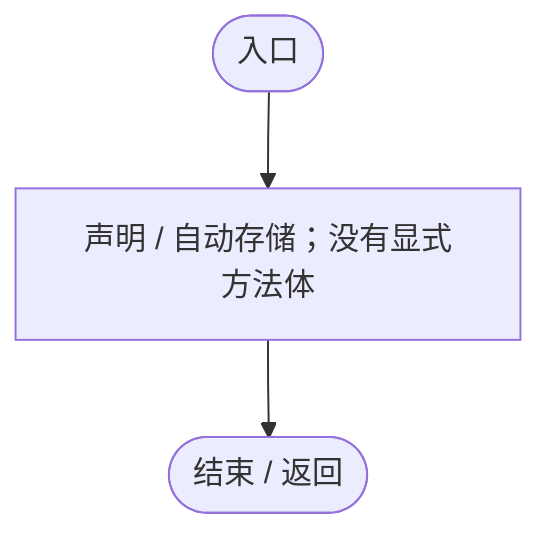
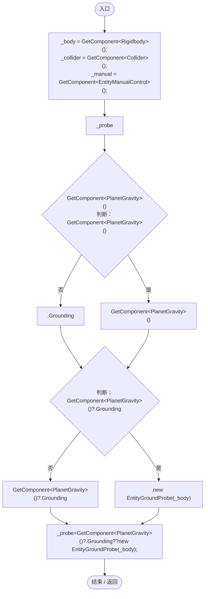
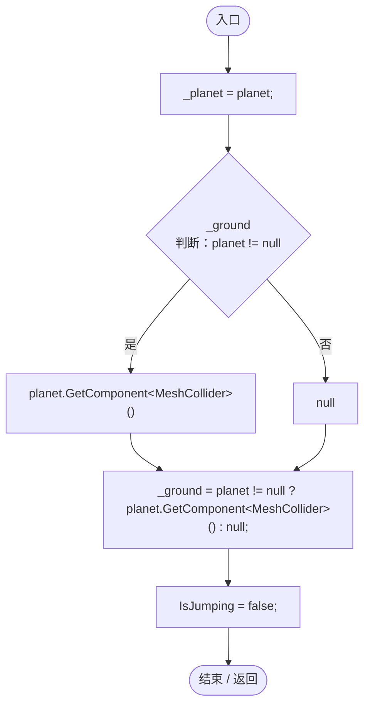
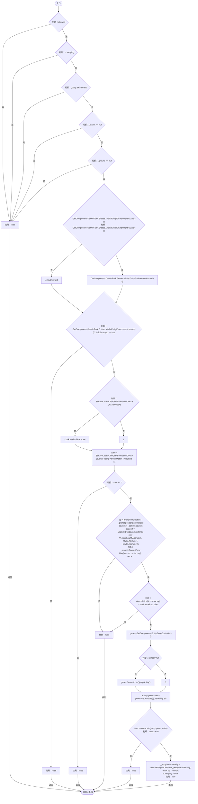
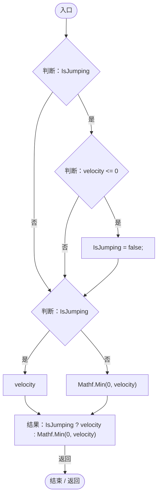
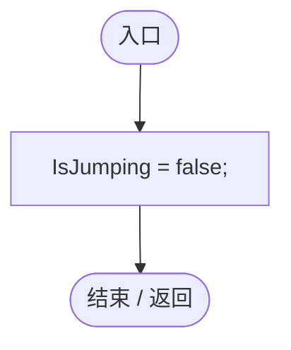
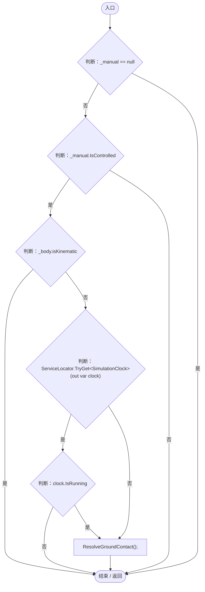
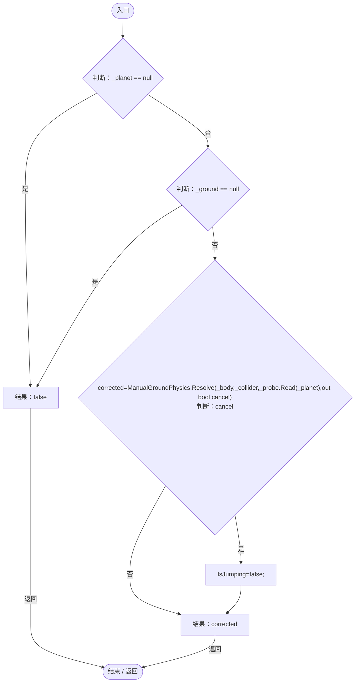
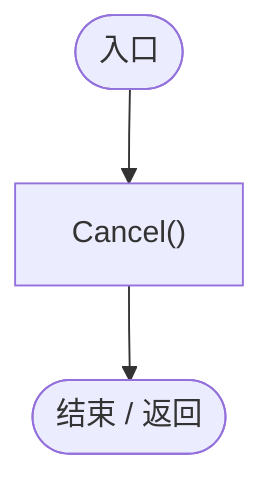

# EntityJumpMotor.cs

[返回总索引](../README.md) · `Runtime` · `Assets/DarwinPark/Entities/EntityJumpMotor.cs`

[源文件](../../../Assets/DarwinPark/Entities/EntityJumpMotor.cs) · 源码校验：`069db1849742ce870033f8d6fc4e5acc1c0e4c7b92209f4e04f4e0778f1c661f`

方法按源文件位置排列。事件/回调引用不表示立即执行；分支与异常说明见总索引。完整源码与可点击关系图请打开离线手册。

## IsJumping.get · L13

`get`

### Editor / Player · 语法控制结构 / 声明（非CFG）

## IsJumping.set · L13

`private set`

### Editor / Player · 语法控制结构 / 声明（非CFG）

## Awake · L20

`private void Awake()`

### Editor / Player · Roslyn编译器控制流

项目内调用/回调引用：

- [EntityGroundProbe.EntityGroundProbe.ctor · L17](6cefee808441951d.md#mc22b17280aeb06a7)（构造函数）

## Bind · L21

`public void Bind(Transform planet)`

### Editor / Player · Roslyn编译器控制流

项目内调用/回调引用：

- [EntityJumpMotor.IsJumping.set · L13](fa3269c9da0aa692.md#m7670a4afd72b6c02)（访问器）

## TryJump · L23

`public bool TryJump(bool allowed)`

### Editor / Player · Roslyn编译器控制流

项目内调用/回调引用：

- [EntityJumpMotor.IsJumping.get · L13](fa3269c9da0aa692.md#mdfdc0a35f515d9ec)（访问器）
- [EntityEnvironmentHazard.IsSubmerged.get · L31](5c434d0ba85333b1.md#mab7b6057b8137739)（访问器）
- [ServiceLocator.TryGet · L26](f2fdbe9f9ccd93cb.md#m143b24e6d58471b0)（方法）
- [EntityGeneController.GetAttribute · L277](7494d53178552f0e.md#m5ef0e4e944f0c71b)（方法）
- [EntityJumpMotor.IsJumping.set · L13](fa3269c9da0aa692.md#m7670a4afd72b6c02)（访问器）

## RadialVelocity · L45

`public float RadialVelocity(Vector3 up, float velocity)`

### Editor / Player · Roslyn编译器控制流

项目内调用/回调引用：

- [EntityJumpMotor.IsJumping.get · L13](fa3269c9da0aa692.md#mdfdc0a35f515d9ec)（访问器）
- [EntityJumpMotor.IsJumping.set · L13](fa3269c9da0aa692.md#m7670a4afd72b6c02)（访问器）

## Cancel · L50

`public void Cancel()`

### Editor / Player · Roslyn编译器控制流

项目内调用/回调引用：

- [EntityJumpMotor.IsJumping.set · L13](fa3269c9da0aa692.md#m7670a4afd72b6c02)（访问器）

## FixedUpdate · L51

`private void FixedUpdate()`

### Editor / Player · Roslyn编译器控制流

项目内调用/回调引用：

- [EntityManualControl.IsControlled.get · L12](a6969896da35e1f0.md#m125d8f7da7ab33bf)（访问器）
- [ServiceLocator.TryGet · L26](f2fdbe9f9ccd93cb.md#m143b24e6d58471b0)（方法）
- [SimulationClock.IsRunning.get · L22](a8f444aec9614b0a.md#m10f4fe307faca0f0)（访问器）
- [EntityJumpMotor.ResolveGroundContact · L58](fa3269c9da0aa692.md#mffedece4299d5f02)（方法）

## ResolveGroundContact · L58

`public bool ResolveGroundContact()`

★ 修复（防Bug回归）：密集曲面上的切向速度控制可能覆盖接触解算，用真实碰撞表面兜底防止操控实体穿地溺水。

### Editor / Player · Roslyn编译器控制流

项目内调用/回调引用：

- [ManualGroundPhysics.Resolve · L7](2dedd2812512cf4e.md#m0f57cf9424cb98a1)（方法）
- [EntityGroundProbe.Read · L18](6cefee808441951d.md#m3bf34129587fac82)（方法）
- [EntityJumpMotor.IsJumping.set · L13](fa3269c9da0aa692.md#m7670a4afd72b6c02)（访问器）

## OnDisable · L64

`private void OnDisable()`

### Editor / Player · Roslyn编译器控制流

项目内调用/回调引用：

- [EntityJumpMotor.Cancel · L50](fa3269c9da0aa692.md#m0adf552ecb134cc5)（方法）
