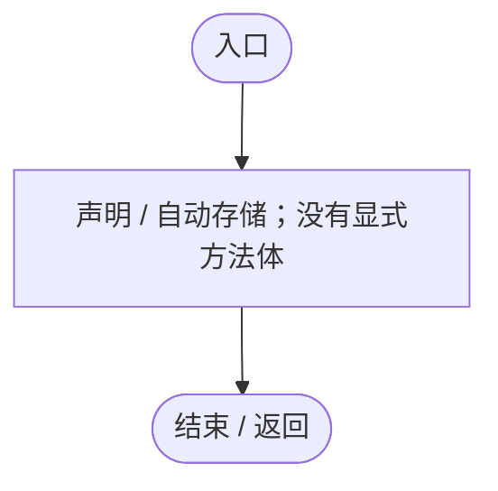
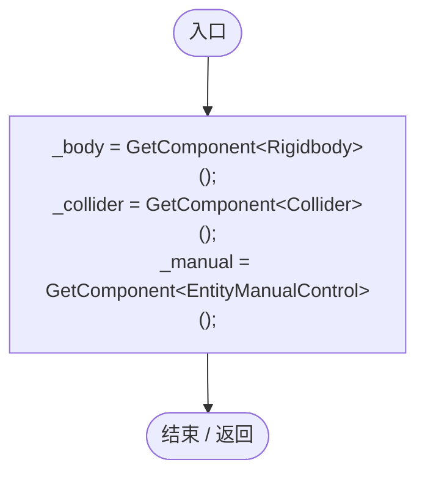
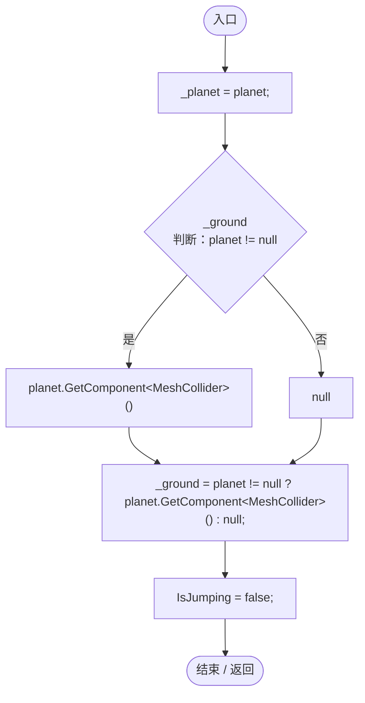
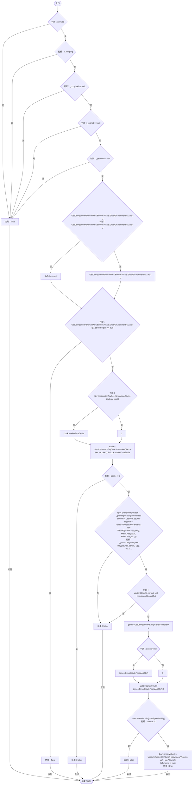
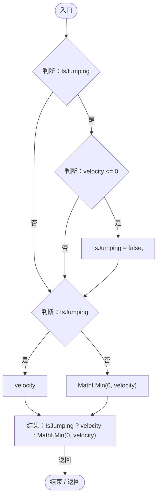
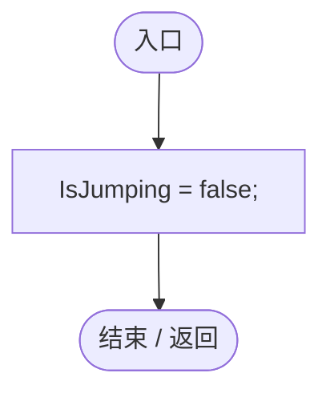
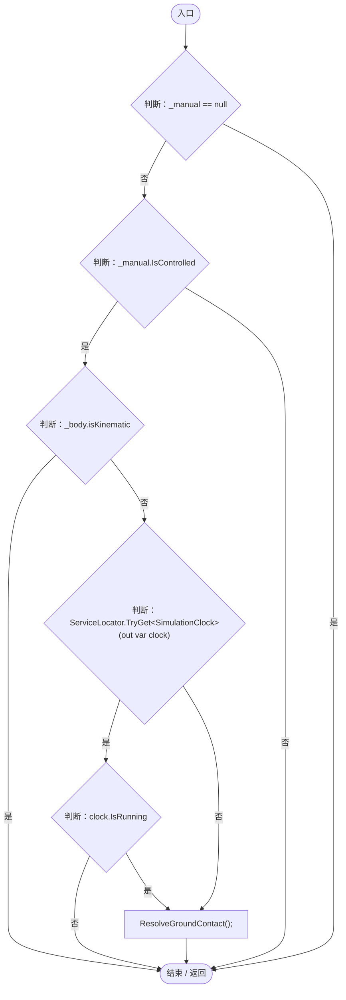
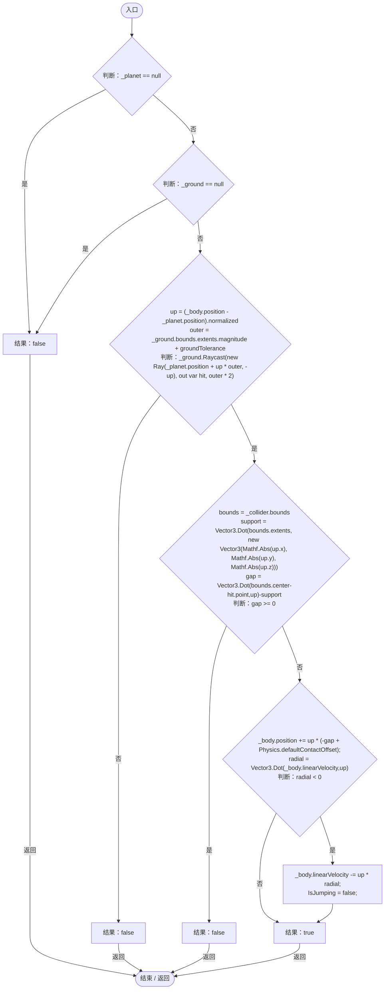
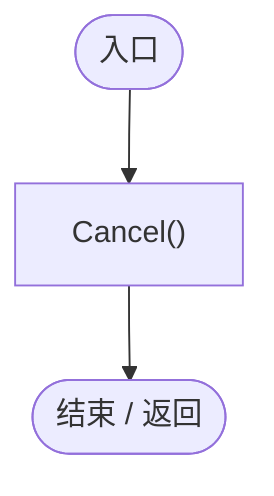

# EntityJumpMotor.cs

[返回总索引](../README.md) · `Runtime` · `Assets/DarwinPark/Entities/EntityJumpMotor.cs`

[源文件](../../../Assets/DarwinPark/Entities/EntityJumpMotor.cs) · 源码校验：`fc14c91b2b7b31439fad5fddb726a28578146a93abbaed5e8a09ff9b866c8fac`

方法按源文件位置排列。事件/回调引用不表示立即执行；分支与异常说明见总索引。完整源码与可点击关系图请打开离线手册。

## IsJumping.get · L13

`get`

### Editor / Player · 语法控制结构 / 声明（非CFG）

## IsJumping.set · L13

`private set`

### Editor / Player · 语法控制结构 / 声明（非CFG）

## Awake · L19

`private void Awake()`

### Editor / Player · Roslyn编译器控制流

## Bind · L20

`public void Bind(Transform planet)`

### Editor / Player · Roslyn编译器控制流

项目内调用/回调引用：

- [EntityJumpMotor.IsJumping.set · L13](fa3269c9da0aa692.md#m7670a4afd72b6c02)（访问器）

## TryJump · L22

`public bool TryJump(bool allowed)`

### Editor / Player · Roslyn编译器控制流

项目内调用/回调引用：

- [EntityJumpMotor.IsJumping.get · L13](fa3269c9da0aa692.md#mdfdc0a35f515d9ec)（访问器）
- [EntityEnvironmentHazard.IsSubmerged.get · L31](5c434d0ba85333b1.md#mab7b6057b8137739)（访问器）
- [ServiceLocator.TryGet · L26](f2fdbe9f9ccd93cb.md#m143b24e6d58471b0)（方法）
- [EntityGeneController.GetAttribute · L257](7494d53178552f0e.md#m600509f72d274f0c)（方法）
- [EntityJumpMotor.IsJumping.set · L13](fa3269c9da0aa692.md#m7670a4afd72b6c02)（访问器）

## RadialVelocity · L44

`public float RadialVelocity(Vector3 up, float velocity)`

### Editor / Player · Roslyn编译器控制流

项目内调用/回调引用：

- [EntityJumpMotor.IsJumping.get · L13](fa3269c9da0aa692.md#mdfdc0a35f515d9ec)（访问器）
- [EntityJumpMotor.IsJumping.set · L13](fa3269c9da0aa692.md#m7670a4afd72b6c02)（访问器）

## Cancel · L49

`public void Cancel()`

### Editor / Player · Roslyn编译器控制流

项目内调用/回调引用：

- [EntityJumpMotor.IsJumping.set · L13](fa3269c9da0aa692.md#m7670a4afd72b6c02)（访问器）

## FixedUpdate · L50

`private void FixedUpdate()`

### Editor / Player · Roslyn编译器控制流

项目内调用/回调引用：

- [EntityManualControl.IsControlled.get · L12](a6969896da35e1f0.md#m125d8f7da7ab33bf)（访问器）
- [ServiceLocator.TryGet · L26](f2fdbe9f9ccd93cb.md#m143b24e6d58471b0)（方法）
- [SimulationClock.IsRunning.get · L22](a8f444aec9614b0a.md#m10f4fe307faca0f0)（访问器）
- [EntityJumpMotor.ResolveGroundContact · L57](fa3269c9da0aa692.md#m2b0cf22d86a21bf5)（方法）

## ResolveGroundContact · L57

`public bool ResolveGroundContact()`

★ 修复（防Bug回归）：密集曲面上的切向速度控制可能覆盖接触解算，用真实碰撞表面兜底防止操控实体穿地溺水。

### Editor / Player · Roslyn编译器控制流

项目内调用/回调引用：

- [EntityJumpMotor.IsJumping.set · L13](fa3269c9da0aa692.md#m7670a4afd72b6c02)（访问器）

## OnDisable · L72

`private void OnDisable()`

### Editor / Player · Roslyn编译器控制流

项目内调用/回调引用：

- [EntityJumpMotor.Cancel · L49](fa3269c9da0aa692.md#m74e8ff8f50ccc15b)（方法）
