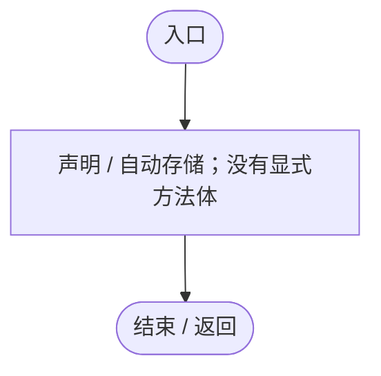
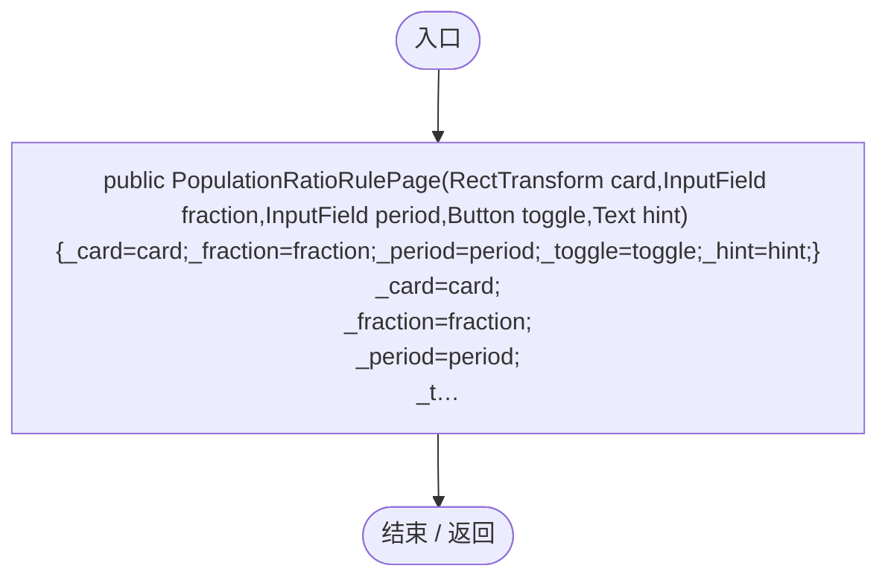
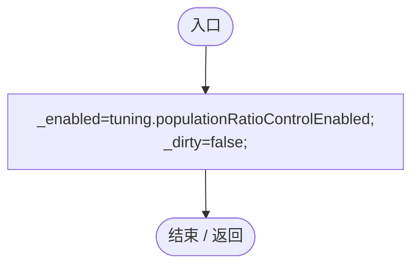
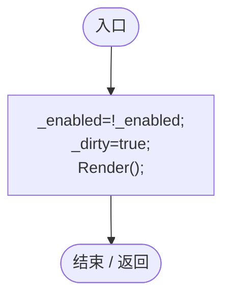
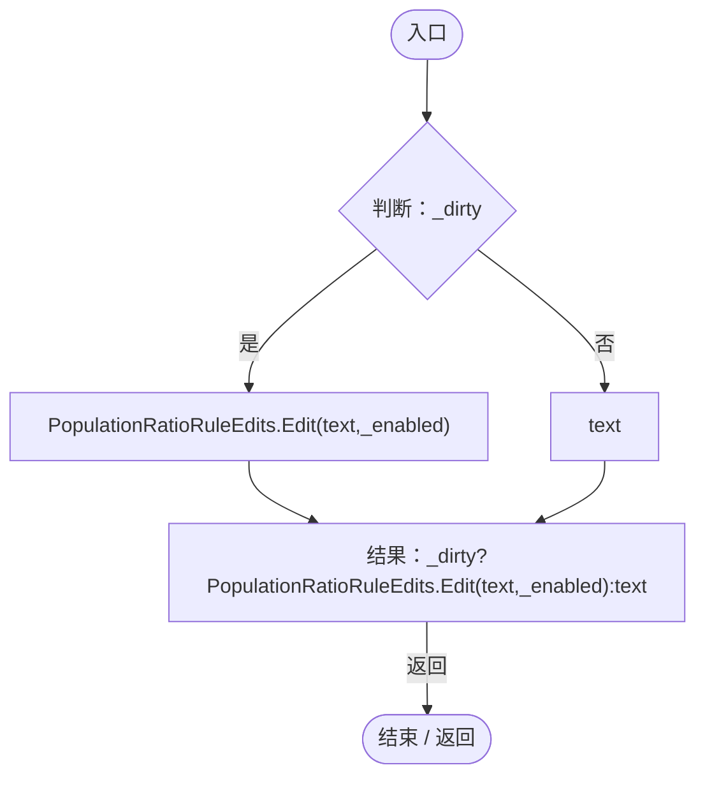
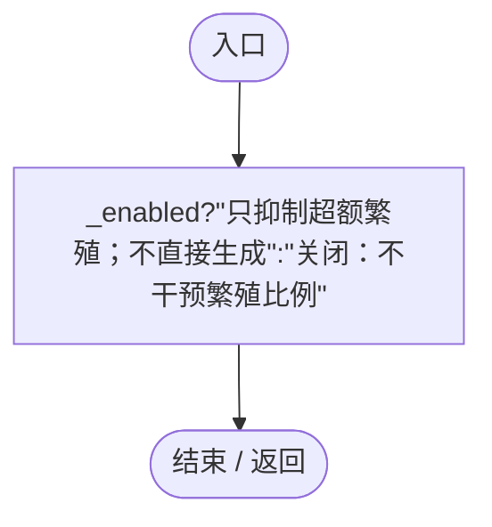
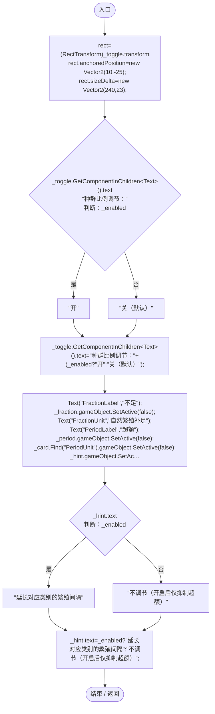
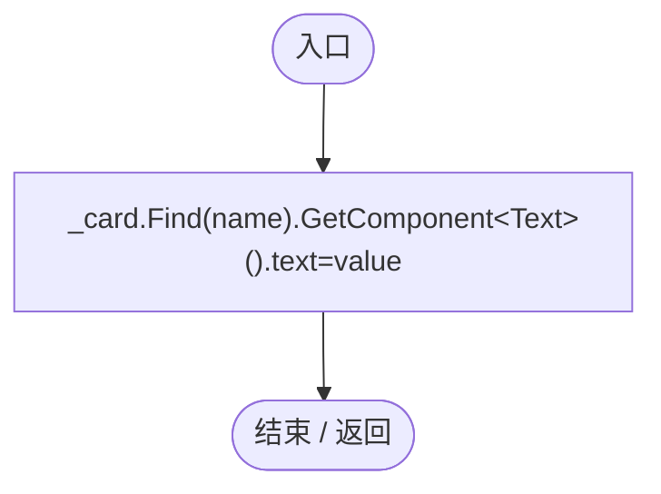

# PopulationRatioRulePage.cs

[返回总索引](../README.md) · `Runtime` · `Assets/DarwinPark/UI/PopulationRatioRulePage.cs`

[源文件](../../../Assets/DarwinPark/UI/PopulationRatioRulePage.cs) · 源码校验：`6e4349f11575a02db82aaaa9b516cc8126ba9e672093647b55f4a03fca1b1a31`

方法按源文件位置排列。事件/回调引用不表示立即执行；分支与异常说明见总索引。完整源码与可点击关系图请打开离线手册。

## Selected.get · L15

`get`

### Editor / Player · 语法控制结构 / 声明（非CFG）

## Selected.set · L15

`set`

### Editor / Player · 语法控制结构 / 声明（非CFG）

## PopulationRatioRulePage.ctor · L16

`public PopulationRatioRulePage(RectTransform card,InputField fraction,InputField period,Button toggle,Text hint)`

### Editor / Player · Roslyn编译器控制流

## Sync · L18

`public void Sync(GameplayTuning tuning)`

### Editor / Player · Roslyn编译器控制流

## Toggle · L19

`public void Toggle()`

### Editor / Player · Roslyn编译器控制流

项目内调用/回调引用：

- [PopulationRatioRulePage.Render · L22](fbcf38a1243f31af.md#mc422ce7ad74a1257)（方法）

## Edit · L20

`public string Edit(string text)`

### Editor / Player · Roslyn编译器控制流

项目内调用/回调引用：

- [PopulationRatioRuleEdits.Edit · L6](9580649cce6b5f38.md#mc36029fa9961e2df)（方法）

## Status.get · L21

`public string Status`

### Editor / Player · 语法控制结构 / 声明（非CFG）

## Render · L22

`public void Render()`

### Editor / Player · Roslyn编译器控制流

项目内调用/回调引用：

- [PopulationRatioRulePage.Text · L30](fbcf38a1243f31af.md#mcc9015908a4565b3)（方法）

## Text · L30

`private void Text(string name,string value)`

### Editor / Player · Roslyn编译器控制流

