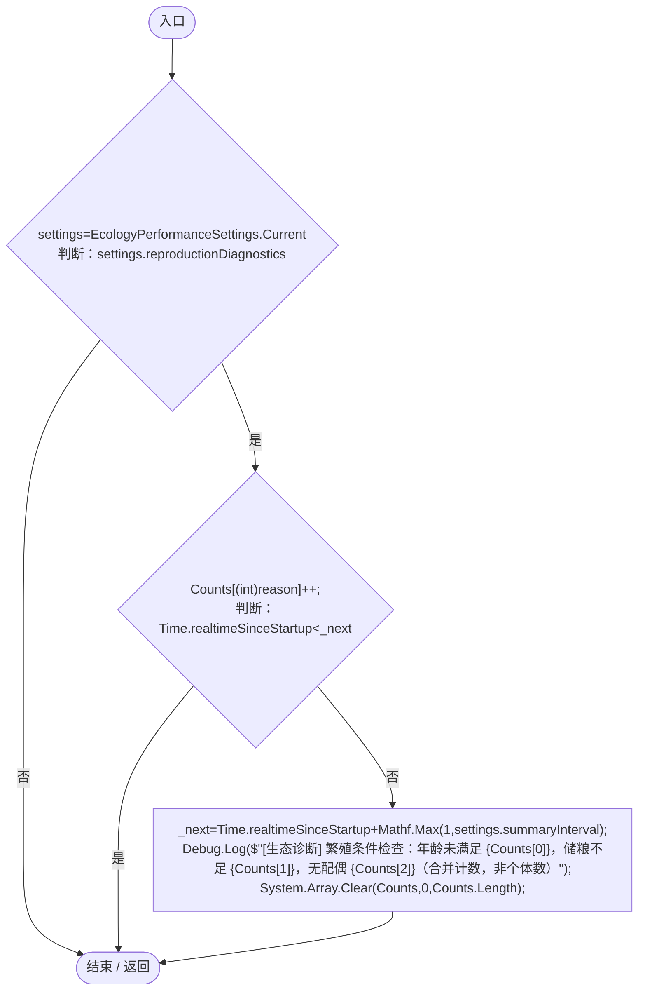
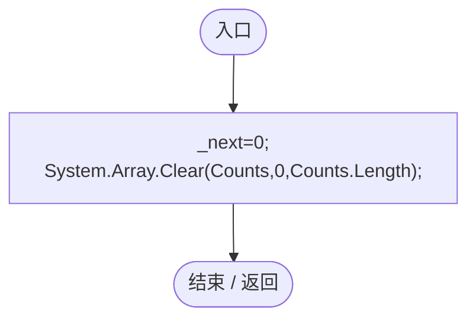

# EcologyDiagnostics.cs

[返回总索引](../README.md) · `Runtime` · `Assets/DarwinPark/Entities/Ecology/EcologyDiagnostics.cs`

[源文件](../../../Assets/DarwinPark/Entities/Ecology/EcologyDiagnostics.cs) · 源码校验：`fb6466f81a1cb1d12940a81de647711562156e47ba928bf936086c82bcae1da2`

方法按源文件位置排列。事件/回调引用不表示立即执行；分支与异常说明见总索引。完整源码与可点击关系图请打开离线手册。

## Blocked · L10

`public static void Blocked(ReproductionBlock reason)`

### Editor / Player · Roslyn编译器控制流

项目内调用/回调引用：

- [EcologyPerformanceSettings.Current.get · L13](d5a013a7598d7dff.md#m9b5b45c2da3c08f0)（访问器）

## Reset · L18

`[RuntimeInitializeOnLoadMethod(RuntimeInitializeLoadType.SubsystemRegistration)] private static void Reset()`

### Editor / Player · Roslyn编译器控制流

