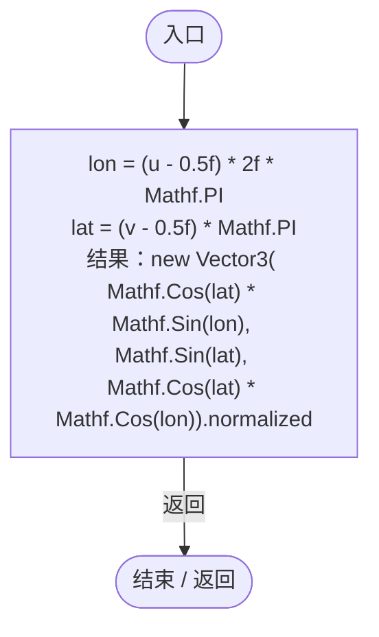
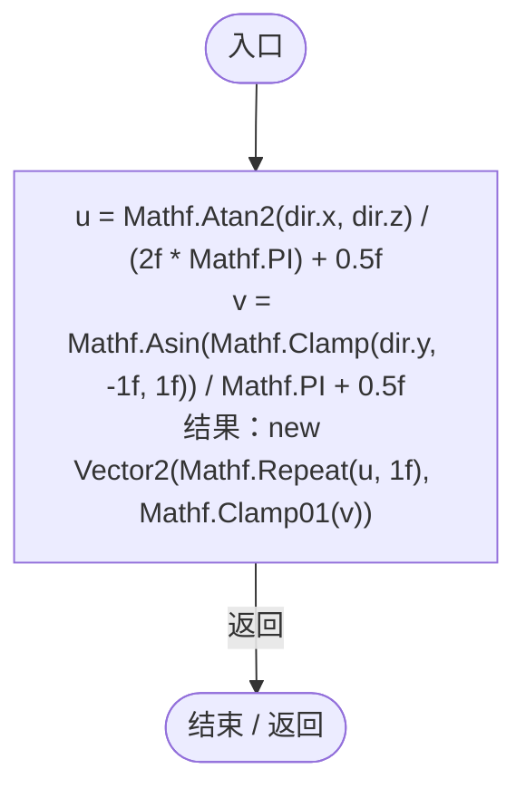
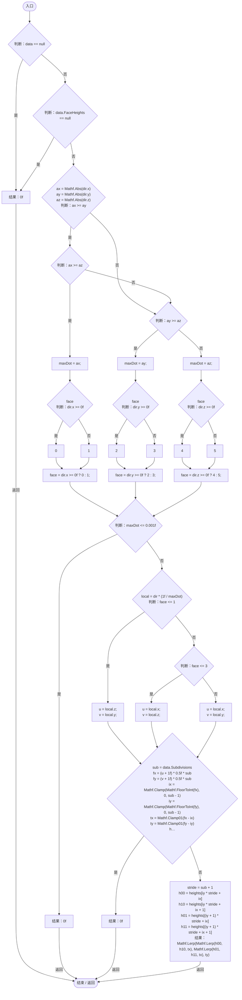
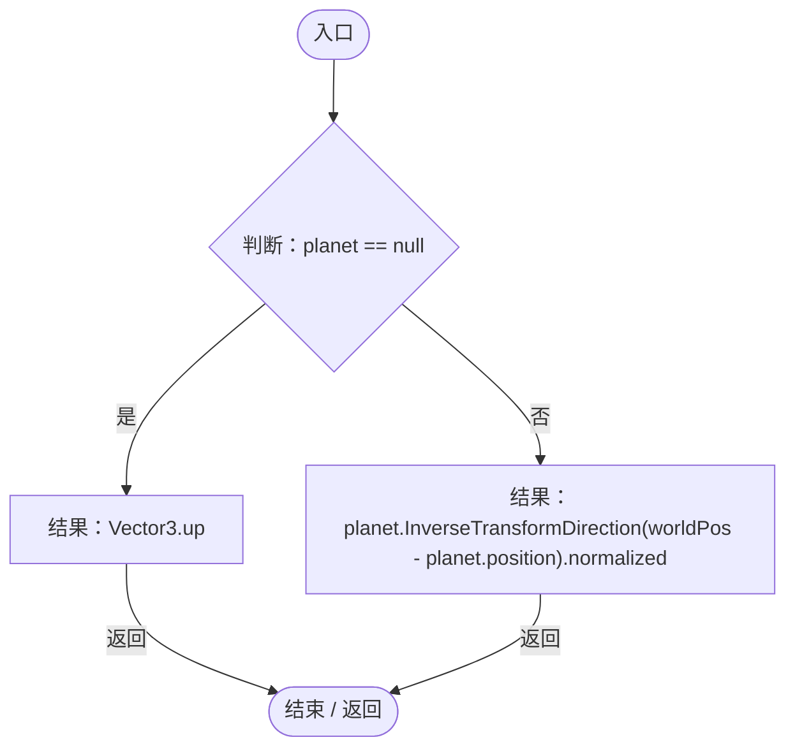

# PlanetTerrainSampler.cs

[返回总索引](../README.md) · `Runtime` · `Assets/DarwinPark/Planet/Terrain/PlanetTerrainSampler.cs`

[源文件](../../../Assets/DarwinPark/Planet/Terrain/PlanetTerrainSampler.cs) · 源码校验：`5f00070b622570719ea5147375a43210694acffe94a1194c971c8383652596b6`

方法按源文件位置排列。事件/回调引用不表示立即执行；分支与异常说明见总索引。完整源码与可点击关系图请打开离线手册。

## DirectionFromUV · L13

`public static Vector3 DirectionFromUV(float u, float v)`

等距柱状投影 UV → 球面单位方向。u=0/1 为同一条经线。

### Editor / Player · Roslyn编译器控制流

## DirectionToUV · L24

`public static Vector2 DirectionToUV(Vector3 dir)`

球面单位方向 → 等距柱状投影 UV（与 Shader 的 sphereUV 对齐）。

### Editor / Player · Roslyn编译器控制流

## SampleHeight · L32

`public static float SampleHeight(PlanetTerrainData data, Vector3 dir)`

按世界方向双线性采样 Cube-Sphere 高度。

### Editor / Player · Roslyn编译器控制流

## WorldToLocalDirection · L76

`public static Vector3 WorldToLocalDirection(Transform planet, Vector3 worldPos)`

把世界坐标转成星球局部方向（兼容星球被旋转/移动）。

### Editor / Player · Roslyn编译器控制流

