# PopulationMaintenanceRegression.cs

[返回总索引](../README.md) · `Editor` · `Assets/DarwinPark/Editor/PopulationMaintenanceRegression.cs`

[源文件](../../../Assets/DarwinPark/Editor/PopulationMaintenanceRegression.cs) · 源码校验：`848cc33796c5ba654bbb5369be2ea1311a0f1a7ae0566778aac485f4155e8283`

方法按源文件位置排列。事件/回调引用不表示立即执行；分支与异常说明见总索引。完整源码与可点击关系图请打开离线手册。

<a id="mc40ef68f62ca2b35"></a>

## Folder.get · L28

`private static string Folder`


### Editor · 语法控制结构 / 声明（非CFG）

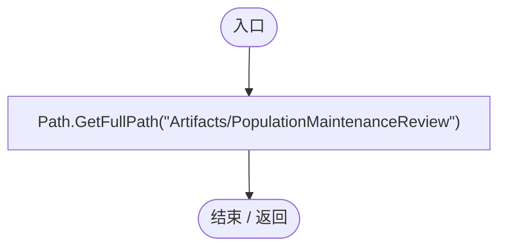

<a id="mdb17b46a9bbc35f3"></a>

## PopulationMaintenanceRegression.ctor · L29

`static PopulationMaintenanceRegression()`


### Editor · Roslyn编译器控制流

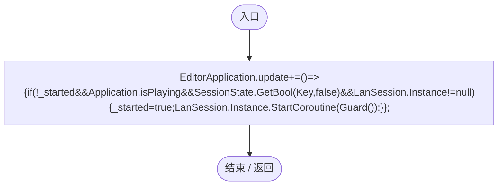

项目内调用/回调引用：

- [PopulationMaintenanceRegression.回调@29 · L29](fda63d99884ef0fb.md#m446164021e550710)（回调/委托）

<a id="m446164021e550710"></a>

## 回调@29 · L29

`( … => 回调`


### Editor · Roslyn编译器控制流

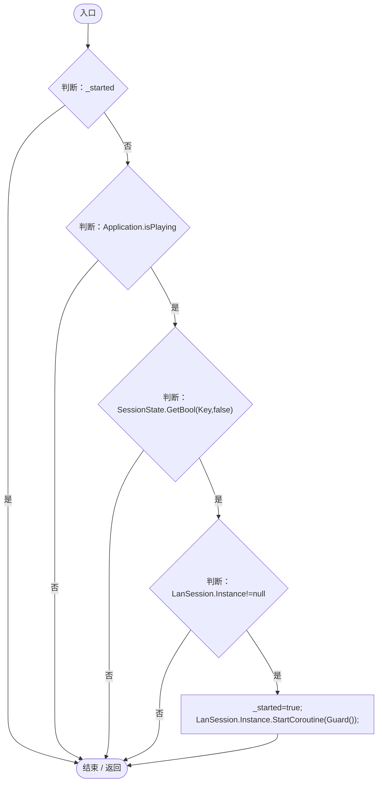

项目内调用/回调引用：

- [LanSession.Instance.get · L23](9fb633eebffe669c.md#mbf83306994878383)（访问器）
- [PopulationMaintenanceRegression.Guard · L32](fda63d99884ef0fb.md#m297886f03b1b6694)（方法）

<a id="m9cb0f1ea94e2fd8e"></a>

## RunBatch · L30

`public static void RunBatch()`


### Editor · Roslyn编译器控制流

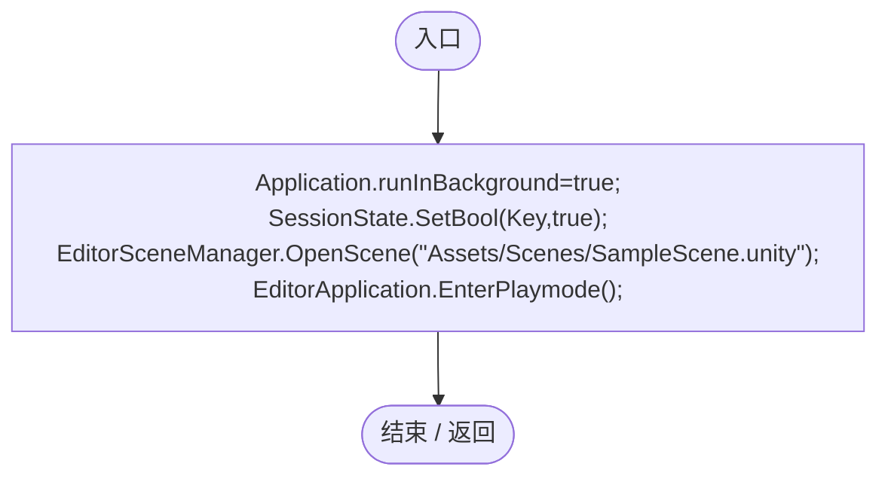

<a id="m8b287c7ca4d0ea91"></a>

## Check · L31

`private static void Check(bool value,string text)`


### Editor · Roslyn编译器控制流

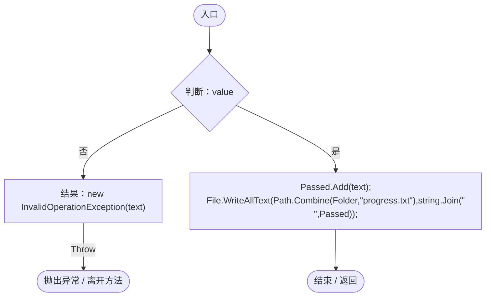

<a id="m297886f03b1b6694"></a>

## Guard · L32

`private static IEnumerator Guard()`


### Editor · Roslyn编译器控制流

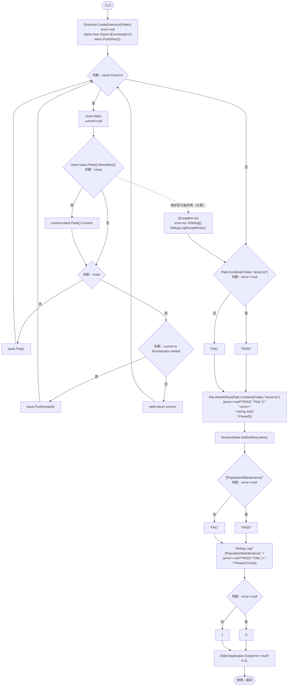

项目内调用/回调引用：

- [PopulationMaintenanceRegression.Run · L50](fda63d99884ef0fb.md#m7b7f9e05fb817b3e)（方法）

<a id="mfa759f156d7c9ea7"></a>

## Clear · L38

`private static void Clear()`


### Editor · Roslyn编译器控制流

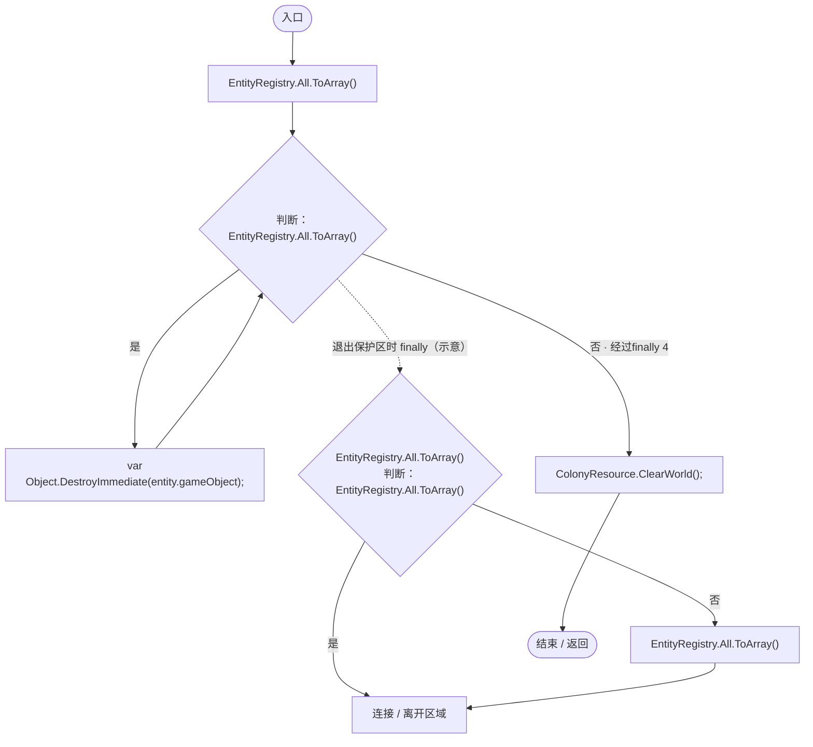

项目内调用/回调引用：

- [ColonyResource.ClearWorld · L100](293dbaecfff4b585.md#m634e84088b7cf78c)（方法）

<a id="m57647ac65900cc64"></a>

## Spawn · L39

`private static DarwinEntity Spawn(Vector3 point,params (string id,float value)[] definitions)`


### Editor · Roslyn编译器控制流

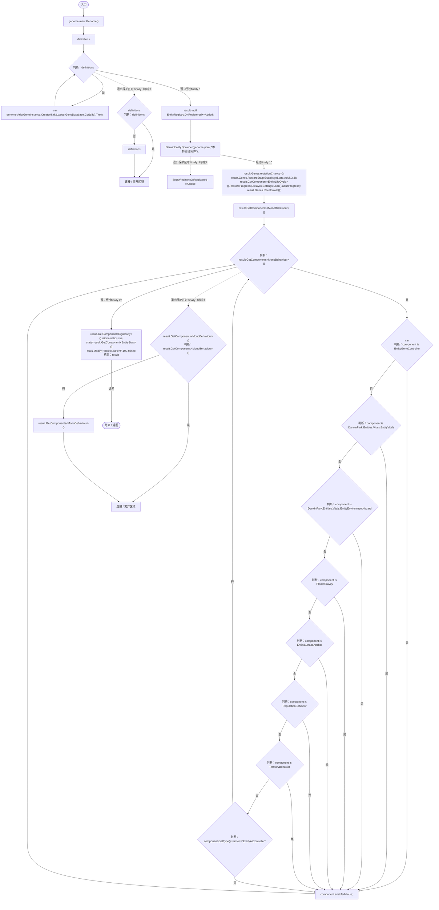

项目内调用/回调引用：

- [Genome.Add · L19](a2ef23f865bc7ee8.md#md9cfdc94b8b8d40f)（方法）
- [GeneInstance.Create · L20](f82e1498d67f5afd.md#m72e94c278de3cf8b)（方法）
- [GeneDatabase.Get · L135](ec0a03483435a863.md#m8f3bbfb35f3ca397)（方法）
- [DarwinEntity.Genes.get · L14](70798dde169f2e8b.md#m622eb1adf401d431)（访问器）
- [EntityGeneController.RestoreStageState · L45](7494d53178552f0e.md#m49489af39061f1a1)（方法）
- [EntityLifeCycle.RestoreProgress · L48](9f4138bfbae654b7.md#mfc75121476d49679)（方法）
- [LifeCycleSettings.Load · L16](ace76969fe8f61de.md#mbd2925785484f343)（方法）
- [EntityGeneController.Recalculate · L90](7494d53178552f0e.md#m93744c8f3039b93c)（方法）
- [EntityStats.Modify · L111](75aa86a368efdf24.md#m9c837be197158240)（方法）
- [PopulationMaintenanceRegression.Added · L41](fda63d99884ef0fb.md#m49f5bdd263262d76)（局部函数）

<a id="m49f5bdd263262d76"></a>

## Added · L41

`void Added(DarwinEntity e)`


### Editor · Roslyn编译器控制流

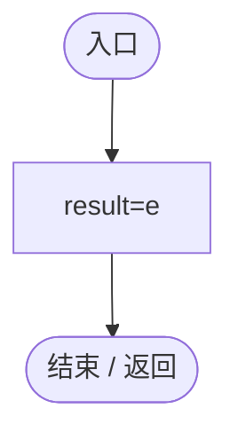

<a id="md8c59462749a812f"></a>

## Logic · L46

`private static ReproductionGeneLogic Logic(DarwinEntity e)`


### Editor · Roslyn编译器控制流

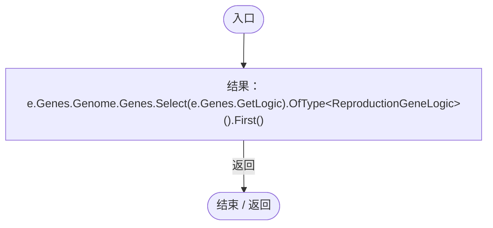

项目内调用/回调引用：

- [DarwinEntity.Genes.get · L14](70798dde169f2e8b.md#m622eb1adf401d431)（访问器）
- [EntityGeneController.GetLogic · L184](7494d53178552f0e.md#m4f4e58e1a4abadfc)（方法）

<a id="me7712d4512bf7272"></a>

## Capture · L48

`private static IEnumerator Capture(string name)`

★ 适配：切页后等待布局与动态字体字形准备完毕，再截取真实稳定画面。

### Editor · Roslyn编译器控制流

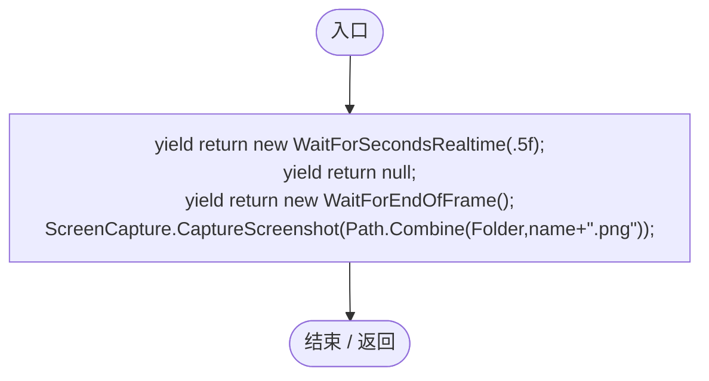

<a id="m69ed9585555a9a33"></a>

## Wait · L49

`private static IEnumerator Wait(Func<bool> done,string reason)`


### Editor · Roslyn编译器控制流

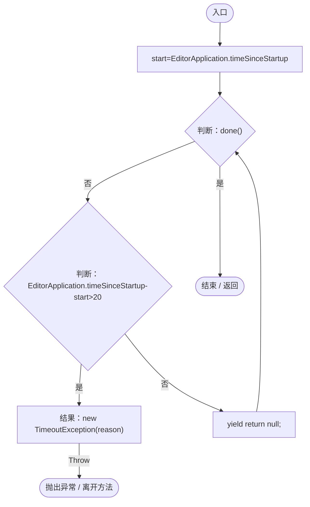

<a id="m7b7f9e05fb817b3e"></a>

## Run · L50

`private static IEnumerator Run()`


### Editor · Roslyn编译器控制流

```mermaid
flowchart TD
  b0(["入口"])
  b1["yield return null;<br/>session=Object.FindFirstObjectByType&lt;WorldSessionManager&gt;()<br/>builder=Object.FindFirstObjectByType&lt;PlanetTerrainMeshBuilder&gt;()<br/>clock=ServiceLocator.Get&lt;SimulationClock&gt;()<br/>builder.subdivisions=24;<br/>typeof(WorldSessionManag…"]
  b2["new WorldGameSettings{entityLimit=0}<br/>entityLimit=0<br/>EntityPopulationLimit.UseSnapshot(new WorldGameSettings{entityLimit=0});"]
  b3["home=EcologyQueries.Surface(builder.transform.position+Vector3.up*(builder.radius+builder.heightScale))"]
  b4["i=0"]
  b5{"判断：i&lt;192"}
  b6{"y=1-2*(i+.5f)/192<br/>angle=i*2.399963f<br/>d=new Vector3(Mathf.Sqrt(1-y*y)*Mathf.Cos(angle),y,Mathf.Sqrt(1-y*y)*Mathf.Sin(angle))<br/>p=EcologyQueries.Surface(builder.transform.position+d*(builder.radius+builder.heightScale))<br/>判断：(p-builder.transfor…"}
  b7["home=p;"]
  b8["i++"]
  b9["control=Object.FindFirstObjectByType&lt;SimulationControlPanel&gt;()<br/>typeof(SimulationControlPanel).GetMethod(&quot;SwitchPage&quot;,Private).Invoke(control,new object[]{1});<br/>yield return null;<br/>panel=Object.FindFirstObjectByType&lt;RandomSpawnPanel&gt;()<br/>pane…"]
  b10{"判断：work.Visible"}
  b11{"判断：GameInputGate.Blocked"}
  b12["!clock.IsRunning"]
  b13["work.Visible&amp;&amp;GameInputGate.Blocked&amp;&amp;!clock.IsRunning"]
  b14["Check(work.Visible&amp;&amp;GameInputGate.Blocked&amp;&amp;!clock.IsRunning,&quot;选择实体实际打开两列来源窗口并暂停单人模拟&quot;);"]
  b15["yield return VerifySourceUI(work);<br/>work.SetGene(&quot;gene_growth&quot;,true,true);<br/>work.SetGene(&quot;gene_locomotion&quot;,false,true);<br/>Check(work.Draft.method==RandomSpawnMethod.Genes,&quot;基因条件自动选择独立随机方式&quot;);<br/>yield return Capture(&quot;two-column-source&quot;);<br/>source=w…"]
  b16["i=0"]
  b17{"判断：i&lt;80"}
  b18["genome=source.CreateGenome()<br/>CheckSource(genome,source);<br/>signatures.Add(string.Join(&quot;&#124;&quot;,genome.Genes.Select(g=&gt;g.DefinitionId+g.Value)));"]
  b19["i++"]
  b20["Check(signatures.Count&gt;20,&quot;必有必无以外的基因和数值逐个随机，而非整批复制&quot;);<br/>work.SelectTemplate(null);"]
  b21{"判断：work.Draft.method==RandomSpawnMethod.Template"}
  b22["work.Draft.CreateGenome().Genes.Count==RandomSpawnRecipe.DefaultGenome().Genes.Count"]
  b23["work.Draft.method==RandomSpawnMethod.Template"]
  b24["Check(work.Draft.method==RandomSpawnMethod.Template&amp;&amp;work.Draft.CreateGenome().Genes.Count==RandomSpawnRecipe.DefaultGenome().Genes.Count,&quot;模板方式与基因随机方式互斥，不附加随机基因&quot;);"]
  b25["work.ApplySelection();"]
  b26{"判断：work.Visible"}
  b27["!GameInputGate.Blocked"]
  b28["!work.Visible"]
  b29["Check(!work.Visible&amp;&amp;!GameInputGate.Blocked,&quot;应用来源后恢复输入&quot;);"]
  b30["spawner=RandomPlanetSpawner.Ensure(clock.gameObject)<br/>Check(spawner.StartRecipe(source,8,true),&quot;实际启动条件随机生成&quot;);<br/>yield return Wait(()=&gt;!spawner.IsBusy,&quot;条件随机生成&quot;);"]
  b31{"判断：EntityRegistry.All.Count==8"}
  b32["EntityRegistry.All.All(e=&gt;source.Matches(e.Genes.Genome))"]
  b33["EntityRegistry.All.Count==8"]
  b34["Check(EntityRegistry.All.Count==8&amp;&amp;EntityRegistry.All.All(e=&gt;source.Matches(e.Genes.Genome)),&quot;真实批次满足必有必无条件&quot;);"]
  b35["yield return null;<br/>Check(EntityRegistry.All.All(e=&gt;source.Matches(e.Genes.Genome)),&quot;出生初始化不破坏明确生成条件&quot;);<br/>work.Open(panel);<br/>work.SetGene(&quot;gene_growth&quot;,true,true);<br/>work.SetGene(&quot;gene_locomotion&quot;,false,true);"]
  b36{"判断：work.SaveRule(30)"}
  b37["WorldSaveStore.Read(WorldSaveStore.FileFor(session.Current.id)).maintenance.rules.Single().source.included.Contains(&quot;gene_growth&quot;)"]
  b38["work.SaveRule(30)"]
  b39["Check(work.SaveRule(30)&amp;&amp;WorldSaveStore.Read(WorldSaveStore.FileFor(session.Current.id)).maintenance.rules.Single().source.included.Contains(&quot;gene_growth&quot;),&quot;两列界面可新增维持规则并实际保存&quot;);"]
  b40["work.Close();<br/>PopulationMaintenance.Restore(null);<br/>Clear();<br/>tuning=PopulationMaintenanceSettings.Current<br/>oldMin=tuning.minimumAdditionalGenes<br/>oldMax=tuning.maximumAdditionalGenes<br/>tuning.minimumAdditionalGenes=tuning.maximumAdditionalGene…"]
  b41["source<br/>new RandomSpawnRecipe{method=RandomSpawnMethod.Genes,name=&quot;有生长无行动&quot;,included=new(){&quot;gene_growth&quot;},excluded=new(){&quot;gene_locomotion&quot;}}<br/>method=RandomSpawnMethod.Genes<br/>name=&quot;有生长无行动&quot;"]
  b42["new(){&quot;gene_growth&quot;}<br/>&quot;gene_growth&quot;<br/>included=new(){&quot;gene_growth&quot;}"]
  b43["new(){&quot;gene_locomotion&quot;}<br/>&quot;gene_locomotion&quot;<br/>excluded=new(){&quot;gene_locomotion&quot;}"]
  b44["source=new RandomSpawnRecipe{method=RandomSpawnMethod.Genes,name=&quot;有生长无行动&quot;,included=new(){&quot;gene_growth&quot;},excluded=new(){&quot;gene_locomotion&quot;}};"]
  b45["i=0"]
  b46{"判断：i&lt;10"}
  b47["Spawn(home+Vector3.right*i*3,(&quot;gene_nutrition&quot;,20));<br/>i++"]
  b48["new PopulationMaintenanceRule{id=Guid.NewGuid().ToString(&quot;N&quot;),source=source,ratio=.3f}<br/>id=Guid.NewGuid().ToString(&quot;N&quot;)<br/>source=source<br/>ratio=.3f<br/>rule=new PopulationMaintenanceRule{id=Guid.NewGuid().ToString(&quot;N&quot;),source=source,ratio=.3f}"]
  b49{"判断：PopulationMaintenance.Set(rule)"}
  b50["PopulationMaintenance.Needed(rule)==5"]
  b51["PopulationMaintenance.Set(rule)"]
  b52["Check(PopulationMaintenance.Set(rule)&amp;&amp;PopulationMaintenance.Needed(rule)==5,&quot;30%目标按新增后分母计算：10个不匹配实体应补5个&quot;);"]
  b53["before=EntityRegistry.All.Count<br/>yield return new WaitForSecondsRealtime(.2f);<br/>Check(EntityRegistry.All.Count==before,&quot;暂停时不自动补充实体&quot;);<br/>clock.Play();<br/>yield return Wait(()=&gt;PopulationMaintenance.Count(rule)&gt;=5&amp;&amp;!spawner.IsBusy,&quot;自动补充到目标比例&quot;);<br/>c…"]
  b54{"判断：EntityRegistry.All.Count==15"}
  b55["PopulationMaintenance.Count(rule)==5"]
  b56["EntityRegistry.All.Count==15"]
  b57["Check(EntityRegistry.All.Count==15&amp;&amp;PopulationMaintenance.Count(rule)==5,&quot;不足时实际自动生成到目标比例而非只改计数&quot;);"]
  b58["Object.DestroyImmediate(EntityRegistry.All.First(e=&gt;source.Matches(e.Genes.Genome)).gameObject);<br/>clock.Play();<br/>yield return Wait(()=&gt;PopulationMaintenance.Count(rule)==5&amp;&amp;!spawner.IsBusy,&quot;死亡后补足&quot;);<br/>clock.Pause();<br/>Check(EntityRegistry.All.…"]
  b59["new WorldGameSettings{entityLimit=14}<br/>entityLimit=14<br/>EntityPopulationLimit.UseSnapshot(new WorldGameSettings{entityLimit=14});"]
  b60["resume=clock.GameTime<br/>clock.Play();<br/>yield return Wait(()=&gt;clock.GameTime&gt;resume+1.2f,&quot;数量上限检查&quot;);<br/>clock.Pause();"]
  b61{"判断：EntityRegistry.All.Count==14"}
  b62["PopulationMaintenance.Count(rule)==4"]
  b63["EntityRegistry.All.Count==14"]
  b64["Check(EntityRegistry.All.Count==14&amp;&amp;PopulationMaintenance.Count(rule)==4,&quot;自动补充遵守世界实体上限&quot;);"]
  b65["new WorldGameSettings{entityLimit=0}<br/>entityLimit=0<br/>EntityPopulationLimit.UseSnapshot(new WorldGameSettings{entityLimit=0});"]
  b66["clock.Play();<br/>yield return Wait(()=&gt;PopulationMaintenance.Count(rule)==5&amp;&amp;!spawner.IsBusy,&quot;释放数量上限后补充&quot;);<br/>clock.Pause();<br/>Check(EntityRegistry.All.Count==15,&quot;数量空位恢复后自动继续维持&quot;);<br/>WorldAuthority.IsReplica=true;"]
  b67["new PopulationMaintenanceRule{id=Guid.NewGuid().ToString(&quot;N&quot;),source=source}<br/>id=Guid.NewGuid().ToString(&quot;N&quot;)<br/>source=source<br/>Check(!PopulationMaintenance.Set(new PopulationMaintenanceRule{id=Guid.NewGuid().ToString(&quot;N&quot;),source=source}),&quot;联机…"]
  b68["WorldAuthority.IsReplica=false;<br/>WorldAuthority.CanEdit=false;"]
  b69{"判断：spawner.StartRecipe(source,2,true)"}
  b70["!PopulationMaintenance.Remove(rule.id)"]
  b71["!spawner.StartRecipe(source,2,true)"]
  b72["Check(!spawner.StartRecipe(source,2,true)&amp;&amp;!PopulationMaintenance.Remove(rule.id),&quot;普通成员不能绕过生成或维持规则编辑权限&quot;);"]
  b73["WorldAuthority.CanEdit=true;<br/>session.SaveNow(false);<br/>disk=WorldSaveStore.Read(WorldSaveStore.FileFor(session.Current.id))"]
  b74{"判断：disk.maintenance.rules.Single().ratio==.3f"}
  b75["disk.maintenance.rules.Single().source.excluded.Contains(&quot;gene_locomotion&quot;)"]
  b76["disk.maintenance.rules.Single().ratio==.3f"]
  b77["Check(disk.maintenance.rules.Single().ratio==.3f&amp;&amp;disk.maintenance.rules.Single().source.excluded.Contains(&quot;gene_locomotion&quot;),&quot;维持来源、条件和比例实际写盘读取&quot;);"]
  b78["frame=LanWorldSnapshot.Frame(1)<br/>Check(frame.maintenance.rules.Single().source.method==RandomSpawnMethod.Genes,&quot;联机快照携带维持规则&quot;);<br/>invalid=JsonUtility.FromJson&lt;WorldSaveData&gt;(JsonUtility.ToJson(disk))<br/>invalid.maintenance.rules[0].ratio=1;<br/>reje…"]
  b79["WorldSaveStore.Validate(invalid);"]
  b80["rejected=true;"]
  b81["Check(rejected,&quot;无法有限补足的100%比例在清场前拒绝&quot;);<br/>invalid=JsonUtility.FromJson&lt;WorldSaveData&gt;(JsonUtility.ToJson(disk));<br/>invalid.maintenance.rules[0].source.included.Add(&quot;missing-gene&quot;);<br/>rejected=false;"]
  b82["WorldSaveStore.Validate(invalid);"]
  b83["rejected=true;"]
  b84["Check(rejected,&quot;未知基因维持规则在清场前拒绝&quot;);<br/>session.Open(disk);<br/>yield return Wait(()=&gt;!session.Busy,&quot;维持规则重载&quot;);<br/>clock.Pause();"]
  b85{"判断：PopulationMaintenance.Rules.Count==1"}
  b86["PopulationMaintenance.Count(PopulationMaintenance.Rules[0])==5"]
  b87["PopulationMaintenance.Rules.Count==1"]
  b88["Check(PopulationMaintenance.Rules.Count==1&amp;&amp;PopulationMaintenance.Count(PopulationMaintenance.Rules[0])==5,&quot;真实重载恢复规则和目标计数&quot;);"]
  b89["panel=Object.FindFirstObjectByType&lt;RandomSpawnPanel&gt;();<br/>panel.transform.Find(&quot;Maintain&quot;).GetComponent&lt;Button&gt;().onClick.Invoke();<br/>yield return Capture(&quot;maintenance-rules&quot;);<br/>RandomSpawnWorkbench.Instance.Close();<br/>Clear();<br/>parent=Spawn(hom…"]
  b90{"判断：parent.Genes.IsGestating"}
  b91{"判断：logic.CaptureState().maintenanceWait&gt;0"}
  b92["parent.GetComponent&lt;EntityStats&gt;().CaptureValues().Single(v=&gt;v.id==&quot;storedNutrient&quot;).value==reserve"]
  b93["!parent.Genes.IsGestating&amp;&amp;logic.CaptureState().maintenanceWait&gt;0&amp;&amp;parent.GetComponent&lt;EntityStats&gt;().CaptureValues().Single(v=&gt;v.id==&quot;storedNutrient&quot;).value==reserve"]
  b94["Check(!parent.Genes.IsGestating&amp;&amp;logic.CaptureState().maintenanceWait&gt;0&amp;&amp;parent.GetComponent&lt;EntityStats&gt;().CaptureValues().Single(v=&gt;v.id==&quot;storedNutrient&quot;).value==reserve,&quot;超量时延迟新孕育，不扣储粮或删除亲本&quot;);"]
  b95["session.SaveNow(false);<br/>Check(WorldSaveStore.Read(WorldSaveStore.FileFor(session.Current.id)).entities.Single().reproduction.Single().maintenanceWait&gt;0,&quot;降低繁殖的等待进度成对保存&quot;);<br/>logic.OnUpdate(tuning.extraBreedingDelaySeconds*4);<br/>Check(parent.Ge…"]
  b96{"判断：royal.Genes.IsGestating"}
  b97["queen.State.maintenanceWait&gt;0"]
  b98["!royal.Genes.IsGestating"]
  b99["Check(!royal.Genes.IsGestating&amp;&amp;queen.State.maintenanceWait&gt;0,&quot;王后同样应用维持比例的繁殖间隔&quot;);"]
  b100["AntColonyReproduction.Advance(queen,tuning.extraBreedingDelaySeconds*4);<br/>Check(royal.Genes.IsGestating,&quot;王后超量时降低频率但仍可正常开始孕育&quot;);<br/>legacy=JsonUtility.FromJson&lt;WorldSaveData&gt;(JsonUtility.ToJson(disk))<br/>legacy.maintenance=null;<br/>session.Open(lega…"]
  b101["i=0"]
  b102{"判断：i&lt;10"}
  b103["Spawn(home+Vector3.right*i*3,(&quot;gene_nutrition&quot;,20));<br/>i++"]
  b104["new PopulationMaintenanceRule{id=Guid.NewGuid().ToString(&quot;N&quot;),source=source,ratio=.333f}<br/>id=Guid.NewGuid().ToString(&quot;N&quot;)<br/>source=source<br/>ratio=.333f<br/>partitionA=new PopulationMaintenanceRule{id=Guid.NewGuid().ToString(&quot;N&quot;),source=source,rat…"]
  b105["new PopulationMaintenanceRule{id=Guid.NewGuid().ToString(&quot;N&quot;),source=new RandomSpawnRecipe{method=RandomSpawnMethod.Genes,name=&quot;无生长有营养&quot;,included=new(){&quot;gene_nutrition&quot;},excluded=new(){&quot;gene_growth&quot;}},ratio=.667f}<br/>id=Guid.NewGuid().ToStri…"]
  b106["new RandomSpawnRecipe{method=RandomSpawnMethod.Genes,name=&quot;无生长有营养&quot;,included=new(){&quot;gene_nutrition&quot;},excluded=new(){&quot;gene_growth&quot;}}<br/>method=RandomSpawnMethod.Genes<br/>name=&quot;无生长有营养&quot;"]
  b107["new(){&quot;gene_nutrition&quot;}<br/>&quot;gene_nutrition&quot;<br/>included=new(){&quot;gene_nutrition&quot;}"]
  b108["new(){&quot;gene_growth&quot;}<br/>&quot;gene_growth&quot;<br/>excluded=new(){&quot;gene_growth&quot;}"]
  b109["source=new RandomSpawnRecipe{method=RandomSpawnMethod.Genes,name=&quot;无生长有营养&quot;,included=new(){&quot;gene_nutrition&quot;},excluded=new(){&quot;gene_growth&quot;}}"]
  b110["ratio=.667f<br/>partitionB=new PopulationMaintenanceRule{id=Guid.NewGuid().ToString(&quot;N&quot;),source=new RandomSpawnRecipe{method=RandomSpawnMethod.Genes,name=&quot;无生长有营养&quot;,included=new(){&quot;gene_nutrition&quot;},excluded=new(){&quot;gene_growth&quot;}},ratio=.667f}"]
  b111{"判断：PopulationMaintenance.Set(partitionA)"}
  b112["PopulationMaintenance.Set(partitionB)"]
  b113["PopulationMaintenance.Set(partitionA)"]
  b114["Check(PopulationMaintenance.Set(partitionA)&amp;&amp;PopulationMaintenance.Set(partitionB),&quot;可同时保存互斥的33.3%和66.7%维持规则&quot;);"]
  b115["clock.Play();<br/>yield return Wait(()=&gt;PopulationMaintenance.Count(partitionA)&gt;=5&amp;&amp;!spawner.IsBusy,&quot;互斥比例分区补充&quot;);<br/>stable=EntityRegistry.All.Count<br/>stableTime=clock.GameTime<br/>yield return Wait(()=&gt;clock.GameTime&gt;stableTime+3,&quot;分区稳定检查&quot;);<br/>clock.Pau…"]
  b116{"判断：PopulationMaintenance.Set(impossible)"}
  b117["PopulationMaintenance.Rules.Single(r=&gt;r.id==partitionB.id).ratio==.667f"]
  b118["!PopulationMaintenance.Set(impossible)"]
  b119["Check(!PopulationMaintenance.Set(impossible)&amp;&amp;PopulationMaintenance.Rules.Single(r=&gt;r.id==partitionB.id).ratio==.667f,&quot;互斥比例总和超过100%被拒绝并保留原规则&quot;);"]
  b120["PopulationMaintenance.Restore(null);"]
  b121["tuning.minimumAdditionalGenes=oldMin;<br/>tuning.maximumAdditionalGenes=oldMax;<br/>WorldAuthority.CanEdit=true;<br/>WorldAuthority.IsReplica=false;"]
  b122["yield return VerifyFormation(home,clock);<br/>clock.Pause();"]
  b123["new PopulationMaintenanceRule{id=Guid.NewGuid().ToString(&quot;N&quot;),source=new RandomSpawnRecipe{method=RandomSpawnMethod.Genes,name=&quot;清理验证&quot;,included=new(){&quot;gene_growth&quot;}}}<br/>id=Guid.NewGuid().ToString(&quot;N&quot;)"]
  b124["new RandomSpawnRecipe{method=RandomSpawnMethod.Genes,name=&quot;清理验证&quot;,included=new(){&quot;gene_growth&quot;}}<br/>method=RandomSpawnMethod.Genes<br/>name=&quot;清理验证&quot;"]
  b125["new(){&quot;gene_growth&quot;}<br/>&quot;gene_growth&quot;<br/>included=new(){&quot;gene_growth&quot;}"]
  b126["source=new RandomSpawnRecipe{method=RandomSpawnMethod.Genes,name=&quot;清理验证&quot;,included=new(){&quot;gene_growth&quot;}}"]
  b127["PopulationMaintenance.Set(new PopulationMaintenanceRule{id=Guid.NewGuid().ToString(&quot;N&quot;),source=new RandomSpawnRecipe{method=RandomSpawnMethod.Genes,name=&quot;清理验证&quot;,included=new(){&quot;gene_growth&quot;}}});"]
  b128{"判断：WorldEntityActions.ClearAll()"}
  b129{"判断：PopulationMaintenance.Rules.Count==1"}
  b130["PopulationMaintenance.Rules.All(r=&gt;!r.enabled)"]
  b131["WorldEntityActions.ClearAll()&amp;&amp;PopulationMaintenance.Rules.Count==1&amp;&amp;PopulationMaintenance.Rules.All(r=&gt;!r.enabled)"]
  b132["Check(WorldEntityActions.ClearAll()&amp;&amp;PopulationMaintenance.Rules.Count==1&amp;&amp;PopulationMaintenance.Rules.All(r=&gt;!r.enabled),&quot;清除全部实体会停用维持规则，不会立即重新生成&quot;);"]
  b133(["结束 / 返回"])
  b0 --> b1
  b1 --> b2
  b2 --> b3
  b3 --> b4
  b4 --> b5
  b5 -->|"是"| b6
  b5 -->|"否"| b9
  b6 -->|"是"| b7
  b6 -->|"否"| b8
  b7 --> b9
  b8 --> b5
  b9 --> b10
  b10 -->|"是"| b11
  b10 -->|"否"| b13
  b11 -->|"是"| b12
  b11 -->|"否"| b13
  b12 --> b14
  b13 --> b14
  b14 --> b15
  b15 --> b16
  b16 --> b17
  b17 -->|"是"| b18
  b17 -->|"否"| b20
  b18 --> b19
  b19 --> b17
  b20 --> b21
  b21 -->|"是"| b22
  b21 -->|"否"| b23
  b22 --> b24
  b23 --> b24
  b24 --> b25
  b25 --> b26
  b26 -->|"否"| b27
  b26 -->|"是"| b28
  b27 --> b29
  b28 --> b29
  b29 --> b30
  b30 --> b31
  b31 -->|"是"| b32
  b31 -->|"否"| b33
  b32 --> b34
  b33 --> b34
  b34 --> b35
  b35 --> b36
  b36 -->|"是"| b37
  b36 -->|"否"| b38
  b37 --> b39
  b38 --> b39
  b39 --> b40
  b40 --> b41
  b41 --> b42
  b42 --> b43
  b43 --> b44
  b44 --> b45
  b45 --> b46
  b46 -->|"是"| b47
  b46 -->|"否"| b48
  b47 --> b46
  b48 --> b49
  b49 -->|"是"| b50
  b49 -->|"否"| b51
  b50 --> b52
  b51 --> b52
  b52 --> b53
  b53 --> b54
  b54 -->|"是"| b55
  b54 -->|"否"| b56
  b55 --> b57
  b56 --> b57
  b57 --> b58
  b58 --> b59
  b59 --> b60
  b60 --> b61
  b61 -->|"是"| b62
  b61 -->|"否"| b63
  b62 --> b64
  b63 --> b64
  b64 --> b65
  b65 --> b66
  b66 --> b67
  b67 --> b68
  b68 --> b69
  b69 -->|"否"| b70
  b69 -->|"是"| b71
  b70 --> b72
  b71 --> b72
  b72 --> b73
  b73 --> b74
  b74 -->|"是"| b75
  b74 -->|"否"| b76
  b75 --> b77
  b76 --> b77
  b77 --> b78
  b78 --> b79
  b79 --> b81
  b80 --> b81
  b81 --> b82
  b82 --> b84
  b83 --> b84
  b84 --> b85
  b85 -->|"是"| b86
  b85 -->|"否"| b87
  b86 --> b88
  b87 --> b88
  b88 --> b89
  b89 --> b90
  b90 -->|"否"| b91
  b90 -->|"是"| b93
  b91 -->|"是"| b92
  b91 -->|"否"| b93
  b92 --> b94
  b93 --> b94
  b94 --> b95
  b95 --> b96
  b96 -->|"否"| b97
  b96 -->|"是"| b98
  b97 --> b99
  b98 --> b99
  b99 --> b100
  b100 --> b101
  b101 --> b102
  b102 -->|"是"| b103
  b102 -->|"否"| b104
  b103 --> b102
  b104 --> b105
  b105 --> b106
  b106 --> b107
  b107 --> b108
  b108 --> b109
  b109 --> b110
  b110 --> b111
  b111 -->|"是"| b112
  b111 -->|"否"| b113
  b112 --> b114
  b113 --> b114
  b114 --> b115
  b115 --> b116
  b116 -->|"否"| b117
  b116 -->|"是"| b118
  b117 --> b119
  b118 --> b119
  b119 --> b120
  b120 -->|"经过finally 121"| b122
  b122 --> b123
  b123 --> b124
  b124 --> b125
  b125 --> b126
  b126 --> b127
  b127 --> b128
  b128 -->|"是"| b129
  b128 -->|"否"| b131
  b129 -->|"是"| b130
  b129 -->|"否"| b131
  b130 --> b132
  b131 --> b132
  b132 --> b133
  b79 -. "保护区可能异常（示意）" .-> b80
  b82 -. "保护区可能异常（示意）" .-> b83
  b41 -. "退出保护区时 finally（示意）" .-> b121

```

项目内调用/回调引用：

- [ServiceLocator.Get · L33](f2fdbe9f9ccd93cb.md#m2ae625299520c56d)（方法）
- [PlanetClimateMap.Instance.get · L16](b4e9726c1bcf4c37.md#m3add54a419aeef9f)（访问器）
- [PlanetOreSystem.Instance.get · L8](86b3fbb4d9436121.md#m53f6a6af4b6dc252)（访问器）
- [WorldSessionManager.Create · L41](08741c7b7b9d9344.md#m6aadfeee8b90aacd)（方法）
- [PopulationMaintenanceRegression.Wait · L49](fda63d99884ef0fb.md#m69ed9585555a9a33)（方法）
- [SimulationClock.Pause · L79](a8f444aec9614b0a.md#m30929d45a885d0f1)（方法）
- [PopulationMaintenanceRegression.Clear · L38](fda63d99884ef0fb.md#mfa759f156d7c9ea7)（方法）
- [PopulationMaintenance.Restore · L136](923ccc4e86c4786c.md#m17a7879cb457a04a)（方法）
- [EntityPopulationLimit.UseSnapshot · L30](44f717c5df79d270.md#m735185cedc969868)（方法）
- [EcologyQueries.Surface · L47](bdf7ccc2c9c0452f.md#m2f1f6873ee5fc8df)（方法）
- [PlanetTerrainMeshBuilder.WaterRadius.get · L94](415285cf043354a9.md#m28d8809083881ec1)（访问器）
- [RandomSpawnWorkbench.Instance.get · L19](0763b7475b3c75db.md#m6f18ab57fe0cbfad)（访问器）
- [PopulationMaintenanceRegression.Check · L31](fda63d99884ef0fb.md#m8b287c7ca4d0ea91)（方法）
- [RandomSpawnWorkbench.Visible.get · L19](0763b7475b3c75db.md#mfc1adb76149ae015)（访问器）
- [GameInputGate.Blocked.get · L8](52955daae7e592ab.md#m765763b665829633)（访问器）
- [SimulationClock.IsRunning.get · L22](a8f444aec9614b0a.md#m10f4fe307faca0f0)（访问器）
- [PopulationMaintenanceRegression.VerifySourceUI · L84](fda63d99884ef0fb.md#m49a83bc6962271f6)（方法）
- [RandomSpawnWorkbench.SetGene · L66](0763b7475b3c75db.md#m9192e34c98ddfb4e)（方法）
- [PopulationMaintenanceRegression.Capture · L48](fda63d99884ef0fb.md#me7712d4512bf7272)（方法）
- [RandomSpawnRecipe.CreateGenome · L25](923ccc4e86c4786c.md#m2612c79fe3848e08)（方法）
- [PopulationMaintenanceRegression.CheckSource · L117](fda63d99884ef0fb.md#m6e3694c20cef641f)（方法）
- [RandomSpawnWorkbench.SelectTemplate · L64](0763b7475b3c75db.md#m2052a884e9c5139f)（方法）
- [RandomSpawnRecipe.DefaultGenome · L18](923ccc4e86c4786c.md#me771b4b81f75bedc)（方法）
- [RandomSpawnWorkbench.ApplySelection · L72](0763b7475b3c75db.md#m9baa3e245445f955)（方法）
- [RandomPlanetSpawner.Ensure · L24](1c13222a547b265c.md#mccefd1367aa9ded3)（方法）
- [RandomPlanetSpawner.StartRecipe · L28](1c13222a547b265c.md#md37fb84c58dea354)（方法）
- [RandomSpawnWorkbench.Open · L29](0763b7475b3c75db.md#m0c118b57d249ff5d)（方法）
- [RandomSpawnWorkbench.SaveRule · L74](0763b7475b3c75db.md#m42aecb344c8280a4)（方法）
- [WorldSaveStore.Read · L72](d67a35e5e3814c15.md#mca362c7675a5800c)（方法）
- [WorldSaveStore.FileFor · L48](d67a35e5e3814c15.md#m419a625e2bcc70f8)（方法）
- [WorldSessionManager.Current.get · L21](08741c7b7b9d9344.md#m5d26a5eb846a8504)（访问器）
- [RandomSpawnWorkbench.Close · L42](0763b7475b3c75db.md#mb3132a8d58c9ba62)（方法）
- [PopulationMaintenanceSettings.Current.get · L67](923ccc4e86c4786c.md#m98032f1fd6454bb8)（访问器）
- [PopulationMaintenanceRegression.Spawn · L39](fda63d99884ef0fb.md#m57647ac65900cc64)（方法）
- [PopulationMaintenance.Set · L113](923ccc4e86c4786c.md#m75c086e56c17f2aa)（方法）
- [PopulationMaintenance.Needed · L85](923ccc4e86c4786c.md#m29a1a96365f74909)（方法）
- [SimulationClock.Play · L78](a8f444aec9614b0a.md#m7aa9e64b7de60ed0)（方法）
- [PopulationMaintenance.Count · L84](923ccc4e86c4786c.md#m2d5cc0fde7e7bbfa)（方法）
- [SimulationClock.GameTime.get · L23](a8f444aec9614b0a.md#m74adfa39a896652f)（访问器）
- [PopulationMaintenance.Remove · L119](923ccc4e86c4786c.md#m0a08161e15af8470)（方法）
- [WorldSessionManager.SaveNow · L157](08741c7b7b9d9344.md#mbecd8b5c222ba46b)（方法）
- [LanWorldSnapshot.Frame · L32](02a722701106da02.md#m85d6595c09ac428c)（方法）
- [WorldSaveStore.Validate · L73](d67a35e5e3814c15.md#mb2f88d55be126f07)（方法）
- [WorldSessionManager.Open · L58](08741c7b7b9d9344.md#m0a8e69a8a4fbc512)（方法）
- [PopulationMaintenanceRegression.Logic · L46](fda63d99884ef0fb.md#md8c59462749a812f)（方法）
- [EntityStats.CaptureValues · L86](75aa86a368efdf24.md#mbf54fc67f0d07a99)（方法）
- [ReproductionGeneLogic.OnUpdate · L36](ac319ea70bd8b723.md#mf050ec0ba2694604)（方法）
- [DarwinEntity.Genes.get · L14](70798dde169f2e8b.md#m622eb1adf401d431)（访问器）
- [ReproductionGeneLogic.CaptureState · L33](ac319ea70bd8b723.md#mb3b414bac984dd2e)（方法）
- [AntColonyMember.Ensure · L51](baebd85c05598377.md#m408f716118716988)（方法）
- [AntColonyMember.Assign · L54](baebd85c05598377.md#mda0fe308acecb8f2)（方法）
- [AntColonyReproduction.Advance · L25](c22084eac4e522ed.md#mf3336413ca12a59b)（方法）
- [AntColonyMember.State.get · L27](baebd85c05598377.md#mc8282e8cc823ceeb)（访问器）
- [PopulationMaintenanceRegression.VerifyFormation · L119](fda63d99884ef0fb.md#m8d254003d546f403)（方法）
- [WorldEntityActions.ClearAll · L23](afe657f09857fa47.md#m6f4e8f1fb05f5b38)（方法）
- [PopulationMaintenanceRegression.回调@53 · L53](fda63d99884ef0fb.md#mca63a9f591a2492e)（回调/委托）
- [PopulationMaintenanceRegression.回调@57 · L57](fda63d99884ef0fb.md#m5e7a9fee025b9034)（回调/委托）
- [PopulationMaintenanceRegression.回调@59 · L59](fda63d99884ef0fb.md#m8143842540df5e39)（回调/委托）
- [PopulationMaintenanceRegression.回调@59 · L59](fda63d99884ef0fb.md#m030cccb6839ccf1e)（回调/委托）
- [PopulationMaintenanceRegression.回调@59 · L59](fda63d99884ef0fb.md#m8ba29b4d1b70a6a1)（回调/委托）
- [PopulationMaintenanceRegression.回调@66 · L66](fda63d99884ef0fb.md#mb70d0b2fcc352220)（回调/委托）
- [PopulationMaintenanceRegression.回调@67 · L67](fda63d99884ef0fb.md#m1a00e032d555de32)（回调/委托）
- [PopulationMaintenanceRegression.回调@67 · L67](fda63d99884ef0fb.md#mc592a771c1c57b49)（回调/委托）
- [PopulationMaintenanceRegression.回调@68 · L68](fda63d99884ef0fb.md#m9099b61603bb831f)（回调/委托）
- [PopulationMaintenanceRegression.回调@68 · L68](fda63d99884ef0fb.md#m34522ec713c654c7)（回调/委托）
- [PopulationMaintenanceRegression.回调@68 · L68](fda63d99884ef0fb.md#mf3e33282846a0194)（回调/委托）
- [PopulationMaintenanceRegression.回调@72 · L72](fda63d99884ef0fb.md#m797e438ab2650908)（回调/委托）
- [PopulationMaintenanceRegression.回调@74 · L74](fda63d99884ef0fb.md#mba4bfd995847ba21)（回调/委托）
- [PopulationMaintenanceRegression.回调@74 · L74](fda63d99884ef0fb.md#m845fcf6881ab0776)（回调/委托）
- [PopulationMaintenanceRegression.回调@77 · L77](fda63d99884ef0fb.md#m032febb944468c90)（回调/委托）
- [PopulationMaintenanceRegression.回调@78 · L78](fda63d99884ef0fb.md#m001ad95e3c12e353)（回调/委托）
- [PopulationMaintenanceRegression.回调@78 · L78](fda63d99884ef0fb.md#m0a7db7aefcd8ea1a)（回调/委托）
- [PopulationMaintenanceRegression.回调@78 · L78](fda63d99884ef0fb.md#m6d703e6044eaa8d9)（回调/委托）
- [PopulationMaintenanceRegression.回调@81 · L81](fda63d99884ef0fb.md#mcafc483e42de9c6d)（回调/委托）

<a id="mca63a9f591a2492e"></a>

## 回调@53 · L53

`( … => 回调`


### Editor · Roslyn编译器控制流

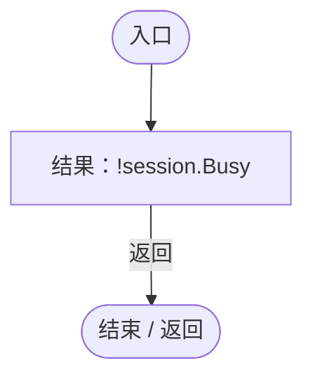

项目内调用/回调引用：

- [WorldSessionManager.Busy.get · L24](08741c7b7b9d9344.md#m4483e2e4f28f7c85)（访问器）

<a id="m5e7a9fee025b9034"></a>

## 回调@57 · L57

`g … => 回调`


### Editor · Roslyn编译器控制流

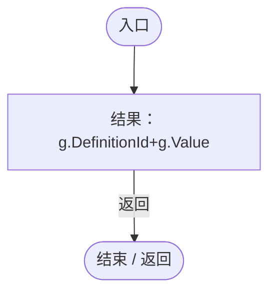

<a id="m8143842540df5e39"></a>

## 回调@59 · L59

`( … => 回调`


### Editor · Roslyn编译器控制流

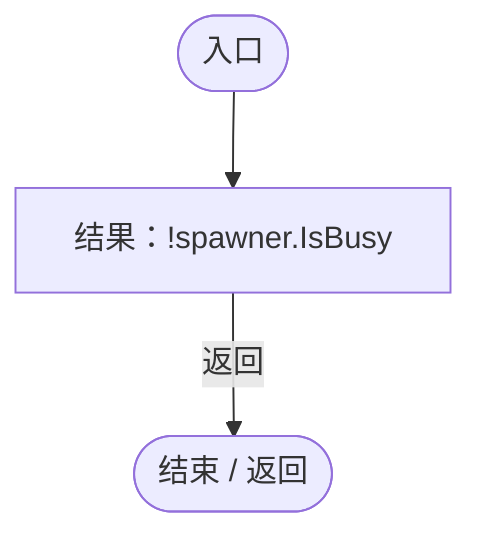

项目内调用/回调引用：

- [RandomPlanetSpawner.IsBusy.get · L18](1c13222a547b265c.md#m93511175a525fd2b)（访问器）

<a id="m030cccb6839ccf1e"></a>

## 回调@59 · L59

`e … => 回调`


### Editor · Roslyn编译器控制流

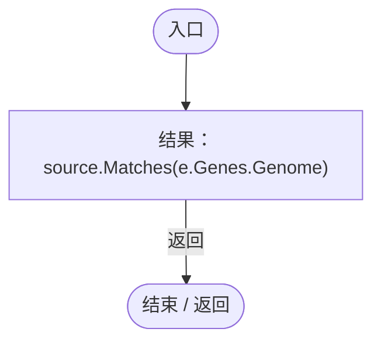

项目内调用/回调引用：

- [RandomSpawnRecipe.Matches · L34](923ccc4e86c4786c.md#mb2348b1f360c1cce)（方法）
- [DarwinEntity.Genes.get · L14](70798dde169f2e8b.md#m622eb1adf401d431)（访问器）

<a id="m8ba29b4d1b70a6a1"></a>

## 回调@59 · L59

`e … => 回调`


### Editor · Roslyn编译器控制流


项目内调用/回调引用：

- [RandomSpawnRecipe.Matches · L34](923ccc4e86c4786c.md#mb2348b1f360c1cce)（方法）
- [DarwinEntity.Genes.get · L14](70798dde169f2e8b.md#m622eb1adf401d431)（访问器）

<a id="mb70d0b2fcc352220"></a>

## 回调@66 · L66

`( … => 回调`


### Editor · Roslyn编译器控制流


项目内调用/回调引用：

- [PopulationMaintenance.Count · L84](923ccc4e86c4786c.md#m2d5cc0fde7e7bbfa)（方法）
- [RandomPlanetSpawner.IsBusy.get · L18](1c13222a547b265c.md#m93511175a525fd2b)（访问器）

<a id="m1a00e032d555de32"></a>

## 回调@67 · L67

`e … => 回调`


### Editor · Roslyn编译器控制流

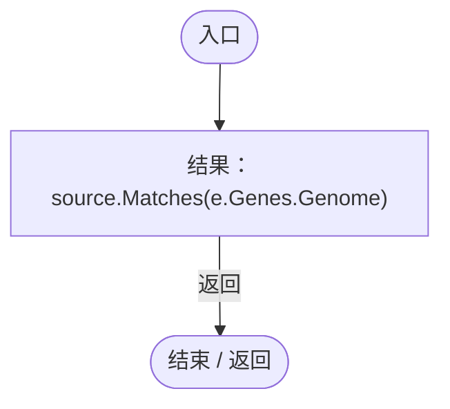

项目内调用/回调引用：

- [RandomSpawnRecipe.Matches · L34](923ccc4e86c4786c.md#mb2348b1f360c1cce)（方法）
- [DarwinEntity.Genes.get · L14](70798dde169f2e8b.md#m622eb1adf401d431)（访问器）

<a id="mc592a771c1c57b49"></a>

## 回调@67 · L67

`( … => 回调`


### Editor · Roslyn编译器控制流

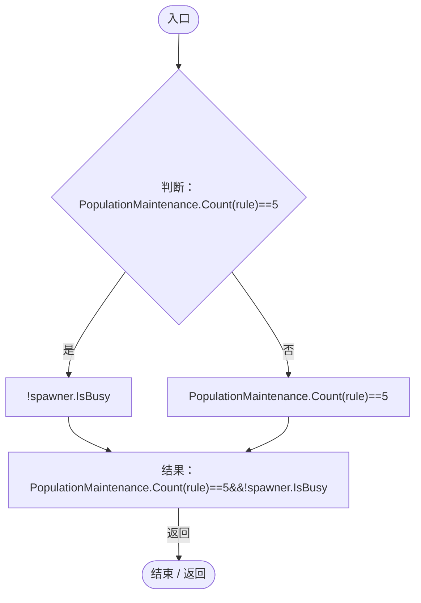

项目内调用/回调引用：

- [PopulationMaintenance.Count · L84](923ccc4e86c4786c.md#m2d5cc0fde7e7bbfa)（方法）
- [RandomPlanetSpawner.IsBusy.get · L18](1c13222a547b265c.md#m93511175a525fd2b)（访问器）

<a id="m9099b61603bb831f"></a>

## 回调@68 · L68

`e … => 回调`


### Editor · Roslyn编译器控制流

```mermaid
flowchart TD
  b0(["入口"])
  b1["结果：source.Matches(e.Genes.Genome)"]
  b2(["结束 / 返回"])
  b0 --> b1
  b1 -->|"返回"| b2

```

项目内调用/回调引用：

- [RandomSpawnRecipe.Matches · L34](923ccc4e86c4786c.md#mb2348b1f360c1cce)（方法）
- [DarwinEntity.Genes.get · L14](70798dde169f2e8b.md#m622eb1adf401d431)（访问器）

<a id="m34522ec713c654c7"></a>

## 回调@68 · L68

`( … => 回调`


### Editor · Roslyn编译器控制流

```mermaid
flowchart TD
  b0(["入口"])
  b1["结果：clock.GameTime&gt;resume+1.2f"]
  b2(["结束 / 返回"])
  b0 --> b1
  b1 -->|"返回"| b2

```

项目内调用/回调引用：

- [SimulationClock.GameTime.get · L23](a8f444aec9614b0a.md#m74adfa39a896652f)（访问器）

<a id="mf3e33282846a0194"></a>

## 回调@68 · L68

`( … => 回调`


### Editor · Roslyn编译器控制流

```mermaid
flowchart TD
  b0(["入口"])
  b1{"判断：PopulationMaintenance.Count(rule)==5"}
  b2["!spawner.IsBusy"]
  b3["PopulationMaintenance.Count(rule)==5"]
  b4["结果：PopulationMaintenance.Count(rule)==5&amp;&amp;!spawner.IsBusy"]
  b5(["结束 / 返回"])
  b0 --> b1
  b1 -->|"是"| b2
  b1 -->|"否"| b3
  b2 --> b4
  b3 --> b4
  b4 -->|"返回"| b5

```

项目内调用/回调引用：

- [PopulationMaintenance.Count · L84](923ccc4e86c4786c.md#m2d5cc0fde7e7bbfa)（方法）
- [RandomPlanetSpawner.IsBusy.get · L18](1c13222a547b265c.md#m93511175a525fd2b)（访问器）

<a id="m797e438ab2650908"></a>

## 回调@72 · L72

`( … => 回调`


### Editor · Roslyn编译器控制流

```mermaid
flowchart TD
  b0(["入口"])
  b1["结果：!session.Busy"]
  b2(["结束 / 返回"])
  b0 --> b1
  b1 -->|"返回"| b2

```

项目内调用/回调引用：

- [WorldSessionManager.Busy.get · L24](08741c7b7b9d9344.md#m4483e2e4f28f7c85)（访问器）

<a id="mba4bfd995847ba21"></a>

## 回调@74 · L74

`v … => 回调`


### Editor · Roslyn编译器控制流

```mermaid
flowchart TD
  b0(["入口"])
  b1["结果：v.id==&quot;storedNutrient&quot;"]
  b2(["结束 / 返回"])
  b0 --> b1
  b1 -->|"返回"| b2

```

<a id="m845fcf6881ab0776"></a>

## 回调@74 · L74

`v … => 回调`


### Editor · Roslyn编译器控制流

```mermaid
flowchart TD
  b0(["入口"])
  b1["结果：v.id==&quot;storedNutrient&quot;"]
  b2(["结束 / 返回"])
  b0 --> b1
  b1 -->|"返回"| b2

```

<a id="m032febb944468c90"></a>

## 回调@77 · L77

`( … => 回调`


### Editor · Roslyn编译器控制流

```mermaid
flowchart TD
  b0(["入口"])
  b1["结果：!session.Busy"]
  b2(["结束 / 返回"])
  b0 --> b1
  b1 -->|"返回"| b2

```

项目内调用/回调引用：

- [WorldSessionManager.Busy.get · L24](08741c7b7b9d9344.md#m4483e2e4f28f7c85)（访问器）

<a id="m001ad95e3c12e353"></a>

## 回调@78 · L78

`( … => 回调`


### Editor · Roslyn编译器控制流

```mermaid
flowchart TD
  b0(["入口"])
  b1{"判断：PopulationMaintenance.Count(partitionA)&gt;=5"}
  b2["!spawner.IsBusy"]
  b3["PopulationMaintenance.Count(partitionA)&gt;=5"]
  b4["结果：PopulationMaintenance.Count(partitionA)&gt;=5&amp;&amp;!spawner.IsBusy"]
  b5(["结束 / 返回"])
  b0 --> b1
  b1 -->|"是"| b2
  b1 -->|"否"| b3
  b2 --> b4
  b3 --> b4
  b4 -->|"返回"| b5

```

项目内调用/回调引用：

- [PopulationMaintenance.Count · L84](923ccc4e86c4786c.md#m2d5cc0fde7e7bbfa)（方法）
- [RandomPlanetSpawner.IsBusy.get · L18](1c13222a547b265c.md#m93511175a525fd2b)（访问器）

<a id="m0a7db7aefcd8ea1a"></a>

## 回调@78 · L78

`( … => 回调`


### Editor · Roslyn编译器控制流

```mermaid
flowchart TD
  b0(["入口"])
  b1["结果：clock.GameTime&gt;stableTime+3"]
  b2(["结束 / 返回"])
  b0 --> b1
  b1 -->|"返回"| b2

```

项目内调用/回调引用：

- [SimulationClock.GameTime.get · L23](a8f444aec9614b0a.md#m74adfa39a896652f)（访问器）

<a id="m6d703e6044eaa8d9"></a>

## 回调@78 · L78

`r … => 回调`


### Editor · Roslyn编译器控制流

```mermaid
flowchart TD
  b0(["入口"])
  b1["结果：r.id==partitionB.id"]
  b2(["结束 / 返回"])
  b0 --> b1
  b1 -->|"返回"| b2

```

<a id="mcafc483e42de9c6d"></a>

## 回调@81 · L81

`r … => 回调`


### Editor · Roslyn编译器控制流

```mermaid
flowchart TD
  b0(["入口"])
  b1["结果：!r.enabled"]
  b2(["结束 / 返回"])
  b0 --> b1
  b1 -->|"返回"| b2

```

<a id="m49a83bc6962271f6"></a>

## VerifySourceUI · L84

`private static IEnumerator VerifySourceUI(RandomSpawnWorkbench work)`

★ 新增：通过真实Canvas输入控件、按钮和JSON文件验证焦点/筛选/互斥/自动列出，而不是仅调用字符串筛选函数。

### Editor · Roslyn编译器控制流

```mermaid
flowchart TD
  b0(["入口"])
  b1["root=ServiceLocator.Get&lt;UIRoot&gt;().MainCanvas.transform.Find(&quot;RandomSpawnWorkbenchBlocker/RandomSpawnWorkbench&quot;)<br/>search=Search()<br/>search.Select();<br/>search.ActivateInputField();<br/>yield return null;"]
  b2["&quot;生长&quot;"]
  b3{"判断：&quot;生长&quot;"}
  b4["char"]
  b5["search<br/>new Event{type=EventType.KeyDown,character=character}<br/>type=EventType.KeyDown<br/>character=character<br/>search.ProcessEvent(new Event{type=EventType.KeyDown,character=character});"]
  b6{"判断：&quot;生长&quot;"}
  b7["&quot;生长&quot;"]
  b8["连接 / 离开区域"]
  b9{"判断：search.text==&quot;生长&quot;"}
  b10["search.isFocused"]
  b11["search.text==&quot;生长&quot;"]
  b12["Check(search.text==&quot;生长&quot;&amp;&amp;search.isFocused,&quot;原生搜索框连续输入中文并保持焦点&quot;);"]
  b13["yield return null;<br/>Check(root.GetComponentsInChildren&lt;Text&gt;().Where(t=&gt;t.name==&quot;GeneLabel&quot;).All(t=&gt;t.text.Contains(&quot;生长&quot;)),&quot;搜索输入即时过滤真实基因行&quot;);<br/>search.ProcessEvent(Event.KeyboardEvent(&quot;backspace&quot;));<br/>Check(search.text==&quot;生&quot;,&quot;搜索退格可正常编辑而不丢失输入&quot;);…"]
  b14{"判断：work.Draft.excluded.Contains(&quot;gene_growth&quot;)"}
  b15["!work.Draft.included.Contains(&quot;gene_growth&quot;)"]
  b16["work.Draft.excluded.Contains(&quot;gene_growth&quot;)"]
  b17["Check(work.Draft.excluded.Contains(&quot;gene_growth&quot;)&amp;&amp;!work.Draft.included.Contains(&quot;gene_growth&quot;),&quot;主题有无按钮真实点击互斥&quot;);"]
  b18["Named(&quot;Include_gene_growth&quot;).onClick.Invoke();<br/>Named(&quot;Exclude_gene_locomotion&quot;).onClick.Invoke();<br/>Check(Named(&quot;Include_gene_growth&quot;).image.sprite==UIVisualTheme.SurfaceSprite(&quot;selected&quot;),&quot;选中按钮使用游戏统一主题表面&quot;);<br/>name=root.GetComponentsInChildr…"]
  b19{"判断：File.Exists(path)"}
  b20{"判断：File.ReadAllText(path).Contains(&quot;gene_growth&quot;)"}
  b21["saved.source.excluded.Contains(&quot;gene_locomotion&quot;)"]
  b22["File.Exists(path)&amp;&amp;File.ReadAllText(path).Contains(&quot;gene_growth&quot;)&amp;&amp;saved.source.excluded.Contains(&quot;gene_locomotion&quot;)"]
  b23["Check(File.Exists(path)&amp;&amp;File.ReadAllText(path).Contains(&quot;gene_growth&quot;)&amp;&amp;saved.source.excluded.Contains(&quot;gene_locomotion&quot;),&quot;保存条件按钮实际生成独立可读JSON并成对加载&quot;);"]
  b24["bytes=File.ReadAllBytes(path)"]
  b25{"判断：bytes.Length&gt;2"}
  b26{"判断：bytes[0]==239"}
  b27{"判断：bytes[1]==187"}
  b28["bytes[2]==191"]
  b29["bytes.Length&gt;2&amp;&amp;bytes[0]==239&amp;&amp;bytes[1]==187&amp;&amp;bytes[2]==191"]
  b30["Check(!(bytes.Length&gt;2&amp;&amp;bytes[0]==239&amp;&amp;bytes[1]==187&amp;&amp;bytes[2]==191),&quot;条件JSON为无BOM的UTF-8&quot;);"]
  b31["edited=JsonUtility.FromJson&lt;RandomSpawnPresetStore.Preset&gt;(File.ReadAllText(path))<br/>edited.source.name=externalName;<br/>File.WriteAllText(path,JsonUtility.ToJson(edited,true));<br/>work.Close();<br/>owner=Object.FindFirstObjectByType&lt;RandomSpawnPane…"]
  b32{"判断：sources.Any(r=&gt;r.name==&quot;默认实体&quot;)"}
  b33{"判断：EntityTemplateManager.Templates.All(t=&gt;sources.Any(r=&gt;r.name==t.templateName))"}
  b34["sources.Any(r=&gt;r.name==externalName)"]
  b35["sources.Any(r=&gt;r.name==&quot;默认实体&quot;)&amp;&amp;EntityTemplateManager.Templates.All(t=&gt;sources.Any(r=&gt;r.name==t.templateName))&amp;&amp;sources.Any(r=&gt;r.name==externalName)"]
  b36["Check(sources.Any(r=&gt;r.name==&quot;默认实体&quot;)&amp;&amp;EntityTemplateManager.Templates.All(t=&gt;sources.Any(r=&gt;r.name==t.templateName))&amp;&amp;sources.Any(r=&gt;r.name==externalName),&quot;重新打开后自动列出默认模板、所有模板和外部编辑的条件&quot;);"]
  b37{"判断：PopulationMaintenance.Rules.Count==0"}
  b38["root.GetComponentsInChildren&lt;Text&gt;().Any(t=&gt;t.name==&quot;Conditions&quot;&amp;&amp;t.text.Contains(&quot;必有：&quot;)&amp;&amp;t.text.Contains(&quot;必无：&quot;))"]
  b39["PopulationMaintenance.Rules.Count==0"]
  b40["Check(PopulationMaintenance.Rules.Count==0&amp;&amp;root.GetComponentsInChildren&lt;Text&gt;().Any(t=&gt;t.name==&quot;Conditions&quot;&amp;&amp;t.text.Contains(&quot;必有：&quot;)&amp;&amp;t.text.Contains(&quot;必无：&quot;)),&quot;自动列出包含控制基因说明但不会自动启动全部规则&quot;);"]
  b41["root.GetComponentsInChildren&lt;ScrollRect&gt;().Single(r=&gt;r.name==&quot;MaintenanceSources&quot;).verticalNormalizedPosition=0;<br/>yield return Capture(&quot;automatic-maintenance-sources&quot;);<br/>conditionRow=ConditionRow()<br/>conditionRow.GetComponentsInChildren&lt;Inpu…"]
  b42{"判断：PopulationMaintenance.Rules.Count==1"}
  b43{"判断：PopulationMaintenance.Rules.Single().ratio==.25f"}
  b44["PopulationMaintenance.Rules.Single().source.included.Contains(&quot;gene_growth&quot;)"]
  b45["PopulationMaintenance.Rules.Count==1&amp;&amp;PopulationMaintenance.Rules.Single().ratio==.25f&amp;&amp;PopulationMaintenance.Rules.Single().source.included.Contains(&quot;gene_growth&quot;)"]
  b46["Check(PopulationMaintenance.Rules.Count==1&amp;&amp;PopulationMaintenance.Rules.Single().ratio==.25f&amp;&amp;PopulationMaintenance.Rules.Single().source.included.Contains(&quot;gene_growth&quot;),&quot;自动列出条件可直接设定比例并启用真实规则&quot;);"]
  b47["ConditionRow().GetComponentsInChildren&lt;Button&gt;().Single(b=&gt;b.name==&quot;RuleEnabled&quot;).onClick.Invoke();<br/>yield return null;<br/>Check(!PopulationMaintenance.Rules.Single().enabled,&quot;自动列表原生按钮可停用规则&quot;);<br/>ConditionRow().GetComponentsInChildren&lt;Button&gt;()…"]
  b48{"判断：PopulationMaintenance.Rules.Count==0"}
  b49["work.MaintenanceSources().Any(r=&gt;r.name==externalName)"]
  b50["PopulationMaintenance.Rules.Count==0"]
  b51["Check(PopulationMaintenance.Rules.Count==0&amp;&amp;work.MaintenanceSources().Any(r=&gt;r.name==externalName),&quot;移除规则保留JSON来源供再次启用&quot;);"]
  b52["work.Close();<br/>work.Open(owner);<br/>yield return null;<br/>root=ServiceLocator.Get&lt;UIRoot&gt;().MainCanvas.transform.Find(&quot;RandomSpawnWorkbenchBlocker/RandomSpawnWorkbench&quot;);<br/>dropdown=root.GetComponentsInChildren&lt;Dropdown&gt;().Single(d=&gt;d.name==&quot;Save…"]
  b53{"判断：work.Draft.included.Contains(&quot;gene_growth&quot;)"}
  b54["work.Draft.excluded.Contains(&quot;gene_locomotion&quot;)"]
  b55["work.Draft.included.Contains(&quot;gene_growth&quot;)"]
  b56["Check(work.Draft.included.Contains(&quot;gene_growth&quot;)&amp;&amp;work.Draft.excluded.Contains(&quot;gene_locomotion&quot;),&quot;已存条件在生成来源中可选且恢复控制基因&quot;);"]
  b57(["结束 / 返回"])
  b0 --> b1
  b1 --> b2
  b2 --> b3
  b3 -->|"是"| b4
  b3 -->|"否 · 经过finally 6"| b9
  b4 --> b5
  b5 --> b3
  b6 -->|"否"| b7
  b6 -->|"是"| b8
  b7 --> b8
  b9 -->|"是"| b10
  b9 -->|"否"| b11
  b10 --> b12
  b11 --> b12
  b12 --> b13
  b13 --> b14
  b14 -->|"是"| b15
  b14 -->|"否"| b16
  b15 --> b17
  b16 --> b17
  b17 --> b18
  b18 --> b19
  b19 -->|"是"| b20
  b19 -->|"否"| b22
  b20 -->|"是"| b21
  b20 -->|"否"| b22
  b21 --> b23
  b22 --> b23
  b23 --> b24
  b24 --> b25
  b25 -->|"是"| b26
  b25 -->|"否"| b29
  b26 -->|"是"| b27
  b26 -->|"否"| b29
  b27 -->|"是"| b28
  b27 -->|"否"| b29
  b28 --> b30
  b29 --> b30
  b30 --> b31
  b31 --> b32
  b32 -->|"是"| b33
  b32 -->|"否"| b35
  b33 -->|"是"| b34
  b33 -->|"否"| b35
  b34 --> b36
  b35 --> b36
  b36 --> b37
  b37 -->|"是"| b38
  b37 -->|"否"| b39
  b38 --> b40
  b39 --> b40
  b40 --> b41
  b41 --> b42
  b42 -->|"是"| b43
  b42 -->|"否"| b45
  b43 -->|"是"| b44
  b43 -->|"否"| b45
  b44 --> b46
  b45 --> b46
  b46 --> b47
  b47 --> b48
  b48 -->|"是"| b49
  b48 -->|"否"| b50
  b49 --> b51
  b50 --> b51
  b51 --> b52
  b52 --> b53
  b53 -->|"是"| b54
  b53 -->|"否"| b55
  b54 --> b56
  b55 --> b56
  b56 --> b57
  b3 -. "退出保护区时 finally（示意）" .-> b6

```

项目内调用/回调引用：

- [UIRoot.MainCanvas.get · L14](9c1421378791f0e0.md#maa2cc9baf1248477)（访问器）
- [ServiceLocator.Get · L33](f2fdbe9f9ccd93cb.md#m2ae625299520c56d)（方法）
- [PopulationMaintenanceRegression.Search · L87](fda63d99884ef0fb.md#m7dffdcddbf335d72)（局部函数）
- [PopulationMaintenanceRegression.Check · L31](fda63d99884ef0fb.md#m8b287c7ca4d0ea91)（方法）
- [PopulationMaintenanceRegression.Named · L88](fda63d99884ef0fb.md#m7f9edf8ae88aa40c)（局部函数）
- [UIVisualTheme.SurfaceSprite · L45](ca525a798a08f966.md#md3ae1d7fd207ae2f)（方法）
- [RandomSpawnPresetStore.Load · L27](9f09efd086264861.md#mbb593ba9438a87f8)（方法）
- [RandomSpawnWorkbench.Close · L42](0763b7475b3c75db.md#mb3132a8d58c9ba62)（方法）
- [RandomSpawnWorkbench.Open · L29](0763b7475b3c75db.md#m0c118b57d249ff5d)（方法）
- [RandomSpawnWorkbench.MaintenanceSources · L191](0763b7475b3c75db.md#m4f2be45ea6b387ef)（方法）
- [EntityTemplateManager.Templates.get · L23](ab5e6457e8a7aba0.md#m45cc5b075f7bf4ec)（访问器）
- [PopulationMaintenanceRegression.Capture · L48](fda63d99884ef0fb.md#me7712d4512bf7272)（方法）
- [PopulationMaintenanceRegression.ConditionRow · L108](fda63d99884ef0fb.md#mab3a3bc9594665e0)（局部函数）
- [PopulationMaintenanceRegression.回调@92 · L92](fda63d99884ef0fb.md#mb20a4d4e96266bf1)（回调/委托）
- [PopulationMaintenanceRegression.回调@92 · L92](fda63d99884ef0fb.md#mc267a8e8a34c63cd)（回调/委托）
- [PopulationMaintenanceRegression.回调@94 · L94](fda63d99884ef0fb.md#m92fa53b6814441f6)（回调/委托）
- [PopulationMaintenanceRegression.回调@99 · L99](fda63d99884ef0fb.md#mb4e95fea9c5afcd2)（回调/委托）
- [PopulationMaintenanceRegression.回调@100 · L100](fda63d99884ef0fb.md#med4323e73d8eacbe)（回调/委托）
- [PopulationMaintenanceRegression.回调@105 · L105](fda63d99884ef0fb.md#m623a1d099e9c6fe8)（回调/委托）
- [PopulationMaintenanceRegression.回调@105 · L105](fda63d99884ef0fb.md#m6b8aedc223c3bff2)（回调/委托）
- [PopulationMaintenanceRegression.回调@105 · L105](fda63d99884ef0fb.md#m6ae69aab430285d2)（回调/委托）
- [PopulationMaintenanceRegression.回调@106 · L106](fda63d99884ef0fb.md#md636d142e2023ebb)（回调/委托）
- [PopulationMaintenanceRegression.回调@107 · L107](fda63d99884ef0fb.md#m551bd9aeb874b1cc)（回调/委托）
- [PopulationMaintenanceRegression.回调@109 · L109](fda63d99884ef0fb.md#mfdaa95071da2617c)（回调/委托）
- [PopulationMaintenanceRegression.回调@109 · L109](fda63d99884ef0fb.md#ma428f20890d5788a)（回调/委托）
- [PopulationMaintenanceRegression.回调@111 · L111](fda63d99884ef0fb.md#mbbdfce85b2f58860)（回调/委托）
- [PopulationMaintenanceRegression.回调@112 · L112](fda63d99884ef0fb.md#mddc36b41dd06ce88)（回调/委托）
- [PopulationMaintenanceRegression.回调@112 · L112](fda63d99884ef0fb.md#m9aeb29a5c44ad668)（回调/委托）
- [PopulationMaintenanceRegression.回调@114 · L114](fda63d99884ef0fb.md#m35f5d1fd1c20d934)（回调/委托）
- [PopulationMaintenanceRegression.回调@114 · L114](fda63d99884ef0fb.md#m194394e714ff8bc6)（回调/委托）

<a id="m7dffdcddbf335d72"></a>

## Search · L87

`InputField Search()`


### Editor · Roslyn编译器控制流

```mermaid
flowchart TD
  b0(["入口"])
  b1["结果：root.GetComponentsInChildren&lt;InputField&gt;().Single(f=&gt;f.name==&quot;GeneSearch&quot;)"]
  b2(["结束 / 返回"])
  b0 --> b1
  b1 -->|"返回"| b2

```

项目内调用/回调引用：

- [PopulationMaintenanceRegression.回调@87 · L87](fda63d99884ef0fb.md#m58bd01cc02689bfc)（回调/委托）

<a id="m58bd01cc02689bfc"></a>

## 回调@87 · L87

`f … => 回调`


### Editor · Roslyn编译器控制流

```mermaid
flowchart TD
  b0(["入口"])
  b1["结果：f.name==&quot;GeneSearch&quot;"]
  b2(["结束 / 返回"])
  b0 --> b1
  b1 -->|"返回"| b2

```

<a id="m7f9edf8ae88aa40c"></a>

## Named · L88

`Button Named(string name)`


### Editor · Roslyn编译器控制流

```mermaid
flowchart TD
  b0(["入口"])
  b1["结果：root.GetComponentsInChildren&lt;Button&gt;().Single(b=&gt;b.name==name)"]
  b2(["结束 / 返回"])
  b0 --> b1
  b1 -->|"返回"| b2

```

项目内调用/回调引用：

- [PopulationMaintenanceRegression.回调@88 · L88](fda63d99884ef0fb.md#mb6890a3b8b57e696)（回调/委托）

<a id="mb6890a3b8b57e696"></a>

## 回调@88 · L88

`b … => 回调`


### Editor · Roslyn编译器控制流

```mermaid
flowchart TD
  b0(["入口"])
  b1["结果：b.name==name"]
  b2(["结束 / 返回"])
  b0 --> b1
  b1 -->|"返回"| b2

```

<a id="mb20a4d4e96266bf1"></a>

## 回调@92 · L92

`t … => 回调`


### Editor · Roslyn编译器控制流

```mermaid
flowchart TD
  b0(["入口"])
  b1["结果：t.name==&quot;GeneLabel&quot;"]
  b2(["结束 / 返回"])
  b0 --> b1
  b1 -->|"返回"| b2

```

<a id="mc267a8e8a34c63cd"></a>

## 回调@92 · L92

`t … => 回调`


### Editor · Roslyn编译器控制流

```mermaid
flowchart TD
  b0(["入口"])
  b1["结果：t.text.Contains(&quot;生长&quot;)"]
  b2(["结束 / 返回"])
  b0 --> b1
  b1 -->|"返回"| b2

```

<a id="m92fa53b6814441f6"></a>

## 回调@94 · L94

`t … => 回调`


### Editor · Roslyn编译器控制流

```mermaid
flowchart TD
  b0(["入口"])
  b1["结果：t.name==&quot;GeneLabel&quot;"]
  b2(["结束 / 返回"])
  b0 --> b1
  b1 -->|"返回"| b2

```

<a id="mb4e95fea9c5afcd2"></a>

## 回调@99 · L99

`f … => 回调`


### Editor · Roslyn编译器控制流

```mermaid
flowchart TD
  b0(["入口"])
  b1["结果：f.name==&quot;ConditionName&quot;"]
  b2(["结束 / 返回"])
  b0 --> b1
  b1 -->|"返回"| b2

```

<a id="med4323e73d8eacbe"></a>

## 回调@100 · L100

`p … => 回调`


### Editor · Roslyn编译器控制流

```mermaid
flowchart TD
  b0(["入口"])
  b1["结果：p.source.name==conditionName"]
  b2(["结束 / 返回"])
  b0 --> b1
  b1 -->|"返回"| b2

```

<a id="m623a1d099e9c6fe8"></a>

## 回调@105 · L105

`r … => 回调`


### Editor · Roslyn编译器控制流

```mermaid
flowchart TD
  b0(["入口"])
  b1["结果：r.name==&quot;默认实体&quot;"]
  b2(["结束 / 返回"])
  b0 --> b1
  b1 -->|"返回"| b2

```

<a id="m6b8aedc223c3bff2"></a>

## 回调@105 · L105

`t … => 回调`


### Editor · Roslyn编译器控制流

```mermaid
flowchart TD
  b0(["入口"])
  b1["结果：sources.Any(r=&gt;r.name==t.templateName)"]
  b2(["结束 / 返回"])
  b0 --> b1
  b1 -->|"返回"| b2

```

项目内调用/回调引用：

- [PopulationMaintenanceRegression.回调@105 · L105](fda63d99884ef0fb.md#mb4eb25d5baae4b77)（回调/委托）

<a id="mb4eb25d5baae4b77"></a>

## 回调@105 · L105

`r … => 回调`


### Editor · Roslyn编译器控制流

```mermaid
flowchart TD
  b0(["入口"])
  b1["结果：r.name==t.templateName"]
  b2(["结束 / 返回"])
  b0 --> b1
  b1 -->|"返回"| b2

```

<a id="m6ae69aab430285d2"></a>

## 回调@105 · L105

`r … => 回调`


### Editor · Roslyn编译器控制流

```mermaid
flowchart TD
  b0(["入口"])
  b1["结果：r.name==externalName"]
  b2(["结束 / 返回"])
  b0 --> b1
  b1 -->|"返回"| b2

```

<a id="md636d142e2023ebb"></a>

## 回调@106 · L106

`t … => 回调`


### Editor · Roslyn编译器控制流

```mermaid
flowchart TD
  b0(["入口"])
  b1{"判断：t.name==&quot;Conditions&quot;"}
  b2{"判断：t.text.Contains(&quot;必有：&quot;)"}
  b3["t.text.Contains(&quot;必无：&quot;)"]
  b4["t.name==&quot;Conditions&quot;&amp;&amp;t.text.Contains(&quot;必有：&quot;)&amp;&amp;t.text.Contains(&quot;必无：&quot;)"]
  b5["结果：t.name==&quot;Conditions&quot;&amp;&amp;t.text.Contains(&quot;必有：&quot;)&amp;&amp;t.text.Contains(&quot;必无：&quot;)"]
  b6(["结束 / 返回"])
  b0 --> b1
  b1 -->|"是"| b2
  b1 -->|"否"| b4
  b2 -->|"是"| b3
  b2 -->|"否"| b4
  b3 --> b5
  b4 --> b5
  b5 -->|"返回"| b6

```

<a id="m551bd9aeb874b1cc"></a>

## 回调@107 · L107

`r … => 回调`


### Editor · Roslyn编译器控制流

```mermaid
flowchart TD
  b0(["入口"])
  b1["结果：r.name==&quot;MaintenanceSources&quot;"]
  b2(["结束 / 返回"])
  b0 --> b1
  b1 -->|"返回"| b2

```

<a id="mab3a3bc9594665e0"></a>

## ConditionRow · L108

`Transform ConditionRow()`


### Editor · Roslyn编译器控制流

```mermaid
flowchart TD
  b0(["入口"])
  b1["结果：root.GetComponentsInChildren&lt;Text&gt;().Single(t=&gt;t.name==&quot;Name&quot;&amp;&amp;t.text==externalName).transform.parent"]
  b2(["结束 / 返回"])
  b0 --> b1
  b1 -->|"返回"| b2

```

项目内调用/回调引用：

- [PopulationMaintenanceRegression.回调@108 · L108](fda63d99884ef0fb.md#m64a15ef879e16279)（回调/委托）

<a id="m64a15ef879e16279"></a>

## 回调@108 · L108

`t … => 回调`


### Editor · Roslyn编译器控制流

```mermaid
flowchart TD
  b0(["入口"])
  b1{"判断：t.name==&quot;Name&quot;"}
  b2["t.text==externalName"]
  b3["t.name==&quot;Name&quot;"]
  b4["结果：t.name==&quot;Name&quot;&amp;&amp;t.text==externalName"]
  b5(["结束 / 返回"])
  b0 --> b1
  b1 -->|"是"| b2
  b1 -->|"否"| b3
  b2 --> b4
  b3 --> b4
  b4 -->|"返回"| b5

```

<a id="mfdaa95071da2617c"></a>

## 回调@109 · L109

`f … => 回调`


### Editor · Roslyn编译器控制流

```mermaid
flowchart TD
  b0(["入口"])
  b1["结果：f.name==&quot;Ratio&quot;"]
  b2(["结束 / 返回"])
  b0 --> b1
  b1 -->|"返回"| b2

```

<a id="ma428f20890d5788a"></a>

## 回调@109 · L109

`b … => 回调`


### Editor · Roslyn编译器控制流

```mermaid
flowchart TD
  b0(["入口"])
  b1["结果：b.name==&quot;ApplyRatio&quot;"]
  b2(["结束 / 返回"])
  b0 --> b1
  b1 -->|"返回"| b2

```

<a id="mbbdfce85b2f58860"></a>

## 回调@111 · L111

`b … => 回调`


### Editor · Roslyn编译器控制流

```mermaid
flowchart TD
  b0(["入口"])
  b1["结果：b.name==&quot;RuleEnabled&quot;"]
  b2(["结束 / 返回"])
  b0 --> b1
  b1 -->|"返回"| b2

```

<a id="mddc36b41dd06ce88"></a>

## 回调@112 · L112

`b … => 回调`


### Editor · Roslyn编译器控制流

```mermaid
flowchart TD
  b0(["入口"])
  b1["结果：b.name==&quot;DeleteRule&quot;"]
  b2(["结束 / 返回"])
  b0 --> b1
  b1 -->|"返回"| b2

```

<a id="m9aeb29a5c44ad668"></a>

## 回调@112 · L112

`r … => 回调`


### Editor · Roslyn编译器控制流

```mermaid
flowchart TD
  b0(["入口"])
  b1["结果：r.name==externalName"]
  b2(["结束 / 返回"])
  b0 --> b1
  b1 -->|"返回"| b2

```

<a id="m35f5d1fd1c20d934"></a>

## 回调@114 · L114

`d … => 回调`


### Editor · Roslyn编译器控制流

```mermaid
flowchart TD
  b0(["入口"])
  b1["结果：d.name==&quot;SavedConditions&quot;"]
  b2(["结束 / 返回"])
  b0 --> b1
  b1 -->|"返回"| b2

```

<a id="m194394e714ff8bc6"></a>

## 回调@114 · L114

`o … => 回调`


### Editor · Roslyn编译器控制流

```mermaid
flowchart TD
  b0(["入口"])
  b1["结果：o.text==externalName"]
  b2(["结束 / 返回"])
  b0 --> b1
  b1 -->|"返回"| b2

```

<a id="m6e3694c20cef641f"></a>

## CheckSource · L117

`private static void CheckSource(Genome genome,RandomSpawnRecipe source)`


### Editor · Roslyn编译器控制流

```mermaid
flowchart TD
  b0(["入口"])
  b1{"判断：source.Matches(genome)"}
  b2{"判断：genome.Genes.Count==0"}
  b3["结果：new InvalidOperationException(&quot;受约束随机基因组违反生成条件&quot;)"]
  x3(["抛出异常 / 离开方法"])
  b4(["结束 / 返回"])
  b0 --> b1
  b1 -->|"是"| b2
  b1 -->|"否"| b3
  b2 -->|"是"| b3
  b2 -->|"否"| b4
  b3 -->|"Throw"| x3

```

项目内调用/回调引用：

- [RandomSpawnRecipe.Matches · L34](923ccc4e86c4786c.md#mb2348b1f360c1cce)（方法）

<a id="m8d254003d546f403"></a>

## VerifyFormation · L119

`private static IEnumerator VerifyFormation(Vector3 home,SimulationClock clock)`


### Editor · Roslyn编译器控制流

```mermaid
flowchart TD
  b0(["入口"])
  b1["Clear();<br/>group=Guid.NewGuid().ToString(&quot;N&quot;)<br/>queen=Spawn(home,(&quot;gene_growth&quot;,50),(&quot;gene_population&quot;,20))<br/>q=AntColonyMember.Ensure(queen.GetComponent&lt;PopulationBehavior&gt;())<br/>q.Assign(AntRole.Queen,group);<br/>workers=new List&lt;AntColonyMember&gt;()"]
  b2["i=0"]
  b3{"判断：i&lt;8"}
  b4["e=Spawn(home+EcologyQueries.Up(home)*(i+1)*.8f,(&quot;gene_growth&quot;,50),(&quot;gene_population&quot;,20),(&quot;gene_locomotion&quot;,50))<br/>m=AntColonyMember.Ensure(e.GetComponent&lt;PopulationBehavior&gt;())<br/>m.Assign(AntRole.Worker,group);<br/>workers.Add(m);"]
  b5["i++"]
  b6["destinations=workers.Select(m=&gt;{m.Destination(out var p,out _,out _);return p;}).ToArray()"]
  b7{"判断：destinations.All(p=&gt;EcologyQueries.Distance(p,home)&gt;1)"}
  b8["destinations.Distinct().Count()==8"]
  b9["destinations.All(p=&gt;EcologyQueries.Distance(p,home)&gt;1)"]
  b10["Check(destinations.All(p=&gt;EcologyQueries.Distance(p,home)&gt;1)&amp;&amp;destinations.Distinct().Count()==8,&quot;休息工匠获得不同地表站位，不以王后身体为终点&quot;);"]
  b11["initial=workers.Select(m=&gt;m.transform.position).ToArray()"]
  b12["workers"]
  b13{"判断：workers"}
  b14["var"]
  b15["desired=ColonyFormation.Avoid(m.Genes,Vector3.zero,5)"]
  b16{"判断：Mathf.Abs(Vector3.Dot(desired,EcologyQueries.Up(m.transform.position)))&lt;.001f"}
  b17["desired.sqrMagnitude&gt;0"]
  b18["Mathf.Abs(Vector3.Dot(desired,EcologyQueries.Up(m.transform.position)))&lt;.001f"]
  b19["Check(Mathf.Abs(Vector3.Dot(desired,EcologyQueries.Up(m.transform.position)))&lt;.001f&amp;&amp;desired.sqrMagnitude&gt;0,&quot;同轴堆叠成员产生切向避让而非向上吸附&quot;);"]
  b20["workers"]
  b21["yield return null;<br/>mode=Physics.simulationMode<br/>Physics.simulationMode=SimulationMode.Script;<br/>clock.Play();"]
  b22["EntityRegistry.All"]
  b23{"判断：EntityRegistry.All"}
  b24["var<br/>e.GetComponent&lt;Rigidbody&gt;().isKinematic=false;<br/>e.GetComponent&lt;PlanetGravity&gt;().enabled=true;"]
  b25{"判断：EntityRegistry.All"}
  b26["EntityRegistry.All"]
  b27["连接 / 离开区域"]
  b28["yield return null;"]
  b29["step=0"]
  b30{"判断：step&lt;300"}
  b31["workers"]
  b32{"判断：workers"}
  b33["var"]
  b34["EntityNeighborhood.ObservePosition(m.Genes);<br/>m.Advance(.02f);<br/>gene=m.Genes.Genome.Genes.First(g=&gt;m.Genes.GetLogic(g) is LocomotionGeneLogic&amp;&amp;GeneBehaviorAuthority.IsPrimary&lt;LocomotionGeneLogic&gt;(m.Genes,g))<br/>m.Genes.GetLogic(gene).OnUpdate…"]
  b35["workers"]
  b36["EntityRegistry.All"]
  b37{"判断：EntityRegistry.All"}
  b38["var<br/>typeof(PlanetGravity).GetMethod(&quot;FixedUpdate&quot;,Private).Invoke(e.GetComponent&lt;PlanetGravity&gt;(),null);"]
  b39{"判断：EntityRegistry.All"}
  b40["EntityRegistry.All"]
  b41["连接 / 离开区域"]
  b42{"Physics.SyncTransforms();<br/>Physics.Simulate(.02f);<br/>判断：step%5==0"}
  b43["yield return null;"]
  b44["step++"]
  b45["Check(workers.Count(m=&gt;EcologyQueries.Distance(m.transform.position,queen.transform.position)&gt;1.2f)&gt;=6,&quot;真实刚体模拟后大多数堆叠成员走离王后头顶&quot;);"]
  b46["Physics.simulationMode=mode;<br/>clock.Pause();"]
  b47{"判断：ColonyFormation.TryBirthPosition(q,out var birth)"}
  b48["EntityRegistry.All.All(e=&gt;EcologyQueries.Distance(e.transform.position,birth)&gt;=2)"]
  b49["ColonyFormation.TryBirthPosition(q,out var birth)"]
  b50["Check(ColonyFormation.TryBirthPosition(q,out var birth)&amp;&amp;EntityRegistry.All.All(e=&gt;EcologyQueries.Distance(e.transform.position,birth)&gt;=2),&quot;新生位置避开现有成员身体占位&quot;);"]
  b51["Camera.main.GetComponent&lt;OrbitCamera&gt;().FocusOn(queen.transform.position);<br/>yield return new WaitForSecondsRealtime(1.2f);<br/>File.WriteAllText(Path.Combine(Folder,&quot;formation-positions.txt&quot;),string.Join(&quot;\n&quot;,workers.Select(m=&gt;m.Id+&quot; distance…"]
  b52(["结束 / 返回"])
  b0 --> b1
  b1 --> b2
  b2 --> b3
  b3 -->|"是"| b4
  b3 -->|"否"| b6
  b4 --> b5
  b5 --> b3
  b6 --> b7
  b7 -->|"是"| b8
  b7 -->|"否"| b9
  b8 --> b10
  b9 --> b10
  b10 --> b11
  b11 --> b12
  b12 --> b13
  b13 -->|"是"| b14
  b13 -->|"否 · 经过finally 20"| b21
  b14 --> b15
  b15 --> b16
  b16 -->|"是"| b17
  b16 -->|"否"| b18
  b17 --> b19
  b18 --> b19
  b19 --> b13
  b21 --> b22
  b22 --> b23
  b23 -->|"是"| b24
  b23 -->|"否 · 经过finally 25"| b28
  b24 --> b23
  b25 -->|"否"| b26
  b25 -->|"是"| b27
  b26 --> b27
  b28 --> b29
  b29 --> b30
  b30 -->|"是"| b31
  b30 -->|"否"| b45
  b31 --> b32
  b32 -->|"是"| b33
  b32 -->|"否 · 经过finally 35"| b36
  b33 --> b34
  b34 --> b32
  b36 --> b37
  b37 -->|"是"| b38
  b37 -->|"否 · 经过finally 39"| b42
  b38 --> b37
  b39 -->|"否"| b40
  b39 -->|"是"| b41
  b40 --> b41
  b42 -->|"是"| b43
  b42 -->|"否"| b44
  b43 --> b44
  b44 --> b30
  b45 -->|"经过finally 46"| b47
  b47 -->|"是"| b48
  b47 -->|"否"| b49
  b48 --> b50
  b49 --> b50
  b50 --> b51
  b51 --> b52
  b13 -. "退出保护区时 finally（示意）" .-> b20
  b23 -. "退出保护区时 finally（示意）" .-> b25
  b32 -. "退出保护区时 finally（示意）" .-> b35
  b37 -. "退出保护区时 finally（示意）" .-> b39
  b22 -. "退出保护区时 finally（示意）" .-> b46

```

项目内调用/回调引用：

- [PopulationMaintenanceRegression.Clear · L38](fda63d99884ef0fb.md#mfa759f156d7c9ea7)（方法）
- [PopulationMaintenanceRegression.Spawn · L39](fda63d99884ef0fb.md#m57647ac65900cc64)（方法）
- [AntColonyMember.Ensure · L51](baebd85c05598377.md#m408f716118716988)（方法）
- [AntColonyMember.Assign · L54](baebd85c05598377.md#mda0fe308acecb8f2)（方法）
- [EcologyQueries.Up · L41](bdf7ccc2c9c0452f.md#maca7070196f125fd)（方法）
- [PopulationMaintenanceRegression.Check · L31](fda63d99884ef0fb.md#m8b287c7ca4d0ea91)（方法）
- [ColonyFormation.Avoid · L43](c65dce2d54e43480.md#me7d09f85ef3637a0)（方法）
- [AntColonyMember.Genes.get · L28](baebd85c05598377.md#m3b8445af6c82650a)（访问器）
- [SimulationClock.Play · L78](a8f444aec9614b0a.md#m7aa9e64b7de60ed0)（方法）
- [EntityNeighborhood.ObservePosition · L63](e5e24c4aff0395b1.md#m994f4a7ab30bcd1d)（方法）
- [AntColonyMember.Advance · L77](baebd85c05598377.md#m29cff578dd85ff16)（方法）
- [IGeneLogic.OnUpdate · L9](5304fdad773967f8.md#m829188d65276f8e5)（方法）
- [EntityGeneController.GetLogic · L184](7494d53178552f0e.md#m4f4e58e1a4abadfc)（方法）
- [SimulationClock.Pause · L79](a8f444aec9614b0a.md#m30929d45a885d0f1)（方法）
- [ColonyFormation.TryBirthPosition · L58](c65dce2d54e43480.md#mca6d307a76eab2fd)（方法）
- [OrbitCamera.FocusOn · L170](42eb429559b42bcb.md#m90f6d4818e064f1d)（方法）
- [PopulationMaintenanceRegression.Capture · L48](fda63d99884ef0fb.md#me7712d4512bf7272)（方法）
- [PopulationMaintenanceRegression.回调@123 · L123](fda63d99884ef0fb.md#ma8b9dcce6567eeb3)（回调/委托）
- [PopulationMaintenanceRegression.回调@123 · L123](fda63d99884ef0fb.md#m5476909c79dd66bc)（回调/委托）
- [PopulationMaintenanceRegression.回调@124 · L124](fda63d99884ef0fb.md#m7ad7e8ec8a30607b)（回调/委托）
- [PopulationMaintenanceRegression.回调@131 · L131](fda63d99884ef0fb.md#m435434f32326e3c2)（回调/委托）
- [PopulationMaintenanceRegression.回调@134 · L134](fda63d99884ef0fb.md#m26d5ec7913d44d0e)（回调/委托）
- [PopulationMaintenanceRegression.回调@137 · L137](fda63d99884ef0fb.md#m094f8b5df3065359)（回调/委托）
- [PopulationMaintenanceRegression.回调@137 · L137](fda63d99884ef0fb.md#m1a899175425fc123)（回调/委托）

<a id="ma8b9dcce6567eeb3"></a>

## 回调@123 · L123

`m … => 回调`


### Editor · Roslyn编译器控制流

```mermaid
flowchart TD
  b0(["入口"])
  b1["m.Destination(out var p,out _,out _);<br/>结果：p"]
  b2(["结束 / 返回"])
  b0 --> b1
  b1 -->|"返回"| b2

```

项目内调用/回调引用：

- [AntColonyMember.Destination · L134](baebd85c05598377.md#m8fbd14b933818c86)（方法）

<a id="m5476909c79dd66bc"></a>

## 回调@123 · L123

`p … => 回调`


### Editor · Roslyn编译器控制流

```mermaid
flowchart TD
  b0(["入口"])
  b1["结果：EcologyQueries.Distance(p,home)&gt;1"]
  b2(["结束 / 返回"])
  b0 --> b1
  b1 -->|"返回"| b2

```

项目内调用/回调引用：

- [EcologyQueries.Distance · L42](bdf7ccc2c9c0452f.md#mba9c3e3c95d0f2dd)（方法）

<a id="m7ad7e8ec8a30607b"></a>

## 回调@124 · L124

`m … => 回调`


### Editor · Roslyn编译器控制流

```mermaid
flowchart TD
  b0(["入口"])
  b1["结果：m.transform.position"]
  b2(["结束 / 返回"])
  b0 --> b1
  b1 -->|"返回"| b2

```

<a id="m435434f32326e3c2"></a>

## 回调@131 · L131

`g … => 回调`


### Editor · Roslyn编译器控制流

```mermaid
flowchart TD
  b0(["入口"])
  b1{"判断：m.Genes.GetLogic(g) is LocomotionGeneLogic"}
  b2["GeneBehaviorAuthority.IsPrimary&lt;LocomotionGeneLogic&gt;(m.Genes,g)"]
  b3["m.Genes.GetLogic(g) is LocomotionGeneLogic"]
  b4["结果：m.Genes.GetLogic(g) is LocomotionGeneLogic&amp;&amp;GeneBehaviorAuthority.IsPrimary&lt;LocomotionGeneLogic&gt;(m.Genes,g)"]
  b5(["结束 / 返回"])
  b0 --> b1
  b1 -->|"是"| b2
  b1 -->|"否"| b3
  b2 --> b4
  b3 --> b4
  b4 -->|"返回"| b5

```

项目内调用/回调引用：

- [EntityGeneController.GetLogic · L184](7494d53178552f0e.md#m4f4e58e1a4abadfc)（方法）
- [AntColonyMember.Genes.get · L28](baebd85c05598377.md#m3b8445af6c82650a)（访问器）
- [GeneBehaviorAuthority.IsPrimary · L10](be83fa896bbe02ae.md#me2fc1f2e16fcd073)（方法）

<a id="m26d5ec7913d44d0e"></a>

## 回调@134 · L134

`m … => 回调`


### Editor · Roslyn编译器控制流

```mermaid
flowchart TD
  b0(["入口"])
  b1["结果：EcologyQueries.Distance(m.transform.position,queen.transform.position)&gt;1.2f"]
  b2(["结束 / 返回"])
  b0 --> b1
  b1 -->|"返回"| b2

```

项目内调用/回调引用：

- [EcologyQueries.Distance · L42](bdf7ccc2c9c0452f.md#mba9c3e3c95d0f2dd)（方法）

<a id="m094f8b5df3065359"></a>

## 回调@137 · L137

`e … => 回调`


### Editor · Roslyn编译器控制流

```mermaid
flowchart TD
  b0(["入口"])
  b1["结果：EcologyQueries.Distance(e.transform.position,birth)&gt;=2"]
  b2(["结束 / 返回"])
  b0 --> b1
  b1 -->|"返回"| b2

```

项目内调用/回调引用：

- [EcologyQueries.Distance · L42](bdf7ccc2c9c0452f.md#mba9c3e3c95d0f2dd)（方法）

<a id="m1a899175425fc123"></a>

## 回调@137 · L137

`m … => 回调`


### Editor · Roslyn编译器控制流

```mermaid
flowchart TD
  b0(["入口"])
  b1["结果：m.Id+&quot; distance=&quot;+EcologyQueries.Distance(m.transform.position,queen.transform.position)+&quot; position=&quot;+m.transform.position"]
  b2(["结束 / 返回"])
  b0 --> b1
  b1 -->|"返回"| b2

```

项目内调用/回调引用：

- [EcologyQueries.Distance · L42](bdf7ccc2c9c0452f.md#mba9c3e3c95d0f2dd)（方法）
