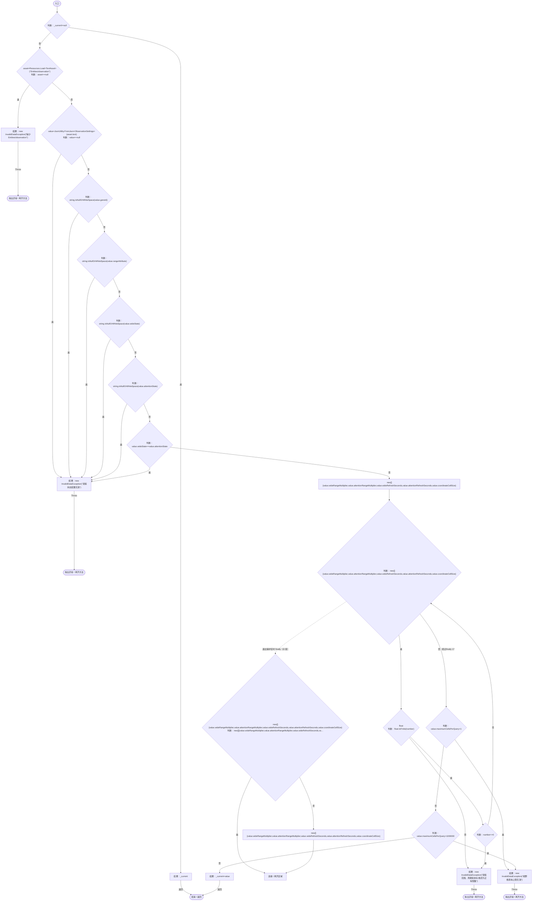
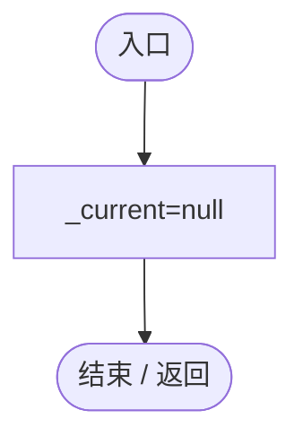

# ObservationSettings.cs

[返回总索引](../README.md) · `Runtime` · `Assets/DarwinPark/Genetics/ObservationSettings.cs`

[源文件](../../../Assets/DarwinPark/Genetics/ObservationSettings.cs) · 源码校验：`e80dad09863040b54b196250ae4fe01d7ffa449c0381e42840dd2ec16c44b5e5`

方法按源文件位置排列。事件/回调引用不表示立即执行；分支与异常说明见总索引。完整源码与可点击关系图请打开离线手册。

## Current.get · L16

`get`

### Editor / Player · Roslyn编译器控制流

## Reset · L26

`[RuntimeInitializeOnLoadMethod(RuntimeInitializeLoadType.SubsystemRegistration)]private static void Reset()`

### Editor / Player · Roslyn编译器控制流

